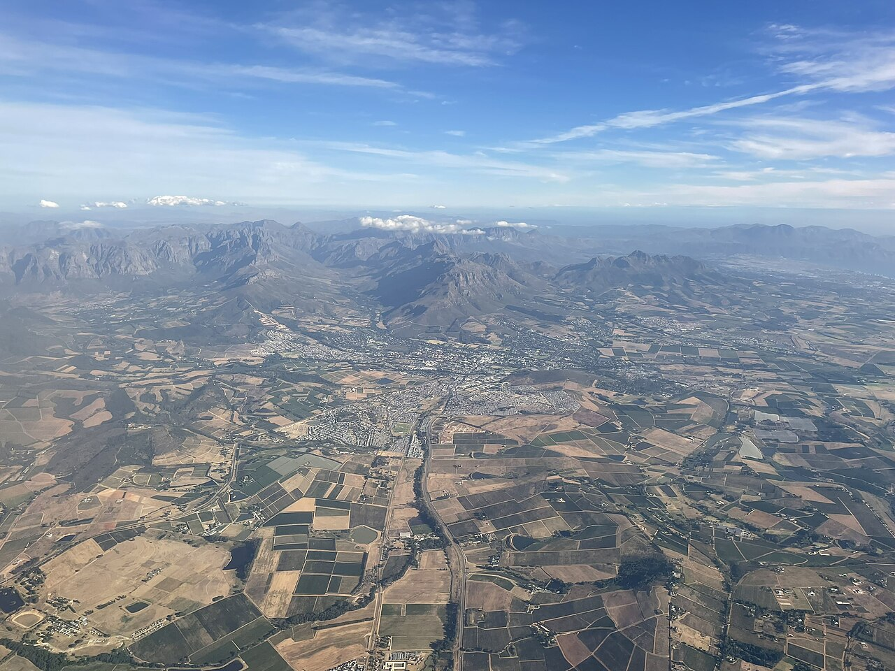

# Stellenbosch

Stellenbosch is the Western Cape's best-known wine district, about 45 km east of Cape Town and a legally defined district within the Wine of Origin system. It combines a colonial founding history with South Africa's first wine route and a mature premium red-wine industry.

Figure: Stellenbosch. Image: CJJ2501, CC0, via Wikimedia Commons ([source page](https://commons.wikimedia.org/wiki/File:Stellenbosch_aerial_photo_from_north-west_2024-01.jpg)).

## A wine centre east of Cape Town

Stellenbosch belongs to the Coastal Region of the Western Cape, roughly 45 km from Cape Town, and serves as one of the country's geographic and academic wine centres. The town is the core, with vineyards spread along the Eerste river, the southern slopes of Simonsberg and the surrounding valleys, so that town, university, wineries and housing are closely interwoven.

The industry here is not isolated. University, research bodies, wine tourism and restaurants form a complete ecosystem, and that density is why Stellenbosch has long held the centre of the South African wine conversation.

The university and research institutes supply variety trials, disease management and trained winemakers, while wine tourism packages historic estates, mountain scenery and restaurants into a sellable product. Industry, academia and tourism together make Stellenbosch both a production zone and a showcase of South African wine culture.

## Founded in 1679 and the Cape tradition

The town was founded in 1679 by Cape governor Simon van der Stel, one of the earliest European settler settlements in South Africa. In the eighteenth century the Cape colony and the Dutch East India Company trading network brought wine into the local economy, and the estate system and wine culture took shape.

Two consequences remain. First, a dense legacy of historic estates and buildings gives the region South Africa's most complete wine landscape. Second, an estate-centred industry shaped later winery scale, ownership and brand stories. The premium image of modern Stellenbosch is inseparable from the land system of that colonial period.

## The 1971 wine route and the 1973 WO scheme

In 1971, Stellenbosch created South Africa's first wine route, turning winery visits into an operating tourism trail. It was an early exercise in regional branding and made "drinking in Stellenbosch" a fixture for international visitors.

In 1973 South Africa formally instituted the Wine of Origin scheme, certifying labels by production area, variety and vintage. Stellenbosch became one of the districts under that scheme, with legal boundaries and labelling rules established from then on. The distinction matters: 1971 is the wine route, while 1973 is the year the WO scheme took effect.

## Mountains, valleys and granite

The terrain is built from a few mountain ridges and valleys. Simonsberg, Helderberg, Stellenbosch Mountain and the Jonkershoek valley together create a wide range of aspects and altitudes, so one district can produce markedly different ripening conditions and styles.

Soils are mainly decomposed granite, with sandstone, shale and valley clay. Granite slopes drain well and hold low fertility, suiting Cabernet Sauvignon and Syrah; valley clay holds water better and suits varieties that need more water and higher yields. Mountain, slope and valley together form the region's [terroir](ref:terroir) and are the main source of stylistic difference between wineries.

Cool air from False Bay moves up the valleys, so the seaward side ripens more slowly and keeps more acidity, while the mountain side is warmer and ripens more fully. That sea-land contrast and the range of aspects let one district produce wines from taut to generous.

## Varieties: Cabernet Sauvignon and Chenin Blanc

Cabernet Sauvignon is Stellenbosch's leading red and the international face of its premium wine. The wines are usually riper than Bordeaux, with blackcurrant, cedar, tobacco and graphite, firm tannin and good capacity for [oak ageing](ref:oak-ageing). The slopes of Simonsberg and Helderberg are considered its best sites.

Syrah performs well on cooler slopes, showing black pepper, violet and dark fruit; Pinotage, a South African cross, is also consistent here. Among whites, Chenin Blanc remains the mainstay, ranging from crisp dry styles to lees-aged and sweet versions. Variety shares decide what a label may claim.

Pinotage, a cross of Pinot Noir and Cinsaut, brings a distinct smoked, banana and dark-fruit character, and it divides opinion. Its history here is tied to the story of indigenous South African varieties, yet plantings have been unstable because of early ripening and yield issues. Supporters call it a unique expression of Cape terroir; critics find the aroma too loud.

## Rules and labels

The Wine of Origin scheme is administered by the Wine and Spirit Board. A wine claiming an origin must be 100% from that area; a [single-variety](ref:single-varietal) or [vintage](ref:vintage) claim requires at least 85%. Labels must also state [alcohol](ref:abv), volume and producer details.

A Stellenbosch label may name only the district or a smaller ward. Wards are legal geographic units, not quality ranks; stylistic differences within one ward can be larger than those between wards. Buyers should separate the district name from estate and brand names.

## Drinking and misconceptions

Stellenbosch reds are best at about 16 to 18 degrees Celsius, with grilled meat, game, mushrooms and hard cheese. Cabernet Sauvignon benefits from decanting; Syrah and Pinotage depend on vintage and style. Chenin Blanc is best at about 9 to 11 degrees Celsius, with seafood, poultry and spiced dishes.

Four misconceptions recur. First, treating 1971 as the year the WO scheme began: 1971 was the wine route, and 1973 was the WO. Second, thinking Stellenbosch is only Cabernet Sauvignon: Syrah, Pinotage, Merlot and Chenin Blanc all matter. Third, treating a ward as a quality grade: it is a geographic unit. Fourth, assuming all South African wine is cheap: top Stellenbosch wines now price alongside famous international regions.

**In brief:** Wine of Origin district in the Coastal Region of the Western Cape, South Africa, about 45 km east of Cape Town. The town was founded in 1679 by Simon van der Stel, the country's first wine route opened in 1971 and the WO scheme was instituted in 1973, when Stellenbosch became a legal district. Its vineyards are about 18% of the national 101,957 hectares, with Simonsberg, Helderberg and granite or sandstone slopes creating diverse terroirs. Cabernet Sauvignon is the leading red and Chenin Blanc the main white. WO rules require 100% origin and 85% for variety or vintage claims.

**Key facts.**

| Item | Detail |
| --- | --- |
| In one line | Wine of Origin district in the Coastal Region of the Western Cape, South Africa, about 45 km east of Cape Town. The town was founded in 1679 by Simon van der Stel, the country's first wine route opened in 1971 and the WO… |
| Level | other |
| Parent | South Africa |
| Country code | ZA |

## References

- [Wine](ref:wine): the broad categories and origin rules.
- [Red wine](ref:red-wine): the framework for red winemaking and style.
- [South Africa](ref:south-africa): the wider map of South African wine regions.
- [Cabernet Sauvignon](ref:cabernet): the region's flagship red variety.
- [Chenin Blanc](ref:chenin): the main white variety.
- [Syrah](ref:syrah): an important red on cooler slopes.
- [Oak ageing](ref:oak-ageing): how barrel type and new-oak share shape style.
- [Terroir](ref:terroir): mountains, aspects and granite soils.
- [Vintage](ref:vintage): vintage variation and labelling rules.
- [Single varietal](ref:single-varietal): the 85% variety labelling rule.
- [Alcohol by volume](ref:abv): what % vol means on a label.
