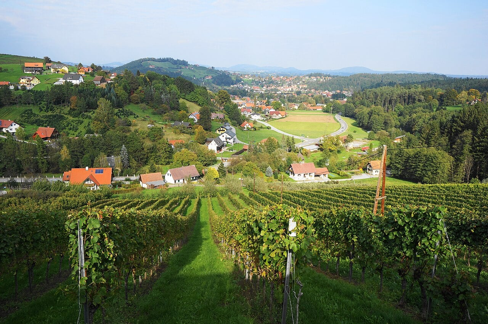

# Styria

Styria, Steiermark in German, is a federal-state wine region in south-eastern Austria, known for dry white wines from Sauvignon Blanc and for the western rosé Schilcher.

Figure: Vineyards and villages in the Schilcher wine country of Weststeiermark, Austria. Image: Naturpuur, CC BY 4.0, via [source page](https://commons.wikimedia.org/wiki/File:Panorama_Schilcher_Weingegend,_Weststeiermark.jpg).

## Definition and scope

Styria is one of Austria's three federal-state wine regions, with vineyards concentrated in the south and south-east of the state, along the South Styrian Wine Road, the Sausal hills and the edge of the Styrian Basin.

The region covers about 5,109 hectares and is Austria's third-largest federal-state wine region. White wine dominates, and the main red grape is Blauer Wildbacher, used chiefly for rosé.

## History

Viticulture in Styria is tied to the farm economy and monastic estates of the eastern Alps, and for a long time served mixed farming and local consumption. In the late twentieth century the region turned to a quality path centred on Sauvignon Blanc and built an international image of fresh, high-acid white wine.

From the 2018 vintage the three sub-regions Südsteiermark, Weststeiermark and Vulkanland Steiermark all obtained DAC status, and the region entered a phase centred on a hierarchy of origin. Junker, released in early November, is the first light wine of each vintage and showcases the new year.

## Geography and climate

Styria lies at the eastern edge of the Alps, with vineyards on the hills where they meet the basin. The climate combines Alpine and Pannonian influences, with warm summers, a wide day-night range and a cool autumn that lengthens ripening.

About three quarters of the vineyards sit on sediments of the Styrian Basin, including silt, marl, sand, gravel and sandstone; about 20% sit on hard rock of the Austroalpine nappes, including gneiss, mica schist, phyllite and amphibolite; and about 3% in the south-east sit on volcanic basalt, slag and tuff.

Local usage calls the marl and silt soils Opok, with moderate drainage and good water retention, and they are considered the base of the minerality and acidity of Styrian white wine. Soil, slope and aspect together make up differences in [terroir](ref:terroir).

## Three DACs

The three DACs of Styria cover different sub-regions, with shared rules and different emphases:

- Südsteiermark DAC in the south, covering Kitzeck-Sausal, Eichberg, Leutschach, Gamlitz and Ehrenhausen, with Sauvignon Blanc and Gelber Muskateller on Opok and calcareous soils.
- Weststeiermark DAC in the west, covering Ligist, Stainz, Deutschlandsberg and Eibiswald, represented by Schilcher, the only rosé allowed in the sub-region.
- Vulkanland Steiermark DAC in the south-east, covering Oststeiermark, Riegersburg, Kapfenstein, St. Anna, Tieschen, Klöch, Straden, St. Peter and Gleichenberg, with volcanic soils where Traminer stands out.

The three-level hierarchy of origin is Gebietswein at regional level, Ortswein at village level and Riedenwein at single-site level. Gebietswein may be released from 1 March of the year after harvest, or from 1 December of the harvest year for Welschriesling and Schilcher; Ortswein and Riedenwein from 1 May of the year after harvest, or from 1 February for Schilcher. Wines labelled Reserve must be released 18 months later than the level requires, or 12 months later for Schilcher.

## Varieties and raw material

Permitted varieties are Welschriesling, Weißburgunder, Morillon, meaning Chardonnay, Grauburgunder, Riesling, Gelber Muskateller, Sauvignon Blanc, Traminer and Blauer Wildbacher, the last only as Schilcher in Weststeiermark, as well as blends of these. The raw material is [grape](ref:grape).

Sauvignon Blanc is the largest variety by area and volume, with blackcurrant leaf, green pepper, passion fruit and mineral notes; Gelber Muskateller is aromatic and light in body; Traminer excels in Vulkanland; Weißburgunder and Morillon give fuller structure. The share of red grapes is very small.

## Winemaking

White grapes are usually whole-bunch pressed or gently pressed and [fermented](ref:fermentation) cool to preserve aroma and [acidity](ref:acidity). Most wines avoid malolactic fermentation to keep a fresh, sharp profile, and some gain texture from lees contact.

DAC rules require hand harvesting and set a residual-sugar limit of 4.0 g/L for [dry](ref:dry) wines, with exceptions where Riesling and Traminer are labelled trocken. Large old casks or stainless steel are the main containers, and [oak](ref:oak-ageing) flavour is usually light.

## Schilcher and Sauvignon Blanc

Schilcher is the rosé of Weststeiermark made from Blauer Wildbacher, pale in colour, high in acidity, with redcurrant, strawberry and a clear spicy note, and it is the most local wine of the region. It is characterised by early release and a fresh palate and suits local ham, pumpkin-seed oil and fried food.

Sauvignon Blanc is the flagship white grape of South Styria, ranging from grass and elderflower to ripe blackcurrant bud and tropical fruit while keeping high acidity and low alcohol. The two represent two paths of the region, a local rosé tradition and a fine white wine from an international variety.

## Labels and serving

The label should be checked for the DAC sub-region, village or Ried site, variety, vintage, alcohol and bottler. A wine labelled as a single variety must be made as a [single-varietal](ref:single-varietal) wine; blends must list the varieties under the rules.

Sauvignon Blanc and Schilcher are served at about 8–10 degrees Celsius, Weißburgunder and Morillon at about 10–12 degrees Celsius, and Reserve level slightly warmer. They suit poultry, river fish, pumpkin-seed-oil salads and Asian food. Refrigerate after opening and finish soon. Excessive drinking harms health and minors should not drink.

## Common misconceptions

First, taking Schilcher for a grape variety. Schilcher is the name of the wine, and the variety is Blauer Wildbacher.
Second, assuming Styria makes only white wine. Rosé from Weststeiermark matters.
Third, treating the three DAC levels as quality grades. Gebietswein, Ortswein and Riedenwein describe the extent of origin.
Fourth, reading freshness as underripeness. High acidity is a deliberate style choice linked to the cool climate and early picking.
Fifth, ignoring release-date rules. DAC release dates and the extra ageing required for Reserve are practical clues to style and ripeness.

**Short definition:** A federal-state wine region in south-eastern Austria with about 5,109 hectares of vineyard; from the 2018 vintage the three sub-regions Südsteiermark, Weststeiermark and Vulkanland Steiermark all hold DAC status, with dry white wines from Sauvignon Blanc, Gelber Muskateller and Traminer and the rosé Schilcher from Blauer Wildbacher in the west; grapes must be picked by hand and the DACs run at Gebietswein, Ortswein and Riedenwein level, with a residual-sugar limit of 4.0 g/L for dry styles.

To read Styria, start with the appellation and its permitted varieties, then the vintage and the producer, then how the wine is labelled; no single check settles it.

Start with [Wine](ref:wine) for geographic boundary, then read [Rosé Wine](ref:rose-wine) for climate and soil. Seeing both keeps Styria from being confused with a neighbouring idea.

## Further reading

- [Wine](ref:wine): an overview of wine categories, vintages and origin rules.
- [White wine](ref:white-wine): the main category of Styria.
- [Rosé wine](ref:rose-wine): the category to which Schilcher belongs.
- [Grape](ref:grape): the structure of wine grapes and ripeness measures.
- [Fermentation](ref:fermentation): the difference between cool fermentation and malolactic fermentation.
- [Acidity](ref:acidity): the source of high acidity in Styrian white wine.
- [Dry](ref:dry): the DAC limit on residual sugar.
- [Terroir](ref:terroir): how Opok and volcanic soils create site differences.
- [Oak ageing](ref:oak-ageing): the Reserve level and the choice of container.
- [Single varietal](ref:single-varietal): the concept behind variety labelling.
