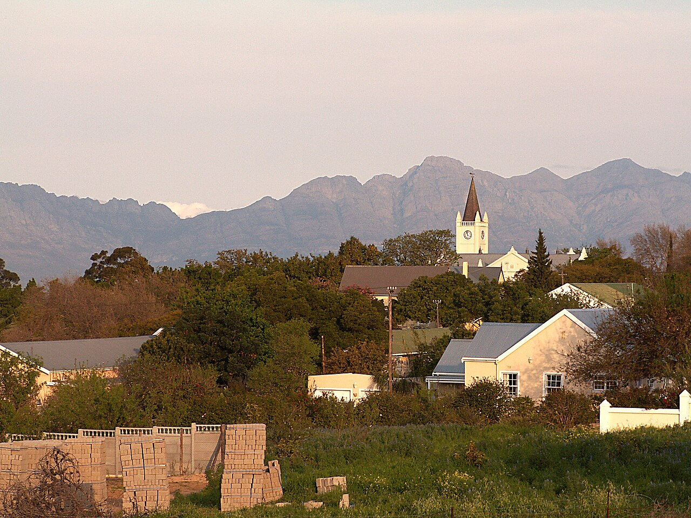

# Swartland

Swartland is a wine district north of Cape Town, known for dryland bush vines, old-vine Chenin Blanc and a new style that has emerged over the past two decades. It is one of South Africa's largest wine districts and the place where the traditional grain belt and the new wave of fine wine overlap most visibly.

Figure: Swartland. Image: Winfried Bruenken ( Amrum ), CC BY-SA 2.5, via Wikimedia Commons ([source page](https://commons.wikimedia.org/wiki/File:Riebeek_Wes_PICT3382.JPG)).

## Definition and scope

Swartland is a district in the Coastal Region of the Western Cape, north of Cape Town. In the 2024 SAWIS statistics, Swartland is grouped with neighbouring Darling into one statistical unit with 11,585 hectares of vineyard, or 13.39% of the national wine-grape area; the national total that year was 86,544 hectares.

Under Wine of Origin, Swartland is a district with eight wards: Malmesbury, Paardeberg, Paardeberg-South, Piketberg-Bo-Berg, Porseleinberg, Riebeekberg, Riebeeksrivier and St Helena Bay. Darling is a separate district containing the Groenekloof ward; a shared statistical unit does not mean the two are the same administrative or labelling level.

## History

Swartland was long a grain-producing part of the Cape, with wheat, livestock and vines coexisting for centuries. The name means black land, a reference to the dark shrub vegetation of the area. From the 19th century, vineyards were planted mainly on mountain foothills and along the Berg River, supplying wineries and distilleries.

For Swartland, begin with the appellation and its permitted varieties. Then look at the vintage and the producer, and finally ask how the wine is labelled. The answers point to different choices, not to a single score.

## Geography and climate

Swartland lies in the transition between the inland and the coast north of Cape Town. It is enclosed to the east and north by the Piketberg, Porterville, Riebeek and Perdeberg mountains, and the Berg River runs through the district from east to west. Summers are hot and dry, with rain concentrated from May to August in a Mediterranean pattern. Cool air from the Atlantic moves in along the Berg River valley and the low ground, lowering night temperatures and reducing fungal pressure.

Altitude and distance from the sea vary considerably within the district. Sites on the mountain foothills are higher and have greater day-night temperature ranges, so they ripen more slowly; valley-floor and riverside sites are warmer and are picked earlier to keep acidity. St Helena Bay, the westernmost ward, is the most exposed to the cold Atlantic.

Soils are dominated by Malmesbury Group shale, an iron-bearing shale that weathers into well-drained, moderately fertile ground. Decomposed granite occurs around Paardeberg and Kasteelberg, giving sandier, faster-draining profiles, and Table Mountain sandstone appears at higher elevations. Some sites have a ferricrete layer known as koffieklip that stores winter water and allows vines to grow through the dry summer without irrigation. These differences form the basis of the [terroir](ref:terroir).

## Wards

The eight wards cover different landforms and climate zones, but all are origin boundaries and carry no extra quality grade:

- Malmesbury: the shale plains in the centre of the district, where grain and vines have long coexisted.
- Paardeberg and Paardeberg-South: the granite massif and its surrounds, with sandy, fast-draining soils and some of the densest concentrations of dryland old vines.
- Riebeekberg and Riebeeksrivier: slopes and river land on either side of the Riebeek Valley, with clear differences in altitude and aspect.
- Piketberg-Bo-Berg: the upper sites of Piketberg in the north, higher and cooler at ripening.
- Porseleinberg: an isolated mountain and stony slopes, small in area.
- St Helena Bay: the westernmost ward, most strongly cooled by the Atlantic.

A ward name may appear on a label on its own, but a wine from the same district may also be labelled simply as Swartland. A more specific name covers a smaller area; it does not mean better wine.

## Varieties and raw materials

Chenin Blanc is the most important white variety in Swartland. Many sites are bush vines of 40 years or more, with low yields and concentrated fruit that often shows citrus, beeswax, dried grass and mineral notes. Cinsault, Grenache, Syrah and Carignan are the main red varieties, often whole-bunch fermented or blended; Colombard still occupies a significant area, mostly for distillation and bulk wine.

Old vines are a key resource, but they are not a guarantee of quality: vintage, yield control, picking date and winemaking matter just as much. The raw material is the [grape](ref:grape). Dryland farming usually gives smaller berries with a higher skin-to-juice ratio, which can concentrate colour and tannin, but it also brings yield variation and strong vintage differences.

## Winemaking

White grapes are usually pressed gently and fermented cool. Chenin Blanc covers a wide range of styles: fresh versions are made in stainless steel without malolactic fermentation, while more complex versions use older oak, clay or concrete, with lees contact and some whole-bunch pressing. Some producers give whites a short skin contact to add texture and aromatic depth.

Red extraction tends to be light. Cinsault and Grenache are often fermented with a large proportion of whole bunches, gaining lighter fruit and spice from the carbon-dioxide environment inside the fermenter; Syrah and Carignan are adjusted site by site for whole-bunch share and maceration time, then aged in large old oak or concrete. New oak is used sparingly, to preserve fruit and a sense of place rather than to cover the wine with [oak](ref:oak-ageing) flavour.

## Rules and labelling

Swartland labelling follows South Africa's Wine of Origin scheme, administered by SAWIS and the Wine and Spirit Board. A wine labelled Swartland or with a ward name must use 100% of its grapes from that origin; when a variety or vintage is named, the relevant component must reach at least 85%. Certified wines may carry the Wine of Origin seal.

Wine of Origin is an origin and certification system, not a quality hierarchy. Names such as Swartland, Malmesbury and Paardeberg indicate the source area only, not body, price or style. Estate names, brand names and region names sit at different levels and cannot substitute for one another.

## Labels and drinking

Check the region name, any ward name, the variety, [vintage](ref:vintage), [alcohol by volume](ref:abv), volume and bottler. A wine labelled as a [single variety](ref:single-varietal) must contain at least 85% of that variety; blends must list their varieties under the rules. The Wine of Origin seal confirms certification, not quality.

Serve fresh Chenin Blanc at 8-10 C, oaked Chenin at 10-12 C, Cinsault and Grenache at 14-16 C and Syrah at 16-18 C. Chenin suits seafood, white meat and spiced dishes; Cinsault and Grenache suit poultry, stews and grilled food; Syrah suits red meat and hard cheese. Chill after opening and finish promptly. Excessive drinking is harmful to health, and minors should not drink.

## Common misconceptions

First, that Swartland is only a grain district. It is now one of South Africa's largest wine districts, with styles ranging from fresh whites to structured reds.
Second, that all 11,585 hectares belong to the Swartland district. The SAWIS figure combines neighbouring Darling, which is a separate district for labelling.
Third, that old vines are a quality grade. Old age is a viticultural fact; quality depends on vintage, site and winemaking, and there is no legal classification.
Fourth, that dryland farming means organic or natural wine. Dryland describes water management; organic and biodynamic status depends on separate certification.
Fifth, that a ward name is a brand or a grade. A ward is simply a smaller legal origin.

### Key dates and figures

- 1973: the Wine of Origin system established legal boundaries and labelling rules.
- 2000s: from the late 2000s, a younger generation revived dryland old-vine plots.

## Further reading

- [Wine](ref:wine): the broad category, vintage and origin rules.
- [White wine](ref:white-wine) and [red wine](ref:red-wine): the two main categories in Swartland.
- [Chenin Blanc](ref:chenin): the district's most important white variety.
- [Sauvignon Blanc](ref:sauvignon): another significant white variety.
- [Grenache](ref:grenache) and [Syrah](ref:syrah): core red varieties and blending components.
- [Grape](ref:grape): grape structure and ripening indicators.
- [Fermentation](ref:fermentation): whole-bunch fermentation versus cool white fermentation.
- [Acidity](ref:acidity): how dryland farming and cool nights affect acidity.
- [Terroir](ref:terroir): shale, granite and sandstone as sources of site difference.
- [Oak ageing](ref:oak-ageing): the role of old and large oak in Swartland.
- [Dry](ref:dry): the dry style of the district's whites.
- [Vintage](ref:vintage): vintage variation in a dryland district.
- [Single variety](ref:single-varietal): the 85% labelling rule.
- [Alcohol by volume](ref:abv): what % vol means on a label.

## Related images

Image: Chenin Blanc. Credit: Benjamin Smith, CC BY-SA 4.0, via Wikimedia Commons ([source page](https://commons.wikimedia.org/wiki/File:Rochecorbon_-_Vignoble_-_02.jpg)). Related image for Swartland.

Image: Grenache. Credit: Jules Troncy, Public domain, via Wikimedia Commons ([source page](https://commons.wikimedia.org/wiki/File:Grenache_N.jpg)). Related image for Swartland.
