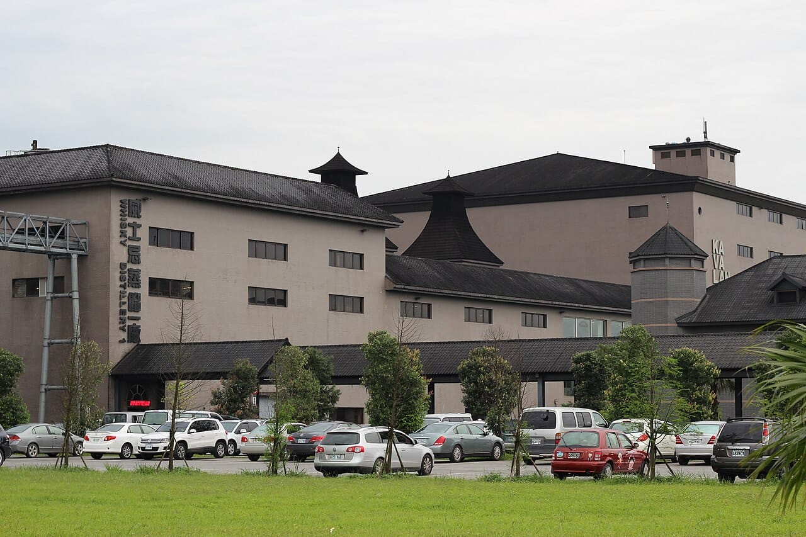

# Taiwan, China

The whisky and drinks region of Taiwan, China, with distilleries in Yilan and Nantou; a subtropical climate ages spirit very fast, and brands such as Kavalan and Omar have drawn international competition attention.

Figure: The King Car Kavalan whisky distillery in Yilan. Image: lovesx-70, CC BY 2.0, via Wikimedia Commons ([source page](https://commons.wikimedia.org/wiki/File:Whisky_Distillery_1,_King_Car_Kavalan_Distillery_20120407.jpg)).

## Definition and boundaries

The whisky region of Taiwan, China, centres on distilleries in Yilan and Nantou; a subtropical climate ages spirit in wood far faster than in Scotland, with a high angel’s share.

Here the “region” is an island distilling industry, not a wine-style parcel. Check the distillery, materials and age; a brand name is not a region and not necessarily a single malt.

## History and naming

Kavalan in Yilan and Omar in Nantou are the main whisky brands; Kavalan won international spirits awards in the 2010s and sparked a Taiwanese whisky boom.

Taiwan’s drinks history also includes wine, sorghum baijiu and rice wine; distilleries in Yuanlin and Puli make fruit liqueurs and plum wine. Whisky is a recent growth story, not the whole category.

## Geography and terroir

Taiwan, China, is subtropical, hot and humid in summer and mild in winter; whisky matures far faster than in Scotland, with a high angel’s share.

Island climate makes warehouse temperature and humidity critical: heat speeds vanilla and wood, while high humidity affects casks and labels. Terroir here is climate and warehouse, not a vineyard slope.

## Raw materials and styles

Whisky style is usually rich, with tropical fruit, vanilla and oak; warm maturation gives young bottles a full body, but risks over-oaking.

Malted barley is the base, with local or imported malt depending on the bottling; distillation and cask type set the style. Sorghum baijiu, rice wine and fruit wine follow different material paths, so do not lump them together.

## Representative producers and bottlings

Representative producers include Kavalan (Yilan), Omar (Nantou) and TTL Nantou; visits and tastings need booking, and distilleries often sit in industrial or tourism parks.

Separate a distillery’s own spirit from purchased or blended stock; Kavalan and Omar differ through distillation, cask and warehouse. Compare the same age or cask type before comparing brands.

## How to drink and pair

Whisky can be sipped neat or with a little water; in Taiwan’s heat ice melts fast, so use one large cube or none. Sorghum baijiu suits small cups, while rice wine and fruit wine are served cold.

Pair with grilling, seafood, tropical fruit and salty snacks; whisky’s vanilla and oak meet fat, while sorghum baijiu stands up to strong flavours. Careful with sweet desserts and high alcohol, since sweetness amplifies heat.

## Labels, buying and misreadings

Read the distillery, materials, age, cask type, ABV and whether it is single malt. A brand name alone is not enough; Taiwan whisky has no Scottish-style legal appellation system.

Common misreadings: treating all Taiwan whisky as one style, or treating warm maturation as “older is better”. Store upright, dark and at room temperature; in heat, avoid sun and stuffy rooms.

## Around and routes

Yilan and Nantou are the main visit directions: Yilan is coastal and humid, Nantou sits inland among hills; both need bookings and transport.

From Taipei, Yilan can be a day trip and Nantou takes longer; distilleries often sit in industrial or tourism parks with limited public transport. One distillery plus a local meal is calmer than rushing two.

**Short definition:** The whisky and drinks region of Taiwan, China, with distilleries in Yilan and Nantou; a subtropical climate ages spirit very fast, and brands such as Kavalan and Omar have drawn international competition attention. 

For Taiwan, China, begin with the appellation and its permitted varieties, then the vintage and the producer, and finish with how the wine is labelled; that order keeps the account grounded.

Do not reduce Taiwan, China to an administrative place name. 

Taiwan's subtropical climate ages whisky fast; Kavalan and Omar are the best-known distilleries, and the island also makes rice wine and beer.

The island's distilleries also make malt whisky with local barley and imported peat.

**Key facts.**

| Item | Detail |
| --- | --- |
| In one line | The whisky and drinks region of Taiwan, China, with distilleries in Yilan and Nantou; a subtropical climate ages spirit very fast, and brands such as Kavalan and Omar have drawn international competition attention. |
| Level | province or region |
| Parent | China |
| Country code | CN |

**Sources and limits.** The key claims about Taiwan, China are checked against the following sources: Taiwan Tobacco and Liquor Corporation (Nantou Distillery's 2008 whisky distillery, copper-pot distillation and OMAR products; OMAR single malt's 46% alcohol strength, oak-cask maturation of four years or more and non-chill filtration), King Car Kavalan Distillery (brand and product information for Kavalan/King Car Kavalan Distillery in Yilan), Ministry of Justice, Taiwan (Taiwan's alcohol administration, alcohol-strength definition and production-and-sales framework). Prices, batches and status change; the body is project-written and does not reproduce source text.

## Further reading

Further reading: discussion of Taiwan whisky is often swallowed by the phrase “tropical maturation”, but the useful lines are distillation, cask and warehouse. Start with distillation: at the same age and cask type, different distilleries give different bodies and aromas. Then cask: bourbon, sherry and wine casks bring different sweetness, dryness and wood. Then warehouse: heat and humidity speed ageing and also make over-oaking more likely. Separating the three lets you judge whether a bottle is young but full, or old but over-oaked. Taiwan also makes sorghum baijiu, rice wine and fruit wine, with entirely different materials and processes; do not put them on the same flavour chart. For Yilan and Nantou, plan transport separately; distilleries often sit in parks, and booking beats turning up.

Awards amplify Taiwan whisky’s reputation, but a prize reflects one batch in one competition, not a single house style. Read distillery, cask, age and ABV when buying; ask whether you like wood and sweetness before adding ice. If you visit only one site, choose Yilan or Nantou and count the travel time—rushing both in one day is less useful. Heat is hard on storage: keep bottles away from sun, stuffy rooms and the kitchen stove, and finish opened bottles within about three months. Do not use the same tasting glass for sorghum baijiu and whisky; the aromas collide. If you buy one bottle, compare a bourbon-cask and a sherry-cask bottling at the same age; cask is easier to see than brand. Try before buying.

Check whether a bottle is single malt, single cask or blended before comparing; those are different categories.

- Related: [china](ref:china), [whisky](ref:whisky), [barley](ref:barley), [distillation](ref:distillation), [terroir](ref:terroir).
- This region provides no map, prices or opening hours; confirm before travelling.
