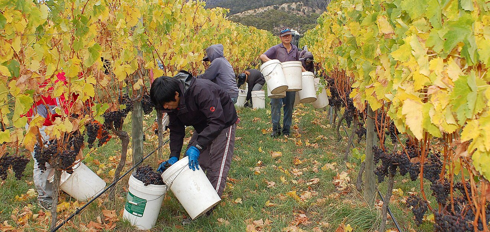

# Tasmania

Tasmania is Australia's southernmost island state, between roughly 41° and 43° south latitude and ringed by the Tasman Sea, Bass Strait and Indian Ocean. It has the lowest mean January temperature of any Australian wine region, and is known for Pinot Noir, Chardonnay, Pinot Gris, Riesling and traditional-method sparkling wine. Seven customary growing areas are recognised: the Tamar Valley, Derwent Valley, East Coast, Coal River Valley, Pipers River, North West and Huon/Channel.

Figure: Tasmania: Stefano Lubiana Wines Tasmania harvest panorama (Wikimedia Commons). Image: Mark Smith, CC BY 2.0, via Wikimedia Commons ([source page](https://commons.wikimedia.org/wiki/File:Stefano_Lubiana_Wines_Tasmania_harvest_panorama.jpg)).

## Definition and boundaries

Tasmania itself forms one complete geographical indication (GI), covering about 68,582 km² with roughly 2,084 hectares of vineyards and an altitude range from the coast to 1,264 metres. "Tasmania" on a label refers to the island as a whole; the seven areas are customary industry divisions, not separate official sub-appellations. Separating "island grown" from "area" matters more than treating the place name as a flavour tag.

Unlike mainland regions, the boundary begins with the coastline. What separates the wines is latitude, altitude, distance from the sea and valley aspect. Pipers River and the Tamar Valley sit cooler and further north, the East Coast receives more sunshine, while the Coal River Valley and Huon/Channel near Hobart are humid and foggy. Under one GI, these areas follow different ripening rhythms and aromatic directions.

The GI name only states that the fruit comes from the island; it does not promise an area, single vineyard or winemaking style. The island holds both small family estates and larger wine groups buying fruit, and some Pinot Noir and Chardonnay is sold to mainland merchants for blending.

## History and naming

Vines reached Tasmania early. In 1788, cuttings arrived on the HMS Bounty, and Bligh trialled plantings on Bruny Island without establishing a commercial industry. In 1823, ex-convict Bartholomew Broughton planted the island's first significant vineyard, and wine from the 1826 vintage was sold as an imitation of Champagne, counted among Australia's earliest sparkling attempts. In 1834, William Henty took cuttings from Launceston to Portland in Victoria; these became the source of the first vineyards in Victoria and South Australia. In 1856, Van Diemen's Land was renamed Tasmania.

The early industry faded after the Victorian gold rush drained the population, and viticulture lay dormant for more than half a century. The modern revival began in 1956, when Frenchman Jean Miguet planted La Provence near Pipers River. In 1958, Italian immigrant Claudio Alcorso founded Moorilla near Hobart, releasing his first vintage in 1962. In 1974, Andrew Pirie, who held a doctorate in viticulture, established Pipers Brook, an early benchmark for cool-climate varieties and bottle-fermented sparkling wine. Planting expanded through the 1990s, island sparkling drew attention in competitions and export markets, and the GI was formally established in the same period.

The name "Tasmania" honours Dutch explorer Abel Tasman; area names mostly come from rivers, bays and nearby towns. The modern history is not a straight line: early nineteenth-century trials, the mid-twentieth-century restart and the 1990s export expansion are three separate beginnings behind today's variety mix.

## Geography and terroir

Tasmania's mean January temperature is about 15.6°C, the lowest of all Australian wine regions. Growing-season rainfall is around 477 mm, with roughly 40% of annual rain falling during the growing season; spring humidity is high and spring frosts occur. The ocean keeps winters mild, but spring warming is uneven, so flowering frost, harvest fog and rain, and disease pressure under humidity are annual risks.

Soils differ greatly between north and south. The Derwent Valley is sandstone and schist; the Coal River Valley has peaty alluvial and sandy low-humus soils; Pipers River has deep, friable, free-draining ground; the Tamar Valley carries gravelly basalt over a clay and limestone base. Stony slopes force roots deep, limiting water and nutrient supply, slowing ripening and preserving natural acidity.

Most vineyards follow valley slopes rather than flat open fields. North-facing slopes receive more sun, while low valley floors collect cold fog at night; commercial vineyards sit on gentle low slopes, and high mountain ground is not planted. Within one valley, aspect, stone content and distance from the sea explain differences more often than the map boundary.

## Raw materials and styles

Pinot Noir and Chardonnay are the two leading varieties, used for both still wines and sparkling base wine; Pinot Gris, Sauvignon Blanc and Riesling follow, with small amounts of Cabernet Sauvignon, Merlot and Gewürztraminer. Traditional-method sparkling is based mainly on Pinot Noir and Chardonnay, with bottle fermentation and extended lees contact, and counts among Australia's finest sparkling wines. The cool climate rules out heavy, high-alcohol reds as a leading direction.

Still Pinot Noir is light to medium bodied, with red cherry, strawberry, dried spice and earth notes and bright acidity. Chardonnay is elegant and complex with high natural acidity: some ferments in stainless steel for a crisp style, others age in oak. Riesling shows citrus and mineral character and can age; Pinot Gris and Sauvignon Blanc focus on fresh fruit. Coastal sites taste more saline and fresh, inland valleys rounder and fuller.

Winemaking choices divide producers. Sparkling wines depend on lees time and dosage style, while still wines differ in whole-cluster proportion, oak size and new-oak share. The cool climate gives a short picking window, and producers choose between ripe fruit and retained acidity; that choice shapes the wine more than the variety itself, and vintage variation is more pronounced than in warmer mainland regions.

## Representative producers and wines

Pipers Brook, founded by Andrew Pirie in 1974, is an early benchmark of the modern industry. House of Arras and Jansz are based around Pipers River, dedicated to or focused on traditional-method sparkling; Arras is regarded as one of Australia's premium sparkling references. Moorilla sits on the Derwent River north of Hobart, with Praxis, Muse and Cloth lines. Stefano Lubiana works an organic and biodynamic north-facing slope at Granton. Josef Chromy, Domaine A, Bream Creek and Holm Oak cover the Tamar Valley, Coal River Valley, East Coast and the Launceston surroundings.

These names are not an official classification; they are reference points formed by the market and trade. Flagship sparkling and single-vineyard Pinot Noir are scarce and expensive, while entry Pinot Gris and Sauvignon Blanc are easier to find in retail and on restaurant lists. Comparing a producer's lines, separate estate fruit from purchased fruit before looking at oak ageing and vintage policy.

The producer base mixes family estates worked over generations with outside capital and larger groups buying fruit or holding brands. Within one brand, entry and flagship wines may come from entirely different parcels, vine ages and winemaking investment.

## How to drink and pair

Serve by variety: sparkling at about 6–8°C, Chardonnay and Pinot Gris at about 10–12°C, Pinot Noir at about 14–16°C. Pinot Noir does not need long decanting; pour a small glass and wait ten to twenty minutes before judging. Sparkling should not sit open for long, since warmth dissipates bubbles and aroma quickly.

Local seafood is the safest match: Tasmanian oysters, smoked salmon, scallops and lobster go with sparkling or crisp Chardonnay; lamb, duck, venison and mushrooms match Pinot Noir; citrus-spiced or lightly spicy dishes pair with Riesling or high-acid Sauvignon Blanc. Local cheese, smoked meats and berry desserts are common on the island table, and seasoning stays simple.

Local food and local wine share the light rhythm of a cool climate: seafood brine, tender lamb and dairy richness do not need heavy sauces. Choose the wine around the fat and salt of the main course, then connect it with sparkling acidity, white-wine freshness or the red fruit and fine tannin of Pinot Noir.

## Labels, buying and misreadings

"Tasmania" on the label is the GI. Names such as Tamar Valley, Pipers River and East Coast are customary divisions, not separate AOCs; the next level down is single vineyard and cuvée name. Vintage matters especially in a cool region: frost, fog, flowering wind and harvest humidity all change yield and ripeness. Comparing producers within the same vintage reveals area differences more clearly than comparing across years.

One misreading is that Tasmania is "only Pinot Noir". In fact sparkling and Chardonnay are equally island signatures, and Riesling and Pinot Gris have steady followings. Another is assuming island wines are always more acidic: variety, picking date and winemaking often matter more than the place name. Light-bodied Pinot Noir and sparkling are sensitive to heat in transit; a bottle kept in an overheated warehouse can show muted fruit.

The price band is broad. Entry Pinot Gris and Sauvignon Blanc sit at everyday prices, flagship sparkling and single-vineyard Pinot Noir are premium, and some old-vine Chardonnay and Riesling can age for a decade or more. Check vintage, importer and storage record when buying; for cellaring, prefer a wine with a complete acid structure.

## Around and routes

Launceston is the gateway for the Tamar Valley and Pipers River direction; Hobart is the gateway for the Derwent Valley, Coal River Valley and Huon/Channel. The two cities are about two to three hours apart by road. Public transport across the island is sparse, so self-drive or a small tour group are the main options; not driving after tasting is a basic rule.

The Tamar Valley spreads tasting rooms along both banks of the Tamar River, suitable for two or three stops plus lunch in a day. The Coal River Valley is about half an hour from Hobart and fits a half-day visit; East Coast estates are dispersed and need a full day. Harvest falls in the southern autumn, March and April, when estates are busiest and some tasting rooms shorten their hours. Confirm bookings through winery websites or the Wine Tasmania directory before setting out.

Most island estates are small family businesses: book ahead, arrive on time and stay out of working areas. Mountain roads and tasting-room thresholds are not always accessible; ask about step-free access and restrooms before bringing older relatives or children. For a relaxed first visit, the Coal River Valley half-day from Hobart or the Tamar Valley half-day from Launceston are the shortest entry routes.

- Related: [australia](ref:australia), [pinot-noir](ref:pinot), [chardonnay](ref:chardonnay), [sparkling-wine](ref:sparkling), [white-wine](ref:white).
