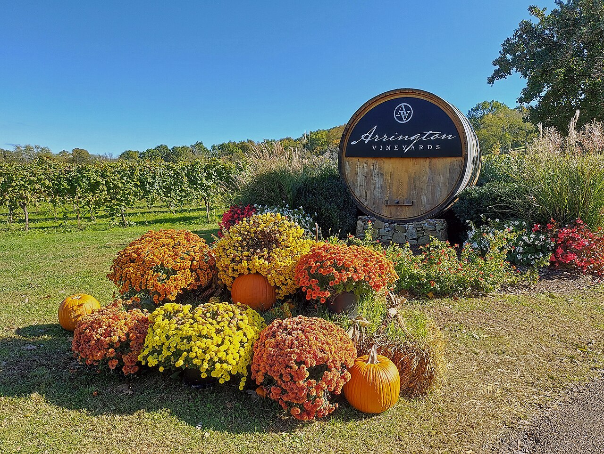

# Tennessee

Tennessee is a state in the south-central United States and the legal home of [Tennessee whiskey](ref:tennessee-whiskey). It is often mistaken for another name for bourbon, but the two do not fully overlap: Tennessee whiskey has its own conditions in state law, yet it is not listed as a separate class in federal rules. Understanding that two-layer structure of state definition and federal labelling is the key to the region.

Figure: Tennessee. Photograph: Tennessee - Arrington Vineyards. Credit: P. Hughes, CC BY-SA 4.0, via Wikimedia Commons ([source](https://commons.wikimedia.org/w/index.php?curid=128050365)).

## Six conditions written into state law

Section 57-2-106 of the Tennessee Code allows a spirit to be labelled Tennessee whiskey only if it is manufactured in Tennessee; made from a grain mixture that is at least 51% corn; distilled to no more than 160 proof (80% ABV); aged in new, charred oak barrels in Tennessee; filtered through maple charcoal before ageing; entered into the barrel at no more than 125 proof (62.5% ABV); and bottled at no less than 80 proof (40% ABV).

Most of this skeleton is shared with [bourbon](ref:bourbon): a corn-led mash, new charred oak, and distillation and entry limits. The differences sit in two places: manufacture and maturation must happen in the state, and the spirit must pass through maple charcoal. State law carves out an exception for one historic distillery's filtration method, so maple charcoal should not be treated as an absolute description of every bottle, but it remains the defining process marker of Tennessee whiskey.

## The Lincoln County Process: name versus place

Maple-charcoal filtration is commonly called the Lincoln County Process. New make is trickled slowly through a thick bed of sugar-maple charcoal before it enters the barrel, stripping some oils, sulphur compounds and rough aromas and leaving a cleaner, softer spirit. The charcoal is burned, stacked and charred from sugar maple, and the depth of the bed and the flow rate change the intensity of the filtration.

The process takes its name from Lincoln County, but a distillery does not have to stand in that county. Jack Daniel's is in Lynchburg, Moore County, and George Dickel is at Cascade Hollow in Coffee County; both are in Tennessee and both use charcoal filtration as a core step. George Dickel's material also highlights chilling the spirit before filtration, which produces a cleaner profile. Confusing the process name with a place is the most common error in reading Tennessee whiskey.

## A skeleton shared with bourbon

In process terms, Tennessee whiskey starts almost exactly like bourbon: a corn-led grain bill with rye and malted barley, mashing and [fermentation](ref:fermentation), then [distillation](ref:distillation) to new make, which enters new charred oak and extracts vanilla, caramel and wood aroma during [oak maturation](ref:oak-ageing). The difference is origin and filtration, not "one uses corn and the other does not".

As a result, Tennessee whiskey can meet the conditions for straight whiskey, or it can be sold without the straight label. Straight requires at least two years in new charred oak and prohibits colouring or flavouring, and whisky under four years old usually has to state its age. These match the straight rules for bourbon, which shows how closely the legal skeletons overlap, with Tennessee adding the state layer.

## Where it sits on the federal label

The US federal standards classify whisky by grain and process, listing bourbon, rye, wheat, malt and corn among the types, and do not list "Tennessee whiskey" as a separate federal class. The current 27 CFR 5.143 allows a state or place name on a label when distillation, and any required maturation, took place there. Tennessee whiskey uses that rule to combine a state name with a product type.

In other words, Tennessee whiskey is a state-law name plus a federally permitted geographic label, not a class defined directly by federal standards in the way bourbon is. TTB label review and origin rules constrain how it is described, but the detailed recipe and process conditions come mainly from Tennessee law. Calling it a separate federally defined class overstates the federal distinction.

## Two representative distilleries

Jack Daniel's is the best-known Tennessee whiskey brand. Its official history dates the distillery's registration to 1866, places it in Lynchburg, and cites the limestone water of Cave Spring Hollow; Old No. 7 is typically associated with vanilla, caramel and banana-like esters. George Dickel sits at Cascade Hollow, with a range that includes No. 12, Bottled in Bond and single-barrel releases, often described as thicker and more cereal-driven.

In the past two decades a new group of small distilleries has appeared across Tennessee, from Nashville to Chattanooga and the surrounding towns. They do not all use large-scale continuous distillation, and they do not all make Tennessee whiskey in the traditional sense, but together they widen the market meaning of the "Tennessee region". Capacity, visiting hours and product ranges should be checked with each producer.

## The boundary of the region

Tennessee is a state, not a protected geographical name established jointly by international treaty and domestic regulation in the way Scotch regions are. Its boundary is the state line, and production is concentrated in the middle of the state south of Nashville: Lynchburg, Cascade Hollow, Tullahoma and Shelbyville share limestone groundwater, four distinct seasons and a corn-growing belt. Those conditions suit corn and suit new-oak maturation.

Compared with other [American](ref:usa) whiskey regions, Tennessee's distinctiveness lies not in raw material but in the combination of state law and charcoal filtration. Kentucky is known for bourbon and industrial clustering, while Tennessee builds recognition around the Tennessee whiskey name and its process tradition. Both operate inside the federal framework, and regional names describe tradition and concentration, not quality.

## Six misreadings of Tennessee

First, that Tennessee whiskey is a separate federally defined class. It is better described as a state-law name combined with a geographic label. Second, that the distillery must be in Lincoln County. The process is named for the county, but production can sit elsewhere in Tennessee. Third, that charcoal filtration happens before bottling. State law requires it before barrel entry, and the spirit still matures afterwards. Fourth, that all Tennessee whiskey is bourbon. They share a skeleton, but the names and process requirements differ. Fifth, that charcoal filtration adds sweetness. It adds no sugar; the sweetness comes from corn and new oak. Sixth, that Jack Daniel's is bourbon. It is sold as Tennessee whiskey and is governed by state law.

In the glass, look first for vanilla, caramel and roasted corn, then judge the rye spice and the coconut note from the cask. A few drops of water open the aroma; ice suppresses sweetness and suits stronger bottlings. Tennessee whiskey is also a common base for an Old Fashioned or a Highball. Drink in moderation, adults only.

[United States](ref:usa) and [Tennessee whiskey](ref:tennessee-whiskey) are the nearest useful comparisons: one clarifies geographic boundary, the other tests climate and soil.

## Related images

Image: Editorial illustration of oak ageing: the toasted barrel staves, wine and a sampling tube; AI-assisted illustration, not a photograph.. Credit: Hejiu editorial team, AI-assisted with Doubao Seedream 5.5; project-generated editorial figure, not a photograph ([about](https://hejiu.org/about/)). Related image for Tennessee.

Image: Category image for United States. Credit: Luke, CC BY-SA 2.0, via Wikimedia Commons ([source page](https://commons.wikimedia.org/wiki/File:Wine_Country_of_the_Dundee_Hills,_Oregon.jpg)). Related image for Tennessee.
