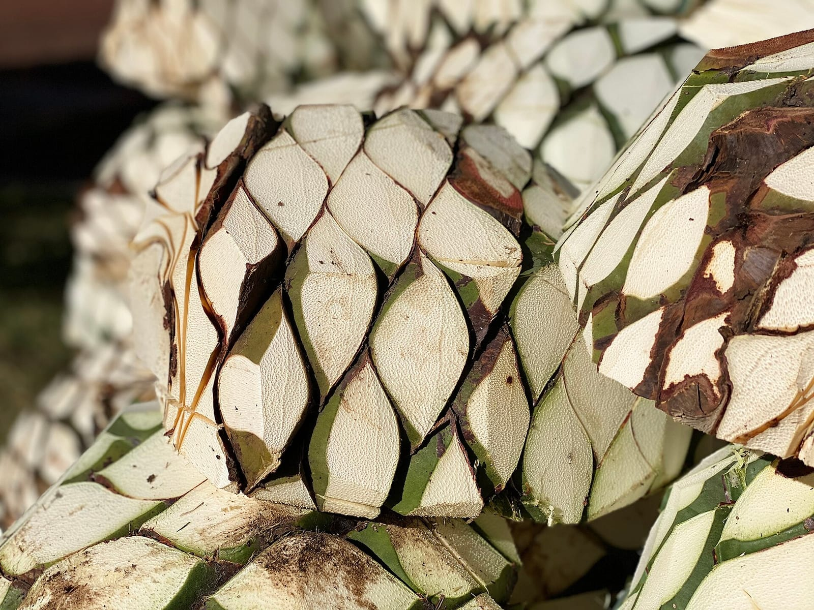

# Tequila region

The tequila protected region is the geographical area Mexico has defined for [tequila](ref:tequila), centred on Jalisco and including specified municipalities in Guanajuato, Michoacán, Nayarit and Tamaulipas. Only products made from blue Weber agave grown inside the region, under the rules, may be labelled tequila.

Figure: Related photograph of Tequila region. Image: Alfonso Jiménez, CC BY-SA 4.0, via Wikimedia Commons ([source page](https://commons.wikimedia.org/wiki/File:La_base_del_tequila_agave_azul_tequilana_Weber.jpg)).

## Geography and legal scope

The core of the region is Jalisco, and the name comes from the town of Tequila in that state. Under the Mexican standard NOM-006-SCFI-2012, the region also includes designated areas in four other states. The municipality list is published by the official standard and the regulator, and the boundary is not a rough division by administrative region.

The regional boundary is a legal concept, not a flavour label. Inside one protected region, highland and lowland climates, soils and farming methods still differ clearly, and distilleries differ in skill. Reading protected region as a quality guarantee ignores those internal differences.

## Agave and terroir

Tequila uses blue Weber agave (Agave tequilana Weber var. azul). Sugar is concentrated in the heart, or piña, and the plant usually needs several years before harvest. The difference between Jalisco's highlands and lowlands is often used to explain style: highland plants tend to be larger and sweeter, lowland plants more herbal and mineral, but these are tendencies rather than laws.

The area around the town of Tequila has volcanic landforms, and red soils and sunlight affect agave ripening. Terroir shapes raw material, but cooking, fermentation and distillation also decide flavour. Treating highland or lowland as a grade mistakes a geographical description for a quality ranking.

## History

The modern form of tequila is tied to 19th century Mexican distillation, railways and glass bottle industry. Before that, fermented agave drinks in the central highlands had a long tradition. In the 20th century tequila expanded in domestic and export markets, white tequila became a mixing base, and age categories were standardised.

The protected region and regulatory system were strengthened in the later 20th century. NOM-006-SCFI-2012 sets requirements for raw materials, region, categories, ageing and labelling, with the Consejo Regulador del Tequila responsible for certification and oversight. This system makes tequila a verifiable category rather than a loose term.

## Raw materials and process

The piña of blue Weber agave is rich in complex fructans that must be cooked into fermentable sugar. Traditional masonry ovens bring smoke and earthy notes, while modern autoclaves are more even and cleaner. After cooking, juice is extracted with a tahona stone wheel or a roller mill and then goes to [fermentation](ref:fermentation).

After fermentation, the liquid is distilled twice in pot [stills](ref:distillation), with heads and tails cut away and the middle kept. Some products use continuous stills or other combinations, but category and process requirements remain bound by the standard. Process differences directly affect sweetness, vegetal notes and alcohol.

## Ageing and categories

Tequila is classified by ageing as Blanco, Reposado, Añejo and Extra Añejo. Blanco usually sees no barrel or only brief contact with stainless steel; Reposado ages at least 2 months; Añejo at least 1 year; Extra Añejo at least 3 years. Exact times and barrel rules follow the standard and the label.

Longer ageing is not automatically better. Barrel ageing brings vanilla, caramel and wood while softening the agave's vegetal character. Products labelled 100% agave differ from mixed products (Mixto) in raw material proportion, and the label should state this; the two are raw-material categories, not a quality ranking.

## Producers and region

The region runs from large companies to small distilleries, with production clusters around the town of Tequila and in the Jalisco highlands and lowlands. Producers choose a style path through raw materials, cooking method and stills, some stressing the vegetal character of white tequila and others the roundness of aged tequila.

When visiting a distillery, separate region from brand: the region defines the legal area, the brand defines a company. Check regulator certification, raw material declaration and category terms rather than the place name on the package alone.

## Common misconceptions

First, equating tequila with every agave distillate. Mezcal and others are separate categories.
Second, assuming all products in the protected region are alike. Internal differences are large.
Third, treating highland or lowland as a grade. They describe geography and stylistic tendency.
Fourth, assuming longer ageing is better. Ageing changes style and softens vegetal notes.
Fifth, treating 100% agave as a quality grade. It states a raw-material category, not process skill.

Tequila must be made from blue Weber agave in the designated region, centred on Jalisco and extending to a few other states. The CRT and NOM system provides the rules. Blanco, Reposado and Añejo are categories based on ageing time, not a sweetness or quality ranking. “One hundred percent agave” and “mixed” are raw-material labels, so read them before comparing products.

**In brief:** The Mexican protected region where blue Weber agave is used to make tequila, centred on Jalisco and extending into parts of Guanajuato, Michoacán, Nayarit and Tamaulipas. 

Start with the appellation and its permitted varieties. From there, consider the vintage and the producer, then how the wine is labelled. That is how a practical judgment about Tequila region is built.

[Tequila](ref:tequila) explains geographic boundary; [Fermentation](ref:fermentation) adds climate and soil. Put Tequila region between them before deciding what it is.

The usual confusion is to treat Tequila region as an administrative place name. Check where its boundary lies first, then which climate and legal category it has; the two need not agree.

Sources for the Tequila region include Consejo Regulador del Tequila, Secretaría de Economía, Mexico, and Oxford University Press.

The tequila region is centred on Jalisco and includes parts of four other states; blue Weber agave and the protected origin rules define the category.

**Key facts.**

| Item | Detail |
| --- | --- |
| In one line | The Mexican protected region where blue Weber agave is used to make tequila, centred on Jalisco and extending into parts of Guanajuato, Michoacán, Nayarit and Tamaulipas. |
| Level | other |
| Country code | MX |

**Sources and limits.** The key claims about Tequila region are checked against the following sources: Consejo Regulador del Tequila (the protected region, raw materials and production requirements; no original text is reproduced), Secretaría de Economía, Mexico (the tequila standard and regulatory framework; no standard text is reproduced), Oxford University Press (Consulted for entries on agave, the tequila region and distillation; no original text is reproduced) and 4 sources in total. Prices, batches and status change; the body is project-written and does not reproduce source text.

For Tequila region, this region was last checked in 2026; prices, batches and availability change, so confirm them against the sources below.

## Further reading

- [Tequila](ref:tequila): the categories, raw materials and ageing framework for tequila.
- [Mezcal](ref:mezcal): another Mexican agave distillate.
- [Fermentation](ref:fermentation): the key step that turns agave sugar into alcohol.
- [Distillation](ref:distillation): the basics of double pot distillation and cuts.
