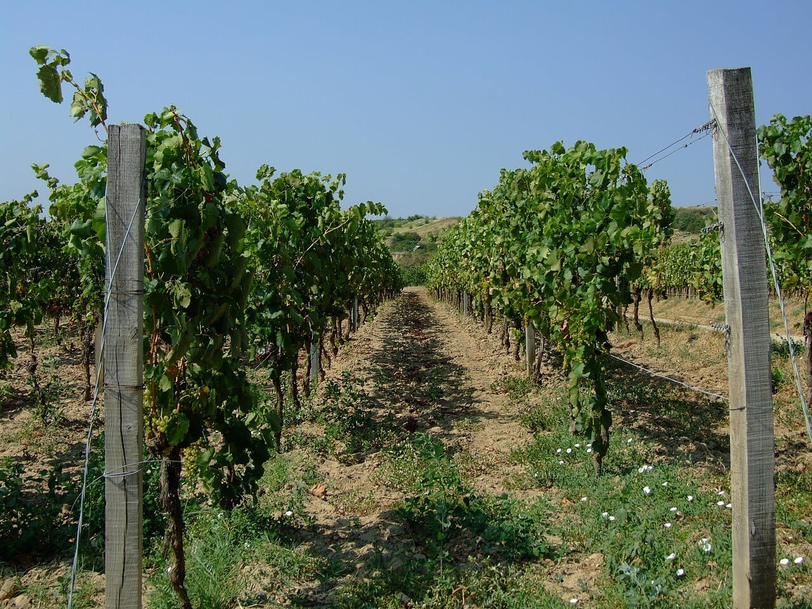
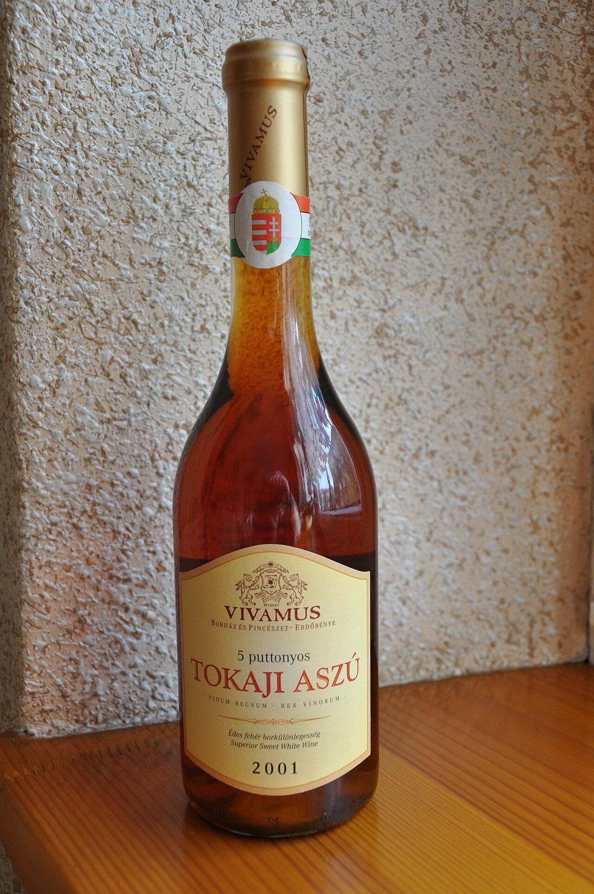
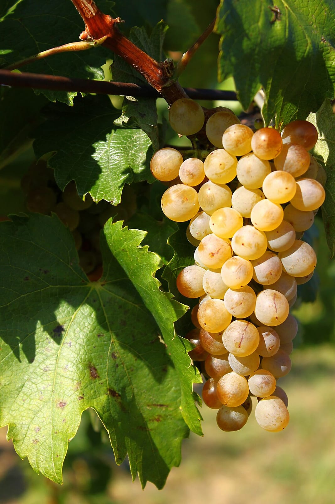

# Tokaj

Tokaj is the historic wine region of north-eastern Hungary, spread along the Bodrog and Tisza rivers and made up of dozens of villages and thousands of small parcels. It is known for [Aszú](ref:tokaji) botrytis wine, and increasingly for dry [Furmint](ref:furmint). Understanding Tokaj means reading geology, rivers and regulation together.

Figure: Tokaj. Photograph: Tokaj vineyard. Credit: Jerzy Kociatkiewicz from Colchester, United Kingdom, CC BY-SA 2.0, via Wikimedia Commons ([source](https://commons.wikimedia.org/w/index.php?curid=4591613)).

## A river and an arc of hills

The region lies in north-eastern Hungary, with the Zemplén mountains to the north and the Great Plain to the south. The mountains block cold air from the north, while warm air from the plain enters along the valleys, creating a mild microclimate. The Bodrog and Tisza rivers bring moisture in autumn, morning fog covers the vineyards, and afternoon sun dries the skins. That rhythm lets [noble rot](ref:noble-rot) develop reliably, making Tokaj one of the world's few botrytis regions.

The region forms a V opening to the south-west, with Tokaj hill (Kopasz) at its tip, a volcanic cone. Vineyards follow valleys and slopes at modest altitude, but aspect and distance from the river create wide differences. Valley floors hold humidity and fog, favouring botrytis; higher slopes drain better and suit dry wine. The relative position of river and hill shapes the style of each village.

## Villages and parcels of Tokaj-Hegyalja

The core of the region is often called Tokaj-Hegyalja, meaning the foothills of Tokaj. Historically more than twenty villages belonged to the area, and today's product specification defines the boundary more precisely. The main towns and villages include Tokaj, Tarcal, Mád, Tállya, Szerencs, Bodrogkeresztúr, Erdőbénye, Tolcsva and Sárospatak. The boundary has changed several times in history, and today the specification is the reference.

Each village is surrounded by many parcels called dűlő. These carry their own names and were historically tied to ranking, taxation and ownership. Single-vineyard labelling has become more common, as estates use parcel names to express differences in soil and microclimate.

## Soil left by four hundred volcanoes

The soils of Tokaj come from volcanic activity between about fourteen and nine million years ago. Andesite, dacite, rhyolite and tuff weather into a range of substrates, locally covered by loess and river deposits. Local writing describes a region built on four hundred volcanoes, a way of expressing the complexity of its soils and the subtle differences between parcels.

The most common vineyard soil is compact weathered volcanic rock, well drained and mineral in character; loess cover holds water and suits drier slopes; white rhyolite dust drains too fast and demands careful viticulture. Soil differences, aspect and valley humidity together create the aromatic complexity of Tokaj.

## Furmint, Hárslevelű and Aszú

Furmint is the main variety: late-ripening, thick-skinned, high in acidity and prone to noble rot. Hárslevelű adds flowers and a softer texture, while Sárgamuskotály contributes grape and floral aroma. They can be vinified separately or blended.

Aszú begins with a base wine from healthy grapes. Botrytised grapes are then selected berry by berry and macerated in the base wine or in must that is still fermenting, before pressing, [fermentation](ref:fermentation) and ageing in oak. The share of botrytised fruit, the length of maceration and the style of the base wine determine the final sweetness and structure. It belongs to the wider family of [dessert wine](ref:dessert-wine), but its process is entirely different from Sauternes or ice wine.

## 1737, 2012 and 2013

In 1737, the Hungarian crown issued a decree defining the boundaries of the Tokaj region and regulating production and trade, one of the earliest origin protection systems in the world. The region subsequently passed through phylloxera, war, nationalisation and privatisation, and its boundaries and rules were revised repeatedly.

In 2013, Hungary changed the labelling of sweet wine: the minimum natural residual sugar for all Aszú became 120 g/L, and the three- and four-puttonyos categories were abolished. Five and six puttonyos may still be used voluntarily, provided they reach 120 g/L and 150 g/L respectively. The Tokaj PDO specification confirmed in 2012 wrote the village area, varieties and methods into the EU system. These changes made labels more precise and turned some old words into history.

## World heritage and wine travel

In 2002, the Tokaj Wine Region Historic Cultural Landscape was inscribed on the UNESCO World Heritage List, covering vineyards, cellars, villages and historic buildings. Many cellars are cut into volcanic tuff, where temperature is stable and humidity high; the mould layer on the walls is part of the ageing environment and is treated as living heritage rather than mere architecture.

Visitors usually base themselves in Tokaj, Mád or Sárospatak. The harvest is the liveliest season, but estates are busy and visits need booking; spring and summer are easier for tastings and vineyard walks. Public transport is limited, so a car helps, but do not drive after tasting. Excessive drinking is harmful, and minors should not drink.

## A northern limit under a warming climate

Tokaj sits near the northern limit of viticulture, so warming affects it differently from southern regions. Higher temperatures make ripening easier and have improved dry Furmint; at the same time, warmer autumns can disrupt botrytis, shortening or destabilising the fog season.

The region is testing picking dates, canopy management and variety proportions, and discussing the potential of higher sites. Late-ripening varieties that once looked risky now ripen more easily in some years. Botrytis wine depends on a fragile balance; climate change will not erase Tokaj, but it will alter its style and vintage variation.

For Tokaj, begin with the appellation and its permitted varieties. Then look at the vintage and the producer, and finally ask how the wine is labelled. The answers point to different choices, not to a single score.

Start with [Tokaji](ref:tokaji) for geographic boundary, then read [Noble rot](ref:noble-rot) for climate and soil. Seeing both keeps Tokaj from being confused with a neighbouring idea.

**Short definition:** The historic wine region of north-eastern Hungary, spread along the Bodrog and Tisza rivers; volcanic soils, autumn fog and Furmint support Aszú botrytis wine, within boundaries drawn in 1737 and a landscape inscribed as World Heritage in 2002.

**Key facts.**

| Item | Detail |
| --- | --- |
| In one line | The historic wine region of north-eastern Hungary, spread along the Bodrog and Tisza rivers; volcanic soils, autumn fog and Furmint support Aszú botrytis wine, within boundaries drawn in 1737 and a landscape inscribed as… |
| Level | other |
| Country code | HU |

**Sources and limits.** The key claims about Tokaj are checked against the following sources: Wines of Hungary (the history, terrain, soils, villages and extent of Tokaj; no original text is reproduced), Wines of Tokaj (residual sugar, ageing and winemaking rules for Aszú and related categories; no original text is reproduced), UNESCO World Heritage Centre (the extent and inscription date of the Tokaj World Heritage site; no original text is reproduced) and 4 sources in total. Prices, batches and status change; the body is project-written and does not reproduce source text.

## Related images

Image: A bottle of Vivamus 5 puttonyos Tokaji Aszú, labelled 2001 and 5 puttonyos.. Credit: Beemwej, CC BY-SA 3.0, via Wikimedia Commons ([source page](https://commons.wikimedia.org/wiki/File:Tokaji_Aszu.JPG)). Related image for Tokaj.

Image: Furmint. Credit: Andrs.kovacs, CC BY-SA 3.0, via Wikimedia Commons ([source page](https://commons.wikimedia.org/wiki/File:Furmint_grape_cluster.jpg)). Related image for Tokaj.
