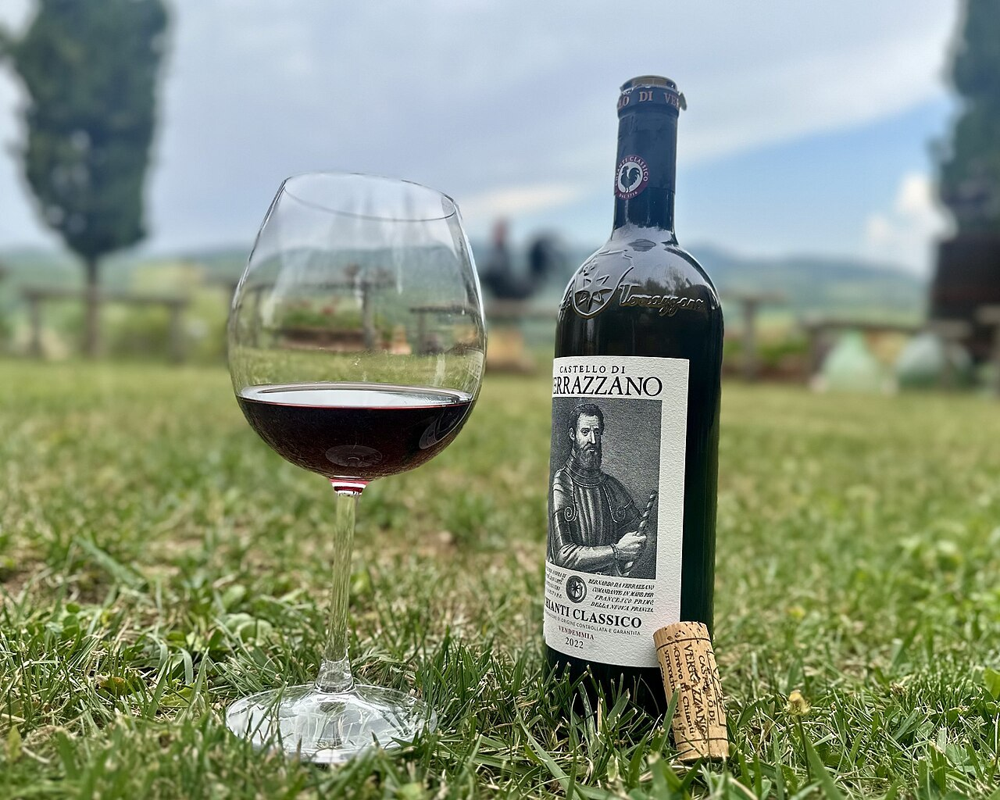

# Tuscany

Tuscany (Italian Toscana) lies in central [Italy](ref:italy) and is one of the country's most recognisable wine regions. It is built around [Sangiovese](ref:sangiovese), from the Chianti hills to the hill town of Montalcino and the Tyrrhenian coast at Bolgheri, and is dominated by [red wine](ref:red-wine) while also producing [white wine](ref:white-wine) and a little sparkling wine.

Figure: Tuscany. Photograph: Tuscany vineyard. Credit: cova69, CC BY 2.0, via Wikimedia Commons ([source](https://commons.wikimedia.org/w/index.php?curid=1393578)).

## Geography and climate

Tuscany runs roughly from the western side of the Apennines to the Tyrrhenian coast. Vineyards are concentrated in the Chianti hills between Florence and Siena, at Montalcino and Montepulciano, and in the southern Maremma and coastal Bolgheri. The hills mostly sit at 200–600 metres, and aspect and drainage set the pace of ripening.

The climate is Mediterranean, with hot dry summers and mild wet winters; the coast is tempered by sea breezes, while inland hills have wider day-night swings. Autumn rain and the choice of picking date are a major source of vintage variation in Tuscany.

Soil is a key to style: Chianti Classico's galestro is a flaky marl and clay that drains well while holding some water; alberese is hard limestone, often on higher slopes; Montalcino has much limestone and clay; Bolgheri has sand, gravel and alluvial soils. Different soils let the same variety show different acidity, aroma and tannin.

## History and classification

Viticulture in Tuscany goes back to Etruscan times, and medieval monasteries and city nobles continued the winemaking tradition. In 1716 Grand Duke Cosimo III of Tuscany issued a decree fixing the boundaries of Chianti, often cited as an early example of delimiting a wine region.

The modern hierarchy follows the Italian system: table wine, IGT (regional wine), DOC and DOCG. DOCG is the highest tier among legal appellations, with stricter rules on varieties, yields, ageing and bottling, and usually an official tasting. Chianti, Chianti Classico, Brunello and Vino Nobile di Montepulciano sit within this framework; Bolgheri exists as a DOC plus the separate Bolgheri Sassicaia DOC.

## Sub-zones

- Chianti and Chianti Classico: Chianti covers a wider area, while Chianti Classico is limited to the historic core between Florence and Siena and usually has a more concentrated structure.
- Montalcino: known for Brunello made from 100% Sangiovese, plus the younger Rosso di Montalcino.
- Montepulciano: represented by Vino Nobile, made from a local selection of Sangiovese.
- Bolgheri: Bordeaux-style blends and Syrah on the coast, one of the centres of the "Super Tuscan" movement.
- San Gimignano: known for Vernaccia white wine and one of the earlier Italian white appellations to gain DOC status.

These sub-zones differ through altitude, soil and sea influence, not through a simple quality ranking.

## Varieties and styles

[Sangiovese](ref:sangiovese) is the leading variety, bringing high acidity, medium to firm tannin and sour cherry, tomato leaf, violet and earthy notes. Traditional blends add local varieties such as Canaiolo and Colorino; Bolgheri makes heavy use of Cabernet Sauvignon, Merlot and Syrah.

Tuscan [red wines](ref:red-wine) range from youthful, easy Chianti to Brunello and Super Tuscans aged in large oak or small barrels. Traditionalists favour long ageing in large casks to preserve acidity and aroma, while modernists put more weight on fruit and French barriques. See [fermentation](ref:fermentation) and [oak ageing](ref:oak-ageing) for the related processes.

[White wine](ref:white-wine) is a smaller share, represented by Vernaccia di San Gimignano and coastal white blends. Overall, Tuscan whites receive less international attention than the reds.

## Representative wines and producers

- [Chianti Classico](ref:chianti-classico): mainly Sangiovese, with clear acidity, and one of Tuscany's best-known red wines.
- [Brunello](ref:brunello): 100% Sangiovese from Montalcino, with long ageing requirements and a serious style.
- [Sassicaia](ref:sassicaia): a Cabernet Sauvignon and Cabernet Franc blend from Bolgheri, often treated as the emblem of the "Super Tuscan" idea.
- Traditional producers such as Biondi-Santi and their link with Brunello, or Tenuta San Guido and its link with Sassicaia, are often used to tell the region's modern history.

"Super Tuscan" is a market and critical habit rather than a legal category; such wines are usually labelled IGT Toscana.

## Common misconceptions

First, treating Chianti Classico as a quality grade. It is first of all a geographical area.
Second, assuming Brunello may include international varieties. Its rules require Sangiovese alone.
Third, taking "Super Tuscan" for a DOCG. It is usually labelled IGT or DOC.
Fourth, thinking Tuscany makes only red wine. White wine and sparkling wine are also produced.
Fifth, assuming all Tuscan reds need long barrel ageing. Younger styles are part of the region too.

Tuscany is centred on Sangiovese, with Chianti and Chianti Classico, Brunello di Montalcino and the coastal Bolgheri region following different paths. Hilly sites, galestro and alberese soils and a Mediterranean climate produce high acidity, sour cherry and earthy notes. DOCG is a framework, not a guarantee for every bottle; the subzone and the producer remain the more specific guide.

**Short definition:** A wine region in central Italy based on Sangiovese, spanning Chianti and Chianti Classico, Brunello di Montalcino and the coastal Bolgheri; hilly terrain, galestro and alberese soils and a Mediterranean climate shape high-acid reds with sour cherry and earthy notes, within the DOCG quality framework.

For Tuscany, begin with the appellation and its permitted varieties. Then look at the vintage and the producer, and finally ask how the wine is labelled. The answers point to different choices, not to a single score.

[Italy](ref:italy) explains geographic boundary; [Red wine](ref:red-wine) adds climate and soil. Put Tuscany between them before deciding what it is.

Do not reduce Tuscany to an administrative place name. 

Sources for Tuscany include Italian Ministry of Agriculture, European Commission, Federdoc, Oxford University Press.

Tuscany's reds are based on Sangiovese, with Chianti, Brunello and Bolgheri as different expressions; the coast also grows Cabernet and Merlot.

The region's DOCG wines include Chianti Classico, Brunello and Vino Nobile di Montepulciano.

**Key facts.**

| Item | Detail |
| --- | --- |
| In one line | A wine region in central Italy based on Sangiovese, spanning Chianti and Chianti Classico, Brunello di Montalcino and the coastal Bolgheri; hilly terrain, galestro and alberese soils and a Mediterranean climate shape hig… |
| Level | province or region |
| Parent | Italy |
| Country code | IT |

**Sources and limits.** The key claims about Tuscany are checked against the following sources: Italian Ministry of Agriculture (the Italian legal wine appellations and the DOCG list), European Commission (the registration status and product specifications of Tuscan origin names), Federdoc (the Italian appellation consortia and the outline of DOCG rules) and 5 sources in total. Prices, batches and status change; the body is project-written and does not reproduce source text.

## Further reading

- [Italy](ref:italy): the national framework to which Tuscany belongs.
- [Sangiovese](ref:sangiovese): the core red variety of Tuscany.
- [Chianti Classico](ref:chianti-classico), [Brunello](ref:brunello) and [Sassicaia](ref:sassicaia): three representative red wines.
- [Red wine](ref:red-wine) and [white wine](ref:white-wine): the basic categories of Tuscany.
- [Oak ageing](ref:oak-ageing) and [fermentation](ref:fermentation): key processes behind style.
- [Wine](ref:wine): an overview of wine categories and origin rules.

## Related images

Image: Chianti Classico example bottle - Annata type. Credit: FranzKafka2000, CC BY-SA 4.0, via Wikimedia Commons.. Credit: FranzKafka2000, CC BY-SA 4.0, via Wikimedia Commons ([source page](https://commons.wikimedia.org/w/index.php?curid=168690826)). Related image for Tuscany.

Image: Brunello di Montalcino. Credit: O.S, CC BY-SA 3.0, via Wikimedia Commons ([source page](https://commons.wikimedia.org/wiki/File:Montalcino_001.jpg)). Related image for Tuscany.
