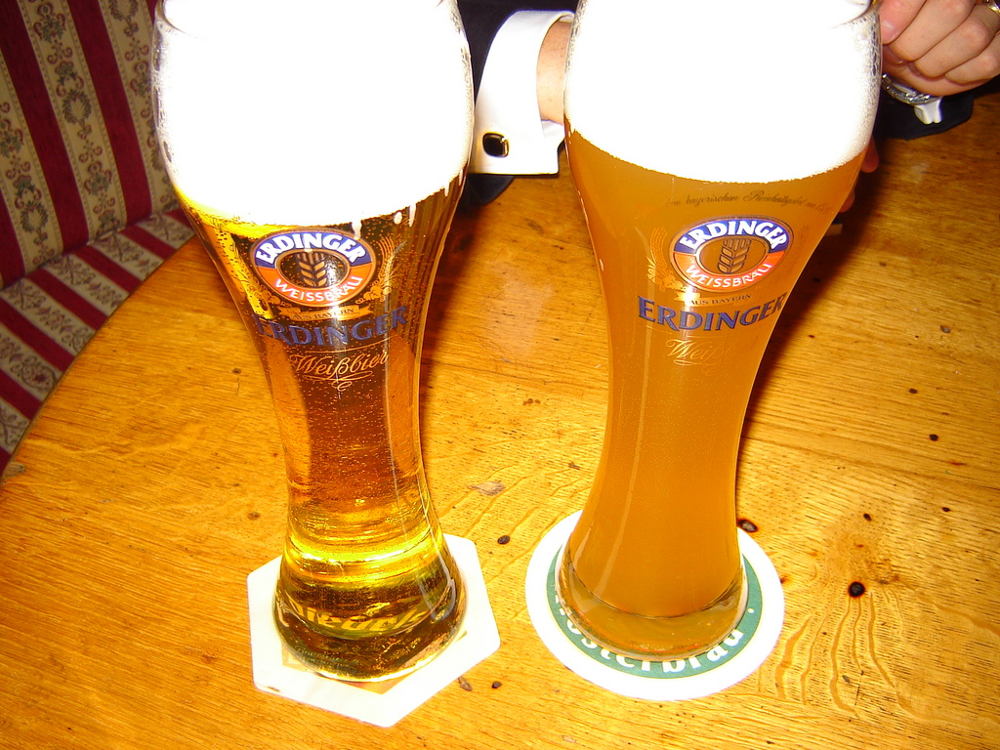

# United States

The United States is a major drinks producer in North America, with large-scale wine, whiskey and beer industries. The wine core is in California, while Oregon and Washington have distinctive styles; bourbon from Kentucky is the most representative spirit; beer ranges from industrial lager to a broad craft market. The US appellation system differs from European protected designations, and understanding this is the starting point for reading American labels.

Figure: United States. Photograph: File:Wine Country of the Dundee Hills, Oregon.jpg. Credit: Luke, CC BY-SA 2.0 ([source page](https://commons.wikimedia.org/wiki/File:Wine_Country_of_the_Dundee_Hills,_Oregon.jpg)). Category image; not a claim that it shows the exact product, site or event.

## Geography and climate

The country spans several climate zones. The west coast is shaped by the Pacific and mountain ranges: inland California is hot and dry in summer, the coast is cool and foggy, and Oregon and Washington are cooler. The centre and east have a continental climate with cold winters and humid summers; the south and south-west are subtropical or semi-arid. Mountains, currents and altitude create marked microclimates.

Heat and water are the key variables for wine regions. California uses irrigation and altitude to balance ripeness and acidity; Oregon and Washington rely more on growing-season length and a dry autumn; the east must deal with humidity, disease and winter cold. These differences explain why the same variety shows different styles across American regions.

## History

The US wine industry was already substantial in the nineteenth century, but Prohibition in the twentieth century interrupted its development. After repeal, California wine recovered and grew rapidly in the later twentieth century through technology, variety planting and international marketing. From the 1970s, regions such as Napa Valley gained attention in international tastings, raising the market standing of American wine.

Whiskey traditions are tied to immigration, agriculture and taxation. Bourbon, made mainly from corn, formed an industrial cluster in Kentucky and nearby areas. Beer saw a craft movement from the late twentieth century, with small breweries gaining ground through stylistic innovation and local identity.

## Wine regions

- California: Napa Valley, Sonoma and the Central Coast, with representative Cabernet Sauvignon, Chardonnay and Merlot.
- Oregon: the Willamette Valley, known for Pinot Noir.
- Washington: the Columbia Valley, warm with a wide diurnal range.
- New York and Pennsylvania: eastern regions where humidity and winter cold shape varieties and styles.
- Others: Texas, Colorado and Idaho also have wine industries of varying scale.

These regions contain finer AVAs. An AVA is a geographic boundary, not a quality tier; estates within one AVA can differ greatly.

## Wine styles

[Cabernet Sauvignon](ref:cabernet) in California often shows ripe blackcurrant, cedar and oak, with a full body; [Chardonnay](ref:chardonnay) ranges from lean to rich, including oak-fermented styles; [Merlot](ref:merlot) often brings plum, cherry and supple tannin. Oregon Pinot Noir is more red-fruited, earthy and spicy.

[Red wine](ref:red-wine) and [white wine](ref:white-wine) styles depend on region, vintage and winemaking. [Oak ageing](ref:oak-ageing) is common in American wine, and the proportion of new barrels and the toast level change vanilla, coconut and spice notes. Sparkling wine is also made in California, some by the traditional method.

## Spirits and beer

[Bourbon](ref:bourbon) is made mainly from corn and aged in new charred oak barrels, often showing vanilla, caramel and grain sweetness. [Whiskey](ref:whisky) in the US also includes rye and other grain whiskeys, with styles shaped by mash bill, distillation and barrel ageing. Kentucky is the core bourbon region, and its distillery trail has become an industry and tourism belt.

[Beer](ref:beer) ranges from large-scale industrial lager to small craft breweries. Craft beer emphasises hop aroma, malt recipes and local character, covering pale ale, IPA, stout and more. Beer and wine are judged by different standards and cannot be compared using the same "region and vintage" framework.

## Regulation and appellations

US wine appellations are built around the AVA (American Viticultural Area), administered by the TTB. An AVA defines a geographic boundary, and labelling with an AVA requires a minimum proportion of grapes from that area; unlike European AOP/PDO, it does not prescribe varieties, yields or winemaking. States also have their own alcohol licensing and sales rules.

Whiskey and beer have their own federal and state labelling rules. When reading a label, distinguish brand, distillery, region, type and vintage; terms such as "single barrel" and "small batch" have their own definitions and should not be taken at face value.

## Climate and soil data

| Area | Climate | Main soils | Representative drinks |
| --- | --- | --- | --- |
| West coast (California, Oregon, Washington) | Mediterranean to oceanic transition | Volcanic, alluvial, gravel | Wine |
| Centre (Kentucky, Tennessee) | Humid continental | Limestone water, clay | Bourbon |
| North-east (New York, Pennsylvania) | Continental, cold winters | Glacial deposits, shale | Wine, craft beer |
| South-west (Texas and others) | Semi-arid | Limestone, sand | Wine |

This table is a macro comparison; soil and microclimate at a specific site still need to be checked within a single AVA or distillery. Treating a state-level climate as a guarantee of style ignores differences within regions.

## Representative drinks and producers

[Jack Daniel's](ref:jackdaniels) is a representative Tennessee whiskey, made from corn, rye and barley, through malting, fermentation, distillation and oak ageing, and charcoal-filtered before bottling. It shows how brand storytelling in American whiskey is tied to region, raw materials and process.

For wine, estates in Napa Valley and Sonoma and Pinot Noir producers in Oregon have their representative wines. For specific products, see the wine pages; region pages provide only the geographic and regulatory framework.

## Market and drinking

The United States is a major drinks consumer and importer. [Wine](ref:wine) is segmented across restaurants, retail and collectors; whiskey and beer are consumed from bars to homes. Drinking should follow moderation, and storage after opening, temperature and glassware all affect the experience.

## Common misconceptions

First, that American wine comes only from California. Oregon, Washington, New York and others also have important regions.

Second, that an AVA is a quality tier. An AVA is only a geographic boundary and does not prescribe quality or varieties.

Third, that all bourbon comes from Kentucky. Kentucky is the core region, but other states also make bourbon.

Fourth, that American beer is all light lager. Craft beer covers many styles.

Fifth, that vintage does not matter in the US. Some wines are still vintage-sensitive, while whiskey depends more on recipe and barrel ageing.

Begin with the appellation and its permitted varieties, move on to the vintage and the producer, and finish with how the wine is labelled. That order keeps the reading of United States practical.

[Wine](ref:wine) and [White wine](ref:white-wine) answer different questions about United States: geographic boundary and climate and soil. Read them as a pair, not as alternatives.

## Further reading

- [Wine](ref:wine): wine categories, winemaking and the regional framework.
- [Red wine](ref:red-wine): tannin and barrel ageing in American reds.
- [Sparkling wine](ref:sparkling): California sparkling wine and the traditional method.
- [Bourbon](ref:bourbon) and [whiskey](ref:whisky): the core American spirits.
- [Beer](ref:beer): the stylistic base of craft beer.
- [Cabernet Sauvignon](ref:cabernet), [Chardonnay](ref:chardonnay) and [Merlot](ref:merlot): common American varieties.
- [Jack Daniel's](ref:jackdaniels): a representative Tennessee whiskey.

## Related images

Image: Jack Daniel's Old No. 7. Credit: Ben Jacobson ( Kranar Drogin ), CC BY 2.5, via Wikimedia Commons ([source page](https://commons.wikimedia.org/wiki/File:Jack_Daniel_Distillery_Lynchburg_TN_001.JPG)). Related image for United States.

Image: Hefeweizen and kristallweizen, two treatments within the same wheat-beer family. Credit: Ich, Public domain, via Wikimedia Commons ([source page](https://commons.wikimedia.org/wiki/File:Hefeweizen_and_kristallweizen.jpg)). Related image for United States.
