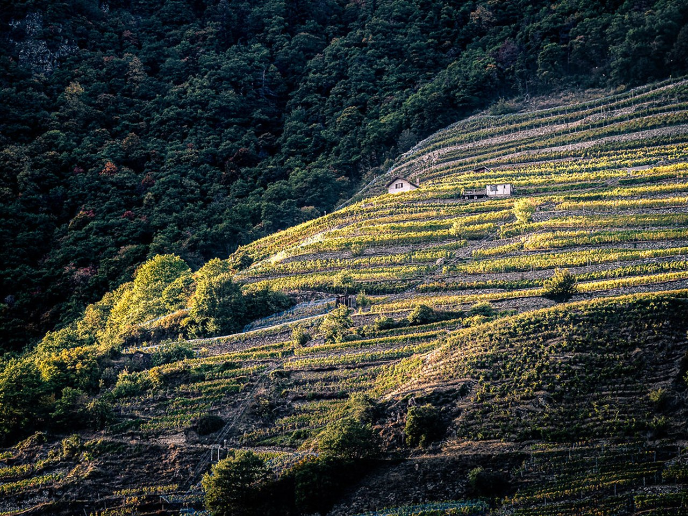

# Valais

Valais, Wallis in German, is the largest wine region in Switzerland, with vineyards along the upper Rhône on both sides of the Alpine valley.

Figure: Valais. Photograph: Fully - Valais, Switzerland - Landscape photography. Credit: Giuseppe Milo (www.pixael.com), CC BY 2.0, via Flickr / Openverse ([source](https://www.flickr.com/photos/87690240@N03/48868951406)).

## Definition and scope

Valais is a cantonal wine region covering the Rhône valley from Brig to where the river enters Lake Geneva, plus parts of the side valleys. The region accounts for about one third of the Swiss vineyard area and is the largest producing canton.

Vineyards are mainly steep terraces, from the valley floor up to high ground. Inside the region, production is divided by village and site, and labels usually carry a village or site name rather than only the canton.

## History

Viticulture in Valais goes back to Roman times and was expanded by monasteries and local nobles in the Middle Ages. Downy mildew and phylloxera devastated the vineyards at the end of the nineteenth century, after which they were rebuilt with grafting and disease management.

In the late twentieth century the region built a system of origin-based labelling. Switzerland is not an EU member, and its AOC is a national and cantonal system that runs parallel to, but is not the same as, the EU PDO and PGI framework. Valais currently has one AOC and ten AOC Grand Cru.

## Geography and climate

Valais is an Alpine valley carved by glaciers 20,000 years ago, with a dry floor, about 650 mm of rain and 2,500 hours of sunshine a year. Strong, hot foehn winds descend from the north side of the Alps, further lowering humidity and speeding ripening so that late varieties ripen reliably.

The dry climate reduces fungal pressure but brings water stress and soil erosion. Vineyards mostly face south or south-west and receive direct light; at altitude the day-night range is large, which helps retain [acidity](ref:acidity). At Visperterminen vines reach about 1,100 metres, among the highest vineyards in Europe.

Soils vary widely, including glacial deposits, weathered granite and gneiss, schist, limestone and alluvium. Parent material changes drainage and heat retention, and creates differences in [terroir](ref:terroir) within the region.

## Terraces and sites

Valais vineyards are mainly terraces (Terrassen) and steep sites, and stone-walled terraces are still maintained by hand where the slope is extreme.

- Lower Valais, close to Lake Geneva, lower in altitude, with more alluvium and limestone.
- Central Valais, around Sion and Sierre, the driest and sunniest part and the area with the highest concentration of Grand Cru sites.
- Upper Valais, near Brig and Visperterminen, the highest and latest ripening.
- Side valleys such as Val d'Anniviers and Val d'Hérens, steeper and smaller in area.

Site names and Grand Cru mentions describe the extent of origin and historical reputation, not a uniform quality grade.

## Varieties and raw material

Reds account for about 59% and whites about 41%, across 55 varieties. The largest variety is Pinot Noir at about 1,275 hectares and 28%, followed by Chasselas at about 755 hectares and 16%, Gamay at about 457 hectares and 10%, Silvaner at about 317 hectares and 7%, Petite Arvine at about 259 hectares and 6%, Sauvignon Blanc at about 214 hectares and 5%, Syrah at about 172 hectares and 4%, Cornalin at about 163 hectares and 4% and Humagne Rouge at about 143 hectares and 3%. The raw material is [grape](ref:grape).

Chasselas is called Fendant in Valais and is the emblematic white grape; Petite Arvine brings citrus and wisteria aromas with a saline finish; Ermitage, meaning Marsanne, is used for some Grand Cru whites. Among reds, Syrah performs reliably in Valais, and Cornalin and Humagne Rouge are local varieties.

## Winemaking

White grapes are gently pressed and [fermented](ref:fermentation) cool, and most wines avoid malolactic fermentation to keep freshness and minerality. Fendant is usually fermented in stainless steel or large old casks with brief lees contact before bottling.

Red grapes are macerated according to variety and style. Pinot Noir and Gamay usually aim for fruit and suppleness, while Syrah and Cornalin need longer maceration to extract colour and tannin; some wines are [aged](ref:oak-ageing) in oak, usually with a modest share of new barrels.

## AOC and Grand Cru

The Valais AOC sets origin, permitted varieties, yields and winemaking rules. AOC Valais is the cantonal label; AOC Grand Cru is a stricter site-level label that applies only to demarcated sites within specific municipalities.

Grand Cru is a site label within the Swiss cantonal system, not a national grade, and it does not rank wines by body or sweetness. A Grand Cru on a label has to be read together with the specific place name.

## Labels and serving

The label should be checked for AOC Valais or a specific Grand Cru name, the village and site, variety, [vintage](ref:vintage), [alcohol](ref:abv), volume and bottler. A wine labelled as a single variety must be made as a [single-varietal](ref:single-varietal) wine; blends must list the varieties under the rules.

Fendant is served at about 8–10 degrees Celsius, Petite Arvine and Ermitage at about 10–12 degrees Celsius, and Syrah and Cornalin at about 15–17 degrees Celsius. Fendant suits river fish, cheese and Asian food; reds suit red meat and game. Refrigerate after opening and finish soon. Excessive drinking harms health and minors should not drink.

## Common misconceptions

First, thinking Valais makes only Fendant white wine. Reds account for 59%, and Pinot Noir is the largest variety.
Second, taking Fendant for a separate variety. Fendant is the local name of Chasselas in Valais.
Third, assuming higher altitude means better quality. Altitude brings later ripening and higher acidity, but style depends on site, variety and vintage.
Fourth, taking Grand Cru for a national grade. It is a site label within the cantonal AOC framework.
Fifth, reading Swiss labels with the EU PDO system. The Swiss AOC is a national system that runs parallel to, but is not the same as, the EU framework.

**Short definition:** The largest wine region in Switzerland, spread along the upper Rhône and covering about 32% of the national vineyard area, or some 4,600 hectares; an Alpine valley with about 650 mm of rain and 2,500 hours of sunshine a year and foehn winds, where vines rise to about 1,100 metres at Visperterminen; reds account for 59% and Pinot Noir is the largest variety, alongside Chasselas, known locally as Fendant, Gamay, Petite Arvine, Cornalin and Humagne Rouge; one AOC Valais and ten AOC Grand Cru.

Valais is best read by starting with the appellation and its permitted varieties, moving to the vintage and the producer, and ending with how the wine is labelled.

[Wine](ref:wine) and [Red wine](ref:red-wine) answer different questions about Valais: geographic boundary and climate and soil. Read them as a pair, not as alternatives.

**Key facts.**

| Item | Detail |
| --- | --- |
| In one line | The largest wine region in Switzerland, spread along the upper Rhône and covering about 32% of the national vineyard area, or some 4,600 hectares; an Alpine valley with about 650 mm of rain and 2,500 hours of sunshine a … |
| Level | other |
| Country code | CH |

**Sources and limits.** The key claims about Valais are checked against the following sources: Swiss Wine Promotion, Canton du Valais (the 4,564 hectares of Valais vineyard and the red and white variety shares), OIV (the entry's background, terminology and regulatory context) and 4 sources in total. Prices, batches and status change; the body is project-written and does not reproduce source text.

For Valais, this page was last checked in 2026; prices, batches and availability change, so confirm them against the sources below.

## Further reading

- [Wine](ref:wine): an overview of wine categories, vintages and origin rules.
- [White wine](ref:white-wine) and [red wine](ref:red-wine): the two main categories of Valais.
- [Grape](ref:grape): the structure of wine grapes and ripeness measures.
- [Fermentation](ref:fermentation): the difference between cool fermentation and malolactic fermentation.
- [Acidity](ref:acidity): how altitude and the day-night range affect acidity.
- [Terroir](ref:terroir): how parent material, aspect and foehn create site differences.
- [Oak ageing](ref:oak-ageing): the choice of container for red wines.
- [Dry](ref:dry): the dry positioning of Fendant and other whites.
- [Vintage](ref:vintage): vintage variation in Valais.
- [Single varietal](ref:single-varietal): the concept behind variety labelling.
- [Alcohol by volume](ref:abv): what % vol means on a label.
