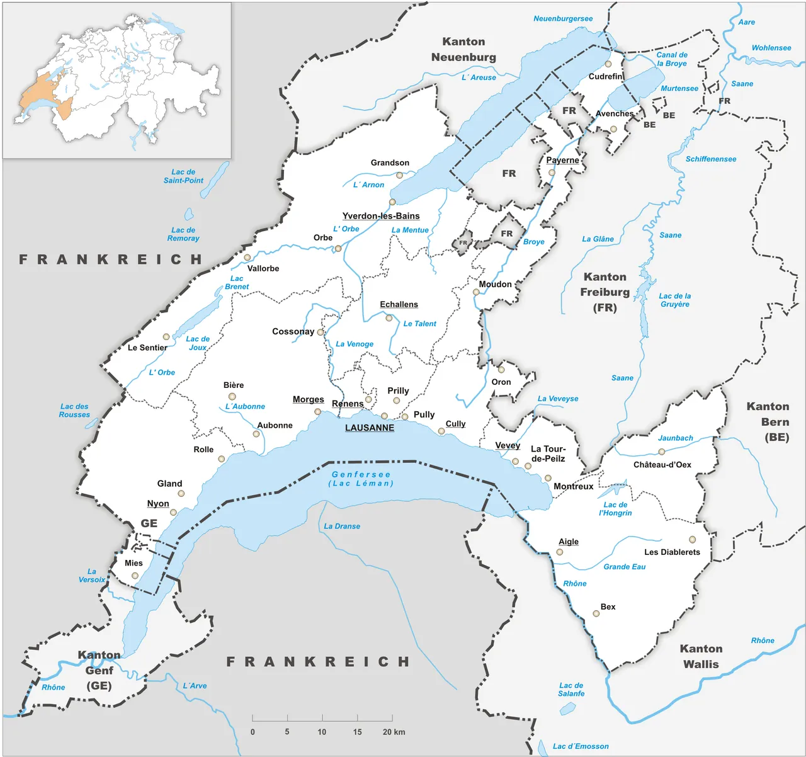

# Vaud

Vaud, Waadt in German, is a wine region in western Switzerland centred on the north shore of Lake Geneva, known for Chasselas white wines and the Lavaux terraces.

Figure: Vaud. Image: Tschubby, CC BY-SA 3.0, via Wikimedia Commons ([source page](https://commons.wikimedia.org/wiki/File:Karte_Kanton_Waadt_2010.png)).

## Definition and scope

Vaud is a cantonal wine region with vineyards along the north shore of Lake Geneva and around Lake Neuchâtel, extending into the inland hills. The canton has about 3,782 hectares of vineyard and is the second-largest region in Switzerland.

Vaud is the only Swiss region where white grapes dominate, at 65% white and 35% red. Inside the canton there are six sub-regions, and place names rather than varieties are the main identifier on labels.

## History

Viticulture in Vaud is tied to lakeside monasteries and the city markets of Lausanne and Geneva. The Lavaux terraces were built up from the Middle Ages onwards, and the stone walls and drainage channels survive today.

In 2007 the Lavaux vineyard and cultural landscape were inscribed as a UNESCO World Heritage site; what was listed is the terraced landscape and its walls, not a particular wine. In the late twentieth century Vaud established its AOC system, bringing sub-regions, municipalities and sites under rules.

## Geography and climate

Vaud vineyards sit on south-facing slopes above Lake Geneva, at about 380 to 600 metres. The lake reflects light and moderates temperature, extending ripening into autumn so that Chasselas reaches good ripeness while keeping acidity.

The Lavaux microclimate is called the three suns, meaning direct sunlight, reflection from the lake and heat stored by the stone walls by day and released at night. Soils are mainly limestone and glacial deposits, with more clearly calcareous soils in Chablais, limestone and molasse in La Côte, and a higher share of clay and limestone in Côtes de l'Orbe.

Soil and lake together make up differences in [terroir](ref:terroir): limestone gives minerality and tension, while glacial deposits and clay give fuller body.

## Six sub-regions

The six sub-regions of Vaud have their own AOCs and emphases:

- Chablais in the south-west, about 590 hectares, with calcareous soils and foehn, represented by Aigle, Yvorne and Ollon, where Chasselas shows salinity and minerality.
- Lavaux, the terraces between Lausanne and Montreux, about 800 hectares, mainly Chasselas, with terraces and stone walls forming the landscape.
- La Côte, the largest sub-region with about 2,000 hectares, between Lausanne and Geneva, with gentle slopes and limestone, where Chasselas is fresh with floral and fruit notes.
- Bonvillars, north of Lake Neuchâtel, about 190 hectares, with calcareous soils, elegant Chasselas and fine Pinot Noir.
- Côtes de l'Orbe, between Lausanne and Yverdon-les-Bains, about 170 hectares, with clay and limestone, giving firmer wines with spice and earthy notes.
- Vully, between Lake Neuchâtel and Lake Murten, the smallest, with both red and white grapes.

Styles differ clearly between sub-regions, but differences in site and vintage within a sub-region matter just as much.

## Varieties and raw material

Chasselas accounts for 59%, or about 2,233 hectares, and is the dominant variety; it is followed by Pinot Noir at about 476 hectares and 13%, Gamay at about 311 hectares and 8%, Gamaret at about 148 hectares and 4%, Garanoir at about 126 hectares and 3% and Chardonnay at about 47 hectares and 1%. The raw material is [grape](ref:grape).

Chasselas is light in body with moderate acidity and restrained aroma, and its style is decided mainly by soil and site, so labels usually give a place such as Yvorne, Féchy or Dézaley rather than the variety. Reds are mainly Gamay and Pinot Noir, and Gamaret and Garanoir are Swiss-bred varieties.

## Winemaking

Chasselas is usually gently pressed and [fermented](ref:fermentation) cool in stainless steel or large old casks, and malolactic fermentation is normally avoided to keep freshness and minerality. Some wines gain texture from lees contact.

Reds are macerated according to the style of Gamay and Pinot Noir, usually aiming for fruit and suppleness, and some wines are briefly [aged](ref:oak-ageing) in oak. Grand Cru whites such as Dézaley often get longer lees contact and later bottling.

## AOC and Grand Cru

The Vaud AOC system includes the cantonal AOC Vaud and the regional AOCs Chablais, La Côte, Lavaux, Bonvillars, Côtes de l'Orbe and Vully. There are also three AOC Grand Cru, Calamin, Dézaley and Dézaley-Marsens.

Within Lavaux there are three AOCs, Lavaux AOC at about 798 hectares, Calamin Grand Cru at about 16 hectares and Dézaley Grand Cru at about 54 hectares. Grand Cru is a smaller demarcated site with stricter rules, but it is not a national grade.

## Labels and serving

The label should be checked for the AOC name, sub-region, municipality or site, variety where stated, [vintage](ref:vintage), volume and bottler. Vaud labels often give a place instead of a variety; a wine labelled as a single variety must be made as a [single-varietal](ref:single-varietal) wine.

Chasselas is served at about 8–10 degrees Celsius, and Grand Cru such as Dézaley and Calamin slightly warmer at about 10–12 degrees Celsius; Gamay and Pinot Noir at about 14–16 degrees Celsius. Chasselas suits river fish, cheese and light dishes, and reds suit poultry and red meat. Refrigerate after opening and finish soon. Excessive drinking harms health and minors should not drink.

## Common misconceptions

First, thinking Chasselas is bland. Its aroma is restrained, and style differences come mainly from soil and site.
Second, thinking Vaud means only Lavaux. La Côte is the largest sub-region, and Chablais and the other three matter as well.
Third, treating Dézaley as a separate region. It is a Grand Cru name inside Lavaux.
Fourth, reading Swiss labels with the EU PDO system. The Swiss AOC is a national system that runs parallel to, but is not the same as, the EU framework.
Fifth, assuming Grand Cru is always richer. Grand Cru sets stricter origin and yield rules, and style still depends on vintage and estate.

**Short definition:** The wine region of the canton of Vaud in Switzerland, with about 3,782 hectares of vineyard and the only Swiss region where white grapes dominate at 65%; Chasselas covers 59%, or about 2,233 hectares, and labels usually give a place name such as Yvorne, Féchy or Dézaley instead of a variety; divided into six sub-regions, Chablais, Lavaux, La Côte, Bonvillars, Côtes de l'Orbe and Vully, with the Lavaux terraces inscribed as a UNESCO World Heritage site in 2007 and the three Grand Cru appellations Calamin, Dézaley and Dézaley-Marsens.

Read Vaud through the appellation and its permitted varieties, then the vintage and the producer, and finally how the wine is labelled. The sequence matters.

[Wine](ref:wine) and [Red wine](ref:red-wine) are the two useful reference points for Vaud. [Wine](ref:wine) sets out geographic boundary; [Red wine](ref:red-wine) brings in climate and soil. Read them together.

**Key facts.**

| Item | Detail |
| --- | --- |
| In one line | The wine region of the canton of Vaud in Switzerland, with about 3,782 hectares of vineyard and the only Swiss region where white grapes dominate at 65%; Chasselas covers 59%, or about 2,233 hectares, and labels usually … |
| Level | other |
| Country code | CH |

**Sources and limits.** The key claims about Vaud are checked against the following sources: Swiss Wine Promotion, Association Lavaux Patrimoine mondial (Lavaux AOC at 798 hectares, Calamin Grand Cru at 16 hectares and Dézaley Grand Cru at 54 hectares), OIV (the entry's background, terminology and regulatory context) and 4 sources in total. Prices, batches and status change; the body is project-written and does not reproduce source text.

## Further reading

- [Wine](ref:wine): an overview of wine categories, vintages and origin rules.
- [White wine](ref:white-wine): the main category of Vaud.
- [Red wine](ref:red-wine): the framework for Gamay and Pinot Noir.
- [Grape](ref:grape): the structure of wine grapes and ripeness measures.
- [Fermentation](ref:fermentation): the difference between cool fermentation and malolactic fermentation.
- [Acidity](ref:acidity): lake microclimate and the balance of acidity.
- [Terroir](ref:terroir): how limestone, glacial deposits and terraces create site differences.
- [Dry](ref:dry): the dry positioning of Chasselas.
- [Vintage](ref:vintage): vintage variation in Vaud.
- [Single varietal](ref:single-varietal): the concept behind variety labelling.
- [Oak ageing](ref:oak-ageing): ageing of reds and Grand Cru whites.

## Related images

Image: Wine. Credit: André Karwath, CC BY-SA 2.5, via Wikimedia Commons ([source page](https://commons.wikimedia.org/wiki/File:Red_and_white_wine_in_glass.jpg)). Related image for Vaud.

Image: Thematic illustration for White wine. Project-made bilingual editorial figure, not an on-site photograph. Related image for Vaud.
