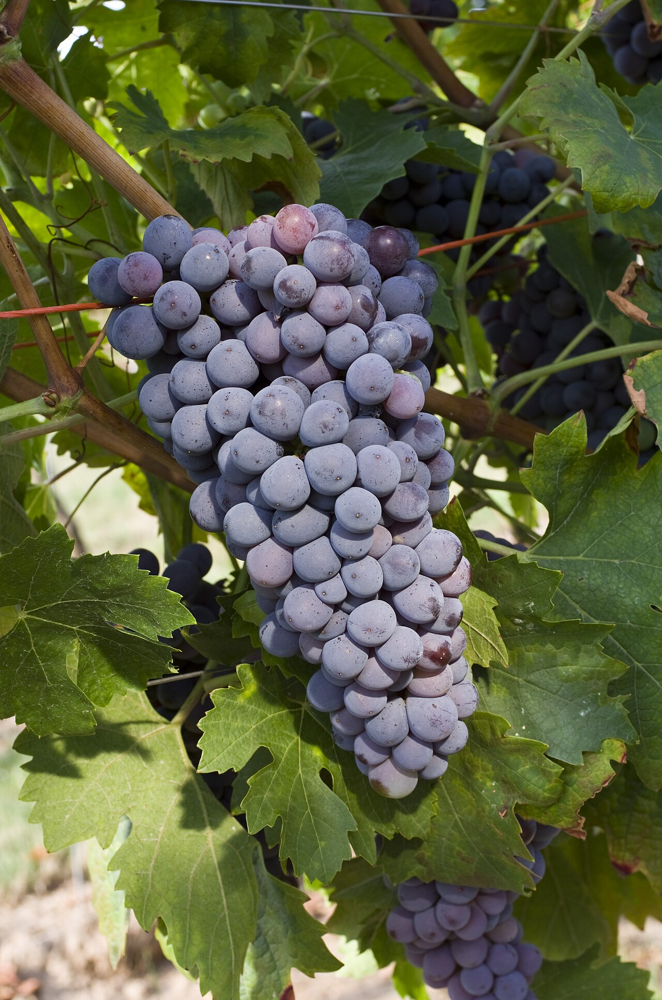
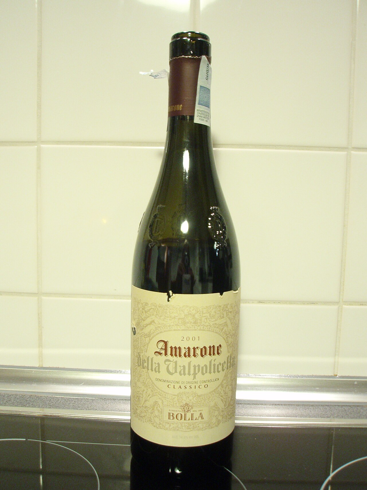

# Veneto

Veneto (Italian Veneto) lies in north-east [Italy](ref:italy), running from the Dolomites at the southern edge of the Alps to the Adriatic and the Venetian lagoon. It is a major Italian wine region, best known for three blocks: the red wines of Valpolicella, the whites of Soave and the sparkling wines of Prosecco.

Figure: Veneto. Photograph: Vineyard, San Giorgio di Valpolicella, Veneto, Italy. Credit: Unknown photographer, CC BY-SA 2.0, via Wikimedia Commons ([source](https://commons.wikimedia.org/w/index.php?curid=354325)).

## Geography and climate

Veneto divides into northern mountains, central hills and southern plain. Vineyards are concentrated around Verona in Valpolicella, Soave and Bardolino, and in the Conegliano and Valdobbiadene hills in the north-east.

The climate moves from Alpine continental conditions in the north to a milder regime on the southern plain and coast. Lake Garda moderates nearby temperatures; day-night swings on the hills help retain aroma and acidity. Autumn rain and picking dates are central to the drying process in Valpolicella.

Soils vary: parts of Soave and Valpolicella are volcanic (basalt) and calcareous, the hills have marl and sandstone, and the plain is mostly alluvial. Volcanic soil is often used to explain the mineral feel and acidity of Soave.

## History and classification

Veneto's winemaking tradition goes back to Roman times and the Venetian Republic, when port and river trade supported wine commerce. From the 20th century, cooperatives and small estates together drove growth in volume and exports.

In Italy, DOCG is the highest tier of legal appellation, followed by DOC, with IGT as regional wine. Amarone and Recioto from Valpolicella, Recioto di Soave, and Conegliano Valdobbiadene Prosecco and Asolo Prosecco all hold DOCG status. Prosecco completed a name change in 2009: the place name remained and the variety name became Glera.

By volume, Veneto is one of the largest DOC wine-producing regions in Italy; Prosecco and the Valpolicella family are major contributors. Exact output changes from year to year and official statistics should be used.

## Sub-zones

- Valpolicella: hills north-west of Verona, based on Corvina, Corvinone and Rondinella, covering labels such as Valpolicella, Ripasso and Amarone.
- Soave: hills east of Verona, based on Garganega, with ranges such as Soave, Soave Classico and Colli Scaligeri.
- Bardolino: the east shore of Lake Garda, mainly Corvina, producing light reds and the Chiaretto rosé.
- Conegliano and Valdobbiadene: the core Prosecco hills, holding DOCG status.
- Asolo: another Prosecco DOCG hill area.
- Piave and the eastern plain: mainly Prosecco DOC and various white wines.

These sub-zones differ through terrain, soil and variety rather than through a single quality ranking.

## Varieties and styles

[Corvina](ref:corvina) is the core of Valpolicella, bringing sour cherry, almond and spice, usually with Corvinone and Rondinella. Amarone dries the grapes in ventilated rooms for months, concentrating sugar and flavour before fermentation, giving a full-bodied, high-alcohol wine that ranges from dried fruit to spice and chocolate.

Ripasso re-ferments ordinary Valpolicella on the lees of Amarone, adding colour, body and flavour; it is not a watered-down Amarone. Recioto is the sweet version that retains residual sugar.

Garganega is the main variety of Soave, bringing pear, citrus, white flowers and almond; styles run from light and fresh to fuller whites with barrel ageing. See [white wine](ref:white-wine) for the related category.

[Glera](ref:glera) is the core variety of Prosecco, with green apple, pear and white-flower aromas. Prosecco mostly uses tank fermentation for the second fermentation, stressing fresh fruit and easy drinking, unlike the traditional method in bottle. See [sparkling wine](ref:sparkling-wine) and [red wine](ref:red-wine) for the related categories.

For Veneto, begin with the appellation and its permitted varieties, then the vintage and the producer, and finish with how the wine is labelled; that order keeps the account grounded.

## Representative wines and producers

- [Amarone](ref:amarone): the dried-grape red of Valpolicella, full-bodied and high in alcohol.
- [Prosecco](ref:prosecco): sparkling wine from Glera, tank-fermented, fresh and easy to drink.
- Soave Classico and Recioto di Soave: the dry and sweet representatives of Soave.
- Valpolicella Ripasso: a style between everyday Valpolicella and Amarone.
- Producers such as Allegrini, Dal Forno Romano, Pieropan, Nino Franco and Bisol are often used as references for the various sub-zones.

Producer style changes with vintage and site, and brand recognition does not guarantee that every bottle meets expectations.

## Common misconceptions

First, thinking Amarone is sweet. Standard Amarone ferments to dryness, and Recioto is the sweet counterpart.
Second, equating Ripasso with Amarone. It is a re-fermentation on the lees.
Third, treating Prosecco as a synonym for Champagne or the same method. It usually uses tank fermentation.
Fourth, assuming all Soave is cheap and neutral. The classic zone and old vines can be structured.
Fifth, taking Veneto's volume lead as a quality lead. Volume and stylistic diversity are two different things.

Veneto is a broad northeastern Italian region, not one wine. Valpolicella and Amarone rely on Corvina and related varieties; Soave is Garganega-based; Prosecco uses Glera and is made mainly in the Treviso hills. The region also includes the Euganean Hills and the plains around Venice. Read the appellation first: Veneto is the administrative frame, while the DOC or DOCG defines the wine.

**At a glance:** A wine region in north-east Italy running from the southern Alps to the Adriatic; represented by Amarone and Ripasso from Valpolicella, Garganega in Soave and Glera in Prosecco, and one of Italy's largest DOC wine-producing regions by volume.

Start with [Italy](ref:italy) for geographic boundary, then read [Corvina](ref:corvina) for climate and soil. Seeing both keeps Veneto from being confused with a neighbouring idea.

Veneto is a large northern Italian region, with Soave and Valpolicella in the hills and Prosecco on the plains; Garganega, Corvina and Glera are core varieties.

The region's sparkling Prosecco is made mainly from Glera, and its Valpolicella blends rely on Corvina.

**Key facts.**

| Item | Detail |
| --- | --- |
| In one line | A wine region in north-east Italy running from the southern Alps to the Adriatic; represented by Amarone and Ripasso from Valpolicella, Garganega in Soave and Glera in Prosecco, and one of Italy's largest DOC wine-produc… |
| Level | province or region |
| Parent | Italy |
| Country code | IT |

**Sources and limits.** The key claims about Veneto are checked against the following sources: Italian Ministry of Agriculture (Veneto's legal appellations and the DOCG list), European Commission (the registration status and product specifications of Amarone, Soave, Prosecco and other origin names), Federdoc (the Veneto consortia and the outline of DOCG rules) and 5 sources in total. Prices, batches and status change; the body is project-written and does not reproduce source text.

## Further reading

- [Italy](ref:italy): the national framework to which Veneto belongs.
- [Glera](ref:glera) and [Corvina](ref:corvina): two core varieties.
- [Amarone](ref:amarone) and [Prosecco](ref:prosecco): two representative wines.
- [Red wine](ref:red-wine), [white wine](ref:white-wine) and [sparkling wine](ref:sparkling-wine): three basic categories.
- [Oak ageing](ref:oak-ageing) and [fermentation](ref:fermentation): key processes behind style.
- [Wine](ref:wine): an overview of wine categories and origin rules.

## Related images

Image: Corvina. Credit: Please note: This photo can be reproduced. Please quote the source as indicated below: Ursula Brühl, Julius Kühn-Institut (JKI) Bundesforschungsinstitut für Kul, CC BY-SA 4.0, via Wikimedia Commons ([source page](https://commons.wikimedia.org/wiki/File:VIVC2863_CORVINA_VERONESE_Cluster_in_the_field_19664.jpg)). Related image for Veneto.

Image: A bottle of Amarone della Valpolicella. Credit: Jerzy Kociatkiewicz, CC BY-SA 2.0, via Wikimedia Commons.. Credit: Jerzy Kociatkiewicz, CC BY-SA 2.0, via Wikimedia Commons ([source page](https://commons.wikimedia.org/w/index.php?curid=8844471)). Related image for Veneto.
