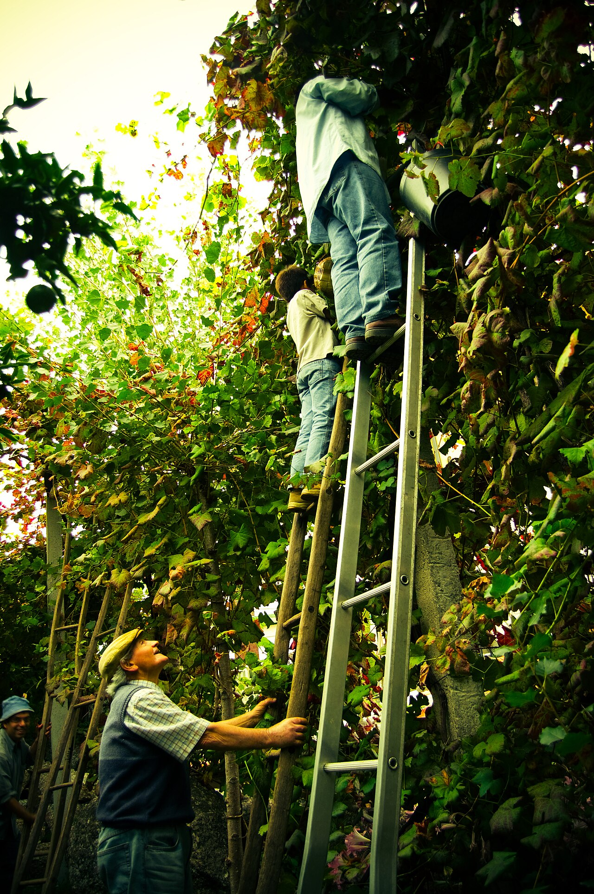

# Vinho Verde

Vinho Verde is an appellation in the Minho region of north-west [Portugal](ref:portugal), known for fresh, low-alcohol, high-acid [wines](ref:wine). The word verde in the name refers to a young wine meant to be drunk early, not to the colour of the wine.

Figure: Vinho Verde. Image: Feliciano Guimarães, CC BY 2.0, via Wikimedia Commons ([source page](https://commons.wikimedia.org/wiki/File:Vindimadores_em_vinha_de_enforcado_15.jpg)).

## Definition and scope

Vinho Verde is a protected designation of origin. The grapes must come from the demarcated Minho area and the wine must be made within the region. It is not the same rule set as the looser Minho regional indication, and the label should distinguish Vinho Verde from Minho.

The appellation covers several river valleys in north-west Portugal, running from the coast inland. Its size means clear differences in climate, soil and varieties, so the rules allow a sub-zone on the label, though a sub-zone is a geographical description rather than a quality ranking.

## History

The region was demarcated in 1908, and the regional viticulture commission, the CVRVV, was created in 1926 to regulate production and trade. This system was established earlier than the modern appellation rules of many European regions.

In the late 20th century the region moved from traditional pergolas to modern trellising and introduced temperature-controlled fermentation. The style then split into two broad paths: one keeps the light, fresh profile, the other, centred on Alvarinho, seeks riper fruit and more structure.

## Geography and climate

The region is strongly influenced by the Atlantic, with high rainfall, high humidity, mild temperatures and a small seasonal range. Vineyards follow the river valleys, where slope, drainage and airflow decide ripeness.

Soils are mainly granite, with some schist and alluvial soil. Weathered granite gives sandy, free-draining, low-fertility soil that helps control yields, while alluvial valley soil holds water and needs more careful management.

Traditional training included vines climbing trees, pergolas and plantings around field edges; modern vineyards use low-trained and trellised systems. Pergolas improve airflow and reduce humidity-related disease but allow little mechanisation.

## Sub-zones

The rules recognise nine sub-zones, Amarante, Ave, Baião, Basto, Cávado, Lima, Monção e Melgaço, Paiva and Sousa.

- Monção e Melgaço: the northernmost part, along the Minho river, sheltered and warmer and drier, the home and core of Alvarinho.
- Lima: around the Lima valley, where Loureiro stands out with bay leaf and white-flower aromas.
- Baião: inland and higher, where Avesso is more common, with marked acidity and minerality.
- Cávado and Ave: near the coast, low and humid, giving lighter styles.
- Basto, Amarante, Paiva and Sousa: further inland, with more continental conditions and a different balance of ripeness and acidity.

The sub-zones reflect climate and terrain rather than a quality hierarchy. The same variety can show different ripeness, acidity and aroma near the coast and inland.

## Varieties and raw material

White varieties are mainly Alvarinho, Loureiro, Arinto (locally Pedernã), Avesso, Trajadura, Azal and Batoca; reds are mainly Vinhão (also Sousão), Padeiro, Espadeiro and others. The raw material is [grape](ref:grape).

Alvarinho has thick skins and intense aroma and keeps enough acidity at high ripeness; Loureiro is elegant but lighter in structure; Arinto has high acidity and tolerates heat; Avesso performs better inland. Blends usually combine varieties to fill in aroma, acidity and body.

The red Vinhão has deeply coloured skins and strongly coloured juice, giving dark, high-acid wines with noticeable tannin, the reference for the region's [red wines](ref:red-wine).

## Winemaking

White grapes are pressed, settled and [fermented](ref:fermentation) cool, usually below 20 degrees Celsius, to keep aroma and acidity. Most wines then avoid malolactic fermentation so that acidity is not reduced and fruit aroma is not covered.

Red grapes ferment with the skins for a relatively short time, taking colour and fruit without over-extracting tannin; red wines usually allow malolactic fermentation, which softens acidity.

Some wines keep a little of the carbon dioxide from fermentation, giving a slight sparkle, while others are fully still. The bubbles come from a winemaking choice and do not indicate quality.

## Alcohol and style

The rules set a maximum total alcohol of 14% vol and a minimum actual [alcohol](ref:abv) of 8% vol; wines naming a sub-zone have a minimum of 9% vol, and wines declaring Alvarinho a minimum of 11.5% vol.

Regular Vinho Verde is mostly 8.5%–11.5% vol, light in body with high [acidity](ref:acidity) and notes of citrus, green apple, white flowers and minerals, best drunk young. Single-variety Alvarinho is mostly 11.5%–13% vol, with riper fruit and fuller structure, and some can age for a few years.

Low alcohol comes from style and rules together and does not mean dilution or poor quality. The freshness of partly converted sugar is exactly what the region aims for.

## Sparkling and late harvest

Besides still wine, the region makes Espumante de Vinho Verde and Espumante de Qualidade de Vinho Verde, both in the [sparkling wine](ref:sparkling-wine) category. Sparkling wines have a maximum total alcohol of 15% vol and a minimum actual alcohol of 10% vol, in styles from light to yeasty.

Some producers also make late-harvest (Vindima Tardia) wines from delayed picking, with sweetness and higher alcohol, in small volumes. These sit outside the light regular style and should be treated separately.

## Labels and serving

The label should be checked for the Vinho Verde appellation, sub-zone, variety, alcohol, volume and bottler. When a single variety is declared, Alvarinho alone must be 100% of the wine; when shown alongside other varieties, Alvarinho must be at least 30%. This is how the [single-varietal](ref:single-varietal) rule works in this appellation.

Origem do Alvarinho is an optional term reserved for wines entitled to declare Alvarinho and made in the Monção e Melgaço sub-zone.

Serve at 8–10 degrees Celsius, with seafood, salads, light white meat and tangy Asian dishes. Sparkling versions can be cooler. Once opened, keep chilled and finish soon. Excessive drinking is harmful to health and minors should not drink.

## Common misconceptions

First, reading Vinho Verde as a green-coloured wine. The name means young, and the wine is usually near colourless or pale lemon.
Second, assuming all Vinho Verde is sparkling. A slight sparkle is a feature of some wines, and still versions are just as common.
Third, treating lower alcohol as lower quality. Low alcohol is the result of the region's style and rules.
Fourth, assuming every Vinho Verde must be finished within the year. Regular wines are best young, but good Alvarinho can age in bottle for several years.
Fifth, treating sub-zones as grades. They describe geography and style, not a ranking.

**In brief:** The appellation of the Minho region in north-west Portugal, known for fresh, low-alcohol whites shaped by Atlantic influence; in the name, verde refers to youth rather than colour, with a minimum actual alcohol of 8% vol for regular wines, 9% vol when a sub-zone is named and 11.5% vol when Alvarinho is declared, and a maximum total alcohol of 14% vol; the main white varieties are Alvarinho, Loureiro, Arinto, Avesso, Trajadura and Azal, with Vinhão leading the reds.

For Vinho Verde, begin with the appellation and its permitted varieties. Then look at the vintage and the producer, and finally ask how the wine is labelled. The answers point to different choices, not to a single score.

## Further reading

- [Portugal](ref:portugal): the national appellation framework that contains Vinho Verde.
- [Wine](ref:wine): an overview of wine categories, vintage and origin rules.
- [White wine](ref:white-wine): the category of the region's main style.
- [Red wine](ref:red-wine): wines made from Vinhão and other red varieties.
- [Sparkling wine](ref:sparkling-wine): background for Espumante de Vinho Verde.
- [Grape](ref:grape): the basic structure and ripeness markers of wine grapes.
- [Fermentation](ref:fermentation): the difference between cool fermentation and malolactic fermentation.
- [Acidity](ref:acidity): how the region's high acidity shapes style and food pairing.
- [Single varietal](ref:single-varietal): the concept behind Alvarinho labelling rules.
- [Alcohol by volume](ref:abv): what 8% vol to 14% vol means on a label.

## Related images

Image: Category image for Portugal. Credit: John Hayes from San Antonio, Texas, USA, CC BY-SA 2.0, via Wikimedia Commons ([source page](https://commons.wikimedia.org/w/index.php?curid=151531010)). Related image for Vinho Verde.

Image: Sparkling wine. Credit: bgvjpe, CC BY 2.0, via Wikimedia Commons ([source page](https://commons.wikimedia.org/wiki/File:Glass_of_champagne.jpg)). Related image for Vinho Verde.
