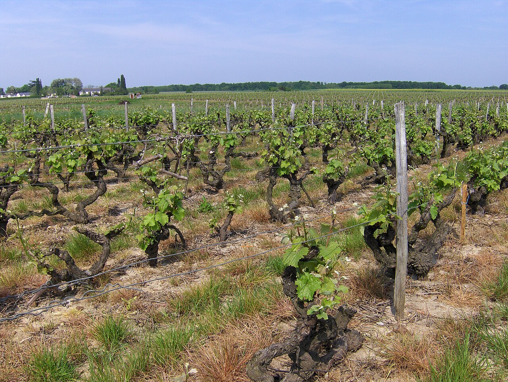

# Vouvray

Vouvray is a white-wine district east of Tours on the right bank of the Loire, with AOC status since 1936. Its principal permitted variety is Chenin Blanc, locally Pineau de la Loire, and one vineyard can be made into dry, off-dry, sweet, botrytised sweet and sparkling styles. Tuffeau limestone plateaus, a cool humid autumn and cave cellars make it the most concentrated place to observe Chenin's range.

Figure: Vouvray: Vouvray Vineyard after budbreak (Wikimedia Commons). Image: Peter Dutton, CC BY 2.0, via Wikimedia Commons ([source page](https://commons.wikimedia.org/wiki/File:Vouvray_Vineyard_after_budbreak.jpg)).

> **Quick verdict**
> **In one line:** This region helps you judge Vouvray for flavour and travel, and plan accordingly.
>
> - **Best for:** Anyone comparing Vouvray with other regions before buying wine or planning a trip.
> - **Not for:** If you want want a “most expensive region” verdict and do not care about style or vintage.
> - **Check first:**
>   - Local legend dates vines here to 372, when the Marmoutier monastery was founded and Saint Martin brought vine varieties and pruning techniques to the area.
>   - Serve by style: dry and sparkling at about 8–10°C, off-dry and sweet at about 10–12°C; sweet wine should not be over-chilled, or its honey and mineral notes close up.

## Definition and boundaries

The district lies close to and upstream of Tours, on a plateau cut by dry valleys ending in cliffs above the Loire, at 85–110 metres altitude. The legal area covers eight municipalities along the Loire and its converging valleys, including Vouvray, Rochecorbon, Vernou-sur-Brenne, Parçay-Meslay and Chançay; vineyards concentrate on south and southeast slopes and plateau edges.

"Vouvray" constrains variety, yield and winemaking; it does not separate slope from plateau. Within one AOC, clay-limestone slopes and siliceous plateau-edge soils differ in drainage, water retention and ripening rhythm. When the label omits a parcel, producer and single-vineyard name are the next distinction.

Across the river, Montlouis-sur-Loire is a separate AOC with the same variety but its own soils and style. Do not merge right-bank Vouvray with left-bank Montlouis; the two have distinct rules and reference producers despite facing each other across the water.

## History and naming

Local legend dates vines here to 372, when the Marmoutier monastery was founded and Saint Martin brought vine varieties and pruning techniques to the area. From the thirteenth century, white varieties were reserved for stony calcareous slopes. Chenin has been identified with Vouvray since at least the ninth century, and many famous parcels were known by the fourteenth.

Soft tuffeau chalk has been quarried since Roman times, and the resulting caves were used through the twentieth century as fermentation, sparkling, ageing and storage cellars. Their steady temperature and humidity were the infrastructure behind the local wine trade, and remain the most recognisable landscape feature for visitors.

The modern benchmark, Domaine Huet, was founded in 1928 by Victor Huet and his son Gaston. Clos du Bourg was bought in 1953 and Le Mont in 1957. The Hwang family purchased the estate in 2003, and Noël Pinguet made wine there until 2012. The estate raised the quality ceiling for Vouvray's dry, off-dry, sweet and sparkling wines alike.

## Geography and terroir

Vouvray has a degraded oceanic climate at the crossroads of oceanic and continental influences. The Loire regulates coastal temperatures, and valleys drain cold air off the slopes. Annual rainfall is around 680 mm, and sunny autumns favour over-ripening and noble rot. The district sits at the climatic limit for late-ripening Chenin: cool years struggle for sugar, while a warm autumn is required to make sweet wine.

The soil framework is Turonian tuffeau chalk from the Late Cretaceous, topped by Senonian, Eocene and Mio-Pliocene siliceous clay and crowned with Quaternary wind-blown silt. Slopes carry clay-limestone soils: a 30–40 cm calcareous clay layer called aubuis over a deeper siliceous sand-clay layer called perruches; plateau edges are siliceous clay. Limestone parcels give higher acidity and clearer mineral notes, clay parcels more roundness.

South and southeast slopes receive the best sun, and dry valleys shelter the vines from wind. The plateau drains fast but holds little water, while slopes retain moisture more steadily. Main risks are flowering rain, harvest humidity and the uncertainty of noble rot: botrytised sweet wine cannot be made every year, and good sweet vintages are scarce and priced well above dry wine.

## Raw materials and styles

Chenin Blanc is the leading variety; the rules allow small accessory varieties such as Orbois B, but market wines are almost all Chenin. The variety has thick skins, high acidity and slow sugar accumulation, and one parcel can move toward dry, off-dry or sweet depending on picking date, sugar and fermentation control.

The style range is broad. Dry (sec) wines are crisp and high in acidity, with green fruit, white flowers and mineral character. Off-dry (demi-sec) balances residual sugar against acidity. Sweet (moelleux) and botrytised sweet (liquoreux) wines show honey, dried fruit, stone fruit and mineral notes, and good vintages age for decades. Sparkling wines undergo bottle fermentation, with fine bubbles and a fresh palate.

Winemaking favours slow cool fermentation and retained natural acidity; sweet wine depends on successive tries to pick botrytised or over-ripe fruit. Oak use varies: most dry wines ferment in stainless steel or old oak, while some sweet wines ferment or age in new oak for texture.

## Representative producers and wines

Domaine Huet is the district's best-known name, with about 30 biodynamic hectares in three single vineyards: Haut-Lieu, 15 hectares on plateau brown clay, fruity and fresh; Clos du Bourg, 6 hectares; and Le Mont, 9 hectares on the slope, tighter and more concentrated. Its dry, off-dry, sweet and sparkling wines all have long ageing potential.

Clos Naudin (Philippe Foreau) is known for rigorous Chenin and sweet wines. François Pinon, Domaine Brochet and the local cooperative are other common sources on shelves and wine lists. These names are not an official classification; they are a market consensus, an entry point rather than a substitute for judging acidity, sweetness and aroma yourself.

Price tiers are distinct: Huet single-vineyard and aged sweet wines are expensive and scarce, while cooperative and entry dry wines are easier to find in restaurants and retail. Compare by style first, then parcel and vintage; that beats memorising producer fame alone.

## How to drink and pair

Serve by style: dry and sparkling at about 8–10°C, off-dry and sweet at about 10–12°C; sweet wine should not be over-chilled, or its honey and mineral notes close up. A medium-bowl white glass works well; young dry wine needs about ten minutes open before it settles.

For Vouvray, begin with the appellation and its permitted varieties. Then look at the vintage and the producer, and finally ask how the wine is labelled. The answers point to different choices, not to a single score.

Drink rhythm matters: young dry wine is best enjoyed young, when fruit and acidity are complete; a good sweet vintage can age ten years or more, developing beeswax, mushroom and nutty notes. Choose sweetness around the food rather than the other way round.

## Labels, buying and misreadings

Below the AOC name, the style words sec, demi-sec, moelleux and liquoreux matter more than the appellation; residual sugar determines the palate, and "dry" does not mean high alcohol. Parcel names such as Le Mont or Clos du Bourg identify a producer's own vineyard, not an official rank.

One misreading is that Vouvray is only sweet wine; dry and sparkling are equally traditional and sizable outputs. Another is that sweet wine must be heavy and cloying: when high acidity holds up the sugar, a sweet Vouvray can finish fresh. Botrytised sweet wine is limited by vintage, scarce in volume, and priced in a different tier from dry wine.

For ageing, Chenin's natural acidity means dry wines keep five to ten years and fine sweet wines several decades. Store away from light, at a steady temperature, on the side; for aged bottles, check storage record and cork condition before buying.

## Around and routes

The district lies about ten kilometres east of Tours, roughly a quarter-hour by car; self-drive is easiest, and the Loire à Vélo cycle route links Tours to riverside estates, while public transport is sparse. Most tasting rooms need bookings; harvest runs September to October, when hours shorten, so confirm times on winery websites first.

A half-day fits two or three estates with cave cellars plus lunch; basing yourself in central Tours makes the most relaxed day-trip base. Inside the caves, temperatures are low and floors can be wet; follow staff routes, arrive on time, and stay out of working areas.

With more time, pair Vouvray with left-bank Montlouis as a comparison route, tasting both banks' Chenin in one day to read slope, plateau and valley micro-terrain differences. Leave driving time between tastings; map distance is not real road time.

- Related: [loire](ref:loire), [chenin-blanc](ref:chenin), [sparkling-wine](ref:sparkling), [white-wine](ref:white), [terroir](ref:terroir).
