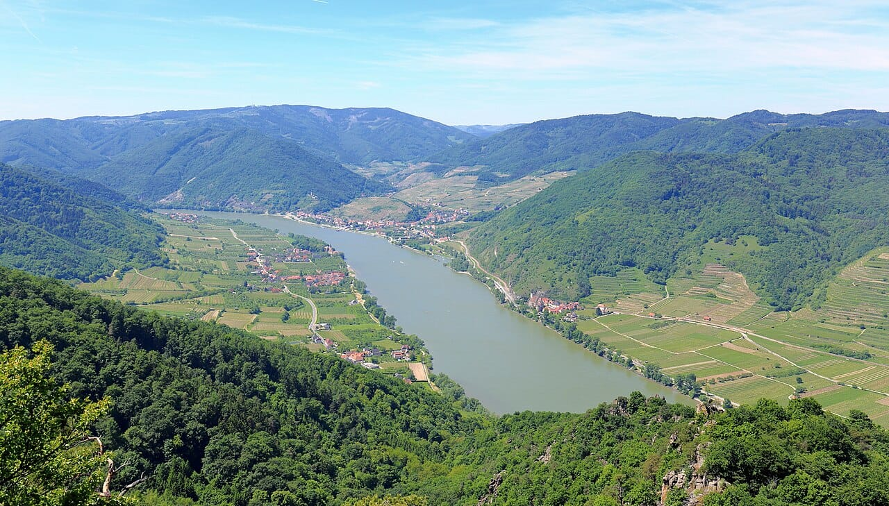
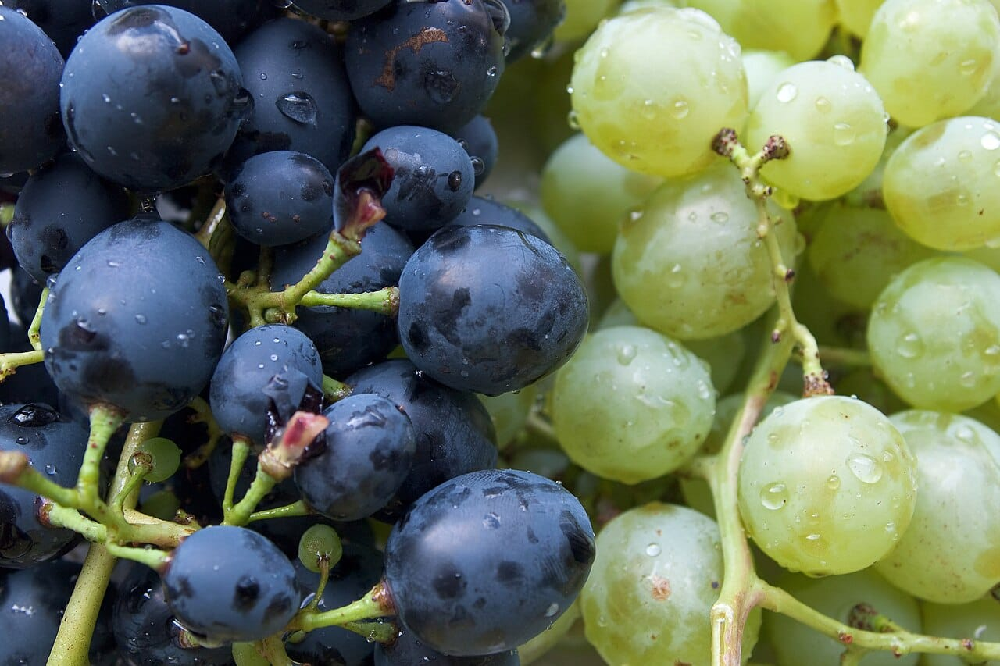

# Wachau

Wachau is a designated wine region in the Danube gorge of Lower Austria, between Melk and Krems, with about 1,340 hectares of steep terraces and dry wines from Grüner Veltliner and Riesling.

Figure: Wachau. Image: C.Stadler/Bwag, CC BY-SA 4.0, via Wikimedia Commons ([source page](https://commons.wikimedia.org/wiki/File:Wachau_(2).JPG)).

## Definition and scope

Wachau is a protected designation of origin. Grapes must come from the demarcated terraces on both banks of the Danube and be vinified inside the region. The area is long and narrow, and the vineyards sit on the steep slopes and terraces of the valley sides.

From the 2020 vintage Wachau became a Wachau DAC and may label the region, a village and a site under DAC rules. Red and rosé account for a very small share, and white wine dominates.

## History

Viticulture in the Wachau is closely tied to the monasteries along the Danube, and the medieval buildings of Melk Abbey and the Dürnstein area form the historical frame of the region. Stone-walled terraces on the steep slopes were built up over centuries and created today's landscape.

In 1983 local estates founded the Vinea Wachau association and established the three style names Steinfeder, Federspiel and Smaragd to separate dry wines of different alcohol and body. In 2000 the Wachau cultural landscape was inscribed as a UNESCO World Heritage site, and from the 2020 vintage the region obtained DAC status.

## Geography and climate

The Wachau is a gorge cut by the Danube through crystalline rock, with a narrow valley and steep slopes. Vineyards mostly face south or south-east; the river reflects light and heat, night winds bring cold air down the slopes, and the day-night difference helps retain acidity.

The climate is cool continental, with a long growing season, slow ripening and a dry autumn. Crystalline rock, namely gneiss, granite and schist, is the main soil; weathered, it drains well and holds heat. Some terraces are covered with loess, which holds water and fertility better.

Slopes often exceed 30%, some sites are steeper still, and machinery can barely enter. Stone terraces are maintained by hand, which is the structural reason for high cost and low yield.

## Danube terraces and sites

Wachau vineyards are mainly terraces (Terrassen) and steep sites, and a Ried name on the label refers to a specific site.

- West, around Spitz and Aggsbach, with gentler slopes and a higher share of loess.
- Centre, Weißenkirchen, Joching and Wösendorf, with dense terraces and the core of Grüner Veltliner and Riesling.
- East, Dürnstein and the Krems area, with steep slopes and exposed crystalline rock where Riesling performs well.
- Side valleys on both banks, cooler and later ripening.

A site name is a geographic description, not a ranking. Within one village, differences between sites are often larger than differences between villages.

## Varieties and raw material

Grüner Veltliner and Riesling are the two leading varieties. Grüner Veltliner is fuller, with pepper, citrus and legume notes; Riesling is leaner, with high acidity and clear mineral character.

Other white grapes include Neuburger, Weißburgunder, Chardonnay, Gelber Muskateller and Sauvignon Blanc, in small areas. Red grapes include small plantings of Zweigelt, Blaufränkisch and Pinot Noir, mostly for local consumption. The raw material is [grape](ref:grape).

## Winemaking

White grapes are pressed, clarified and [fermented](ref:fermentation) at low temperature to preserve aroma and [acidity](ref:acidity). Tradition uses large old oak casks, while modern estates use temperature-controlled stainless steel, and some wines gain texture from lees contact.

Most wines avoid malolactic fermentation in order to keep acidity sharp. Smaragd often gets longer lees contact and later bottling to add structure. [Oak](ref:oak-ageing) here is mainly a container, not a flavour source.

## DAC and the three styles

Austrian wine is divided into Wein, Landwein, Qualitätswein and Prädikatswein. DAC, Districtus Austriae Controllatus, is a quality category built on a designated region with stricter rules on varieties and style; Wachau has applied Wachau DAC since the 2020 vintage.

Wachau DAC uses a hierarchy of origin, namely Gebietswein at regional level, Ortswein at village level and Riedenwein at single-site level. The level describes the extent of origin, not quality.

Steinfeder, Federspiel and Smaragd are traditional style marks registered by the Vinea Wachau association. They are defined by finished alcohol and are all dry.

- Steinfeder, up to 11.5% vol, the lightest and meant for early drinking.
- Federspiel, 11.5–12.5% vol, balancing freshness and structure, the mainstay of volume and export.
- Smaragd, at least 12.5% vol, the ripest and most structured, capable of ageing.

These three names are not national Prädikat grades and are not the same as the DAC hierarchy of origin. They describe style and alcohol, and a label may carry DAC and Ried information at the same time.

## Labels and serving

The label should be checked for Wachau DAC, the Ried site name, variety, vintage, alcohol, volume and bottler. A wine labelled as a single variety must be made from that variety as a [single-varietal](ref:single-varietal) wine; blends must list the varieties under the rules.

Steinfeder is served at about 8–10 degrees Celsius, Federspiel and Smaragd at about 10–12 degrees Celsius. Grüner Veltliner suits pork, poultry, river fish and Asian food; Riesling suits seafood, fried food and dishes with higher acidity. Refrigerate after opening and finish soon. Excessive drinking harms health and minors should not drink.

## Common misconceptions

First, taking Smaragd for a grape variety. It is a Vinea Wachau style level, not a variety name.
Second, assuming Steinfeder is sweet. All three styles are dry, and the difference lies in alcohol and ripeness.
Third, conflating Wachau DAC with the three Vinea styles. The first is a nationally recognised hierarchy of origin, the second is an association's registered style mark.
Fourth, thinking the Wachau grows only Grüner Veltliner. Riesling is equally important on steep crystalline sites.
Fifth, treating the terraces as a natural given. Stone terraces need continuous manual maintenance and are a direct cause of cost and yield.

[Wine](ref:wine) and [Grape](ref:grape) answer different questions about Wachau: geographic boundary and climate and soil. Read them as a pair, not as alternatives.

**In brief:** A designated wine region in the Danube gorge of Lower Austria between Melk and Krems, with about 1,340 hectares of steep terraces and dry Grüner Veltliner and Riesling from crystalline rock and loess; a Wachau DAC since the 2020 vintage, plus the Steinfeder, Federspiel and Smaragd style marks that the Vinea Wachau association has used since 1983 and defines by finished alcohol at up to 11.5% vol, 11.5–12.5% vol and at least 12.5% vol.

**Key facts.**

| Item | Detail |
| --- | --- |
| In one line | A designated wine region in the Danube gorge of Lower Austria between Melk and Krems, with about 1,340 hectares of steep terraces and dry Grüner Veltliner and Riesling from crystalline rock and loess; a Wachau DAC since … |
| Level | other |
| Country code | AT |

**Sources and limits.** The key claims about Wachau are checked against the following sources: Bundesministerium für Land- und Forstwirtschaft, Regionen und Wasserwirtschaft (the 1,344 hectares of vineyard, the steep terraces and the main varieties), Vinea Wachau Nobilis Districtus (the alcohol ranges of Steinfeder, Federspiel and Smaragd), BMLUK (Migrated from the former reference list at the end of the article; access date not re-verified) and 4 sources in total. Prices, batches and status change; the body is project-written and does not reproduce source text.

## Further reading

- [Wine](ref:wine): an overview of wine categories, vintages and origin rules.
- [White wine](ref:white-wine): the category to which the main Wachau style belongs.
- [Grape](ref:grape): the structure of wine grapes and ripeness measures.
- [Fermentation](ref:fermentation): the difference between low-temperature fermentation and malolactic fermentation.
- [Acidity](ref:acidity): the source and role of high acidity in dry Wachau wine.
- [Alcohol by volume](ref:abv): what dividing the three styles by alcohol means.
- [Oak ageing](ref:oak-ageing): the role of large casks in Wachau white wine.
- [Single varietal](ref:single-varietal): the concept behind variety labelling.

## Related images

Image: Grape. Credit: Vyacheslav Argenberg, CC BY 4.0, via Wikimedia Commons ([source page](https://commons.wikimedia.org/wiki/File:Grapes,_Rostov-on-Don,_Russia.jpg)). Related image for Wachau.

Image: Fermentation. Credit: Tjhackmann, CC BY-SA 4.0, via Wikimedia Commons ([source page](https://commons.wikimedia.org/wiki/File:Phylogenetic_tree_of_bacteria_and_archaea,_highlighting_those_that_carry_out_fermentation.png)). Related image for Wachau.
