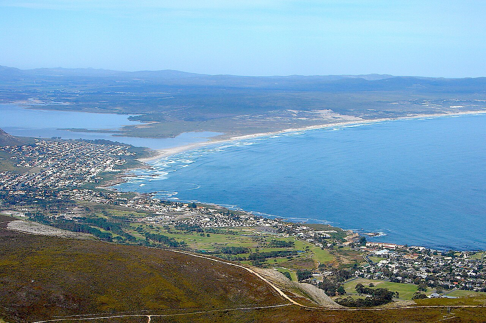

# Walker Bay

Walker Bay is a cool-climate wine district on South Africa's southern coast, around the seaside town of Hermanus, best known for the Pinot Noir and Chardonnay of the Hemel-en-Aarde valley. Its style comes from the interaction of ocean and mountain rather than from a single variety label.

Figure: Walker Bay. Image: Olga Ernst, CC BY-SA 4.0, via Wikimedia Commons ([source page](https://commons.wikimedia.org/wiki/File:Coastline_of_Walker_Bay_(South_Africa).jpg)).

## Definition and scope

Walker Bay is a district in the Cape South Coast region of the Western Cape, east of Cape Town and around Hermanus. Walker Bay itself is the bay on the Indian Ocean side, and the district runs from the coast inland to the mountains. Under Wine of Origin, Walker Bay contains four wards: Hemel-en-Aarde Ridge, Hemel-en-Aarde Valley, Upper Hemel-en-Aarde Valley and Bot River.

The 2024 SAWIS statistics report the whole Cape South Coast region at 2,671 hectares, or 3.09% of the national wine-grape area. That figure covers Elgin, Walker Bay, Cape Agulhas, Overberg and Plettenberg Bay among others, and the official statistics do not break out Walker Bay on its own. The district is small and has fewer producers than Stellenbosch or Paarl.

## History

Before the 1970s, the land around Walker Bay was mainly grain, livestock and a coastal town, with limited vine planting. In 1975, Tim Hamilton Russell bought 170 hectares of undeveloped land in Hemel-en-Aarde in search of the most southerly cool-climate site in South Africa; vines were planted in 1976 and the first vintage followed in 1981. Pinot Noir and Chardonnay gradually built a reputation in the valley.

Anthony Hamilton Russell took over in 1991 and bought the property from the family in 1994, narrowing the range to Pinot Noir and Chardonnay. More producers followed into the valley, and Wine of Origin ward boundaries were drawn as plantings expanded. Hemel-en-Aarde means heaven and earth, and it is one of the district's most recognisable place names.

## Geography and climate

Walker Bay lies near the southern tip of Africa and is influenced by the cold Benguela Current, which keeps sea temperatures low and makes the coast cooler than inland areas at the same latitude. In summer, south-easterly winds from the ocean move up the valleys, bringing cooling and dry air; in winter the westerlies bring more rain. The mountains block some inland heat, giving the Hemel-en-Aarde valley a relatively distinct mesoclimate.

Altitude and aspect create clear differences. Valley floors and lower slopes are warmer and suit earlier-ripening Chardonnay; higher sites near the mountains are cooler and ripen later, giving Pinot Noir finer acidity and aroma. Sites close to the bay are more exposed to sea fog and wind, and require extra canopy and disease management.

Soils are mainly Bokkeveld shale, commonly the Glen Rosa and Klapmuts forms, with clay and good water retention; Upper Hemel-en-Aarde Valley also has decomposed granite, which is sandier; Table Mountain sandstone appears on higher slopes and ridges, draining faster and holding less fertility. The distribution of shale, granite and sandstone shapes rooting depth, water supply and ripening, and forms the basis of the [terroir](ref:terroir).

## Wards

The four wards cover different landforms and climates, but all are origin boundaries rather than a quality ranking:

- Hemel-en-Aarde Valley: the lower valley, with a higher share of shale and clay, where the district first built its reputation and both Chardonnay and Pinot Noir can reach good ripeness.
- Upper Hemel-en-Aarde Valley: higher up the valley, with decomposed granite and shale clay, giving tighter wines with clearer acidity.
- Hemel-en-Aarde Ridge: the highest and most inland of the three, with stony clay and shale soils and the latest ripening; known for finely structured Pinot Noir and Chardonnay.
- Bot River: the western gateway to Walker Bay, around the Bot River village and lagoon, with Bokkeveld shale and Table Mountain sandstone; influenced by the lagoon and sea breezes, it suits Chenin Blanc, Sauvignon Blanc, Pinotage, Syrah and other Rhone varieties.

A ward may be named on its own, but a more specific name only means a smaller area, not a higher quality.

## Varieties and raw materials

Pinot Noir and Chardonnay are the core varieties of Walker Bay, especially in the three Hemel-en-Aarde wards. Pinot Noir often shows red cherry, raspberry, spice and earth, with fine tannin and high acidity; Chardonnay shows citrus, white flowers, nuts and mineral notes, and some wines see oak and lees. Sauvignon Blanc performs well on cooler sites, while Pinotage and Syrah are also planted around Bot River.

The cool climate slows ripening, so sugar accumulation and acid loss do not move together, and the picking window is narrow. The raw material is the [grape](ref:grape). The same variety can ripen very differently between wards, and producers usually pick in several passes to keep acidity and aromatic layers.

## Winemaking

Pinot Noir is often partly whole-bunch fermented, with gentle punch-downs or pump-overs to avoid over-extraction, then aged in French [oak](ref:oak-ageing), with the share of new barrels set by the producer's style. Chardonnay is gently pressed and partly fermented in oak with lees stirring and malolactic fermentation to add texture and complexity; fresher styles use stainless steel or large barrels and avoid obvious oak.

Sauvignon Blanc is usually fermented cool to preserve aroma; Pinotage often has a shorter maceration to keep fruit, while structured versions macerate longer and age in old oak; Syrah varies in whole-bunch share by site, from pepper and blackberry to riper, fuller fruit. Acidity is central to the district's style, and winemaking usually avoids excessive deacidification or clarification.

## Rules and labelling

Walker Bay labelling follows South Africa's Wine of Origin scheme. A wine labelled Walker Bay or with a ward name must use 100% of its grapes from that origin; when a variety or vintage is named, the relevant component must reach at least 85%. Certified wines may carry the Wine of Origin seal.

Wine of Origin is an origin and certification system, not a quality hierarchy. Walker Bay, Hemel-en-Aarde Valley and Hemel-en-Aarde Ridge are legal place names covering different areas; Hemel-en-Aarde is not a producer brand and does not stand for one fixed style. Region names, estate names and brand names sit at different levels.

## Labels and drinking

Check the region name, any ward name, the variety, [vintage](ref:vintage), [alcohol by volume](ref:abv), volume and bottler. A wine labelled as a [single variety](ref:single-varietal) must contain at least 85% of that variety; blends must list their varieties under the rules. The Wine of Origin seal confirms certification, not quality.

Serve Pinot Noir at 14-16 C, Chardonnay at 10-12 C, Sauvignon Blanc at 8-10 C and Syrah at 16-18 C. Pinot Noir suits poultry, mushrooms and light red meat; Chardonnay suits seafood, white meat and creamy dishes; Sauvignon Blanc suits seafood and salads. Chill after opening and finish promptly. Excessive drinking is harmful to health, and minors should not drink.

## Common misconceptions

First, that Walker Bay is a ward. It is a district containing four wards.
Second, that Hemel-en-Aarde is a brand. It is part of legal ward names, not a producer trademark.
Third, that a cool district cannot make full-bodied wine. Coolness shapes ripening and acidity; body still depends on vintage, site and winemaking.
Fourth, that Walker Bay only makes Pinot Noir and Chardonnay. Chenin Blanc, Sauvignon Blanc, Pinotage and Syrah are also important around Bot River.
Fifth, that the Wine of Origin seal is a quality grade. It certifies origin, variety and vintage, not quality.

## Further reading

- [Wine](ref:wine): the broad category, vintage and origin rules.
- [White wine](ref:white-wine) and [red wine](ref:red-wine): the two main categories in Walker Bay.
- [Pinot Noir](ref:pinot-noir): the core red variety of Hemel-en-Aarde.
- [Chardonnay](ref:chardonnay): the district's core white variety.
- [Sauvignon Blanc](ref:sauvignon): a white variety of Bot River and cooler sites.
- [Syrah](ref:syrah): one of the Rhone varieties of Bot River.
- [Grape](ref:grape): ripening indicators in a cool climate.
- [Fermentation](ref:fermentation): whole-bunch and barrel fermentation.
- [Acidity](ref:acidity): how cool climates retain acidity.
- [Terroir](ref:terroir): shale, sandstone and sea wind as sources of ward difference.
- [Oak ageing](ref:oak-ageing): oak choices for Pinot Noir and Chardonnay.
- [Dry](ref:dry): the dry style of the district's whites.
- [Vintage](ref:vintage): vintage variation in a cool district.
- [Single variety](ref:single-varietal): the 85% labelling rule.
- [Alcohol by volume](ref:abv): what % vol means on a label.

## Related images

Image: Syrah Grapes on the Vine. Credit: U.S. Geological Survey, CC0, via Wikimedia Commons.. Credit: U.S. Geological Survey, CC0, via Wikimedia Commons ([source page](https://commons.wikimedia.org/w/index.php?curid=114429512)). Related image for Walker Bay.

Image: Pinot Noir. Credit: Cjp24, Public domain, via Wikimedia Commons ([source page](https://commons.wikimedia.org/wiki/File:Grape_near_Sancerre.jpg)). Related image for Walker Bay.
