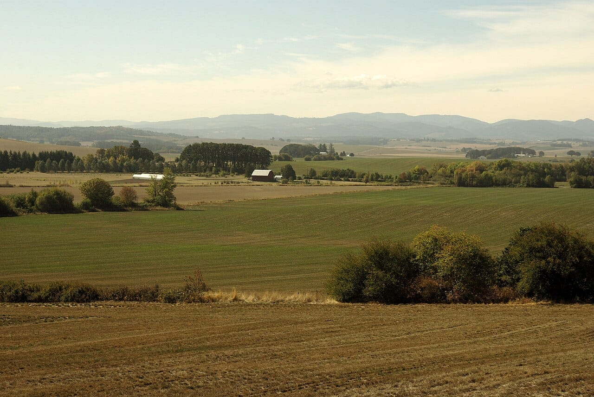
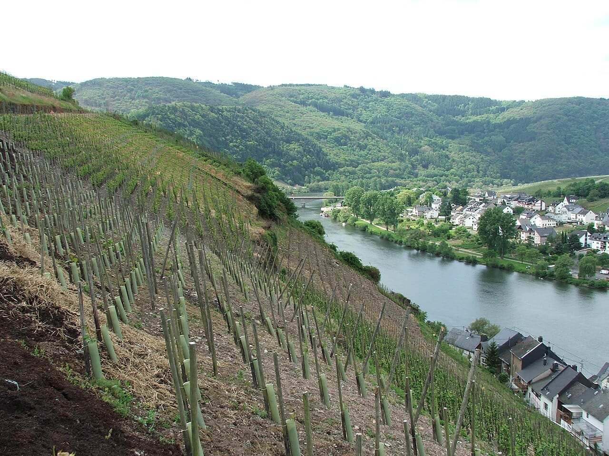

# Willamette Valley

Willamette Valley is Oregon's leading wine region, known for Pinot Noir in a cool climate and often described as the American region closest in style to Burgundy.

Figure: Willamette Valley. Image: Rvannatta ( talk · contribs ) Image edits: Peteforsyth ( talk · contribs ), CC BY-SA 3.0, via Wikimedia Commons ([source page](https://commons.wikimedia.org/wiki/File:Wvatbethel1.jpg)).

## Definition and scope

Willamette Valley is a wine region in north-west Oregon, established as an AVA in 1983. The AVA covers about 3,428,800 acres (about 1,387,600 hectares), with about 25,450 acres (about 10,300 hectares) of vineyard. The valley runs about 150 miles (240 km) north to south and is about 60 miles (97 km) wide at its widest point.

The region contains about two-thirds of Oregon's wineries and vineyards, with more than 700 wineries. The Willamette Valley AVA covers the whole valley, and inside it sit 11 nested AVAs, each defining a smaller area and climate band.

## History

In 1965 David and Diana Lett planted the first Pinot Noir in Willamette Valley, regarded as the starting point of Oregon's fine wine. Winery numbers grew through the 1970s, and the Willamette Valley AVA was approved in 1983.

Pinot Noir then became the region's signature, and nested AVAs such as Dundee Hills, Yamhill-Carlton and Eola-Amity Hills followed. Oregon's wine industry is mostly small family wineries, and about 70% of wineries produce fewer than 5,000 cases a year.

## Geography and climate

The Coast Range lies west of Willamette Valley and the Cascades to the east, and the two ranges separate the cool, wet Pacific air from the dry climate further east. The growing season is mild and long: warm summers, cool nights, a drawn-out autumn with slow early rain, and mild, wet winters.

Elevation and aspect create clear differences. The valley floor and low slopes ripen earlier, while high slopes and north-facing sites ripen later; the Van Duzer Corridor is a gap in the Coast Range that lets cold Pacific air into the valley, making the Eola-Amity Hills area cooler with a larger day-night range.

Soils fall into three main groups: marine sedimentary rock, volcanic soil and loess. Dundee Hills volcanic soil (the Jory series) drains well and holds moderate nutrients; Yamhill-Carlton is mostly marine sedimentary; Chehalem Mountains and Tualatin Hills have loess cover. Soil and aspect differences form the basis of [terroir](ref:terroir).

## Nested AVAs

The Willamette Valley AVA contains 11 nested AVAs:

- Chehalem Mountains: mountains in the north of the valley, including smaller areas such as Laurelwood District and Ribbon Ridge.
- Dundee Hills: known for volcanic soil and Pinot Noir, ripening relatively early.
- Eola-Amity Hills: cooled by Van Duzer Corridor air, with more visible acidity and structure.
- Laurelwood District: characterised by loess (laurelwood) soil.
- Lower Long Tom: a newer AVA in the south of the valley.
- McMinnville: known for marine sedimentary soil and a cooler climate.
- Mount Pisgah: a small AVA in Polk County.
- Ribbon Ridge: a separate AVA west of the Chehalem Mountains, mostly marine sedimentary soil.
- Tualatin Hills: a loess and volcanic area in the north-west of the valley.
- Van Duzer Corridor: a cool band formed by the Coast Range gap.
- Yamhill-Carlton: north-west of the valley, marine sedimentary soil, ripening earlier.

The point of nested AVAs is to make differences inside the large valley concrete, but an AVA is still a geographic name, not a quality grade.

## Varieties and raw material

Pinot Noir is the dominant variety in Willamette Valley, alongside Pinot Gris, Pinot Blanc, Chardonnay, Riesling, Melon, Gewürztraminer, Gamay and Syrah. The raw material is [grape](ref:grape).

In a cool climate Pinot Noir has thin skins and high acidity, typically showing red cherry, raspberry, rose and earth; differences between AVAs appear mainly in ripeness, acidity and tannin structure. Pinot Gris and Chardonnay are mostly used for dry whites, Riesling keeps higher acidity, and Gamay makes lighter reds.

## Winemaking

Pinot Noir usually sees partial whole-cluster or whole-berry fermentation and shorter maceration to keep fruit and aroma; fermentation is cool and some wines use native yeast. Ageing is mostly in French [oak](ref:oak-ageing) with a low share of new barrels, so fruit is not masked.

Whites [ferment](ref:fermentation) cool. Pinot Gris and Chardonnay mostly use stainless steel or old barrels, and some Chardonnay sees lees stirring; Riesling keeps residual sugar or is fully dry, depending on the winery. Sparkling wine is also made in the region, usually by the traditional method.

## AVA and labelling

For Willamette Valley, US appellations of origin are governed by 27 CFR 4.25. A wine labelled with an AVA must derive at least 85% of its volume from grapes grown inside that AVA; for a county or state appellation the figure falls to 75%. The wine must also be fully finished in the state where the labelled area lies, with limited exceptions.

Oregon adds a stricter variety rule: when a label names a variety, that variety must be at least 90% of the wine, above the federal 75%. This makes Oregon variety labels closer to a single-variety statement and raises the bar for blending.

Both AVA and variety labelling are statements about source and composition, not quality grades. The Willamette Valley AVA covers the whole valley, and nested AVAs only indicate a more specific geographic range.

## Labels and serving

The label should be checked for the AVA name, variety, [vintage](ref:vintage), [alcohol](ref:abv), volume and bottler. A wine labelled as a [single variety](ref:single-varietal) must meet Oregon's 90% rule; blends must list their varieties under the rules. Pinot Noir is served at about 14–16 degrees Celsius, Chardonnay and Pinot Gris at about 10–12 and Riesling at about 8–10.

Pinot Noir suits poultry, mushrooms, salmon and light red meat; Pinot Gris suits seafood and Asian dishes; Chardonnay suits creamy dishes. Refrigerate after opening and finish soon. Excessive drinking harms health and minors should not drink.

## Common misconceptions

First, thinking Willamette Valley grows only Pinot Noir. Pinot Noir leads, but Pinot Gris, Chardonnay, Riesling and Gamay hold steady area too.
Second, treating the Willamette Valley AVA as the whole of Oregon. Oregon also has Umpqua Valley, Rogue Valley and Columbia Gorge.
Third, treating nested AVAs as quality grades. They are more specific geographic ranges and do not judge wine quality.
Fourth, assuming Oregon's variety rule matches the federal one. Oregon requires 90%, the federal rule 75%.
Fifth, thinking a cool climate means under-ripeness. Willamette Valley relies on a long growing season and slow autumn ripening, vintages differ clearly, and late years demand strict fruit selection.

**At a glance:** Willamette Valley wine region in north-west Oregon, established as an AVA in 1983. The AVA covers about 3,428,800 acres (1,387,600 hectares), with 25,450 acres (10,300 hectares) of vineyard and about two-thirds of Oregon's wineries. The Coast Range and Cascades shelter a mild, long growing season; soils are marine sedimentary, volcanic and loess. Pinot Noir dominates, first planted in 1965, alongside Pinot Gris, Chardonnay and Riesling. There are 11 nested AVAs, and Oregon requires 90% for a variety label against the federal 75%. 

Read Willamette Valley through the appellation and its permitted varieties, then the vintage and the producer, and finally how the wine is labelled. The sequence matters.

Put [Wine](ref:wine)'s geographic boundary next to [Red wine](ref:red-wine)'s climate and soil; the difference marks the boundary.

**Key facts.**

| Item | Detail |
| --- | --- |
| In one line | Willamette Valley wine region in north-west Oregon, established as an AVA in 1983. The AVA covers about 3,428,800 acres (1,387,600 hectares), with 25,450 acres (10,300 hectares) of vineyard and about two-thirds of Oregon… |
| Level | other |
| Parent | United States |
| Country code | US |

**Sources and limits.** The key claims about Willamette Valley are checked against the following sources: Oregon Wine Board (the AVA year, area, vineyard area, nested AVA list and descriptions of climate and soils; the first Pinot Noir planting and Oregon's 90% variety-labelling rule against the federal 75% rule), Electronic Code of Federal Regulations (TTB) (the 85% origin rule for AVAs and the 75% rule for county and state appellations), OIV (the entry's background, terminology and regulatory context). Prices, batches and status change; the body is project-written and does not reproduce source text.

## Further reading

- [Wine](ref:wine): an overview of wine categories, vintages and origin rules.
- [Red wine](ref:red-wine) and [white wine](ref:white-wine): the two main categories in Willamette Valley.
- [Grape](ref:grape): the structure of wine grapes and ripeness measures.
- [Fermentation](ref:fermentation): the difference between Pinot Noir and white fermentation.
- [Acidity](ref:acidity): how a cool climate and the day-night range affect acidity.
- [Terroir](ref:terroir): how marine sediment, volcanic soil and loess create AVA differences.
- [Oak ageing](ref:oak-ageing): old barrels and low new-oak shares for Pinot Noir.
- [Dry](ref:dry): the dry positioning of Willamette Valley whites.
- [Vintage](ref:vintage): vintage variation and autumn rain in Willamette Valley.
- [Single varietal](ref:single-varietal): the concept behind variety labelling.
- [Alcohol by volume](ref:abv): what % vol means on a label.

## Related images

Image: Acidity. Credit: Chemicalinterest, Public domain, via Wikimedia Commons ([source page](https://commons.wikimedia.org/wiki/File:Zn_reaction_with_HCl.JPG)). Related image for Willamette Valley.

Image: Terroir. Credit: Friedrich Petersdorff, CC BY-SA 2.0 de, via Wikimedia Commons ([source page](https://commons.wikimedia.org/wiki/File:080110_zell_mosel.JPG)). Related image for Willamette Valley.
