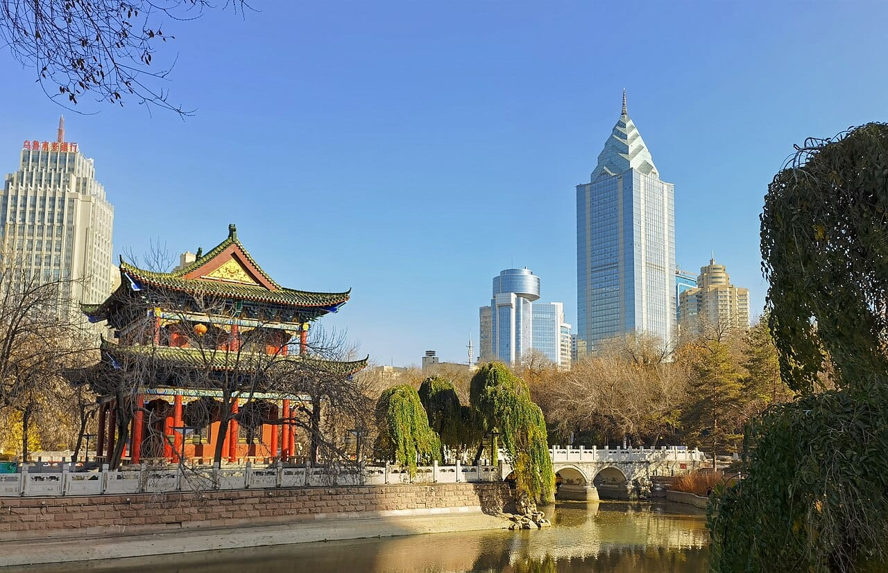

# Xinjiang

Xinjiang lies in north-western China and is one of the country's largest provincial-level grape-growing areas, as well as a key raw-material base for domestic [wine](ref:wine). Wine grapes are concentrated on the northern Tianshan foothills, in the Ili valley and in the Yanqi basin, while traditional grape districts such as Turpan are dominated by raisins and table grapes. Compared with eastern regions, Xinjiang's wine industry is led more by large companies and grape-supply bases.

Figure: Xinjiang. Image: HaziiDozen, CC BY-SA 4.0, via Wikimedia Commons ([source page](https://commons.wikimedia.org/wiki/File:%E4%B9%8C%E9%B2%81%E6%9C%A8%E9%BD%90%E4%BA%BA%E6%B0%91%E5%85%AC%E5%9B%AD%E5%B0%81%E9%9D%A2.jpg)).

## Geography and climate

Xinjiang sits deep inland and has a temperate continental arid climate: low rainfall, high evaporation, long sunshine hours and marked day-night temperature swings. Hot days and cool nights in summer favour sugar accumulation while helping keep acidity in balance, and dry air keeps fungal pressure far below that of humid regions, so most years need little spraying.

The cost is that irrigation is essential. Vineyards generally depend on drip systems and wells or canals, and water allocation directly sets how much land can be planted. Winters in the north are severe, so vines must be buried for winter protection, a task that consumes much manual labour each year and constrains the choice of training system.

Soils are mostly gravel, sandy loam and grey desert soil, well drained and quick to warm. The alluvial fans of the northern Tianshan have deep profiles, while the Yanqi basin combines lake sediments and gravelly soils near Bosten Lake.

## Main sub-regions

- Northern Tianshan foothills: a belt running through Changji, Hutubi, Manas, Shihezi and Wusu, the most concentrated wine-grape area in Xinjiang and home to many large wine businesses and grape bases.
- Ili valley: a valley opening westward, relatively mild and moist, suited to early and mid-ripening varieties and an unusual cooler pocket within Xinjiang.
- Yanqi basin: around Yanqi Hui Autonomous County in Bayingolin Prefecture, at about 1000–1200 metres, with Bosten Lake moderating temperatures; the main wine-grape area of southern Xinjiang.
- Turpan and Hami: known for table and drying grapes, with a small share of wine grapes.

There is no unified legal hierarchy among these sub-regions; the industry mostly divides them by geographical belt and company base.

## Varieties and styles

[Cabernet Sauvignon](ref:cabernet-sauvignon) is the most widely planted wine variety in Xinjiang, reaching high ripeness with ample tannin and often used for structured [red wine](ref:red-wine); [Merlot](ref:merlot) softens blends and early-drinking products; [Chardonnay](ref:chardonnay) is the main white variety, used for [white wine](ref:white-wine). Syrah, Cabernet Gernischt and a few minor varieties are also planted.

Aridity and strong sun push sugar up quickly and leave a narrow picking window. In the cellar, early picking, yield control and moderate [oak](ref:oak-ageing) are common ways to balance alcohol with freshness, and temperature control during [fermentation](ref:fermentation) is especially important for preserving fruit.

The overall style is ripe and fruit-forward with relatively high alcohol; in recent years some wineries have moved toward fresher, tighter wines by lowering yields, using higher ground and adjusting picking dates.

## Industry and regulation

The basic definition, categories and labelling requirements for wine follow the national standard GB/T 15037. Some Xinjiang sub-regions have registered geographical indication products; the exact names and protected areas follow the competent authority's announcements.

A defining feature of the industry is the separation of grape base and brand: much of the fruit comes from growers or bases supplying wine companies, and the share of estate-owned vineyard is low. Long transport distances, the cost of winter vine burial and water scarcity are three long-term factors in Xinjiang's cost structure. The number of boutique wineries has grown, but large-scale production still dominates.

## Representative wines and producers

- CITIC Guoan Wine: based around Manas, one of the larger wine producers in Xinjiang, with products across several price bands.
- Xiangdu Wine: based in the Yanqi basin, one of the earlier southern Xinjiang businesses to build its own vineyards and winery.
- The northern Tianshan grape bases: supplying bulk wine and private-label products to several domestic brands, and key to understanding Xinjiang's role in the industry.

## Common misconceptions

First, equating Xinjiang with "Turpan grapes". Turpan is dominated by table and drying grapes, while wine grapes have other main districts.
Second, assuming an arid region needs no disease control. Dry air lowers fungal pressure, but humidity from irrigation and local microclimates still need management.
Third, thinking strong sun automatically means good sweetness. High sugar is not high quality, and acidity and tannin ripeness matter just as much.
Fourth, treating all Xinjiang wine as cheap bulk wine. The region also has boutique wineries pursuing yield control and site expression.
Fifth, ignoring the cost of winter vine burial. It directly affects planting costs and sustainability in Xinjiang.

Xinjiang’s vineyards are concentrated around the northern Tianshan foothills, the Ili valley and the Yanqi basin. A continental arid climate brings strong sunlight and wide day-night temperature swings; gravelly soils, drip irrigation and winter burial are common. Cabernet and other international varieties dominate, and the region is also a major raw-material base. It is too large to be treated as one style; subregion, altitude and producer matter.

**Short definition:** A wine region in north-western China centred on the northern Tianshan foothills, the Ili valley and the Yanqi basin; a temperate continental arid climate brings strong sun and wide day-night swings, and gravelly soils with drip irrigation and winter vine burial define local viticulture, with Cabernet Sauvignon and other international varieties dominant in China's key grape base.

Xinjiang is best approached through the appellation and its permitted varieties, then the vintage and the producer, and then how the wine is labelled. One check alone will not settle it.

The comparison with [China](ref:china) and [Merlot](ref:merlot) runs through geographic boundary and climate and soil. Each answers a different question.

**Key facts.**

| Item | Detail |
| --- | --- |
| In one line | A wine region in north-western China centred on the northern Tianshan foothills, the Ili valley and the Yanqi basin; a temperate continental arid climate brings strong sun and wide day-night swings, and gravelly soils wi… |
| Level | province or region |
| Parent | China |
| Country code | CN |

**Sources and limits.** The key claims about Xinjiang are checked against the following sources: People's Government of Xinjiang Uygur Autonomous Region (Used to check the region's administrative divisions, climate and agriculture), OIV (Used to check China's vineyard area and global wine production figures), Standardization Administration of China (Used to check the definition, categories and basic labelling requirements for wine) and 5 sources in total. Prices, batches and status change; the body is project-written and does not reproduce source text.

## Further reading

- [China](ref:china): the national framework to which Xinjiang belongs.
- [Cabernet Sauvignon](ref:cabernet-sauvignon), [Merlot](ref:merlot) and [Chardonnay](ref:chardonnay): the main wine varieties of Xinjiang.
- [Red wine](ref:red-wine) and [white wine](ref:white-wine): the two main product types.
- [Wine](ref:wine): an overview of wine categories and origin rules.
- [Fermentation](ref:fermentation) and [oak ageing](ref:oak-ageing): key processes behind Xinjiang style.

## Related images

Image: Category image for China. Credit: Gary Todd, CC0, via Wikimedia Commons ([source page](https://commons.wikimedia.org/wiki/File:Shang_Bronze_Gu,_Jue,_%26_Jia_Wine_Vessels.jpg)). Related image for Xinjiang.

Image: Chardonnay. Credit: Jenavive at English Wikipedia, Public domain, via Wikimedia Commons ([source page](https://commons.wikimedia.org/wiki/File:Chardonnay.jpg)). Related image for Xinjiang.
