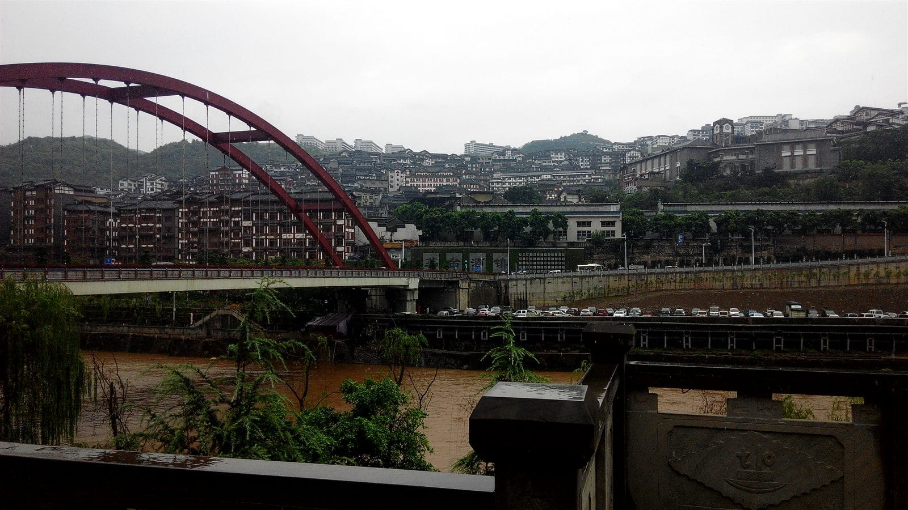

# Xishui County

Xishui County belongs to Zunyi in Guizhou and lies in the north of the province, west of Zunyi, at the junction of northern Guizhou, southern Sichuan and western Chongqing. Tongzi and Qijiang in Chongqing border it to the east; Chishui to the west; Renhuai and Gulin in Sichuan to the south; and Hejiang in Sichuan to the north. The official profile gives an area of 3,128 square kilometres, 26 township-level units and a total population of about 800,000. A separate county government page lists 4 subdistricts, 20 towns, 2 townships and 257 villages or communities. The difference reflects the statistical date and classification method; cite the version being used.

Image: a Xijiu bottle, used to identify the brand's visual identity; it is not a panorama of Xijiu Town or the distillery. Photo: Lhzss8, CC BY-SA 4.0, via Wikimedia Commons ([source page](https://commons.wikimedia.org/wiki/File:%E4%B8%80%E6%AC%BE%E4%B9%A0%E9%85%92.jpg)).

## Location and access

Xishui's geographic keyword is transition. It sits on the slope where the Yunnan–Guizhou Plateau descends toward the Sichuan Basin; the land falls from east to west, and elevation varies greatly from river valley to mountain. The Chishui River cuts through the western part of the county in a deep gorge, while the rest is a mosaic of mountains, terraces and smaller valleys. Official material calls Xishui a “green oasis and red city”: green for its forests and ecology, red for the Four Crossings of the Chishui River.

Roads provide the main access. The Rongzun, Jiangxigu and Zhengxi expressways form the principal corridors, making entry from Zunyi, Chongqing and Luzhou relatively convenient. The county has no civil airport, and rail is not the primary mode of arrival. Bus schedules, departure points and expressway conditions change; check transport-authority and bus-station information on the day of travel.

Xishui Town, the county seat, Xijiu Town and Tucheng are in three different directions. On a map they may look close, but the route has to follow valleys and ridges, and fog and rain can lengthen the drive substantially. Approaching from [Gulin](ref:gulin) or [Luzhou](ref:luzhou) across the provincial border changes road quality and bus frequency; do not apply big-city commuting assumptions.

## Industry and production area

Xishui's central liquor landmark is Xijiu Town and [Xijiu](ref:xijiu). The Guizhou Xijiu headquarters stands on the middle Chishui River in the northern Guizhou highlands, near the Erlangtan ferry associated with the Red Army's four crossings. The company's public history traces its predecessor to a baijiu workshop of the Yin family during the Ming Wanli period; it was consolidated into a state-owned enterprise through an acquisition in 1952, joined the Moutai group in 1998, and was reorganised as Guizhou Xijiu Co., Ltd. in 2022. Those dates and ownership changes are the basis for understanding the relationship between the brand and the production area.

Xishui belongs to the [sauce-aroma baijiu](ref:sauce) belt of the Chishui River. Compared with [Maotai Town](ref:maotai) downstream and [Gulin](ref:gulin) across the river, Xishui occupies the middle reaches, with its own valley elevation, summer humidity and raw-material transport conditions. It is correct to think of the Chishui as a continuous sauce-aroma corridor, but the microclimates, company systems and product styles within that corridor are not identical.

Xijiu is not the only producer in Xishui. The county also has supporting industries around fermentation, qu making, packaging, printing, logistics and sorghum growing. Official material lists baijiu as one of the leading industries alongside coal, power, building materials and packaging. That structure shows that Xishui's liquor economy is not an isolated factory compound but part of a county economy supported by energy, transport and agriculture.

## Flavour and craft

The public process of [sauce-aroma baijiu](ref:sauce) is “qu making at Dragon Boat Festival, grain addition at Double Ninth, nine steamings, eight fermentations and seven draws”. Xishui lies in the Chishui valley, where summer temperatures and humidity are high and the microbial activity of qu making and stacked fermentation is vigorous. Workshops manage temperature through cooling, ventilation and turning the fermenting grain to avoid overheating or a stalled fermentation. Winters in the valley are comparatively mild, but mountain townships have a wider temperature range, and raw materials and base liquor need separate storage management.

Xijiu's product range spans different prices and vintages, and its style is often described as a prominent sauce aroma with a mellow, layered body and a long finish. Specific products differ noticeably in aroma, acidity, sweetness and bitterness; one phrase cannot cover the range. Differences between round liquors, the age structure of base liquor and the blending ratio are what determine the final style.

For an ordinary drinker, start with three questions: is the aroma clean, is the entry balanced, and is there a persistent finish? Drink from a small cup, smell the empty cup first, then sip. Do not judge sauce aroma through large banquet toasts. To understand the strong-aroma alternative, read [strong-aroma baijiu](ref:strong) and [baijiu](ref:baijiu), but do not let an aroma category stand in for a specific product.

## Visiting and itineraries

Xishui has two useful visitor lines: liquor and history. The liquor line centres on Xijiu Town, the Chishui valley, the townscape and the exterior of the distillery. Whether a site is open, how to book and which areas may be photographed depend on company notices and local rules. A working distillery is not an ordinary scenic area; visitors should not enter production halls on their own, and care is needed near traffic and rockfall when photographing the valley road.

The history line centres on Tucheng. Tucheng was an important site in the Red Army's four crossings of the Chishui River, and the town preserves old streets, ferry points and memorial spaces. Visitors should keep a quiet, respectful manner; a memorial is not an ordinary photo stop. Xishui's official profile treats the Four Crossings as a core part of the city's memory, and understanding that history explains why the county calls itself a “red city” more than a distillery visit alone does.

A sensible two-day route is to enter Xishui from Zunyi or Chongqing on the first day, visit Xijiu Town and its river valley in the afternoon, then return to the county seat or stay nearby. On the second morning, visit Tucheng, then leave by the same road or toward Luzhou. With only one day, choose either the liquor line or the history line; do not backtrack repeatedly on mountain roads.

## Food and seasons

Xishui's food sits at the junction of northern Guizhou and southern Sichuan: mutton rice noodles, tofu pudding, cured meat, fermented chilli and wild mountain vegetables are common. With sauce-aroma baijiu, savoury, fermented and moderately oily dishes support the body better than heavy chilli, which can mask the finer aromas. At an ordinary meal, a small amount is enough; there is no need to prove expertise through forced drinking.

Spring and autumn suit Xijiu Town and Tucheng. Summer is hot and humid in the valley, with a higher risk of heavy rain and flash floods. Winter is damp and cold in the mountains, with a large diurnal range. Fog along the Chishui valley reduces visibility, so drivers should allow extra time and avoid unfamiliar mountain roads at night.

## Common misconceptions

First, Xishui is not only “the place where Xijiu is made”. It also has Tucheng Old Town, the Four Crossings history and mountain ecology; the county deserves a full day.

Second, Xijiu and Moutai are not the same company. They share a historical connection, but their current corporate systems, brands and production locations differ.

Third, “Chishui River sauce aroma” is not one flavour. The middle reaches, the lower reaches and the opposite bank differ in microclimate, raw materials and blending style.

Fourth, do not estimate the distance from Xishui to Xijiu Town or Tucheng using plain-city experience. Mountain roads and fog can add substantially to the drive; itineraries need buffers.

## Further reading

- For the shared language of sauce aroma, read [sauce-aroma baijiu](ref:sauce).
- To place Xishui within Zunyi and Guizhou, read [Zunyi](ref:zunyi) and [Guizhou](ref:guizhou); for the other bank, read [Gulin](ref:gulin) and [Luzhou](ref:luzhou).
- To compare the Maotai and Xijiu town positions, read [Maotai Town](ref:maotai); for the strong-aroma route, read [strong-aroma baijiu](ref:strong).
- For the national picture of liquor geography, read [China](ref:china) and [baijiu](ref:baijiu).

## Related images

Image: The Chishui River valley at Maotai Town, used to show the river landscape; not Erlang Town in Gulin or a Langjiu factory view. Credit: Wahsaw, CC0, via Wikimedia Commons ([source page](https://commons.wikimedia.org/wiki/File:Chishui_River_Bank_in_Maotai%28Moutai%29_Town%2C_Renhuai_City%2C_Zunyi%2C_Guizhou.jpg)). Related image for Xishui County.

Image: Related photograph of Maotai Distillery (Kweichow Moutai). Credit: Jula2812, CC BY-SA 4.0, via Wikimedia Commons ([source page](https://commons.wikimedia.org/wiki/File:Maotai_-_Kweichow_Moutai_Distillery_China,_Flasche_Etikett_Detail_(2).jpg)). Related image for Xishui County.
