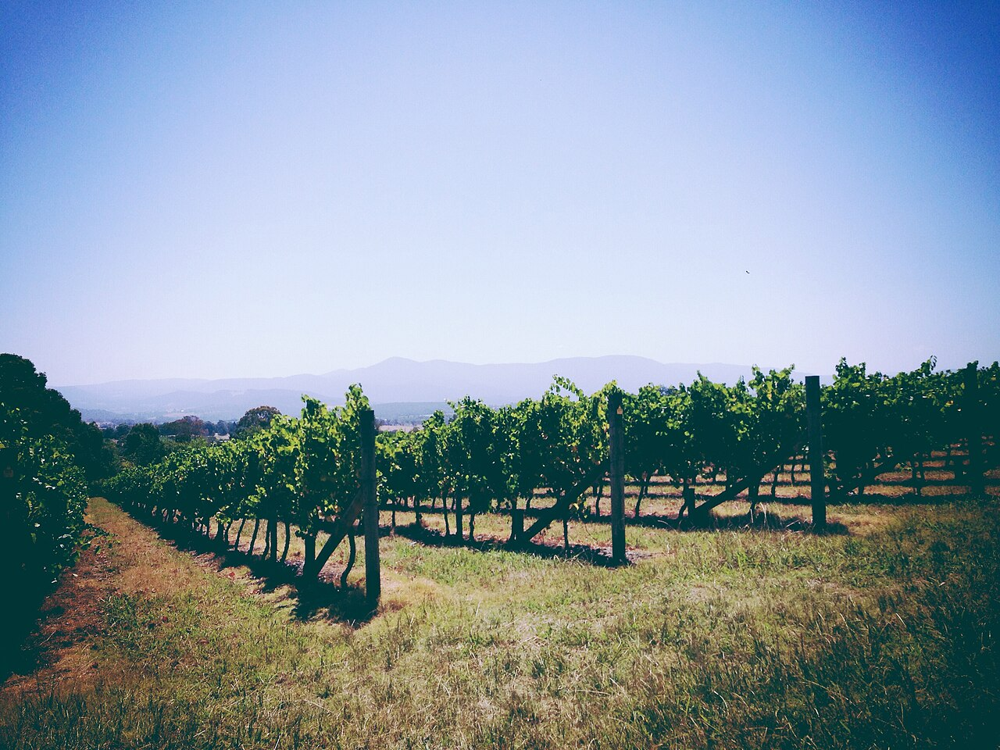

# Yarra Valley

The Yarra Valley lies about fifty kilometres northeast of Melbourne and was Victoria’s first planted wine district, with the first vines set out in 1838. Its cool climate is known for Pinot Noir, Chardonnay and Shiraz; the region gained GI status in the 1990s and its style is often compared with Burgundy and the Northern Rhône.

Figure: Yarra Valley: Yarra Valley vines (12740490444) (Wikimedia Commons). Image: DearEdward from New York, NY, USA, CC BY 2.0, via Wikimedia Commons ([source page](https://commons.wikimedia.org/wiki/File:Yarra_Valley_vines_(12740490444).jpg)).

## Definition and boundaries

The Yarra Valley sits in central Victoria, northeast of Melbourne. Its GI covers about 3,130 square kilometres with roughly 2,837 hectares of vines, spread along the Yarra River from Whittlesea in the west to Kinglake in the north, Mount Gregory in the east and Gembrook in the south. On 30 October 1996 the Yarra Valley was registered as a sub-region within the Port Phillip GI; a GI label claim requires at least 85% fruit from that district.

Informally the valley splits into the Valley Floor (lower Yarra, 50 to 80 m, warmer) and the Upper Yarra (around Seville, Warburton and Hoddles Creek, rising to about 400 m, cooler). The warmer floor suits Cabernet Sauvignon and Shiraz, while the upper valley is known for Pinot Noir, Chardonnay and sparkling base wine; town and river position say more about style than the broad name Yarra Valley. The Yarra River winds through the valley, and tributaries and wooded slopes moderate humidity; the long north-south shape means altitude and aspect explain ripening rhythm more than latitude does. The Valley Floor near Melbourne has easy access and mature visitor facilities, while the Upper Yarra is more remote, with scattered blocks among bush and pasture.

## History and naming

In 1838 the Scottish-born Ryrie brothers planted Victoria’s first vines on the site that became Yering Station. The property passed to Paul de Castella in 1850; in 1863 Hubert de Castella founded St Hubert’s and Guillaume de Pury established Yeringberg. In 1889 Yering Station won the Grand Prix at the Paris Exposition Universelle, the only winery in the southern hemisphere to do so. The Ryrie brothers ran cattle first, planting Black Cluster of Hamburg and Sweetwater; the de Castella family developed the estate into a regional winemaking centre, and it won the Argus Gold Cup for best Victorian vineyard in 1861.

In the early twentieth century, the shift to fortified wine and economic depression ended in 1937, when all valley vines had been converted to grazing land. The revival began with Wantirna Estate in 1963; Bailey Carrodus founded Yarra Yering in 1969 and John Middleton founded Mount Mary in 1971, and the 1973 vintage produced the first commercial Yarra Valley wine in more than fifty years. TarraWarra was established in 1982, James Halliday founded Coldstream Hills in 1985, and in 1986 Moët & Chandon set up Domaine Chandon at Green Point, Coldstream. The revival generation followed cool-climate principles: Carrodus advocated unirrigated, low-yielding vines. In 1978 Chateau Yarrinya won the valley's first Jimmy Watson Trophy, and De Bortoli won again in 1997.

## Geography and terroir

The valley has a cool climate, with a mean January temperature of about 18.9 °C and 750 to 950 mm of annual rainfall concentrated in winter and spring. Elevation runs from 50 to 430 m, and southwesterlies and maritime influence keep summers from turning hot. The lower Yarra has grey-brown sandy loam over red-brown clay, while the Upper Yarra holds younger red volcanic soils; river valley and aspect create clear microclimate differences. Maritime air enters from Port Phillip and the southern bays, cooling summer afternoons; mist forms in spring and autumn, and slopes and benches catch more light than hollows.

Higher, volcanic sites ripen later with higher acidity and suit Chardonnay and Pinot Noir; low, warm flats ripen earlier and can carry Cabernet Sauvignon and Shiraz. The main risks are spring frost, wet flowering and harvest rain. In cool vintages Pinot Noir tannin can stay tight, and Cabernet may not reach full ripeness. Volcanic soils are mineral-rich and free-draining, giving clear Chardonnay acidity; clayier sites hold water and nutrient, broadening fruit with a slightly firmer texture.

## Raw materials and styles

By recent crush, Pinot Noir accounts for about 44% and Chardonnay about 30%, together around three quarters of the harvest. The rest includes Shiraz, Cabernet Sauvignon, Merlot and other reds, plus whites such as Sauvignon Blanc and Riesling. Shiraz is often co-fermented with a small proportion of Viognier, and Chardonnay and Pinot Noir from the coolest sites go into sparkling base wine. Nebbiolo, Arneis, Gamay and Grüner Veltliner have been tried on small blocks alongside the mainstream varieties.

Pinot Noir usually shows red cherry, strawberry, spice and earth, with high acidity and fine tannin; Chardonnay ranges from crisp citrus to a barrel-fermented richness. Shiraz on warm sites leans to spice and dark fruit, in the Northern Rhône direction. Traditional-method sparkling wine is part of the region’s reputation. Whites often go through lees stirring and partial barrel fermentation for roundness; new oak proportions in Pinot Noir are generally restrained, keeping fruit and acidity forward.

## Representative producers and wines

Representative estates include Yarra Yering, whose Dry Red Wine No.1 is a classic Bordeaux-style blend, Mount Mary, Coldstream Hills, Oakridge, Giant Steps and Dominique Portet, along with Yeringberg, TarraWarra, De Bortoli and Domaine Chandon; there are about 160 wineries in the valley. Domaine Chandon was a key driver of traditional-method sparkling in Australia, while Yeringberg keeps a nineteenth-century family-estate style.

These names are market references, not an official classification. Small family estates and large company brands coexist, and boutique producers experiment with low yields, whole-cluster fermentation, low sulphur and skin contact. Flagship and entry wines differ clearly in price tier, and comparing different sites from one producer reveals the terroir differences best. Many estates run restaurants and accommodation for visitors, and small-batch wines reach buyers mainly through cellar-door sales and mailing lists.

## How to drink and pair

Pinot Noir is served at 14 to 16 °C, Chardonnay at 10 to 12 °C and sparkling wine at 8 to 10 °C. Young wines need no long decanting; aged Pinot Noir can be opened half an hour ahead.

Pair with roast poultry, duck, mushrooms, lamb and light red meat: Pinot Noir with duck and fungi, Chardonnay with roast chicken, seafood and cream sauces, sparkling wine on its own as an aperitivo or with fried food and soft cheese, and Shiraz with grilled sausages and braises. Local food draws on Australian grill cuisine and modern Australian cooking; mushrooms, asparagus, goat cheese and vegetables pair well with the valley's fresh acidity.

## Labels, buying and misreadings

Read the GI level and the 85% fruit rule first, then the Valley Floor or Upper Yarra, town and site name. Pinot Noir and Chardonnay differ clearly between warm and cool sites, and vintage rainfall and ripeness matter a great deal. There is no statutory village classification below the GI; site and town names are convention among producers, and different blocks from one estate can differ greatly.

A common mistake is treating “Australian cool climate” as one style, or assuming Australian wine is always full-bodied and high in alcohol. The Yarra Valley stands on acidity and texture, and most reds are medium-bodied. Check producer, vintage and storage history when buying; cellaring candidates should come from good vintages.

## Around and routes

The valley is about an hour from Melbourne city, with estates concentrated around Coldstream, Yering and Healesville. Most tastings are by appointment; allow 60 to 90 minutes per visit, and two or three estates plus lunch makes a comfortable day. Harvest, from February to April in the Southern Hemisphere, is the busiest season. Healesville is the gateway town toward the Upper Yarra, with wineries and galleries nearby.

The Yarra Valley is a popular Melbourne wine-country destination, with weekend markets, restaurants and view tasting rooms in summer; visits can be combined with Yarra River trails, cycling and valley gardens. Public transport is limited, so driving or a wine-country tour from Melbourne is easier. Spring and autumn suit slope visits and blossom season; book lunch and tastings ahead on summer weekends.

- Related: [australia](ref:australia), [pinot-noir](ref:pinot), [chardonnay](ref:chardonnay), [white-wine](ref:white), [red-wine](ref:red).
- Check GI rules, opening hours and tasting bookings on Wine Australia or the Yarra Valley association website before travelling.

**In brief:** A cool-climate region northeast of Melbourne, Victoria, planted from 1838 and one of Australia’s earliest wine districts; known for Pinot Noir, Chardonnay and Shiraz, it received GI status in the 1990s and leans toward Burgundy and the Northern Rhône in style. 
