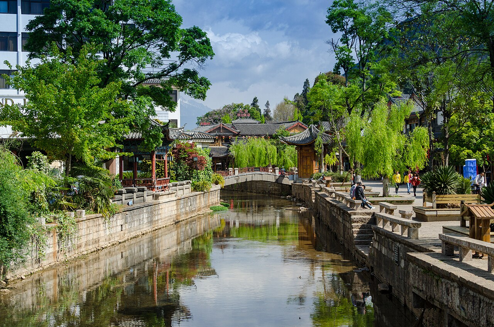

# Yunnan

Yunnan lies in south-west China, and its wine regions belong to two very different worlds. One is Deqin on the Diqing Shangri-La highland, where vineyards follow the dry valleys of the Jinsha and Mekong rivers from 1800 m up to 2800 m. The other is the low-altitude basin of Mile in Honghe Prefecture, where vineyards sit at about 1480 m. They share a page because together they define the geographic span of Yunnan wine, not because they taste alike.

Figure: Yunnan. Image: xiquinhosilva, CC BY 2.0, via Wikimedia Commons ([source page](https://commons.wikimedia.org/wiki/File:55936-Lijiang_(27941831943).jpg)).

## Two Yunnans: highland and basin

Yunnan's wine country is not one continuous, uniform tract. Diqing Prefecture uses the Shangri-La region as its brand core, with Deqin County holding the densest concentration of vineyards and wineries; Mile lies in south-east Yunnan and follows a separate low-altitude path. Diqing sits in the Three Parallel Rivers area, and official material describes the quality planting belt as 27 degrees north latitude at 1800–2800 m. Deqin's vineyard bases are spread across the dry valleys of the Jinsha and Mekong, and high plots reach 2400–2800 m.

This page is a province-level node under [China](ref:china). Yunnan wine belongs to the broader category of [wine](ref:wine), mainly [red wine](ref:red-wine) but also [white wine](ref:white-wine). A region name and an administrative boundary are not the same thing: Shangri-La is a regional brand, Deqin is the core county, and Mile is a separate route.

## High-altitude terroir: ultraviolet, temperature range and valleys

Deqin's high vineyards roughly occupy 2400–2800 m. The air is thin and cloud cover is limited, so ultraviolet intensity is higher than at low altitude, the day-night temperature range is large, and the growing season is long. Shangri-La Wine's public material gives a 180–200 day growing season, 2500 hours of sunshine a year, 200–600 mm annual rainfall and 1240 mm annual evaporation, with evaporation far exceeding rainfall.

These figures explain why Deqin vineyards depend on irrigation. The valley floor is dry, sandy and gravelly soils on slopes and alluvial fans drain quickly, and snowmelt and mountain springs are the main water sources. Strong ultraviolet light and wide temperature swings thicken skins and help phenolic development, while cooler nights preserve acidity. The same conditions bring wind, hail and uneven ripening. High altitude is not a universal certificate of quality; it is a set of constraints that demands detailed parcel management.

## Deqin: villages below the Meili Snow Mountains

Deqin's grape industry began in 2000, when Cabernet Sauvignon and Cabernet Franc were planted in villages such as Adong, Shuori, Sinong and Xidang at about 2200–2600 m. Ao Yun's public material records that local farmers planted 14 hectares in four villages in 2000, that a winery was built at 2600 m in Adong in 2014, and that 314 parcels were later divided into 900 sub-plots managed by microclimate and soil. This fragmented parcel approach is typical of high-valley estates.

Deqin County State-owned Investment Group data record 14057 mu of vineyard, 4711 tonnes a year, seven large-scale bases, 3996.31 mu certified organic or green, and benefits reaching 6 townships, 19 village committees and 3000 households. In June 2026, Diqing launched the Shangri-La wine region and brand estates in Kunming, bringing Deqin and Shangri-La wineries into a shared regional narrative. Behind the numbers is a county-level industry: grapes are not scenery but the shared base of farm income and winery supply.

## Mile: the other pole at low altitude

Mile lies in Honghe Hani and Yi Autonomous Prefecture, with vineyards at about 1480 m near 24 degrees north. The climate is warmer than Deqin, and red soil and basin conditions suit earlier-ripening varieties. Yunnan Red was founded in 1997 and farms about 1300 hectares in Mile, mainly Rose Honey, Crystal, Dance of the Clouds and French Wild, varieties rarely planted at scale outside Yunnan.

The difference between Mile and Deqin is not only altitude. Deqin relies on snowmelt, strong ultraviolet light and a long season, giving tighter wines with clearer acidity; Mile has ample heat and faster ripening, giving rounder wines with jammier, more tropical fruit. Calling both “Yunnan wine” blurs these distinctions. A more accurate statement is that Yunnan has both a high-altitude river-valley geography and a low-altitude basin geography.

## Varieties, winemaking and style

Yunnan highland reds are based mainly on Cabernet Sauvignon and Cabernet Franc, with some Syrah and Merlot; whites are based mainly on Chardonnay and other white varieties. [Cabernet Sauvignon](ref:cabernet) and [Chardonnay](ref:chardonnay) support the red and white ranges respectively, and the raw material is [grape](ref:grape). High-altitude fruit has thick skins and ripe seeds, so fermentation must manage tannin extraction; some estates use longer maceration and gentle extraction so that structure does not bury the aroma.

Reds usually go through temperature-controlled [fermentation](ref:fermentation), pressing and ageing in oak or inert containers. [Oak ageing](ref:oak-ageing) depends on estate style: too much new oak can cover highland fruit, while old oak better preserves freshness. Whites usually ferment cool to emphasise acidity, citrus and white flowers. Mile's varieties and techniques lean toward the fruit expression of a warmer region, in contrast with Deqin's high-altitude style.

## Industry, brand and rules

The Deqin data show that Yunnan wine is not scattered household production but an industry with bases, certification and county planning. The grape industry began in 2000; in 2018 Shangri-La Wine led the drafting of a technical code for highland grape planting in Diqing, which official material describes as China's first single-vineyard standard. The 2026 regional launch used “Shangri-La” as the core brand and pushed regionalisation, branding and wine tourism.

On rules, Yunnan wine production is governed by food-safety regulations and national standards, while geographical indications, regional brands and single-vineyard standards are different layers. “Shangri-La”, “Deqin” and “Mile” on a label point to different geographic scopes, so buyers should read the winery, vintage and varieties together rather than relying on the region name alone.

## Common misreadings of Yunnan wine

First, equating Yunnan wine with Shangri-La. Mile also has large-scale planting and brands.

Second, assuming higher altitude means better wine. High altitude brings strong ultraviolet light and temperature range, but also uneven ripening, wind damage and irrigation pressure.

Third, treating “highland” as a single style. Parcels in different Deqin villages and at different elevations differ greatly.

Fourth, dismissing Mile as a low-end region. It has a long planting history and a stable variety system, and style should be judged by the individual wine.

Fifth, confusing a regional brand with a geographical indication. Brand, region, single vineyard and geographical indication are different layers of identity.

## References

- [China](ref:china): the national-level region node that contains Yunnan.
- [Wine](ref:wine): wine categories, vintage and origin rules.
- [Red wine](ref:red-wine): wines made from Cabernet Sauvignon, Cabernet Franc and other red varieties.
- [White wine](ref:white-wine): wines made from Chardonnay and other white varieties.
- [Cabernet Sauvignon](ref:cabernet): a main red variety in Deqin and Mile.
- [Chardonnay](ref:chardonnay): one of the main white varieties in Yunnan.
- [Grape](ref:grape): the structure and ripeness markers of wine grapes.
- [Fermentation](ref:fermentation): how temperature control and maceration affect style.
- [Oak ageing](ref:oak-ageing): how new and old oak affect highland wine.
