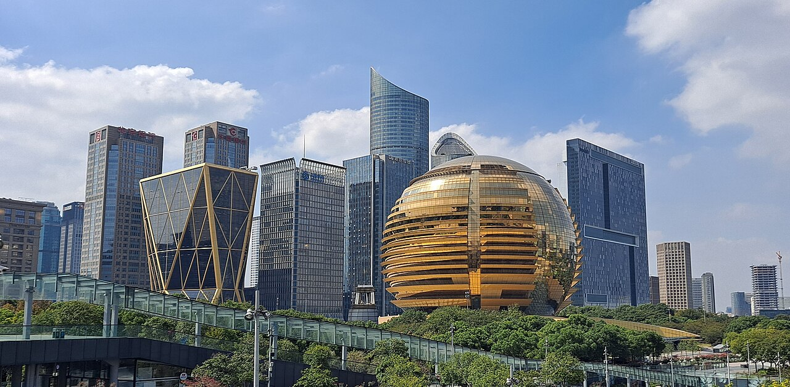

# Zhejiang Province

Zhejiang lies on the south-east coast of China, on the southern wing of the Yangtze delta, with plains, hills and islands. In the map of alcoholic drinks it is the core yellow wine region: [Shaoxing](ref:shaoxing) on the Shaoxing plain brews with glutinous rice, wheat qu and Jian Lake water to make the Jiafan, Yuanhong, Shanniang and Xiangxue families, while Jinhua and Huzhou keep traditions of their own. This page describes the province-level region and its industry; process detail is left to the Shaoxing page.

Figure: Zhejiang Province. Image: EditQ, CC BY-SA 4.0, via Wikimedia Commons ([source page](https://commons.wikimedia.org/wiki/File:%E6%9D%AD%E5%B7%9E%E9%92%B1%E6%B1%9F%E6%96%B0%E5%9F%8E_4_(cropped).jpg)).

## Definition and scope

Zhejiang is a province in eastern [China](ref:china). A province-level region page covers the whole province but is not a single legally defined appellation. The name with protected geographical meaning is Shaoxing wine, whose range, materials and process are set by a geographical indication product standard. The provincial scale is useful because it puts the Shaoxing, Jinhua and Huzhou traditions inside one administrative and market frame; it does not make Zhejiang a quality grade. The page has level province and sits above the city page for [Shaoxing](ref:shaoxing).

## History and industry

Zhejiang yellow wine is tied to rice farming, water transport and urban consumption. Written records of brewing around Shaoxing become fuller from the Tang and Song onward, and in the Ming and Qing periods Shaoxing wine travelled north and south by canal and sea as an important traded wine. In the twentieth century, joint public-private operation and state consolidation merged scattered workshops into factories and raised output and standardisation; after reform and opening, branding, vintage claims and the gift market reshaped the product range.

Jinhua is represented by Shousheng wine. A Ming-period brewer used polished glutinous rice with red qu and wheat qu together, and fermented in separate jars by the weifan method, giving an amber wine with a full flavour. Huzhou appears in historical records through Wucheng wine, and the area also kept a local winter-brewed rice wine tradition using white rice, white wheat and white water. These examples show that Zhejiang yellow wine is not a single Shaoxing story.

## Natural conditions and process

Zhejiang has a subtropical monsoon climate, humid in summer, mild in winter and well watered. Humidity and temperature act on qu making, fermentation and ageing: warmth and moisture help microbes grow but also raise the risk of souring, so qu rooms and fermentation jars need ventilation, temperature control and batch loading.

Water is a key variable. Jian Lake has moderate hardness and mineral content and is treated by the Shaoxing trade as its core source; Jinhua and Huzhou rely on local wells and river water. Differences in water change saccharification speed, fermentation temperature and mouthfeel.

[Glutinous rice](ref:glutinous-rice) is the main material, [wheat](ref:wheat) is made into wheat qu, and [water](ref:water) carries saccharification and fermentation. [Qu making](ref:qu-making) cultivates moulds and enzymes, while the wine starter provides Rhizopus and yeast. The traditional rice-handling routes are linfan, tanfan and weifan: linfan cools steamed rice quickly with cold water and is used mainly for the wine starter; tanfan spreads the rice to cool in air and suits long fermentation; weifan adds rice in stages during fermentation to control sugar release. Jiafan wine is a product type that adds a higher proportion of rice on a Yuanhong base, not a separate step alongside those three. [Fermentation](ref:fermentation) usually takes place in earthen jars and relies on stirring to remove heat and exchange air, followed by pressing, clarification, pasteurisation and storage in pottery.

## Styles and representatives

Shaoxing wine is usually described through four products: Yuanhong is drier, Jiafan is semi-dry with a fuller body, Shanniang uses wine instead of water and is semi-sweet, and Xiangxue uses distilled rice spirit instead of water and is sweeter. Huadiao mostly refers to jar format and painted packaging, and the sugar type still has to be read from the label. Zhejiang yellow wine shares rice aroma, wheat qu aroma and aged aroma, and differs mainly in material ratios, qu and ageing time.

Jinhua Shousheng wine combines red qu and wheat qu and tends toward a fuller style; Huzhou winter-brewed rice wine uses the three-white combination and tastes fresher. Under GB/T 13662-2018, Yellow wine, products state type and alcohol content according to sugar and process; Shaoxing wine as a geographical indication product is also bound by a dedicated standard for range and process.

## Common misconceptions

First, that Zhejiang only makes Shaoxing yellow wine. Jinhua and Huzhou have traditions of their own.
Second, that Jiafan is a separate brewing method. It describes a product with more rice, while the loading still follows tanfan or weifan.
Third, that Huadiao is the top grade. It is mostly a name for packaging and ageing format.
Fourth, that darker colour means older wine. Colour depends on qu, vessel, caramel colour and ageing and cannot date a bottle by itself.
Fifth, that a geographical indication is a quality ranking. It confirms range and process compliance, not sensory or price standing.

**In brief:** An eastern coastal province and the core yellow wine region of China; Shaoxing wine combines glutinous rice, wheat qu and Jian Lake water, with tanfan, linfan and weifan rice-handling routes and jiafan-style products, while Jinhua and Huzhou keep traditions of their own.

For Zhejiang Province, begin with the appellation and its permitted varieties. Then look at the vintage and the producer, and finally ask how the wine is labelled. The answers point to different choices, not to a single score.

A frequent error is to treat Zhejiang Province as an administrative place name. Establish where its boundary lies, then which climate and legal category it has. Neither answer settles the question alone.

**Key facts.**

| Item | Detail |
| --- | --- |
| In one line | An eastern coastal province and the core yellow wine region of China; Shaoxing wine combines glutinous rice, wheat qu and Jian Lake water, with tanfan, linfan and weifan rice-handling routes and jiafan-style products, wh… |
| Level | province or region |
| Parent | China |
| Country code | CN |

**Sources and limits.** The key claims about Zhejiang Province are checked against the following sources: China Alcoholic Drinks Association (public industry and regional information on yellow wine; no source text is copied), State Administration for Market Regulation, Standardization Administration of China (terminology, classification and labelling requirements for yellow wine; no standard text is copied), Standardization Administration of China (the protected range, materials and process requirements for Shaoxing wine; no standard text is copied) and 4 sources in total. Prices, batches and status change; the body is project-written and does not reproduce source text.

## Further reading

- [China](ref:china): the national regional and regulatory background.
- [Shaoxing](ref:shaoxing): the materials, process and product structure of Shaoxing wine.
- [Yellow wine](ref:yellow-wine): definition, classification and brewing overview.
- [Glutinous rice](ref:glutinous-rice) and [wheat](ref:wheat): the main material and the qu material.
- [Water](ref:water): Jian Lake and local sources in the style.
- [Qu making](ref:qu-making) and [fermentation](ref:fermentation): wheat qu and jar fermentation.
- [GB/T 13662-2018, Yellow wine](ref:gbt-13662-2018): the general product standard.
