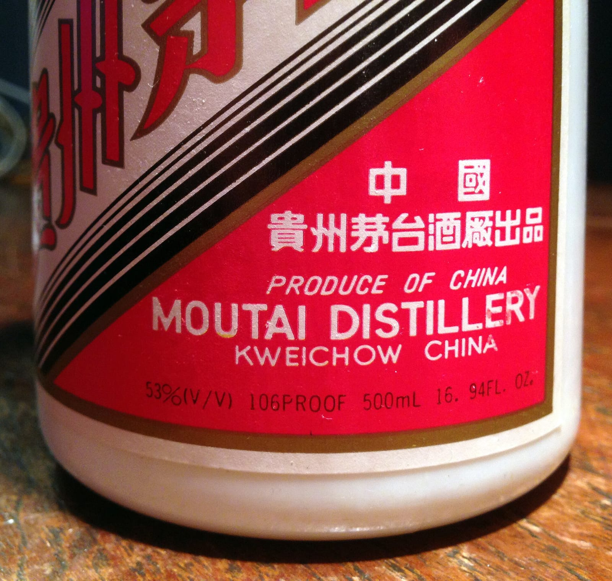

# Zunyi

Zunyi is in northern Guizhou, bordering Chongqing to the north, Sichuan to the west, Guiyang to the south and Tongren and Qiandongnan to the east. The Chishui River runs from south to north through western Zunyi and cuts a deep valley around Maotai Town in Renhuai. The core area of sauce-aroma baijiu lies along this valley. Zunyi's public story is often shared between revolutionary history and Maotai liquor, but to understand the production area you need to see valley climate, the seasonal rhythm of qu making and grain loading, and the spatial layout of the distilleries together.

Image: a detail of a Maotai bottle label, used for product identification; it is not a panorama of the Maotai valley. Photo: Jula2812, CC BY-SA 4.0, via Wikimedia Commons ([source page](https://commons.wikimedia.org/wiki/File:Maotai_-_Kweichow_Moutai_Distillery_China,_Flasche_Etikett_Detail_(2).jpg)).

## Location and access

Zunyi is a prefecture-level city in [Guizhou](ref:guizhou), administering Renhuai, Chishui, Xishui and other counties and cities. Maotai Town is in Renhuai and still requires a mountain drive from Zunyi's urban centre. The region has Zunyi Xinzhou Airport, Maotai Airport, the Chongqing-Guiyang high-speed railway and expressways; travellers can enter from Guiyang, Chongqing or Chengdu. Schedules change, so check transport on the day of travel.

If the goal is Maotai Town, look first at Maotai Airport or road connections to Renhuai. Do not assume that arriving in Zunyi city means arriving in Maotai. The drive from the urban centre to Maotai Town is winding, and rain or holidays make it slower. Staying in Renhuai or Maotai Town saves more time than commuting from Zunyi city each day.

## Industry and production area

Zunyi baijiu is mainly [sauce-aroma baijiu](ref:sauce), with [Maotai Town](ref:maotai) as the core production place and Kweichow Moutai as the flagship company. Sauce aroma has a long process cycle: multiple rounds of fermentation, distillation and liquor collection, followed by grading, storage and blending. The Chishui valley is hot and humid in summer and damp and cold in winter, with high humidity and active microbial life. The valley walls and narrow space create a relatively stable microclimate. The industry often calls this the "valley microbial environment", but the actual effect still depends on qu making, stacking and cellar management.

"Qu making at Dragon Boat Festival, grain loading at Double Ninth" is a common summary of the sauce-aroma rhythm. Around the Dragon Boat Festival, temperatures rise and qu making enters a key period; around the Double Ninth Festival, sorghum is harvested and the first grain loading begins. First loading, second loading, liquor collection, storage and blending form a cycle that crosses the year. Companies divide the rounds and set parameters differently, so the phrase is not the whole process. For a visitor, understanding why sauce aroma takes so long is more useful than memorising numbers.

Zunyi is not only Maotai Town. The Chishui River corridor also includes production areas in Xishui and Jinsha, and Maotai Town itself has several liquor companies. Valley land is limited, and distilleries, housing and roads are mixed together. That is why a visit to Maotai Town needs planning. "Core production area" does not mean a street of distilleries that anyone can walk through; many workshops are closed to the public.

## Flavour and craft

[Sauce-aroma baijiu](ref:sauce) is commonly described as having a prominent sauce aroma, elegant and fine layers, a mellow body, a long aftertaste and an empty cup that retains fragrance. Compared with strong aroma, the aroma is more complex and the entry thicker; compared with light aroma, the fermentation period and number of liquor-collection rounds are greater. Products differ by production area, raw materials, round proportions and blending; one brand cannot stand for the whole style.

High-temperature qu making, stacked fermentation and multiple liquor-collection rounds are important for the complex aroma. High-temperature qu selects heat-tolerant microbes. Stacked fermentation exposes the material to air and site microbes in an open environment. Multiple rounds separate the liquors and allow them to be stored and later combined. Blending is not "adding flavouring"; it is the combination of different rounds, ages and typical bodies into a stable style.

For an ordinary drinker, start with the empty cup. Sauce-aroma baijiu often retains a noticeable fragrance after the cup is empty, but a sharp smell is not the same as quality. Then taste the thickness and balance of the entry, and finally check whether the aftertaste is clean. Pour [baijiu](ref:baijiu) into a small cup, let it rest for a minute and then smell it; this is more accurate than smelling a freshly opened bottle.

## Visiting and itineraries

The core visit is [Maotai distillery and Maotai Town](ref:maotai). The production area of the Moutai distillery is not a public scenic spot; the parts that can be visited are usually arranged through the company or official channels. The town's Moutai liquor culture facilities, memorial spaces and valley viewpoints are a different kind of experience. Opening areas, booking and reception policies should be checked through [official Moutai channels](ref:maotai) and local notices. Do not trust unofficial promises of "guaranteed access to the factory".

If you have one day, enter Maotai Town from Renhuai in the morning, look at the valley and town layout, then visit the cultural spaces that are open; leave the afternoon for a tasting or the return trip. To follow the full [Maotai Town liquor route](ref:route), allow at least two days: one for the town and the distillery surroundings, one for other points along the Chishui River. Mountain roads are slippery in rain, so do not overpack the schedule.

Between Zunyi city and Maotai Town there are also the Zunyi Conference site, Loushan Pass and other historical sites. If you combine revolutionary history with the liquor industry, split them across two days. Distillery visits involve walking and waiting, and historical sites also take time; combining both in one day is tiring.

## Food and seasons

Zunyi food follows northern Guizhou patterns: lamb rice noodles, tofu pudding noodles, sour soup and chilli are common. With sauce-aroma baijiu, salt and fat can support the thick body; too much chilli amplifies the burning sensation and should not come first in a tasting. In a banquet, controlling the amount matters more than "drinking well", and nobody should drive after drinking, especially on mountain roads.

Summer is hot and humid in the valley; Maotai Town is at low elevation and afternoon temperatures are high, so carry water. Winter is damp and cold; indoor and outdoor temperatures are not very different, but the chill is penetrating, so dress warmly. Spring and autumn are the most comfortable seasons, but rain and fog can affect flights and mountain roads. The Dragon Boat Festival and Double Ninth Festival are key points in the production rhythm; if you want to observe qu making or grain loading, confirm with official channels in advance.

## Common misunderstandings

First, Zunyi city is not Maotai Town. There is a long mountain drive between them, and the itinerary should treat them separately.

Second, "sauce aroma" is not one fixed flavour. Rounds, ages and products differ greatly.

Third, the distillery is not a scenic spot open at all times. Production areas have safety and confidentiality requirements, and visits must go through official booking.

Fourth, "empty-cup fragrance" is not the only standard. Cleanliness, balance and length of aftertaste matter just as much.

## Further reading

- For the shared language of sauce aroma, read [Sauce-aroma baijiu](ref:sauce).
- To compare Guizhou with Sichuan production areas, read [Guizhou](ref:guizhou) and [China](ref:china).
- To place Maotai Town on a Chishui River journey, read [Maotai Town liquor route](ref:route) first, then check Renhuai accommodation and return transport.
