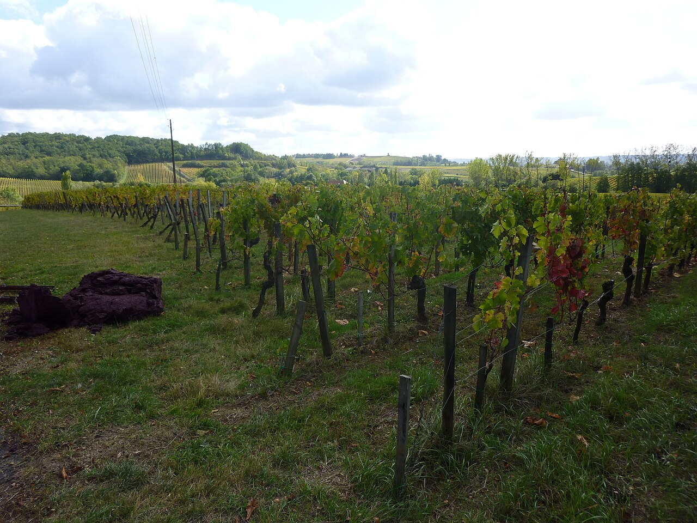

# Bordeaux AOC Decree

On a label, "Bordeaux" is a regional appellation — not an estate, not a brand. It covers the plantable vineyard of the Gironde department, was recognised as an AOC on 14 November 1936, and has a specification approved on 19 September 2025.

The advantage of a regional AOC is a clear threshold: if the parcel lies inside the boundary, the varieties and yields comply, and the winemaking and labelling follow the rules, the name may be used. Beneath that layer sit more specific village AOCs such as Margaux, Pauillac, Pomerol and Saint-Émilion. The more specific the name, the tighter the rules and, usually, the higher the price.

Figure: Bordeaux is a regional AOC covering plantable land in the Gironde; the image shows a Bordeaux vineyard. Image: davitydave, CC BY 2.0, via Wikimedia Commons ([source page](https://commons.wikimedia.org/wiki/File:Vineyard_in_Bordeaux.jpg)).

## Where the regional AOC sits

Bordeaux's appellation system is a set of concentric circles. The outer ring is regional Bordeaux and Bordeaux Supérieur; inside it are regional sub-zones such as the Côtes de Bordeaux; further in are communes such as Saint-Émilion and Pauillac; at the centre are the classified estates and single vineyards.

The regional AOC does not dictate what a particular parcel must plant. It defines an allowed range. Within that range the grower chooses Merlot or Cabernet Sauvignon, early or late picking, new or old oak. Those choices, not the appellation, create the difference between estates.

## Geography: two rivers, gravel and clay

Bordeaux sits where the Garonne and Dordogne meet to form the Gironde estuary. The left bank is dominated by gravel, which drains well and warms early, suiting Cabernet Sauvignon; the right bank is clay and limestone, which holds water, suiting Merlot and Cabernet Franc.

A maritime climate brings mild winters and wet springs, along with frost and autumn rain. The 2025 specification updated the boundary, but the logic is unchanged: a parcel must be able to ripen reliably, not by luck in a good year.

## Varieties: red, white and rosé

Permitted red varieties include Merlot, Cabernet Sauvignon, Cabernet Franc, Petit Verdot, Malbec and Carménère. Whites are built on Sémillon, Sauvignon Blanc and Muscadelle. Rosé is usually made by a short maceration of red varieties, giving pale colour and direct fruit.

Bordeaux's tradition is blending, not single varietals. The specification does not impose one proportion, but it does require the finished wine to match the style description of the appellation. Blending spreads risk: if one variety ripens poorly, another can supply structure.

## Yields, pruning and harvest

The 2025 specification sets ceilings of 60 to 64 hectolitres per hectare for red wine, with an absolute maximum of 68; 67 to 77 for white, maximum 77; and 62 to 72 for rosé, maximum 72. Pruning method, bud count and row spacing are also constrained.

These numbers are not bureaucracy. Higher yields dilute flavour and thin the body, and Bordeaux relies on ageing and blending to build structure, so the raw material must be concentrated. In frost or drought years the rules allow adjustments through a formal procedure, but not automatic relaxation.

## Vinification, ageing and style

Red wine goes through maceration, fermentation and pressing, then into oak barrels or concrete. The regional AOC does not impose a new-oak ratio or a minimum ageing period; those are estate decisions. Whites are often fermented or aged in barrel on the lees to build texture.

The specification sets minimum natural alcohol, volatile acidity and sulphur dioxide limits, but the current text should be consulted for the exact figures. For a consumer, the useful reading is that an AOC guarantees origin and baseline method, not the style or quality of a particular estate.

## Labels and classifications

The label must show "Bordeaux" and "Appellation Bordeaux Contrôlée". Vintage, estate name, the word "Château" and classifications such as Cru Bourgeois each have conditions. The 1855 classification is a private, historically formed ranking, not part of the AOC regulation, yet it shapes the market powerfully.

The 2025 specification also lowered yield ceilings in several sub-appellations by roughly a tenth, aiming to keep wines balanced as warmer seasons push ripeness up. Small estates respond differently: some cut yields and raise prices, some sell through cooperatives, some replant with more drought-tolerant varieties. A regulation supplies a ceiling, not a livelihood.

The 2025 specification refines geographical names, type sizes and additional information. For exporters, the most common error is presenting a regional wine as a village-level one, or using an unauthorised "Château" name.

## Market and disputes

Bordeaux faces falling volumes, more frost and drought, and fluctuating Chinese demand. Small estates and cooperatives see margins squeezed, and some parcels shift to other crops or lie fallow. At the same time, the classified growths keep a firm price structure, producing a stark two-tier market.

Other disputes: whether the 1855 ranking should be revised; whether new oak and micro-oxygenation erode a sense of place; and whether the regional name "Bordeaux" is overused and dilutes the value of the villages. A specification can draw a boundary, but it cannot choose what the market prefers.

## See also and references

- The region as a whole: [Bordeaux](ref:region-bordeaux).
- Margaux on the left bank: [Margaux](ref:region-margaux).
- Pauillac on the left bank: [Pauillac](ref:region-pauillac).
- Pomerol on the right bank: [Pomerol](ref:region-pomerol).
- Saint-Émilion on the right bank: [Saint-Émilion](ref:region-saint-emilion).
- The idea behind the name: [appellation](ref:term-appellation).

1. INAO / Planète Bordeaux, "Cahier des charges de l'appellation Bordeaux", 2025.
2. INAO, "appellations viticoles", accessed 20 November 2026.
3. CIVB, "Bordeaux wines — the appellations", accessed 20 November 2026.
4. Légifrance, "arrêtés d'homologation des cahiers des charges", accessed 20 November 2026.
5. CIVB, "Le vignoble de Bordeaux — chiffres clés", accessed 20 November 2026.

For Bordeaux AOC Decree, begin with the issuing body. Then look at the version, and finally ask the scope. The answers point to different choices, not to a single score.

The comparison with [Bordeaux](ref:region-bordeaux) and [Pauillac](ref:region-pauillac) runs through issuer and scope. Each answers a different question.

**In brief:** Bordeaux is a regional appellation, recognised in 1936, with a specification approved in September 2025. It sets grape varieties, yield ceilings, pruning and labelling for red, white and rosé wines, and sits above dozens of more specific village-level AOCs.

**Key facts.**

| Item | Detail |
| --- | --- |
| In one line | Bordeaux is a regional appellation, recognised in 1936, with a specification approved in September 2025. It sets grape varieties, yield ceilings, pruning and labelling for red, white and rosé wines, and sits above dozens… |
| Issuer | Institut national de l'origine et de la qualité (INAO) |
| Code | Cahier des charges de l'AOC Bordeaux |
| Effective | 2025-09-19 |
| Scope | Viticulture, vinification and labelling for the regional Bordeaux AOC |

**Sources and limits.** The key claims about Bordeaux AOC Decree are checked against the following sources: Planète Bordeaux / INAO (Full 2025 specification; used for varieties, yield ceilings and labelling), INAO (Used to confirm the approving body and boundary management), Conseil Interprofessionnel du Vin de Bordeaux (Used for the hierarchy of regional and village appellations; Used for vineyard area and production structure) and 5 sources in total. Prices, batches and status change; the body is project-written and does not reproduce source text.
