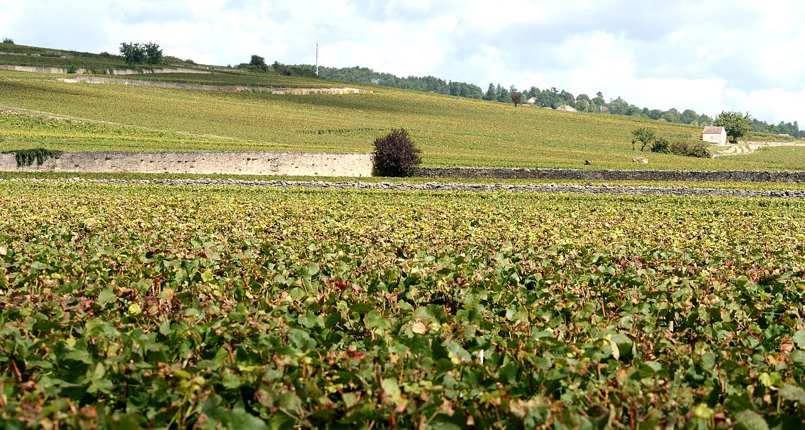

# Burgundy AOC Decree

Burgundy's complexity lies less in its estates than in its place names. On a single hill, the summit, the midslope and the foot may belong to three different appellations; on two sides of one road, the label can read completely differently. Understanding the system is half of understanding why Burgundy is expensive.

There are 84 appellations in three tiers: 7 regional, 44 village and 33 grand cru. Inside the village tier sit 640 premier cru parcel designations, which are not separate appellations but more specific plots attached to a village name.

Figure: Burgundy traces parcels down to climats; the image shows a vineyard in the Côte de Beaune. Image: Megan Mallen, CC BY 2.0, via Wikimedia Commons ([source page](https://commons.wikimedia.org/wiki/File:C%C3%B4te_de_Beaune,_Burgundy_vineyard.jpg)).

## Three tiers: regional, village and grand cru

Regional appellations cover the whole of Burgundy, including Bourgogne, Bourgogne Aligoté and Bourgogne Passetoutgrain. They set the baseline varieties and yields, serve everyday drinking and provide the base for blends.

Village appellations carry a commune name: Gevrey-Chambertin, Meursault, Pommard. A label may show the village alone, or add Premier Cru and a named parcel. The 33 grand crus are separate appellations whose names stand alone on the label.

The higher the tier, the tighter the rules: lower yield ceilings, higher ripeness requirements, stricter tasting and label review. A grand cru is not a legal promise of better taste; it is a promise that the parcel operates under stricter production constraints.

## Geography: from Chablis to Mâcon

The vineyards follow the Saône valley and limestone slopes, grouped into Chablis, the Côte de Nuits, the Côte de Beaune, the Côte Chalonnaise and the Mâconnais. Chablis lies in the north on Kimmeridgian marl; the Côte de Nuits and Côte de Beaune form the core, with east-facing slopes and good drainage.

Soil differences are amplified to an extreme. On the same slope, variations in marl content, topsoil depth and stone cover can shift the wine from light to powerful. Burgundy's idea of a parcel is essentially a legal recognition of that fine grain.

## Climats: parcel names, not weather

In Burgundy a climat is a historically named vineyard, not a meteorological pattern. In 2015 the climats were inscribed as a UNESCO World Heritage site, recognised as a centuries-old system of naming and cultivating parcels.

More than 1500 parcels are now recorded, of which 640 are classified as premier cru. Inheritance law fragments ownership, so one climat may be held by a dozen families, each farming differently. That is why wines from the same parcel can differ so widely.

## Varieties and growing

Reds are dominated by Pinot Noir, with a little Gamay; whites by Chardonnay, with Aligoté for regional white wines. Variety rules are not advice but conditions: mislabel the grape and the wine loses the name.

Planting density, pruning, bud count and yield ceilings are set separately by each appellation. Grand cru ceilings are the lowest, regional the highest. Hail or frost may trigger a reduction claim, but the ceiling itself cannot be exceeded.

## Vinification and ageing

Reds are usually destemmed or partly whole-cluster fermented, macerated for days to weeks, then moved to oak. Whites ferment in barrel or age on the lees, with stirring frequency shaping texture. The specifications govern minimum alcohol, volatile acidity and sulphur dioxide, but not the proportion of new oak.

That leaves room for radically different styles from one grand cru: some growers seek transparency and lightness, others concentration and power. The appellation guarantees place; the estate decides expression.

## Labels and market

The label must carry the appellation name and "Appellation Contrôlée". A village wine may add a parcel name; a grand cru is named by the vineyard itself. Estate names, négociant names and the word "Domaine" each have conditions; misstating the tier is the most common compliance error.

Burgundy prices are driven by scarcity: grand cru surfaces are small, demand is global and vintages swing. Auction houses and Asian demand amplify the effect, turning parcel names into investment assets.

The distinction between a négociant and a domaine also moves prices. Domaine bottling usually means full control from vine to bottle; négociant bottling may involve purchased grapes or wine. For the same grand cru, a domaine bottle can cost several times a négociant bottle. A buyer who reads only the vineyard name may miss who actually made the wine. That is why the words "Domaine" and "Maison" on a Burgundy label deserve a second look.

## Disputes: climate, heritage and expansion

A warming climate advances harvest and lowers acidity, challenging traditional ripeness standards; frost and hail are more frequent, raising insurance costs. Inheritance keeps splitting parcels, making mechanisation harder.

The other argument is whether grand cru boundaries should be redrawn. Supporters say climate has changed ripening conditions and boundaries should follow reality; opponents reply that an appellation is a product of history and culture, not of short-term market advantage.

## See also and references

- The region as a whole: [Burgundy](ref:region-burgundy).
- The northern villages and parcels: [Côte de Nuits](ref:region-cote-de-nuits).
- The southern core: [Côte de Beaune](ref:region-cote-de-beaune).
- Chablis in the north: [Chablis](ref:region-chablis).
- The appellation system: [appellation](ref:term-appellation).
- The land idea: [terroir](ref:term-terroir).

1. BIVB, "Burgundy wines — appellations and climats", accessed 20 November 2026.
2. BIVB, "Burgundy appellations — press kit", accessed 20 November 2026.
3. INAO, "appellations viticoles", accessed 20 November 2026.
4. UNESCO, "The Climats, terroirs of Burgundy", accessed 20 November 2026.
5. Légifrance, "cahiers des charges des AOC", accessed 20 November 2026.

**In brief:** Burgundy has 84 appellations in three tiers — regional, village and grand cru — with parcels traced down to historical units called climats. In 2015 the climats were inscribed as a UNESCO World Heritage site, giving a set of vineyard names a cultural identity.

Read Burgundy AOC Decree through the issuing body, then the version, and finally the scope. The sequence matters.

[Burgundy](ref:region-burgundy)'s issuer and [Côte de Beaune](ref:region-cote-de-beaune)'s scope form a useful pair: the contrast shows where one ends and the other begins.

The decree's annexes list the permitted parcels, varieties and yields in detail.

**Key facts.**

| Item | Detail |
| --- | --- |
| In one line | Burgundy has 84 appellations in three tiers — regional, village and grand cru — with parcels traced down to historical units called climats. In 2015 the climats were inscribed as a UNESCO World Heritage site, giving a se… |
| Issuer | Institut national de l'origine et de la qualité (INAO) |
| Code | Cahiers des charges des AOC de Bourgogne |
| Effective | 1936-07-31 |
| Scope | Viticulture, vinification and labelling for the Burgundy appellations |

**Sources and limits.** The key claims about Burgundy AOC Decree are checked against the following sources: Bourgogne Wines / BIVB (Used for the 84 appellations, their tiers, varieties and yield framework; Used to check the 7 regional, 44 village and 33 grand cru figures), INAO (Used to confirm the approval and amendment procedure for each specification), UNESCO World Heritage Centre (Used to check the 2015 inscription and its scope) and 5 sources in total. Prices, batches and status change; the body is project-written and does not reproduce source text.
