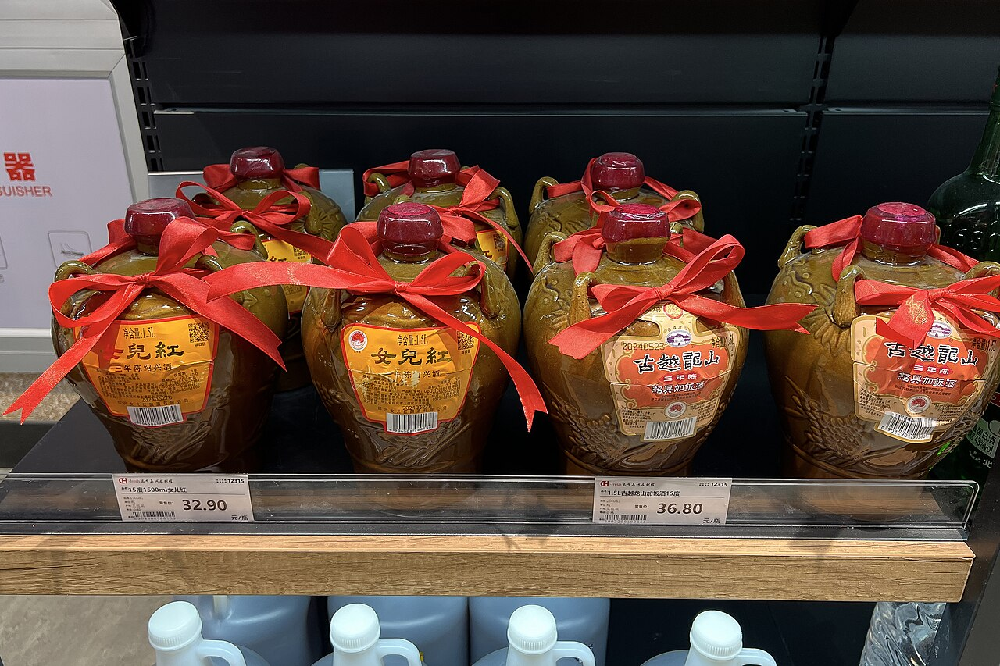

# China's geographical indication protection

Geographical indication protection in China cannot be summed up by one law, one agency or one list. It involves at least three tracks: protection of geographical indication products, geographical indication collective or certification marks, and agricultural-product geographical indications. When a drinks page speaks of a “geographical indication product”, it usually means the first track, governed by the Measures for the Protection of Geographical Indication Products. Merging the three tracks into one system is the most common starting error in understanding Chinese GIs.

Figure: Jars of Shaoxing wine in a Beijing supermarket; Shaoxing wine is an example of a GI product, but the image is not the official mark and does not prove that this jar is licensed to use it. Image: N509FZ, CC BY-SA 4.0, via Wikimedia Commons ([source page](https://commons.wikimedia.org/wiki/File:Jarred_Shaoxing_wine_at_a_supermarket_in_Beijing_(20241109164501).jpg)).

> **Quick verdict**
> **In one line:** This standard explains the scope, limits and common misreadings of China's geographical indication protection.
>
> - **Best for:** Anyone who needs the scope and limits of China's geographical indication protection quickly.
> - **Not for:** If you want need the full standard text or a compliance ruling.
> - **Check first:**
>   - Alcoholic drinks are an active category in Chinese GIs.
>   - For consumers, a GI is a traceable clue about origin and rules, not a “certificate of quality”.

## Definition and four characteristics

Article 2 of the Measures defines a geographical indication product as a product that originates in a specific region and whose quality, reputation or other characteristics are essentially attributable to the natural and human factors of that region. It covers two kinds of product: those grown or bred in the region, and those whose raw materials come entirely from the region, or partly from elsewhere but are produced and processed in the region under a specific process. The key is not that the name contains a place name, but that a demonstrable link exists between the product's characteristics and the place.

Article 3 adds four characteristics: authenticity, territoriality, specificity and linkage. Authenticity means the name has been used continuously over a long period and is generally known to the public; territoriality means all or the main production steps take place within the defined region; specificity means the product has relatively distinct quality features, a particular reputation or other characteristics; linkage means that this specificity is determined by the region's natural and human factors. All four are required. A place name alone, or a traditional craft alone, is not enough.

## Legal framework and competent authority

The current regulation is CNIPA Order No. 80, the Measures for the Protection of Geographical Indication Products, published on 2023-12-29 and in force from 2024-02-01. It covers applications, examination and recognition, revocation, modification and use of the special mark. Article 5 gives CNIPA responsibility for national management and protection of GI products and the special mark, including unified acceptance and examination of applications and recognition of products; local intellectual property departments are responsible within their administrative areas.

The regulation overlaps in part with the former General Administration of Quality Supervision, Inspection and Quarantine's Provisions on the Protection of Geographical Indication Products. CNIPA's explanatory notes state that, in application, the newer rule prevails: where the two differ on recognition, management and protection of GI products, the new Measures apply; for administrative enforcement, the relevant laws and regulations apply. When citing the old provisions, therefore, check the date and the subject matter; do not treat the 2005 procedure as the current procedure after 2024.

## Application, examination and the special mark

The applicant may be a county-level or higher people's government, or a representative social organisation or protection application body designated by it. The application includes the product name, region, quality features, link to the region, production technical specifications and test reports. The procedure includes formal examination and technical examination, with the objection stage placed after technical examination to improve efficiency. Once approved, CNIPA issues an announcement defining the region, quality technical requirements and use of the special mark.

After protection is granted, the applicant must manage the use of the name and special mark and the product's characteristic quality; producers must organise production according to the relevant standard. Use of the special mark generally requires registration; a producer that fails to follow the standard and does not correct the problem within the deadline may have its registration cancelled. The special mark is not something a producer may simply print for itself: it has registration, supervision and exit mechanisms.

## Three tracks: product protection, trade marks, agricultural GIs

The first track is GI product protection under these Measures, focused on recognition of the product-place-quality link and the special mark. The second is the GI collective mark or certification mark under the Trademark Law and trademark registration procedure, focused on registration and licensing of the sign. The third is the agricultural-product GI administered by agricultural authorities, focused on agricultural origin, production rules and quality control. Applicants, examining authorities, mark designs, protection terms and legal bases all differ.

This means that “this liquor has a geographical indication” must specify which track. A product may hold both GI product protection and a GI certification mark, or only one; a place name may be a protected GI product name, or may be registered as an ordinary or collective trademark, which is not the same thing. Equating “has a GI” with “officially certified” or “better quality” hides the institutional differences.

## Examples in alcoholic drinks

Alcoholic drinks are an active category in Chinese GIs. Shaoxing wine is a representative GI product of yellow rice wine, with technical rules covering the region, raw materials, process and sensory requirements; Moutai liquor, Wuliangye and other baijiu brands also have GI product protection or related trademark protection; the Helan Mountain East Foothills wine region in Ningxia is an important GI for wine. The protection path differs by product: some rely mainly on product protection, some on certification marks, and some on both.

Take Shaoxing wine: the core of GI protection is not the two characters “Shaoxing”, but the flavour produced by the specific region's glutinous rice, wheat qu, water, brewing season and traditional process. Without those conditions, a producer in the same city does not automatically have the right to use the protected name. Conversely, a GI is not “something only one company may make”: producers within the region who meet the technical rules may apply to use the special mark under the rules.

## China-EU mutual recognition

China and the EU signed the Agreement on Cooperation on, and Protection of, Geographical Indications on 2020-09-14; it entered into force on 2021-03-01. The first batch contains about 100 Chinese GIs and 96 EU GIs, protected from the date of entry into force; the second batch contains 175 from each side, with protection procedures to be completed within 4 years. Alcoholic drinks are an important category: Munich beer, Irish whiskey, Cava, Armagnac and Tokaj wine are among the first-batch EU names.

The point of mutual recognition is to give qualifying GIs protection in the other market and access to the other side's official mark. It is not “automatic worldwide protection” and not “all alcoholic drinks are mutually recognised”. The listed products, scope, technical rules and later changes all follow the agreement and the two sides' announcements. To check whether a drink has China-EU GI protection, use CNIPA announcements and the list, not marketing copy.

## Common misreadings

First, a GI is not an ordinary trademark. A GI product name generally cannot be monopolised by one company; it protects the group of producers within the region who meet the rules. Second, a GI is not a quality ranking. It states origin, rules and specificity; it does not mean every product using the name is equally good, nor that products outside the name are necessarily worse. Third, a GI is not created simply by putting a place name next to a product. Without long use, a place link, technical rules and examination, “wine from somewhere” is not a GI.

Fourth, GI product protection is not the same as a GI trademark. They can coexist, but applicants, procedures, marks and enforcement paths differ. Fifth, the special mark is not free to print. Use requires registration and is supervised; forging or misusing the mark is unlawful. Sixth, China-EU mutual recognition is not automatic. Only products listed in the agreement and completing the relevant procedure receive treaty protection in the other market.

## What it means for drinkers and writers

For consumers, a GI is a traceable clue about origin and rules, not a “certificate of quality”. When buying, look at the product name, region, producer, execution standard, special mark and batch number. If the name is a protected GI, check the announced region and technical requirements to see whether the product is inside the region and produced according to the rules. For writers, the accurate phrase is “this product has obtained GI product protection”, not “this product is a geographical indication”, and certainly not “this product is therefore better”.

The value of the GI system is to fix local knowledge, natural conditions and production rules so that consumers can identify them and compliant producers in the region can obtain protection. It also generates boundary disputes: how to draw the region, how to define the traditional process, how to supervise the special mark. Understanding those disputes is more useful than memorising a list when judging a drink's real identity.

## Further reading and see also

- [China](ref:china): the national context for GI products.
- [Baijiu](ref:baijiu): one of the most active categories in Chinese GI protection.
- [Yellow wine](ref:yellow-wine): the category to which Shaoxing wine belongs.
- [Ningxia](ref:ningxia): the regional context for Helan Mountain East Foothills wine.
- [Shaoxing](ref:shaoxing): the geographic and craft context for Shaoxing wine.
