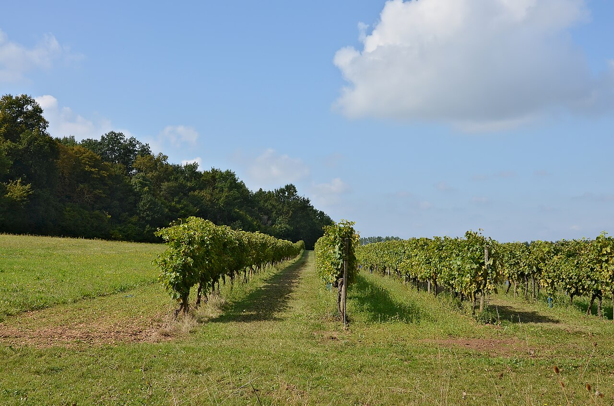

# Cognac AOC Decree

Cognac acquired a legal identity earlier than most drinkers assume. In 1909 the French government first fixed the growing boundary; in 1936 the appellation d'origine contrôlée was formally granted. The current specification was approved by the Institut national de l'origine et de la qualité on 10 October 2022 and published in the official journal on 16 October 2022.

The document reads less like a brochure than like an engineering code: which parcels may be planted, which varieties, how to prune, how much each hectare may yield, when to distil and how long to keep the spirit in oak. The familiar words VS, VSOP and XO ultimately rest on these clauses.

Figure: Cognac is divided into six growing zones; the image shows a vineyard in the Borderies cru. Image: JLPC, CC BY-SA 3.0, via Wikimedia Commons ([source page](https://commons.wikimedia.org/wiki/File:Cherves-Richemont_16_Vignoble_du_cognac_Borderies_2014.jpg)).

## Three layers: decree, specification and trade body

The first layer is the 1909 delimitation and the 1936 appellation, which define the legal boundary of the name. The second is the cahier des charges, which regulates growing, vinification, distillation and ageing item by item. The third is day-to-day governance by the BNIC and the UGVC.

France folded its AOC system into the EU PDO framework in 2009, so Cognac is protected by both French decree and EU geographical-indication law. The two layers are amended at different speeds, but the protection stacks: using "Cognac" without entitlement breaches French law and EU law at once.

## Six crus: from Grande Champagne to Bois Ordinaires

The region is divided into six growing zones: Grande Champagne, Petite Champagne, Borderies, Fins Bois, Bons Bois and Bois Ordinaires. They are not administrative provinces but quality belts drawn by soil and climate.

Grande Champagne has the classic chalk soils, fine texture and long ageing potential; Petite Champagne sits next to it with a slightly broader structure; Borderies is the smallest and often shows floral and nutty notes. Fins Bois, Bons Bois and Bois Ordinaires lie closer to the coast or the inland fringe and give more direct fruit.

A blend of Grande and Petite Champagne may be labelled "Fine Champagne" only if Grande makes up at least 50% of the blend. It is a protected combination, not an arbitrary marriage of two zones.

## Varieties and growing: the rule of Ugni Blanc

Ugni Blanc accounts for roughly 98% of Cognac's vineyard. Its high acidity and low sugar keep the fruit clean through distillation and give a spirit that can survive long oak ageing. Folle Blanche, Colombard, Montils and Sémillon remain permitted, but only in small areas.

Planting density, pruning method, harvest date and maximum yield are all fixed by the specification. Yield is not pushed to the limit: over-productive vines dilute flavour, and the resulting spirit cannot carry extended oak ageing. Vintage variation therefore shows up directly in the raw wine.

## Distillation: two copper stills, finished by 31 March

After pressing, the juice ferments into a wine of about 8% to 9% alcohol. It then passes through a Charentais copper still for two distillations. The first run yields brouillis; the second yields the bonne chauffe, with heads and tails cut away so that only the heart remains.

The specification requires the second distillation to be completed by 31 March of the year after harvest. The date is not ceremonial: it gets the new spirit into oak before warm weather unsettles fermentation and microbial conditions. Still size, shape and heating method are also constrained by tradition.

The distiller's craft shows in the cut: the proportion of heads and tails, and the moment the collector is switched, decide how clean the spirit is and how well it will age. The rule can fix temperatures and alcohol ranges, not hand feel; this is why two houses in the same appellation, working with the same variety, can differ so widely. The bonne chauffe from the second distillation usually stays below 72.4% alcohol before it goes into oak.

## Ageing and age labels: from VS to XXO

The spirit must mature in oak for at least 2 years. During that time alcohol strength falls slowly, lignin and tannin enter the liquid, and the colour shifts from clear to amber. Blenders combine vintages and crus to produce a house style.

The familiar labels correspond to statutory minimums: VS at 2 years, VSOP at 4 years, Napoléon at 6 years, XO at 10 years and XXO at 14 years. The XO threshold rose from 6 to 10 years in 2018, and the 2022 specification formalised the change.

## Labels, market and disputes

The label must carry "Cognac" and the appellation mark, and the strength may not fall below 40%. A cru name may be used only if all the grapes come from that cru; Fine Champagne must meet the blend rule above. Producer, bottler and lot details must be traceable.

Cognac production and exports are highly concentrated, with the BNIC handling statistics and promotion. Three disputes dominate: a warming climate is advancing harvest and lowering acidity; younger drinkers are moving toward lower-strength and ready-to-drink products; and volume controls are accused of protecting large growers at the expense of small ones. A specification can govern a label, but not a palate.

## See also and references

- The towns and geography of the region: [Cognac region](ref:region-cognac).
- The drink and its styles: [Cognac](ref:drink-style-cognac).
- The wider brandy family: [brandy](ref:drink-style-brandy).
- Another French sparkling specification: [Champagne AOC decree](ref:standard-champagne-aoc-decree).
- The history of the appellation idea: [appellation](ref:term-appellation).

1. BNIC, "A protected origin", accessed 20 November 2026.
2. BNIC, "How cognac is made", accessed 20 November 2026.
3. INAO, "Cahier des charges de l'appellation Cognac", accessed 20 November 2026.
4. Légifrance, "Arrêté du 10 octobre 2022", accessed 20 November 2026.
5. BNIC, accessed 20 November 2026.

**In brief:** Cognac was among the first French wine regions to be delimited, and its current product specification was approved and published in October 2022. It fixes six growing crus, permitted varieties, double copper-still distillation and oak ageing, and writes VS, VSOP and XO into law.

Start with the issuing body. From there, consider the version, then the scope. That is how a practical judgment about Cognac AOC Decree is built.

[Cognac](ref:region-cognac) and [Brandy](ref:drink-style-brandy) answer different questions about Cognac AOC Decree: issuer and scope. Read them as a pair, not as alternatives.

**Key facts.**

| Item | Detail |
| --- | --- |
| In one line | Cognac was among the first French wine regions to be delimited, and its current product specification was approved and published in October 2022. It fixes six growing crus, permitted varieties, double copper-still distil… |
| Issuer | Institut national de l'origine et de la qualité (INAO) |
| Code | Cahier des charges de l'AOC Cognac |
| Effective | 2022-10-16 |
| Scope | Viticulture, distillation, ageing and labelling in the Cognac appellation |

**Sources and limits.** The key claims about Cognac AOC Decree are checked against the following sources: Bureau National Interprofessionnel du Cognac (Used for the six crus, the AOC history and the delimitation; Used for the Ugni Blanc share, double distillation and oak ageing), INAO (Used to confirm the approving body and the legal status of the specification), Légifrance (Used to confirm approval on 10 October 2022 and publication on 16 October 2022) and 5 sources in total. Prices, batches and status change; the body is project-written and does not reproduce source text.
