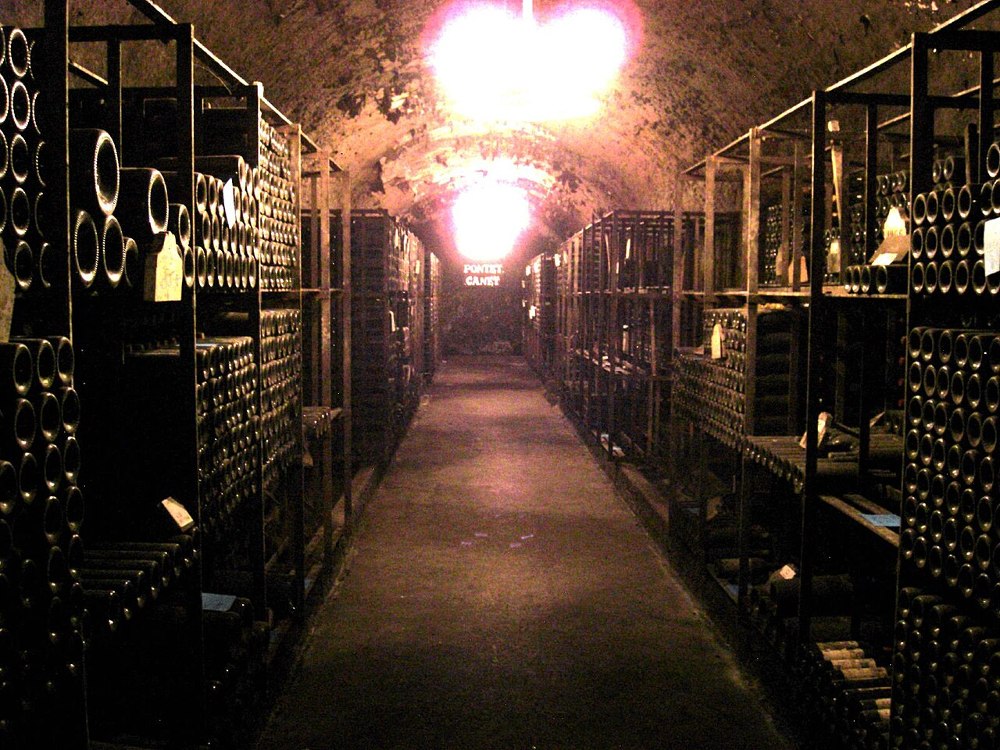

# EU Wine Regulation 1308/2013

Europe's wine rules are often read as a recipe book. They are closer to a market-access manual: they decide how a wine may be named, how it must be labelled, how it travels between member states, and when a place name deserves protection. The technical details live in delegated acts and national implementing rules. This regulation supplies the frame.

It was adopted by the European Parliament and the Council on 17 December 2013 and has applied since 1 January 2014. It replaced the earlier regulation that bundled several agricultural markets into one text. Wine now shares a common market organisation with fruit, vegetables and dairy, while keeping a dedicated wine chapter.

Figure: EU wine rules run from vineyard to label; the image shows an underground cellar at a Bordeaux estate. Image: seligmanwaite, CC BY 2.0, via Wikimedia Commons ([source page](https://commons.wikimedia.org/wiki/File:Underground_wine_cellar_of_Pontet-Canet.jpg)).

## A market regulation, not a winemaking manual

The regulation does not begin with sugar enrichment or acidification. It maps four territories: production potential (who may plant, and how much), quality policy (which names are protected), labelling and consumer information, and trade with third countries. Technical parameters — maximum enrichment, permitted acidification, sulphur dioxide limits — are supplied later by Commission delegated acts, and member states designate the agencies that enforce them.

That architecture has a practical consequence. Reading 1308/2013 alone will not tell you whether a given bottle is compliant. You also need the implementing regulations, the national decree and the local product specification. This is why the same wine can carry slightly different label details in France, Italy and Spain while the underlying mandatory information is identical.

## The compliance chain from planting to bottle

From 1 January 2016, the EU has managed vineyard area through planting authorisations. New plantings require authorisation from the member state; replanting rights circulate through a permit system. The aim is to avoid uncontrolled expansion while leaving an entry route for young growers. Validity periods, area ceilings and priority criteria are set nationally within the EU framework.

At the cellar, producers must declare harvest volumes, keep winemaking records, and carry accompanying documents when selling across borders. Enrichment, acidification, de-acidification and concentration are allowed only under specified conditions; in exceptional weather years, some regions receive temporary adjustments. Member-state inspectors check compliance, and the Commission audits whether national systems are consistent.

## Labels: what must be said, what may be said

Mandatory information includes the category of wine, alcohol content, net quantity, lot number, the name of the producer or importer, the country of origin in certain cases, sulphite warnings and allergens. A geographical name, vintage, grape variety or "château bottled" claim is optional, but once printed it must satisfy specific conditions. PDO and PGI names are protected and cannot be freely translated or reworded.

Since 8 December 2023, wine must also carry a nutrition declaration and an ingredient list. To keep the bottle uncluttered, the EU allows the full information to sit on an electronic label, with only the energy value and a link on the physical label. That is a cost for small estates and a transparency gain for consumers; the dispute is whether e-labels are accessible to older drinkers and people without smartphones.

## Quality policy: the line between PDO and PGI

A PDO requires 100% of the grapes to come from the delimited area and 100% of the wine to be made there. A PGI sets a lower bar: at least 85% of the grapes must come from the named region, while the remaining operations may take place in a wider zone. Both need a product specification, an inspection body and traceability records; once the name is registered at EU level, the member state protects it domestically.

France's AOC is the national form of a PDO. Champagne, Cognac and Bordeaux were first delimited by French decrees, then entered the EU register. So when a label says "Appellation d'Origine Contrôlée", two layers stand behind it: a French product specification and an EU PDO protection. The two layers do not always move at the same speed, which is where growers and regulators spend much of their time arguing.

## Enforcement, reform and disputes

Enforcement is led by the Commission's agriculture directorate, with spot checks by national customs and farm agencies. The common breach is not counterfeit wine but a labelling mismatch: a PGI sold as a PDO, a vintage that does not match the bottling records, a missing nutrition declaration. Penalties are set by member states and vary widely.

Reform pressure comes from three directions. A warming climate is making traditional boundaries and ripeness standards unreliable; health policy wants more prominent alcohol warnings; and planting authorisations are criticised as a brake on competition. The 2021 labelling amendment was a compromise, and the policy dialogue that followed 2024 has shifted toward reduction and restructuring. For producers, compliance cost is migrating from the cellar to the label and the data behind it.

## See also and references

- The rules for EU spirits geographical indications are covered in [EU Spirits Regulation 2019/787](ref:standard-eu-spirits-regulation-2019-787).
- The French model in detail: [Champagne AOC decree](ref:standard-champagne-aoc-decree).
- How a regional AOC becomes specific wines: [Bordeaux](ref:region-bordeaux).
- The basic category of drink: [wine](ref:drink-style-wine).
- The history of the idea itself: [appellation](ref:term-appellation).

1. European Parliament and Council, Regulation (EU) No 1308/2013, EUR-Lex, 17 December 2013.
2. European Parliament and Council, Regulation (EU) 2021/2117, EUR-Lex, 2021.
3. European Commission, DG Agriculture and Rural Development, "Wine — market measures and labelling", accessed 20 November 2026.
4. INAO, "Institut national de l'origine et de la qualité", accessed 20 November 2026.
5. OIV, "International Organisation of Vine and Wine", accessed 20 November 2026.

The comparison with [Regulation (EU) 2019/787 on Spirit Drinks](ref:standard-eu-spirits-regulation-2019-787) and [Bordeaux](ref:region-bordeaux) runs through issuer and scope. Each answers a different question.

**In brief:** The European Union's framework for the common organisation of the wine market. Adopted in December 2013 and applicable from January 2014, it harmonises planting authorisations, geographical indications, labelling and trade. It does not tell a winemaker how to ferment; it defines when a wine may use a name, and what the bottle must disclose.

Start with the issuing body. From there, consider the version, then the scope. That is how a practical judgment about EU Wine Regulation 1308/2013 is built.

**Key facts.**

| Item | Detail |
| --- | --- |
| In one line | The European Union's framework for the common organisation of the wine market. Adopted in December 2013 and applicable from January 2014, it harmonises planting authorisations, geographical indications, labelling and tra… |
| Issuer | European Parliament and Council of the European Union |
| Code | Regulation (EU) No 1308/2013 |
| Effective | 2014-01-01 |
| Scope | EU common organisation of the wine market: production potential, geographical indications, labelling, trade and controls |

**Sources and limits.** The key claims about EU Wine Regulation 1308/2013 are checked against the following sources: EUR-Lex (Full text; used to check the entry-into-force date, the scope of the wine chapter and the PDO/PGI rules; Used to check the nutrition and ingredient-labelling requirements that apply from 8 December 2023), European Commission, Directorate-General for Agriculture and Rural Development (Used for the Commission's official description of market measures, labelling and geographical indications), INAO (Used to check how French AOC designations connect to EU PDO status) and 5 sources in total. Prices, batches and status change; the body is project-written and does not reproduce source text.
