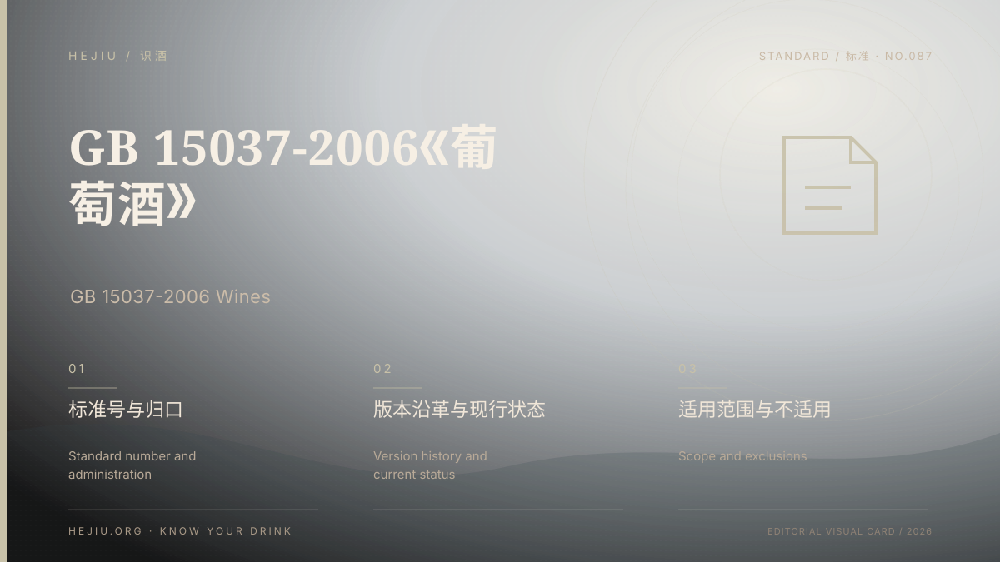

# GB 15037-2006 Wines

GB 15037-2006 is the foundation product standard for Chinese wine. It was published on 2006-12-11, took effect on 2008-01-01 and replaced GB/T 15037-1994. It classifies wine by colour, sugar and carbon dioxide and sets limits for alcohol, dry extract, volatile acid, methanol, preservatives and labelling claims. One point needs correcting: it was issued as mandatory GB 15037-2006, but the 2017 No. 7 announcement converted it in full to recommended GB/T 15037-2006, with number and year unchanged. Current writing should cite GB/T 15037-2006, retaining GB 15037-2006 as the historical designation.

Figure: thematic illustration for GB 15037-2006 Wines. Image: AI-assisted illustration generated with Doubao Seedream 5.0 (project-owned); not a photograph of the subject.

## Standard number and administration

The number is GB 15037-2006; after the 2017 conversion the current designation is GB/T 15037-2006. At publication, Chapter 3, clauses 5.2-5.4 and 8.1-8.2 were mandatory; after conversion none is, though a producer declaring the standard remains bound as an express promise. It was proposed by the China National Light Industry Council, administered by the Baijiu and Wine Subcommittee of the National Technical Committee for Food Industry Standardization, and issued by AQSIQ and SAC. Its definitions adopt the 2003 OIV code non-equivalently.

## Version history and current status

GB/T 15037-1994 was the previous edition. The 2006 edition redefined terminology, prohibited added synthetic colourants, sweeteners, essences and thickeners, added a net-content requirement, revised sampling and inspection rules, and added a normative appendix on sensory grading. It applies to wine produced after 2008-01-01. The conversion changed the prefix only, and the 2006 edition remains current.

## Scope and exclusions

The standard applies to the production, inspection and sale of wine, defined as a fermented beverage made from fresh grapes or grape juice, wholly or partly fermented, with a certain alcohol content. It covers white, rosé and red wine, still and sparkling wine, and special wines including liqueur wine, icewine, noble-rot wine, aromatised wine, low-alcohol and dealcoholised wine. It does not cover fake wine made from edible alcohol, flavourings and water, nor non-grape fruit wine. It is not a food safety standard; hygiene is referenced to GB 2758, contaminants to GB 2762 and additives to GB 2760.

## Key indices and limits

Classification has three dimensions: colour (white, rosé, red), sugar (dry, semi-dry, semi-sweet, sweet) and carbon dioxide (still, sparkling, high and low pressure). Special wines include liqueur wine, made from a wine base of at least 12%vol total alcohol with added grape brandy, edible alcohol or grape spirit, at 15.0%vol to 22.0%vol; grape aerated wine; icewine from grapes frozen below -7°C with no added sugar; noble-rot wine; flor wine; aromatised wine; low-alcohol wine at 1.0%vol to 7.0%vol; dealcoholised wine at 0.5%vol to 1.0%vol; and mountain wine.

Limits: alcohol at 20°C no less than 7.0%vol. Total sugar as glucose: dry no more than 4.0 g/L, semi-dry 4.1 to 12.0, semi-sweet 12.1 to 45.0, sweet 45.1 or more. When total sugar minus total acid as tartaric acid is no more than 2.0 g/L, dry may contain up to 9.0 g/L and semi-dry up to 18.0 g/L. Sparkling wine by sugar: brut no more than 12.0 g/L with 3.0 g/L tolerance, extra dry 12.1 to 17.0, dry 17.1 to 32.0, semi-dry 32.1 to 50.0, sweet 50.1 or more. Dry extract: white no less than 16.0 g/L, rosé 17.0, red 18.0. Volatile acid as acetic acid no more than 1.2 g/L. Citric acid no more than 1.0 g/L for dry, semi-dry and semi-sweet, 2.0 g/L for sweet. Carbon dioxide at 20°C: low-pressure sparkling from 0.05 to 0.29 MPa below 250 mL and 0.05 to 0.34 MPa at 250 mL or above; high-pressure no less than 0.30 MPa below 250 mL and 0.35 MPa at 250 mL or above. Iron no more than 8.0 mg/L, copper no more than 1.0 mg/L. Methanol: white and rosé no more than 250 mg/L, red no more than 400 mg/L. Benzoic acid no more than 50 mg/L, sorbic acid no more than 200 mg/L. Total acid is reported as measured.

A vintage claim requires at least 80% from that harvest year, a variety claim at least 75% from that variety, and an origin claim at least 80% from that origin.

## Test methods

Sensory and routine physicochemical items follow GB/T 15038; benzoic and sorbic acid follow GB/T 5009.29; net content follows JJF 1070; hygiene follows GB 2758. Release inspection covers sensory, alcohol, total sugar, dry extract, volatile acid, carbon dioxide, total sulfur dioxide, net content and aerobic plate count. Type inspection covers all requirements at least every six months and after major changes or long shutdowns. Sensory, alcohol, dry extract, volatile acid, methanol, citric acid, preservatives, hygiene, net content and labelling are Class A failures; total sugar, carbon dioxide, iron and copper are Class B.

## Relationship with neighbouring standards

GB 2758 is the mandatory food safety standard for fermented alcohol and controls microbiological and contaminant hazards; this standard sets classification, physicochemical requirements and label truthfulness. GB 2760 controls additives; this standard prohibits synthetic colourants, sweeteners, essences and thickeners and gives limits for benzoic and sorbic acid. GB/T 17204-2021 assigns broad categories, and GB/T 15038 sets methods only. Compared with the OIV code, this standard borrows definitions but sets Chinese boundaries and limits.

## Compliance and labelling

Labels follow GB 10344 and state the product type or sugar level. Vintage, variety and origin claims must meet the 80%, 75% and 80% thresholds. Alcohol is expressed in %vol, and the difference from the measured value must not exceed ±1.0%vol. A declared standard still matters in disputes.

## Common misconceptions

First, GB 15037-2006 is no longer mandatory; it became GB/T 15037-2006 in 2017, though a declared standard still binds. Second, dry does not mean zero sugar; the limit is 4.0 g/L, or up to 9.0 g/L when the sugar-acid difference is no more than 2.0 g/L. Third, vintage means the grape harvest year, not bottling or ageing, and at least 80% must come from that year. Fourth, a varietal label does not require 100% of that variety; 75% is the threshold. Fifth, higher alcohol is not better; the standard sets only a 7.0%vol minimum. Sixth, total acid is reported as measured, while volatile acid and citric acid have limits. Seventh, total sulfur dioxide is not in Table 2; its use and residue are managed under GB 2760 and GB 2758.

## See also

- [Wine](ref:wine): definition, styles and winemaking.
- [Sparkling wine](ref:sparkling-wine): pressure and sugar grading.
- [Grape](ref:grape): varieties, ripeness and raw material.
- [China](ref:china): Chinese wine regions and standards.
- [Fermentation](ref:fermentation): alcoholic and malolactic fermentation.
- [GB/T 17204-2021](ref:gbt-17204): beverage alcohol terminology and classification.

GB 15037-2006 Wines is best read by starting with the issuing body, moving to the version, and ending with the scope.

Start with [Wine](ref:wine) for issuer, then read [Grape](ref:grape) for scope. Seeing both keeps GB 15037-2006 Wines from being confused with a neighbouring idea.

**Key facts.**

| Item | Detail |
| --- | --- |
| In one line | Published on 2006-12-11 and effective from 2008-01-01, this wine standard replaced GB/T 15037-1994; it classifies wine by colour, sugar and carbon dioxide, and sets a minimum alcohol of 7.0%vol plus dry extract, volatile… |
| Issuer | General Administration of Quality Supervision, Inspection and Quarantine, Standardization Administration of China |
| Code | GB 15037-2006 |
| Effective | 2008-01-01 |
| Scope | Terminology, classification, requirements, test methods, inspection rules and labelling for wine |
