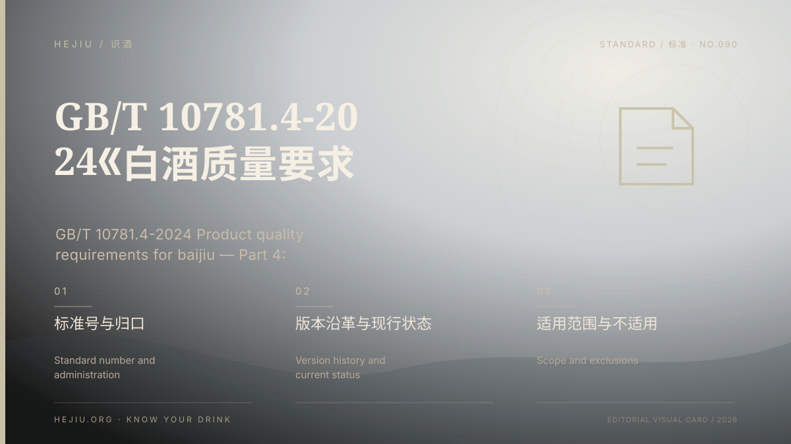

# GB/T 10781.4-2024 Product quality requirements for baijiu — Part 4: Sauce-aroma baijiu

GB/T 10781.4-2024 is the current quality requirement for sauce-aroma baijiu. It was published on 2024-05-28, took effect on 2025-06-01 and fully replaces GB/T 26760-2011. The revision is more than a renumbering. It turns high-temperature qu production, two rounds of grain feeding, multi-round stacking and pit fermentation, and high-temperature distillation into checkable process requirements. It also converts acidity and ester indices to a 53.0%vol basis and sets separate limits for the first year and for later storage.

Figure: thematic illustration for GB/T 10781.4-2024 Product quality requirements for baijiu — Part 4: Sauce-aroma baijiu. Image: AI-assisted illustration generated with Doubao Seedream 5.0 (project-owned); not a photograph of the subject.

## Standard number and administration

The standard number is GB/T 10781.4-2024. The prefix GB/T marks a recommended national standard, not a mandatory one, and it is not a food safety standard. It was issued by the State Administration for Market Regulation and the Standardization Administration of China, proposed by the China National Light Industry Council and administered by the National Technical Committee for Baijiu Standardization (SAC/TC 358). It is Part 4 of the GB/T 10781 series, which covers aroma styles in separate parts. The full number and year should always be cited.

## Version history and current status

The first national standard for sauce aroma was GB/T 26760-2011. The 2024 edition is its first revision. It removes the old strength-based classification and second grade, keeps premium and first grades, adds process control, a combined acid-plus-ester index and net content, revises sensory and physicochemical requirements, deletes hygiene indices, and changes the methods for alcohol, total acid and total esters. The old standard ceased to apply on 2025-06-01. Older labels may still carry the former number, so judge compliance with the production date.

## Scope and exclusions

The standard applies to the production, inspection and sale of sauce-aroma baijiu. It covers sauce-aroma baijiu made entirely with high-temperature qu from glutinous sorghum and wheat (the daqu subtype), and product made with other or mixed qu (the other subtype). It does not cover liquid-fermentation baijiu, solid-liquid baijiu or compounded liquor made from edible alcohol and flavourings. It does not establish origin, vintage, price or brand rank. Food safety is governed separately by GB 2757, GB 2762, GB 2761 and GB 2760.

## Key indices and limits

The definition requires grain raw materials, high-temperature qu as a saccharifying and fermenting agent, solid-state fermentation and distillation, ageing and blending, with no direct or indirect addition of edible alcohol or colour, aroma or taste substances not produced by fermentation, and a characteristic sauce-aroma style. For the daqu subtype, the standard further requires glutinous sorghum and wheat, no artificial inoculation of micro-organisms and no exogenous enzymes.

Process control is the most substantial change. High-temperature qu is cultivated for at least 40 days, turned twice, with a maximum temperature of at least 60°C at the first turning. A production cycle has only two grain feedings, with sorghum breakage of no more than 30%. High-temperature stacking reaches a top temperature of at least 50°C, with at least six stacking rounds and at least six pit-fermentation rounds. Distillation temperature should be at least 35°C, base liquor should be at least 50%vol, and at least five rounds of liquor are collected.

Sensory requirements are divided into 45%vol to 58%vol and 35%vol to below 45%vol, each with premium and first grades.

Physicochemical limits are: alcohol 35.0%vol to 58.0%vol; solids no more than 0.70 g/L; within one year of production, total acid as acetic acid at least 1.50 g/L for premium and 1.40 g/L for first grade, total esters as ethyl acetate at least 2.50 g/L for premium and 2.00 g/L for first grade; ethyl hexanoate no more than 0.30 g/L; after one year, total acid plus total esters at least 60.0 mmol/L for premium and 50.0 mmol/L for first grade. Total acid, total esters and the combined index are calculated on a 53.0%vol basis. The permitted difference between measured and labelled alcohol is ±1.0%vol.

## Test methods

Sensory requirements follow GB/T 10345. Alcohol follows GB 5009.225. Solids, total esters and ethyl hexanoate follow GB/T 10345; total acid follows GB 12456, all converted to 53%vol. The combined acid-plus-ester index follows GB/T 10345. Net content follows JJF 1070. Process control is verified from production records, including qu-making, grain feeding, stacking and pit rounds, and liquor collection. Inspection rules and labelling, packaging, transport and storage follow GB/T 10346.

## Relationship with neighbouring standards

Compared with GB/T 26760-2011, the new edition makes process part of conformity, deletes hygiene indices, uses a combined acid-plus-ester index to handle changes during storage, and fixes the conversion at 53.0%vol, so results from the two editions are not directly comparable. GB/T 15109-2021 defines baijiu terminology but sets no product limits, while this standard uses that terminology system. GB/T 17204-2021 assigns beverage alcohol to broad categories; this standard sets the specific quality requirements. GB 2757-2012 is the mandatory safety floor for methanol and cyanide, and the two cannot substitute for each other.

## Compliance and labelling

Before release, the producer should check production records against the process conditions and then test each batch. Labels should state the product name, aroma type, alcohol content, net content, production date, producer and standard number. A product may be named sauce-aroma baijiu; only a product that meets the daqu process conditions and uses entirely high-temperature qu may be named sauce-aroma baijiu (daqu). Alcohol is expressed in %vol, with a tolerance of ±1.0%vol. Methanol, cyanide, contaminants, mycotoxins and additives remain subject to GB 2757, GB 2762, GB 2761 and GB 2760.

## Common misconceptions

First, GB/T is not mandatory, but once a producer declares it on a label it becomes an express product requirement. Second, the 53.0%vol basis is a conversion basis, not an instruction that the spirit must be bottled at 53%vol. Third, the word daqu is restricted by raw materials, qu type and the ban on artificial inoculation. Fourth, a standard number is not a quality score, vintage proof or origin certificate. Fifth, deleting hygiene indices does not mean safety is unregulated; mandatory food safety standards took over that role.

## See also

- [Sauce-aroma baijiu](ref:sauce-aroma): style, process and regions.
- [Baijiu](ref:baijiu): the wider category.
- [Guizhou Moutai](ref:moutai): a leading sauce-aroma product.
- [Guizhou](ref:guizhou): the core production region.
- [GB/T 26760-2011](ref:gbt-26760): the replaced standard.
- [GB/T 15109-2021](ref:gbt-15109): baijiu terminology.
- [GB/T 17204-2021](ref:gbt-17204): beverage alcohol terminology and classification.
- [Qu making](ref:qu-making): high-temperature qu and turning.
- [Sorghum](ref:sorghum): the main raw material.

[Baijiu](ref:baijiu) and [Moutai](ref:moutai) answer different questions about GB/T 10781.4-2024 Product quality requirements for baijiu — Part 4: issuer and scope. Read them as a pair rather than as alternatives.
