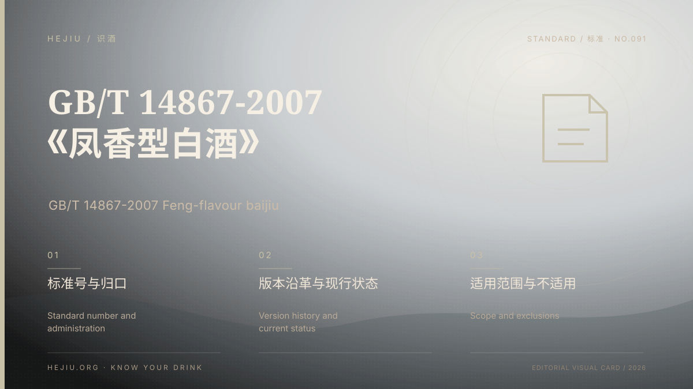

# GB/T 14867-2007 Feng-flavour baijiu

GB/T 14867-2007 is the second national standard for Feng-flavour baijiu. It was published on 2007-01-19, took effect on 2007-07-01 and replaced GB/T 14867-1994. It defines the style as a compound aroma led by ethyl acetate with ethyl hexanoate as support, and writes earthen pit fermentation and jiu-hai storage into the product standard. [Xifeng](ref:xifeng) from Fengxiang, Shaanxi, is the representative product, but the standard covers the whole category. The standard was replaced in full by GB/T 10781.6-2025 from 2026-08-01, so current work should cite the new standard.

Figure: thematic illustration for GB/T 14867-2007 Feng-flavour baijiu. Image: AI-assisted illustration generated with Doubao Seedream 5.0 (project-owned); not a photograph of the subject.

## Standard number and administration

The number is GB/T 14867-2007. The GB/T prefix marks a recommended national standard, not a mandatory one, and it is not a food safety standard. It was issued by the Standardization Administration of China. At publication it was proposed and administered by the Baijiu Subcommittee of the National Technical Committee for Food Industry Standardization; in the current system, Feng-flavour product standards are administered by the National Technical Committee for Baijiu Standardization (SAC/TC 358). Copyright in the text belongs to the issuing body; this standard gives a factual description only.

## Version history and current status

GB/T 14867-1994 was the first edition. The 2007 revision added terminology and definitions, raised the upper alcohol limit for high-strength liquor from 55.0%vol to 68%vol, lowered the lower limit for low-strength liquor from 35.0%vol to 18%vol, changed quality grades to premium and first grade only, and adjusted the physicochemical limits. That edition remained in force until GB/T 10781.6-2025 was published on 2025-08-01 and took effect on 2026-08-01, fully replacing it and bringing Feng aroma into the numbered series of baijiu quality requirements.

## Scope and exclusions

The standard applies to the production, inspection and sale of Feng-flavour baijiu. It covers baijiu made from grain by traditional solid-state fermentation, distillation, jiu-hai ageing and blending, without added edible alcohol or aroma and taste substances not produced by baijiu fermentation, and with a compound aroma led by ethyl acetate and ethyl hexanoate. It does not cover strong, light, sauce or other aroma styles, nor liquid-fermentation baijiu, solid-liquid baijiu or compounded liquor made from edible alcohol and flavourings. It does not establish origin, vintage, price or brand rank, and it cannot replace food safety standards.

## Key indices and limits

The definition requires grain raw materials, traditional solid-state fermentation, distillation, jiu-hai ageing and blending, no added edible alcohol or non-fermentation aroma and taste substances, and a compound aroma in which ethyl acetate leads and ethyl hexanoate supports. The standard also defines jiu-hai: a container woven from rattan, bonded with egg white and similar materials, lined with white cotton cloth and hemp paper, then coated on the inner wall with rapeseed oil and beeswax and dried for storing spirits.

Products are classified by alcohol content into high-strength liquor at 41%vol to 68%vol and low-strength liquor at 18%vol to 40%vol. Physicochemical limits are given in separate tables for the two classes, each with premium and first grades.

For high-strength liquor: total acid as acetic acid at least 0.25 g/L for both grades; total esters as ethyl acetate at least 1.60 g/L for premium and 1.40 g/L for first grade; ethyl acetate at least 0.6 g/L for premium and 0.4 g/L for first grade; ethyl hexanoate 0.25 g/L to 1.20 g/L for premium and 0.20 g/L to 1.0 g/L for first grade; solids no more than 1.0 g/L.

For low-strength liquor: total acid at least 0.20 g/L for premium and 0.15 g/L for first grade; total esters at least 1.00 g/L for premium and 0.60 g/L for first grade; ethyl acetate at least 0.4 g/L for premium and 0.3 g/L for first grade; ethyl hexanoate 0.20 g/L to 1.0 g/L for premium and 0.15 g/L to 0.80 g/L for first grade; solids no more than 0.9 g/L.

Sensory requirements are split by class. Premium high-strength liquor is mellow, elegant, full-bodied and long-finishing; premium low-strength liquor is mellow and full. Below 10°C a white sediment or slight cloudiness is permitted, and it should clear above 10°C.

## Test methods

Sensory and physicochemical requirements follow GB/T 10345, Baijiu analysis methods. Net content follows JJF 1070. Hygiene requirements follow GB 2757. Inspection rules and labelling, packaging, transport and storage follow GB/T 10346, and labels follow GB 10344. Alcohol may be expressed in %vol, with a permitted difference of ±1.0%vol between the measured and labelled values. GB/T 10345 and GB/T 10346 have both been revised since 2007, so current testing should use the editions in force.

## Relationship with neighbouring standards

Compared with strong aroma, Feng aroma also uses pits, but the pits are earthen and jiu-hai storage is emphasised; its aroma is led by ethyl acetate with ethyl hexanoate as support, whereas strong aroma is led by ethyl hexanoate. Compared with sauce aroma, it has no high-temperature stacking or multi-round liquor collection requirement. GB/T 15109-2021 defines terms but sets no limits, and GB/T 17204-2021 assigns beverage alcohol to broad categories. GB 2757-2012 is the mandatory safety floor.

## Compliance and labelling

Labels should follow GB 10344 and state the product name, aroma type, alcohol content, net content, production date, producer and standard number. Alcohol is expressed in %vol, with a tolerance of ±1.0%vol. The standard requires hygiene compliance with GB 2757, but GB 2757 was replaced by GB 2757-2012 in 2012, so current compliance should follow the food safety standards in force. Products made after 2026-08-01 should not declare GB/T 14867-2007 as their standard.

## Common misconceptions

First, GB/T 14867-2007 is no longer current; the current Feng-flavour standard is GB/T 10781.6-2025. Second, Feng aroma is not a simple blend of light and strong aroma; it has its own earthen-pit and jiu-hai process. Third, jiu-hai is not an ordinary pottery jar; its rattan frame and coated lining create different micro-oxidation conditions. Fourth, the alcohol range is a classification boundary, not a quality ranking. Fifth, the aroma name is not an origin certificate; Xifeng's origin and brand history must be checked separately.

## See also

- [Feng-flavour baijiu](ref:feng-aroma): style and process.
- [Baijiu](ref:baijiu): the wider category.
- [Xifeng](ref:xifeng): the representative brand.
- [Shaanxi Xifengjiu](ref:shaanxi-xifengjiu): product and label information.
- [China](ref:china): production background.
- [GB/T 15109-2021](ref:gbt-15109): baijiu terminology.
- [GB/T 17204-2021](ref:gbt-17204): beverage alcohol terminology and classification.
- [Qu making](ref:qu-making): qu and fermentation.

**Short definition:** A 2007 national standard for Feng-flavour baijiu replacing GB/T 14867-1994; its compound aroma is led by ethyl acetate with ethyl hexanoate as support, earthen pit fermentation and jiu-hai storage are process markers, and Shaanxi Xifeng is the representative product. The standard was replaced in full by GB/T 10781.6-2025 with effect from 2026-08-01.
