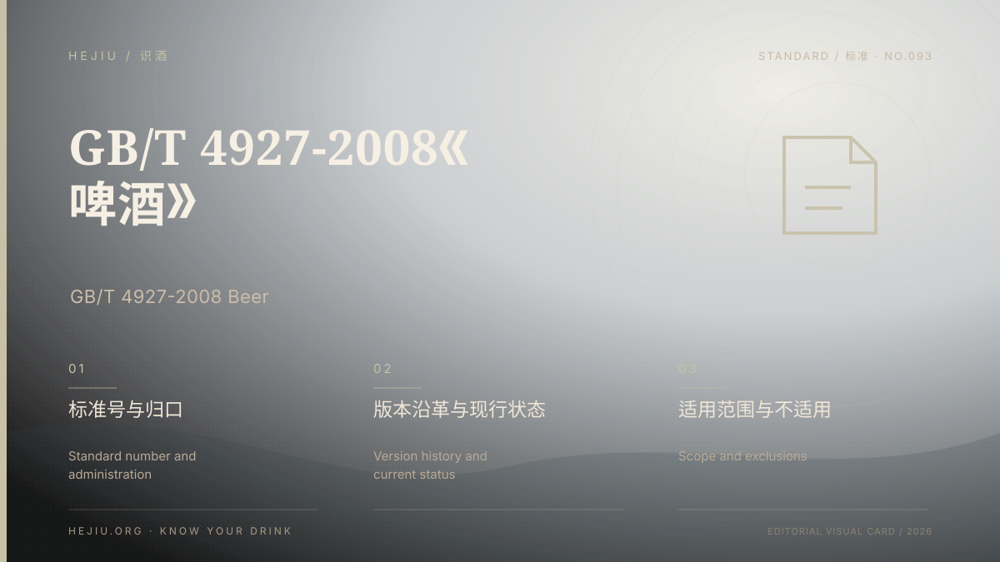

# GB/T 4927-2008 Beer

GB/T 4927-2008 is the current Chinese beer product standard. It was published on 2008-12-29, took effect on 2009-10-01 and replaced GB 4927-2001. It defines beer as a low-alcohol, carbonated fermented drink made mainly from malt and water, with hops and yeast, adding in a note that alcohol-free beer is included. It classifies beer by colour, adds special beer styles, and sets sensory, physicochemical, inspection and labelling requirements.

Figure: thematic illustration for GB/T 4927-2008 Beer. Image: AI-assisted illustration generated with Doubao Seedream 5.0 (project-owned); not a photograph of the subject.

## Standard number and administration

The number is GB/T 4927-2008. It was first published as GB 4927-2008, with clauses 3.1 and 8.1 mandatory and the rest recommended. Under the 2017 No. 7 announcement and the mandatory-standard consolidation, the prefix changed from GB to GB/T with the number and year unchanged, and it ceased to be mandatory. It was proposed by the National Technical Committee for Food Industry Standardization and is administered by the National Technical Committee for Brewing Standardization (TC471).

## Version history and current status

Beer standards have gone through the 1985, 1991, 2001 and 2008 editions. The 2008 edition moved special-beer definitions into the terminology chapter, added alcohol-free and fruit-and-vegetable beer, added product classification, removed the second quality grade, expressed alcohol as %vol, and adjusted foam retention, alcohol, original wort extract, total acid and carbon dioxide limits. It remains current, so the year should always be cited.

## Scope and exclusions

The standard applies to the production, inspection and sale of beer. It covers fermented drinks made mainly from malt and water, with hops and yeast, including alcohol-free beer, and special beers that change raw materials or process, such as wheat beer or fruit-and-vegetable beer. It does not cover wine, huangjiu, baijiu or other beverage alcohol, nor compounded liquor made from edible alcohol and flavourings. It is not a food safety standard; hygiene was referenced to GB 2758 at the time, and current compliance also involves GB 2760, GB 2762 and GB 7718.

## Key indices and limits

Product classification is by colour only: pale beer from 2 EBC to 14 EBC, dark beer from 15 EBC to 40 EBC, and black beer at 41 EBC or above, plus special beers. Draught, draft and fresh beer are terms based on sterilisation or filtration, not product classes in Chapter 4; this is often misread as classification by sterilisation.

Special beers include dry beer with actual fermentation degree of at least 72%; ice beer treated by ice crystallisation with turbidity no more than 0.8 EBC; low-alcohol beer at 0.6%vol to 2.5%vol; alcohol-free beer at no more than 0.5%vol with extract at least 3.0°P; wheat beer with more than 40% wheat malt; cloudy beer at 2.0 EBC or above; and fruit-and-vegetable beer in juice and flavour types.

Pale beer limits are tiered by original wort extract. Minimum alcohol is 5.2%vol at 14.1°P or above, 4.5%vol at 12.1°P to 14.0°P, 4.1%vol at 11.1°P to 12.0°P, 3.7%vol at 10.1°P to 11.0°P, 3.3%vol at 8.1°P to 10.0°P, and 2.5%vol at 8.0°P or below. The labelled original wort extract X is the reference, with a negative tolerance of 0.3°P at 10.0°P or above and 0.2°P below 10.0°P.

Maximum total acid is 3.0 mL/100mL at 14.1°P or above, 2.6 mL/100mL at 10.1°P to 14.0°P, and 2.2 mL/100mL at 10.0°P or below; dark and black beer is 4.0 mL/100mL. Carbon dioxide is 0.35% to 0.65% by mass, and no less than 0.25% for draught fresh, draft and sterilised beer. Diacetyl is no more than 0.10 mg/L for premium and 0.15 mg/L for first grade. For draft and fresh beer, invertase activity should be positive. For pale beer, turbidity is no more than 0.9 EBC for premium and 1.2 EBC for first grade, with white, fine foam and some foam retention required.

## Test methods

Sensory, net-content and physicochemical tests follow GB/T 4928, with net content also subject to the quantitative-packaging measure. Hygiene followed GB 2758, now replaced by GB 2758-2012, so current testing uses the food safety standards in force. Release inspection covers net content, sensory and physicochemical items; type inspection covers all requirements at least every six months and after major process or equipment changes. A batch is defined by the same tank, packaging line, production day and inspection report. Labels follow GB 10344 and current prepackaged-food rules.

## Relationship with neighbouring standards

GB/T 17204-2021 is the top-level terminology and classification standard; this standard answers what a beer must meet. GB 2758 sets safety indices, while this standard sets quality and labelling, so neither replaces the other. GB/T 4928 sets analytical methods only. Compared with baijiu, wine or huangjiu standards, the core beer indices are original wort extract, alcohol, total acid, carbon dioxide and diacetyl, whereas distilled spirits focus on total acid, total esters and methanol, and wine focuses on sugar, dry extract and volatile acid.

## Compliance and labelling

Labels should state the product name, original wort extract, alcohol content, net content, production date, shelf life, producer and standard number. Alcohol is expressed in %vol. Original wort extract is both a key label item and the basis for tiered limits, so the declared value must match the product and meet the negative tolerance. The product name must match a class or special-beer definition: alcohol-free beer must be no more than 0.5%vol with extract at least 3.0°P, and low-alcohol beer must fall between 0.6%vol and 2.5%vol. Glass bottles should comply with GB 4544, and caps, kegs and transport packaging have their own referenced standards.

## Common misconceptions

First, GB/T 4927-2008 is not mandatory; only clauses 3.1 and 8.1 were mandatory in 2008, and the whole standard became recommended in 2017. Second, products are not classified by sterilisation. Chapter 4 classifies by colour and special styles. Third, higher original wort extract does not automatically mean better quality. Fourth, alcohol-free does not mean absolutely zero alcohol; up to 0.5%vol is allowed. Fifth, craft beer is not a legal category in this standard.

## See also

- [Beer](ref:beer): definition, raw materials and style families.
- [Lager](ref:lager): cool bottom fermentation and long storage.
- [Pilsner](ref:pilsner): the classic pale lager style.
- [Hops](ref:hop): bitterness and aroma.
- [Barley](ref:barley): malt and enzyme activity.
- [Fermentation](ref:fermentation): yeast and diacetyl control.
- [GB/T 17204-2021](ref:gbt-17204): beverage alcohol terminology and classification.

[Beer](ref:beer) explains issuer; [Pilsner](ref:pilsner) adds scope. Put GB/T 4927-2008 Beer between them before deciding what it is.

**Key facts.**

| Item | Detail |
| --- | --- |
| In one line | The Chinese beer product standard, published on 2008-12-29 and effective from 2009-10-01, replacing GB 4927-2001; it defines beer as a low-alcohol carbonated fermented drink made mainly from malt and water with hops and … |
| Issuer | General Administration of Quality Supervision, Inspection and Quarantine, Standardization Administration of China |
| Code | GB/T 4927-2008 |
| Scope | Terminology, product classification, requirements, inspection rules and labelling for beer |

**Sources and limits.** The key claims about GB/T 4927-2008 Beer are checked against the following sources: General Administration of Quality Supervision, Inspection and Quarantine, Standardization Administration of China (Searchable by standard number in the National Standards Full-Text Public System; Used to check publication and effective dates, the replaced standard, the 2017 conversion and current status), Oxford University Press (Used for entries on the definition of beer, original wort extract, diacetyl and sterilisation methods), State Administration for Market Regulation (Used to look up standard status and replacements by standard number) and 7 sources in total. Prices, batches and status change; the body is project-written and does not reproduce source text.
