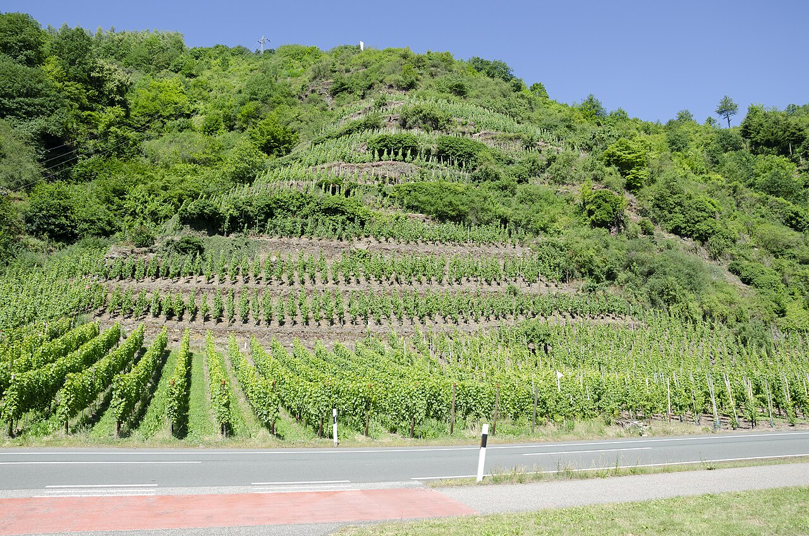

# German Wine Law

German wine law is often reduced to a sugar-scale system. That is only half true. Ripeness underpins the Prädikat hierarchy, but the 2021 reform shifted the centre of gravity toward origin: from the 2026 harvest, the geographical tier on the label will say more about a bottle than "Kabinett" or "Spätlese".

The reform was the tenth major amendment to the law and entered into force on 27 January 2021. It did not abolish the old tiers. Instead it layered a new origin pyramid on top and translated the EU PDO/PGI framework into enforceable German clauses.

Figure: Germany has 13 statutory wine regions; the image shows vineyards at Neef on the Mosel. Image: Peulle, CC0, via Wikimedia Commons ([source page](https://commons.wikimedia.org/wiki/File:Vineyards_Neef_jun_2018.jpg)).

## The 2021 reform and the 2026 start

Two goals drove the change: make it easier for consumers to see where a wine comes from, and give regions more flexible tools under a warming climate. The new rules apply from the 2026 harvest; until then there is a transition period in which estates may sell stock under the old labels.

A second goal was simplification. The old law tangled quality tier with ripeness, leaving consumers unsure how Qualitätswein differed from Prädikatswein. The new law keeps the tier names but moves origin information into the foreground.

## Four quality tiers

The first tier is Deutscher Wein, German wine with no more specific geographical label. The second is Landwein, the German equivalent of an EU PGI, with a broad regional name. The third is Qualitätswein, an EU PDO that must come from one of the 13 designated regions. The fourth is Prädikatswein, also a PDO, with higher ripeness requirements.

The tiers are not a simple ladder of price. Deutscher Wein can be a crisp everyday wine, and Prädikatswein can be dry or sweet; the tier states origin and a ripeness threshold, not a style.

## The 13 Anbaugebiete

Germany has 13 statutory wine regions: Ahr, Baden, Franken, Hessische Bergstraße, Mittelrhein, Mosel, Nahe, Pfalz, Rheingau, Rheinhessen, Saale-Unstrut, Sachsen and Württemberg. They run from north to south with sharply different climates.

Mosel's slate slopes, the Rhine-facing sites of Rheingau, the warm plain of Pfalz and the southern sun of Baden form the country's geographical baseline. A region name is a condition for Qualitätswein and above, and the consumer's first clue to style.

## Six Prädikat levels

Within Prädikatswein, ripeness at harvest creates six levels: Kabinett, Spätlese, Auslese, Beerenauslese, Eiswein and Trockenbeerenauslese. Higher ripeness means more potential alcohol or residual sugar, but the estate can ferment to dry or sweet.

This is why "the higher the Prädikat, the sweeter" is a common error. Trockenbeerenauslese is almost always sweet, but Auslese can be dry; Eiswein depends on a winter freeze and yields tiny volumes. The level is a raw-material measure, not a finished style.

## The new origin pyramid

The 2021 reform introduced four origin levels: Anbaugebiet (major region), Region (sub-region), Ortswein (village wine) and Lagenwein (site wine). The further down the pyramid, the smaller the area and the stricter the rules. Lagenwein requires 100% of the grapes from the named site and lower yield ceilings.

Running in parallel is a private hierarchy: VDP's Großes Gewächs and Erstes Gewächs. Großes Gewächs caps yields at 50 hectolitres per hectare and requires hand harvesting. It is not a statutory tier, but its market influence is large. Consumers need to distinguish a legal Lagenwein from a VDP grand cru.

## Labels and the AP number

The spine of a German label is the Amtliche Prüfungsnummer, issued by a regional testing body and encoding the region, the tested lot and the vintage. The label must also show region, vintage, variety, alcohol content, volume and bottler details.

Terms such as "Trocken", "Halbtrocken" and "Feinherb" have regulated meanings and cannot be used freely. The 2026 rules refine label format, type size and additional geographical names for Lagenwein, so exporters will need new templates.

The AP number is issued by the regional testing authority after chemical and sensory checks; the number itself carries the region code, the testing year and a batch reference. It is both a traceability tool and a signal that the wine passed official examination. After the 2026 rules take effect, old stock may still be sold, but new wines must use the new hierarchy and label format; estates usually design templates in 2025 to avoid running out of labels during a changeover.

Dry labelling also affects exports: a wine marked Trocken in Germany may be read abroad as completely dry, when a few grams of residual sugar can remain. Estates therefore add English back-label notes. For consumers, alcohol, residual sugar and acidity together are more informative than the single word Trocken.

## Disputes and the transition

The first dispute is transition cost. Small estates must redesign labels and update traceability while older stock is still sold under the old rules, so two label systems will coexist in the market. The second is climate: rising ripeness makes Prädikat thresholds easier to reach, raising the risk of grade inflation.

The third is the tension between statutory and private hierarchies. VDP's reputation sometimes outshines the legal tier, and consumers mistake Großes Gewächs for a statutory concept. A wine law can regulate a label; it cannot regulate the market's imagination of a grand cru.

## See also and references

- The national picture: [Germany](ref:region-germany).
- The slate slopes of the Mosel: [Mosel](ref:region-mosel).
- The Rhine-facing sites of Rheingau: [Rheingau](ref:region-rheingau).
- The warm plain of Pfalz: [Pfalz](ref:region-pfalz).
- Germany's beer ingredient rule: [German Beer Purity Law](ref:standard-reinheitsgebot).
- The basic category: [wine](ref:drink-style-wine).

1. Gesetze im Internet, "Weingesetz", accessed 20 November 2026.
2. Wines of Germany, "Wine law and regulations in Germany", accessed 20 November 2026.
3. Wines of Germany, "New origin pyramid", accessed 20 November 2026.
4. BMEL, "Wein — Politik und Regelungen", accessed 20 November 2026.
5. EUR-Lex, Regulation (EU) No 1308/2013, accessed 20 November 2026.

**At a glance:** Germany's wine law was last overhauled in 2021, with a new origin hierarchy applying from the 2026 harvest. It keeps four quality tiers and six Prädikat levels while shifting emphasis from ripeness to place, organised around 13 Anbaugebiete. 

To read German Wine Law, start with the issuing body, then the version, then the scope; no single check settles it.

[Germany](ref:region-germany) and [Rheingau](ref:region-rheingau) answer different questions about German Wine Law: issuer and scope. Read them as a pair, not as alternatives.

**Key facts.**

| Item | Detail |
| --- | --- |
| In one line | Germany's wine law was last overhauled in 2021, with a new origin hierarchy applying from the 2026 harvest. It keeps four quality tiers and six Prädikat levels while shifting emphasis from ripeness to place, organised ar… |
| Issuer | Federal Ministry of Food and Agriculture (BMEL) |
| Code | Weingesetz (WeinG) |
| Effective | 2021-01-27 |
| Scope | Production, classification, origin labelling and labelling of German wine |

**Sources and limits.** The key claims about German Wine Law are checked against the following sources: Gesetze im Internet (Current statute; used for tiers, regions and labelling clauses), Wines of Germany (Used for the 2021 reform, the 2026 start date and the four quality tiers; Used for the four-level origin structure: Anbaugebiet, Region, Ortswein and Lagenwein), Bundesministerium für Ernährung und Landwirtschaft (Used for federal policy objectives and the number of regions) and 5 sources in total. Prices, batches and status change; the body is project-written and does not reproduce source text.
