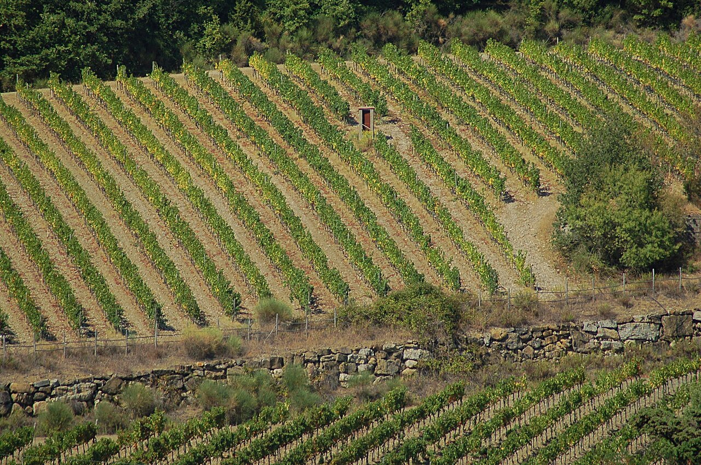

# Italian DOCG System

On an Italian label, DOCG is the highest statutory tier. It is not a guarantee of the best taste but a set of the strictest production and testing conditions: lower yields, longer ageing, smaller bottles and batch-by-batch chemical and sensory review.

The system dates from 1963. That year Italy created a legal appellation framework by presidential decree DPR 930/1963, with DOC and DOCG tiers; Legge 164 of 1992 added IGT to complete today's four-level pyramid. In 1980, Brunello di Montalcino became the first DOCG.

Figure: DOCG is Italy's highest statutory tier; the image shows vineyards in the Chianti Classico valleys. Image: Tom Chance, CC BY-SA 2.0, via Wikimedia Commons ([source page](https://commons.wikimedia.org/wiki/File:Vineyards_in_the_Chianti_Classico_valleys.jpg)).

## The 1963 system and the first DOCG in 1980

DPR 930/1963 turned a place name into a legal instrument: delimiting zones, registering vineyards, fixing varieties and yields, and setting up tasting panels. The context was post-war inconsistency and weak export credibility; the state wanted appellations to rebuild trust.

DOCG was designed as an extra guarantee for an especially valuable DOC. After Brunello di Montalcino in 1980, Barolo, Barbaresco and Chianti Classico followed. Italy now has more than 70 DOCGs and more than 300 DOCs, one of the highest counts in Europe.

## The pyramid: DOCG, DOC and IGT

At the base sits vino, ordinary table wine; above it IGT, a geographical indication; then DOC; then DOCG at the top. At EU level, DOC and DOCG both map to PDO, while IGT maps to PGI. Italy splits the top into two tiers; Europe sees one.

A PDO requires 100% of the grapes from the delimited area and vinification inside it. A PGI requires at least 85% of the grapes from the area. Those ratios are EU rules; Italy cannot loosen them.

## What DOCG adds

First, a zone must have existed as a DOC for at least 7 years before applying for DOCG. Second, the DOCG specification must be stricter than the DOC it came from: lower yields, narrower varieties, longer ageing.

Third, bottles may not exceed 6 litres, and every bottle must carry a state-issued seal with a number for traceability. Fourth, each batch must pass chemical analysis and sensory tasting before bottling; a failure means the wine cannot be released.

## Representative regions

Barolo and Barbaresco are made from Nebbiolo and emphasise structure and ageing; Brunello di Montalcino is Sangiovese with at least two years in oak and four years total; Chianti Classico is the Tuscan core, with the black rooster as its historical symbol.

In Veneto, Prosecco and Franciacorta represent two sparkling paths; in Campania, Taurasi is made from Aglianico and often called the Barolo of the south. DOCG distribution is uneven, densest in the north and centre.

## Labels and market

The label must show "Denominazione di Origine Controllata e Garantita" or DOCG, plus the appellation name. A "Riserva" claim requires longer ageing, but the number of years is set by each specification, not by a single national figure.

DOCG carries an export premium, especially for Barolo, Brunello and Chianti Classico. The premium comes from scarcity and reputation, not from the tier itself; within one DOCG, estate prices can differ severalfold.

## How it differs from the French AOC

French AOC works through parcels and climats, with an emphasis on place and hierarchy. Italian DOCG works through product specifications, with an emphasis on varieties, yields and testing. Both sit under EU PDO protection, but the legal technique differs.

Another difference is scale. France has around 360 AOCs; Italy has more than 400 DOCG and DOC zones combined. Italian zones are smaller on average and their rules vary more, so consumers cannot read style from the tier alone; they have to go back to region and producer.

## Disputes: inflation, climate and the south

The first dispute is DOCG inflation. Critics say the growing number of tiers dilutes the top; supporters say more zones under protection helps small growers.

The second is climate change. Rising ripeness and falling acidity compress the traditional harvest window; some zones seek adjustments to varieties and yields, but DOCG amendments move slowly.

The third is the north-south imbalance. Southern quality has improved visibly, yet market recognition remains concentrated in Tuscany and Piedmont. A DOCG can protect a name; it cannot always change a prejudice.

On the production side, DOCG costs fall in three places: lower yields mean less income per hectare; state seals are charged per bottle; and batch testing takes time and laboratory fees. For a small estate these costs can eat the premium; for an established brand they become a moat. A tier system is never neutral.

Another reality is that DOCG rules are negotiated between ministries and consortia and revised slowly. As the climate warms, some appellations want later harvests or adjusted varieties, but a rule change can take years. Stability is an advantage and a burden.

For consumers, DOCG labels are not very recognisable. Most people remember Barolo or Brunello without knowing they are DOCG; the place name sells better than the tier. That is why Italian labels usually put the appellation first and the tier second.

## See also and references

- Chianti Classico: [Chianti Classico](ref:region-chianti-classico).
- Barolo: [Barolo](ref:region-barolo).
- Montalcino: [Montalcino](ref:region-montalcino).
- The wider region: [Tuscany](ref:region-tuscany).
- The basic category: [red wine](ref:drink-style-red-wine).
- The idea behind the names: [appellation](ref:term-appellation).

1. Federdoc, "The evolution of the pyramid of Italian wines", accessed 20 November 2026.
2. Federdoc, "Italian PDO wines", 2025.
3. Valoritalia, "Disciplinare di produzione DOCG Barbaresco", accessed 20 November 2026.
4. Masaf, accessed 20 November 2026.
5. EUR-Lex, Regulation (EU) No 1308/2013, accessed 20 November 2026.

**In brief:** DOCG is the top tier of the Italian wine pyramid. Created with the DOC system in 1963 and first awarded in 1980, it requires at least 7 years as a DOC, bottles of no more than 6 litres, batch-by-batch chemical and sensory testing, and a state seal. 

For Italian DOCG System, begin with the issuing body. Then look at the version, and finally ask the scope. The answers point to different choices, not to a single score.

Put [Chianti Classico](ref:region-chianti-classico)'s issuer next to [Montalcino](ref:region-montalcino)'s scope; the difference marks the boundary.

DOCG is the highest Italian appellation tier, with stricter rules and tasting panels than DOC.

**Key facts.**

| Item | Detail |
| --- | --- |
| In one line | DOCG is the top tier of the Italian wine pyramid. Created with the DOC system in 1963 and first awarded in 1980, it requires at least 7 years as a DOC, bottles of no more than 6 litres, batch-by-batch chemical and sensor… |
| Issuer | Italian Ministry of Agriculture, Food Sovereignty and Forests (Masaf) |
| Code | DPR 930/1963; Legge 164/1992; D.Lgs 61/2010 |
| Effective | 1963-07-12 |
| Scope | Classification, production rules and labelling of Italian appellation wines |

**Sources and limits.** The key claims about Italian DOCG System are checked against the following sources: Federdoc (Used for DPR 930 of 1963, Legge 164 of 1992 and the creation of DOCG; Used for the seven-year DOC precondition, the six-litre cap and the state seal), Valoritalia (Used to inspect the structure of an actual DOCG specification), Masaf (Used to confirm the competent ministry and the recognition procedure) and 5 sources in total. Prices, batches and status change; the body is project-written and does not reproduce source text.
