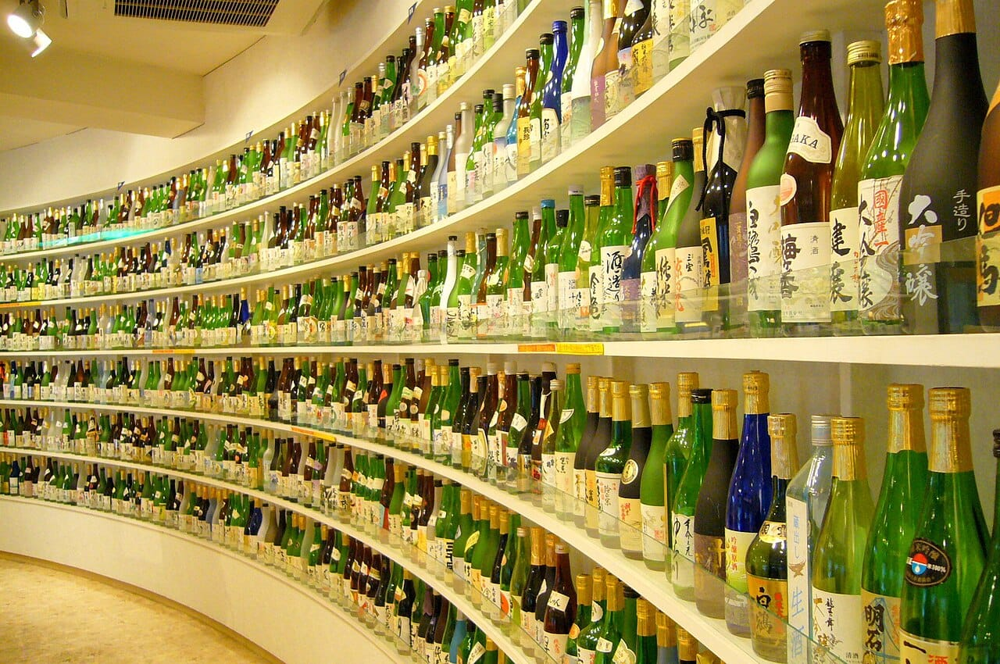

# Japan's Liquor Tax Law

Japan's Liquor Tax Law (酒税法, Law No. 6 of 1953) is a statute enacted by the Japanese parliament. It defines what “liquor” is, how it is classified, what licences are needed to manufacture and sell it, and how liquor tax is imposed. It is often misread as a “sake grading law” or a “labelling law”: sake grades belong to the National Tax Agency's labelling system, while labelling generally falls under food-labelling law and liquor labelling standards. To understand the Liquor Tax Law, put it back in its fiscal place rather than treating it as a quality hierarchy.

Figure: Sake bottles on display at the Japan Sake and Shochu Information Center; an example of the drinks subject to liquor tax, not a rate table, tax stamp or tax document. Image: Yusuke Kawasaki, CC BY 2.0, via Wikimedia Commons ([source page](https://commons.wikimedia.org/wiki/File:Sake_bottles_on_display_at_Japan_Sake_and_Shochu_Information_Center_-_Jan_18,_2007.jpg)).

> **Quick verdict**
> **In one line:** This standard explains the scope, limits and common misreadings of Japan's Liquor Tax Law.
>
> - **Best for:** Anyone who needs the scope and limits of Japan's Liquor Tax Law quickly.
> - **Not for:** If you want need the full standard text or a compliance ruling.
> - **Check first:**
>   - The basic method is a specific duty: tax is calculated by volume (kilolitre, kl) and alcohol content, not as a percentage of sales value.
>   - The law was promulgated on 1953-02-28 and has been amended many times.

## Legal framework and scope

The law was promulgated on 1953-02-28 and has been amended many times. e-Gov Law Search lists it as “Law No. 6 of 1953” and shows the current enforcement date and pending amendments. Its core object is “liquor”: a drink with an alcohol content of at least 1 degree that is fit for drinking, including products that can be diluted with water or other substances and consumed. Alcoholic products that are clearly not intended as drinks are generally handled under other laws or tax categories; containing alcohol does not automatically bring a product within the Liquor Tax Law.

Liquor tax is a national tax, not a local tax and not consumption tax. Consumption tax is levied on consumption; liquor tax is levied on manufacture and removal from the production site. Both appear in the retail price, but their legal bases, collection points and rates differ. The law is supplemented by the Enforcement Order, Enforcement Regulations and National Tax Agency circulars; calculating a specific liability requires the whole set of rules, not one sentence of the statute.

## The four classes of liquor

National Tax Agency classification material divides liquor into four classes: sparkling, brewed, distilled and compounded. Sparkling includes beer, sparkling liquor and other sparkling drinks; brewed includes sake, fruit wine and other brewed drinks; distilled includes continuous-still shochu, single-still shochu, whisky, brandy, raw alcohol and spirits; compounded includes synthetic sake, mirin, sweet fruit wine, liqueur, powdered liquor and miscellaneous liquor. Classification is by statutory criteria such as raw material, process and alcohol content, not by brand.

Sake is defined as a drink made from rice, rice koji and water, fermented and filtered, with alcohol below 22 degrees; or made from rice, rice koji, water and sake lees or other items specified by cabinet order, fermented and filtered, with alcohol below 22 degrees. Whisky is defined as a distillate made from malted grain and water, saccharified, fermented and distilled. Shochu is divided by distillation method: continuous still below 36 degrees, single still below 45 degrees. Mixing these statutory definitions with everyday words such as “sake” or “shochu” makes different processes look like one category.

## How tax is calculated: specific duty by volume

The basic method is a specific duty: tax is calculated by volume (kilolitre, kl) and alcohol content, not as a percentage of sales value. The rate table is expressed as “per 1 kl”, the tax on one thousand litres; different categories and strengths carry different rates. This design links the tax directly to physical quantity and alcohol, makes collection at the production point practical and allows comparison of tax burdens across drink categories.

Under the National Tax Agency table effective from 2026-10-01, sake is 100,000 yen/kl; beer is 155,000 yen/kl; whisky at 37 degrees is 370,000 yen/kl, with 10,000 yen/kl added for each degree above 37. On that basis, a 720 ml bottle of sake carries about 72 yen of liquor tax; a 700 ml bottle of 40% whisky carries about 280 yen (370,000 + 3×10,000 = 400,000 yen/kl, multiplied by 0.7 kl). These figures are tax examples only and exclude consumption tax, freight, channel margin and brand premium.

## Reading the 2026 rate table

The first part of the table relates to Article 23 of the Liquor Tax Law and lists basic rates by class and category. The second part relates to Article 87-2 of the Special Taxation Measures Law and applies another rate set to non-sparkling drinks below 13 degrees (liqueur below 12 degrees). The third part relates to Article 87 and provides relief for small and medium producers, banded by annual tax paid and taxable removal volume. The fourth part contains transitional relief under the supplementary provisions of Law No. 3 of 2023: for categories whose previous-year taxable removals do not exceed 1,300 kl, a proportion of the tax on up to 200 kl in the current year may be reduced. These reliefs are not automatic for every producer; they require application, approval and performance reports.

When reading the table, establish three variables first: category, alcohol strength and taxable removal volume. Then see whether the basic rate, the special-measures rate or the transitional relief applies. Remembering “sake 100,000 yen/kl” is not enough, because sake may also qualify for transitional relief; remembering “whisky 370,000 yen/kl” is not enough, because degrees above 37 add tax. The table is a piecewise function, not a single price list.

## Licences, removal and collection

Manufacturing liquor requires a liquor manufacturing licence; selling it requires a liquor retail licence. Conditions differ by category, scale and business form. Liability for liquor tax generally arises when liquor is removed from the production site; the producer declares and pays accordingly, and the removal, storage and handling of untaxed liquor are tightly controlled. Imported liquor is taxed at import. The system links manufacture, removal and payment into one chain; licensing and tax are two sides of the same administration.

The law also provides for analysis, inspection and record-keeping, to prevent untaxed liquor from entering the market. Consumers do not see these steps, but they explain why liquor needs a licence, why tax is embedded in the price, and why cross-prefecture sales and online sales have rules. Treating liquor tax as “a number in the price” misses its role as a tool of production licensing and distribution control.

## Relationship to labelling and consumers

The Liquor Tax Law governs tax, not all label content. Labelling is mainly governed by the Food Labelling Law, liquor labelling standards and National Tax Agency notices, covering product name, ingredients, alcohol content, volume, producer, origin and storage. Sake terms such as “junmai”, “ginjo” and “daiginjo” have their own labelling standards; they are not tax-rate categories, and a rate table cannot be used to infer a sake grade. Conversely, “sake”, “shochu” and “whisky” in the tax law are categories for tax, not the whole of the market's quality vocabulary.

When looking at price, remember that liquor tax is specific: for the same volume, a higher strength or a higher-tax category usually means more tax, but tax is only one part of the final price; brand, packaging, channel and consumption tax also matter. Attributing “expensive” solely to liquor tax, or “cheap” solely to tax evasion, is an oversimplification. To judge compliance, look at licences, labels, import documents and sales channels, not price alone.

## Common misreadings

First, the Liquor Tax Law is not a sake grading law. Junmai, ginjo and daiginjo belong to the labelling system, not the tax rate. Second, liquor tax is not consumption tax. It is collected at manufacture or import; consumption tax is collected at consumption. Both can appear in a price, but their legal bases differ. Third, liquor tax is not a percentage of the retail price. The basic method is a specific duty by kilolitre and alcohol content; the amount depends on category, strength and volume.

Fourth, “sake” is not a general word for all Japanese alcohol. The law defines sake by raw material, process and strength; shochu, whisky and liqueur are different categories. Fifth, “zero” or “non-alcoholic” drinks are not automatically tax-free. The law uses an alcohol content of at least 1 degree as a basic threshold; drinks below it may fall under other categories but remain subject to food, advertising and minor-protection rules. Sixth, the rate table is not permanent. Japan has adjusted liquor tax in stages, and 2026-10-01 is one point in that sequence; always state the applicable period.

## What it means for writers and producers

When writing about Japanese drinks, keep “tax”, “labelling” and “quality” separate. For sake grades, use the labelling terminology. For liquor tax, state the category, strength, volume and applicable period. For price, explain that tax is only one cost component. Do not write “higher tax means better quality”, and do not write “a lower rate means a purer drink”.

For producers, liquor tax is a hard constraint on product design, pricing and market access. Strength, volume, category, manufacturing licence, removal volume and relief applications all affect the final liability. Cross-border e-commerce and export also involve destination tariffs, consumption taxes and labelling rules; the Japanese table cannot be applied directly to another country. Treating the tax system as a verifiable set of rules, rather than a legend, is what makes content that survives inspection.

## Further reading and see also

- [Sake](ref:sake): one of the core categories in the Liquor Tax Law.
- [Japanese shochu](ref:shochu): another category classified by distillation method and strength.
- [Japan](ref:japan): the geographic background for the tax system and consumption.
- [Sake modernization](ref:modernization): a historical thread linking the sake industry and tax changes.
- [Japanese sake labelling](ref:labelling): a labelling regime separate from the Liquor Tax Law.
