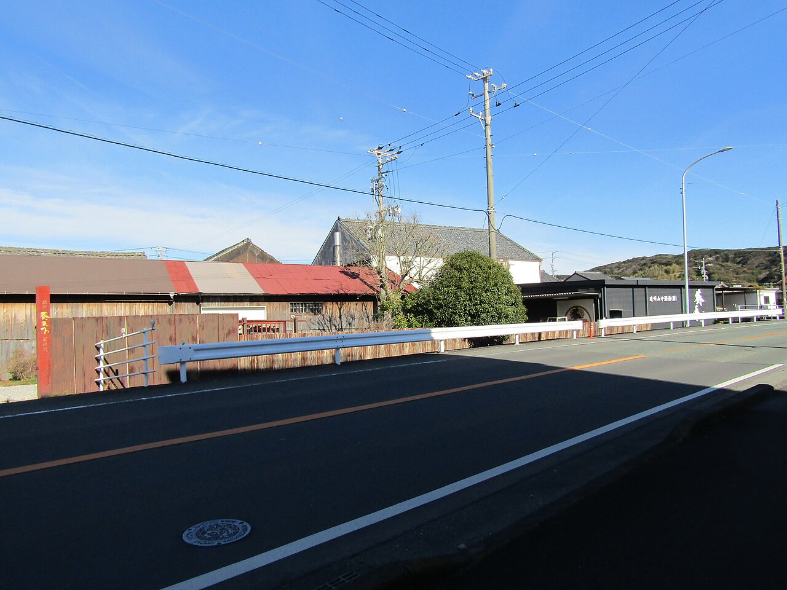

# Japanese Sake Labelling

The words "junmai daiginjo", "honjozo" and "ginjo" on a sake bottle are not adjectives invented by the brewery. They are "specific names" prescribed by the National Tax Agency. Notification No. 8 of 22 November 1989 established the rules, and later amendments produced today's labelling system.

The system does not rank quality. It ties a name to a process. If a bottle says daiginjo, the polishing ratio must be at or below 50%; if it says junmai, no brewing alcohol may be added. Read the name and you can infer the parameters.

Figure: Sake specific names must match process parameters; the image shows a brewery in Enshu, Shizuoka. Image: Halowand, CC BY 4.0, via Wikimedia Commons ([source page](https://commons.wikimedia.org/wiki/File:ENSHU_YAMANAKA_SHUZO_sake_brewery_01.jpg)).

## Notification No. 8 and its legal place

The full title is the Standard for Production Method and Quality Labelling of Sake, issued under the Liquor Tax Act and the Food Labelling Act. It is mandatory, not advisory.

It has been amended several times, with the changes of 1997, 2003, 2015 and 2019 being the most consequential for specific names, ingredient declarations and geographical indications. Each revision forces breweries to update label templates, so exporters have to track the current text.

## What counts as sake

Sake is a fermented beverage made from rice, rice koji and water. It differs from synthetic sake, which permits other ingredients; from shochu, which is distilled; and from mirin, which is a seasoning.

Alcohol content is usually around 15%, within a permitted range. Rice variety, polishing ratio, water and yeast determine flavour direction, and the label discloses only part of that story.

## The eight specific names

Eight names are permitted: junmai daiginjo, junmai ginjo, junmai, daiginjo, ginjo, honjozo, tokubetsu junmai and tokubetsu honjozo.

- The junmai family uses only rice, koji and water, with no added brewing alcohol.
- The ginjo family uses low-temperature, long fermentation and a lower polishing ratio.
- The honjozo family allows a small amount of brewing alcohol to shape aroma and texture.
- The tokubetsu variants add conditions on polishing or process.

Names cannot be combined freely. A junmai daiginjo must satisfy both the no-alcohol rule and a polishing ratio at or below 50%; a honjozo must use rice polished to at or below 70%.

## Polishing ratio and koji share

The polishing ratio is what remains after the outer layers of the grain are milled away. Daiginjo requires at or below 50%, ginjo at or below 60%, honjozo at or below 70%. Junmai has no single ceiling, though tokubetsu junmai usually requires 60% or a special process.

Koji must account for at least 15% of the rice used. That share determines saccharification capacity: too little koji and fermentation stalls; too much and the flavour becomes heavy. Added brewing alcohol is capped at 10% of the weight of the rice, and is zero for the junmai family.

## Mandatory label information

Labels must state the product name, ingredients, polishing ratio, net volume, alcohol content, maker's name and address, and the production date or lot. A specific name must match its process conditions; it cannot be used as pure marketing.

"Nihonshu-do" is not mandatory. It measures density and sugar tendency, not sweetness. Rice varieties such as Yamada Nishiki or Omachi may be declared but must be accurate. Consumers often assume a lower polishing ratio means better sake; in fact it only means more milling, and it is not a flavour guarantee.

## The geographical indication "Japanese Sake"

The National Tax Agency has established a geographical indication for Japanese Sake, with conditions on ingredients, origin and process. Only compliant sake may use the mark, and exports to the EU and other markets receive corresponding protection.

The GI and the specific names are separate labels: the GI protects the Japanese origin brand, while the specific name describes the process. They may appear together but cannot substitute for each other.

## How consumers read it

Sake labels are information-dense, yet many drinkers stop at "daiginjo". In reality, junmai's rice aroma, ginjo's fruitiness and honjozo's clean finish are three different stylistic paths, not a hierarchy.

Temperature matters too: the same bottle behaves differently at 5°C, 15°C and 40°C. The label will not tell you the best serving temperature; that is the part of sake culture learned by experience.

## Disputes: polishing race, added alcohol and climate

The first dispute is the polishing arms race. Some breweries market ratios of 35% or lower, but over-milling strips rice flavour and raises cost.

The second is added brewing alcohol. Honjozo permits a small amount to shape aroma and stability; junmai purists argue it dilutes rice flavour. The law does not judge; it requires disclosure.

The third is climate and rice prices. Hot years soften the grain and complicate fermentation control, while premium rice prices swing and squeeze small breweries.

## See also and references

- The category as a whole: [sake](ref:drink-style-sake).
- Junmai: [junmai sake](ref:drink-style-junmai-sake).
- Ginjo: [ginjo sake](ref:drink-style-ginjo-sake).
- Daiginjo: [daiginjo sake](ref:drink-style-daiginjo-sake).
- The producing country: [Japan](ref:region-japan).
- The concept of polishing: [polishing ratio](ref:term-polishing-ratio).

1. National Tax Agency, "Standard for Production Method and Quality Labelling of Sake" (Notification No. 8), 22 November 1989.
2. National Tax Agency, "Guide to sake labelling", accessed 20 November 2026.
3. National Tax Agency, "Handbook on sake production and labelling", 2025.
4. National Tax Agency, "Protection of the geographical indication Japanese Sake", accessed 20 November 2026.
5. Japan Sake and Shochu Information Center, accessed 20 November 2026.

**In brief:** Japan's National Tax Agency set the standards for sake quality labelling in 1989 by Notification No. 8. Eight specific names separate junmai, ginjo and honjozo styles, tied to polishing ratios, koji share and a cap on added brewing alcohol. The names are process claims, not a ladder of quality.

For Japanese Sake Labelling, begin with the issuing body. Then look at the version, and finally ask the scope. The answers point to different choices, not to a single score.

Treating Japanese Sake Labelling as a product manual mixes two different questions: identity and use. Separate them before comparing.

The entry on Japanese Sake Labelling draws on National Tax Agency, JSS.

Japanese sake labels use polishing ratio, sake meter value and the junmai/ginjo terms; these describe ingredients and method, not a single quality score.

**Key facts.**

| Item | Detail |
| --- | --- |
| In one line | Japan's National Tax Agency set the standards for sake quality labelling in 1989 by Notification No. 8. Eight specific names separate junmai, ginjo and honjozo styles, tied to polishing ratios, koji share and a cap on ad… |
| Issuer | National Tax Agency, Japan |
| Code | NTA Notification No. 8 (22 November 1989) |
| Effective | 1989-11-22 |
| Scope | Production method, quality labelling and labels for Japanese sake |

**Sources and limits.** The key claims about Japanese Sake Labelling are checked against the following sources: National Tax Agency (Notification text; used for the eight specific names, polishing ratios and koji share; Official labelling guide; used for mandatory items and common errors), JSS (Used to compare industry explanations of the specific names and flavours). Prices, batches and status change; the body is project-written and does not reproduce source text.
