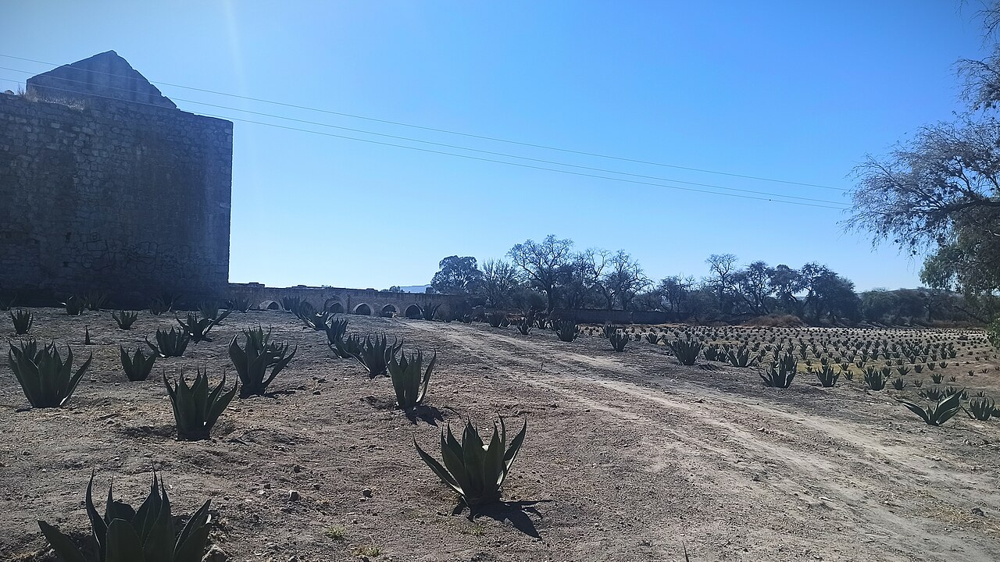

# Mezcal NOM-070

Mezcal is often described as tequila's cousin, but legally the two are not relatives. NOM-070-SCFI-2016 gives mezcal a blunt definition: a 100% agave distillate. There is no allowance for up to 20% other sugars, and no grey zone for blended feedstock.

The standard was revised in 2016 and published in the official gazette on 23 February 2017. Its most important move was to turn "handmade" and "traditional" from adjectives into three verifiable combinations of equipment and process. Artesanal is no longer a flattering label; it is a claim that must match the production log.

Figure: Mezcal permits many agave species; the image shows agave cultivated for mezcal in Guanajuato. Image: Juan Carlos Fonseca Mata, CC BY-SA 4.0, via Wikimedia Commons ([source page](https://commons.wikimedia.org/wiki/File:Cultivo_de_agave_para_industria_del_mezcal_(Jaral_de_Berrio).jpg)).

## From 1994 to 2016: a tightening

The 1994 version of NOM-070 allowed up to 20% of fermentable sugars to come from other sources, which made the raw-material boundary fairly loose. The 2016 text removed that room, made 100% agave a hard condition, and added the Artesanal and Ancestral categories.

The tightening followed the market. Mezcal became fashionable in North America and Europe during the 2010s, prices rose, and cases of sugar dilution, species substitution and fake craft multiplied. Regulators chose process evidence over brand storytelling.

## Raw material: many agaves, all mature

Unlike tequila, which recognises one species, mezcal permits many kinds of maguey. They may be cultivated or wild, but the plants must be physiologically mature, the plots must be registered and georeferenced with the certifying body, and transport requires a permit.

The label must state the scientific or local name of the agave used; if two or more species are blended, they must be listed in descending proportion. This clause is genuinely useful: the difference between Espadín, Tobalá and Tepeztate explains more about a bottle than any vintage.

## Three categories: Mezcal, Artesanal, Ancestral

The standard classifies production by the equipment used at four stages. Plain Mezcal is the most flexible: cooking in earthen pits, masonry ovens or autoclaves; crushing with tahona, mechanical mills or diffusers; fermentation in wooden vats, masonry tanks or stainless steel; distillation in copper alembics or continuous columns.

Artesanal is narrower: cooking must use earthen pits or raised masonry ovens; crushing must use a mallet, tahona or tearing machine; fermentation must use stone or earthen cavities, wooden vats, clay pots or animal skins; distillation must be direct-fired in copper or clay alembics.

Ancestral is the strictest: pit cooking, mallet or tahona crushing, fermentation in stone or earthen cavities, wooden vats, clay pots or skins, and direct-fired distillation in clay pots, all with the agave fibre present. All three categories must be 100% agave. The difference is process, not feedstock.

## Ageing and "abocado con"

- Blanco or Joven: unaged, or rested in inert containers.
- Madurado en Vidrio: rested in glass, with the duration stated.
- Reposado: at least 2 months in wood.
- Añejo: more than 12 months in wooden containers under 1000 litres, with the duration stated.
- Abocado con: permitted ingredients such as agave worm, damiana, honey or citrus added directly, with a dry extract limit of 60 grams per litre.

"Abocado con" is often mistranslated as flavoured. It is a declared addition: what went in, and how much, must be visible on the label. The contrasting term "Destilado con" means the ingredient took part in distillation. The two cannot be used interchangeably.

## The label: 100% agave is mandatory

Mandatory information includes the category (Mezcal, Mezcal Artesanal or Mezcal Ancestral), the ageing or treatment class, alcohol content between 35% and 55%, net volume, the agave name, the state of production, the producer or bottler's name and tax number, and the words "100% Maguey" or "100% Agave".

The legend "Denominación de Origen Protegida" must appear on the main display panel in capitals no smaller than 3 millimetres. Certification is carried out by a conformity-assessment body approved by the economy ministry, and both producers and plots must be registered. Exports to the EU also benefit from geographical-indication registration.

## Market, ecology and disputes

Mezcal's boom has two side effects. Wild agaves, especially Tobalá and Tepeztate that take more than a decade to mature, are being over-harvested. And village economies in the producing regions are being reshaped: young cutters leave for cities, and traditional knowledge thins out.

Other disputes: whether Artesanal and Ancestral certification costs shut out small producers; whether mechanical distillation should be allowed inside the plain Mezcal category; and whether the boundary with tequila is being exaggerated for marketing. The standard supplies answers, but the market keeps testing them.

Prices track the agave species: Espadín is abundant and matures quickly, so it stays affordable; Tobalá and Tepeztate grow slowly and yield less, and a bottle can cost several times more. A buyer who reads only "100% agave" will miss the species premium.

Bottling outside the region is another shift. The standard requires 100% agave to be bottled in the region, but plain Mezcal may be bottled elsewhere under certain conditions. That gives large brands room to cut costs and makes the difference between origin and bottling site important. The rules are imperfect, but they are the most workable boundary available.

## See also and references

- The drink and its styles: [mezcal](ref:drink-style-mezcal).
- The producing state: [Oaxaca](ref:region-oaxaca).
- The comparison with tequila: [tequila](ref:drink-style-tequila).
- Tequila's own standard: [Tequila NOM-006](ref:standard-nom-006-scfi-2012).
- Another agave distillate: [sotol](ref:drink-style-sotol).

1. NOM-070-SCFI-2016, Diario Oficial de la Federación, 23 February 2017.
2. Diario Oficial de la Federación, accessed 20 November 2026.
3. Consejo Regulador del Mezcal, accessed 20 November 2026.
4. Profeco, "bebidas alcohólicas", accessed 20 November 2026.
5. European Commission, EU geographical indications register, accessed 20 November 2026.

Mezcal NOM-070 is best read by starting with the issuing body, moving to the version, and ending with the scope.

The comparison with [Mezcal](ref:drink-style-mezcal) and [Tequila](ref:drink-style-tequila) runs through issuer and scope. Each answers a different question.

**At a glance:** Mexican Official Standard NOM-070-SCFI-2016 defines mezcal as a 100% agave distillate and splits it into Mezcal, Artesanal and Ancestral according to the equipment used for cooking, crushing, fermentation and distillation. Craft stops being an adjective and becomes a checklist.

**Key facts.**

| Item | Detail |
| --- | --- |
| In one line | Mexican Official Standard NOM-070-SCFI-2016 defines mezcal as a 100% agave distillate and splits it into Mezcal, Artesanal and Ancestral according to the equipment used for cooking, crushing, fermentation and distillatio… |
| Issuer | Secretaría de Economía, Mexico |
| Code | NOM-070-SCFI-2016 |
| Effective | 2017-02-23 |
| Scope | Production, bottling, labelling and commercial information for mezcal |

**Sources and limits.** The key claims about Mezcal NOM-070 are checked against the following sources: Consejo Mexicano Regulador de la Calidad del Mezcal (Full standard; used for the 100% agave definition, the categories and the labelling clauses), Gobierno de México (Official gazette; used to confirm the publication of 23 February 2017), CRM (Used for the certification body, the regions and the producer register) and 5 sources in total. Prices, batches and status change; the body is project-written and does not reproduce source text.
