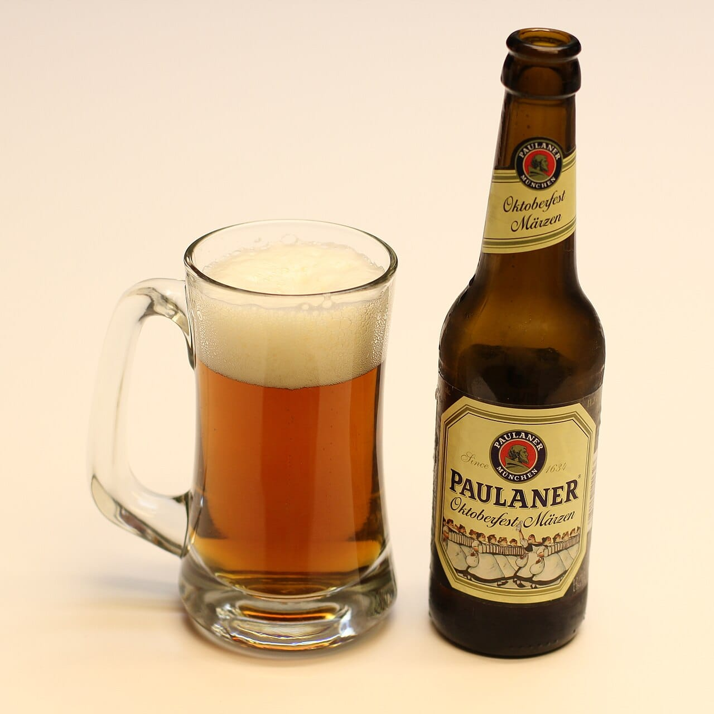

# German Beer Purity Law

"German beer may only be brewed from water, malt, hops and yeast." The line is repeated at every beer table, but it is not a statute transported intact from 1516. The 1516 text names only barley, hops and water; yeast joined the list later, and the rule is enforced today through the 1993 Provisional Beer Law.

Three dates have to be kept apart: the Bavarian territorial edict of 1516, its nationwide adoption in 1906, and the European Court's 1987 ruling on imported beer. Together they produce the regime that exists now.

Figure: The purity law sets the ingredient range for German beer; the image shows a German beer bottle and mug. Image: Scott A. Miller, CC BY 3.0, via Wikimedia Commons ([source page](https://commons.wikimedia.org/wiki/File:Paulaner_Oktoberfest_Marzen_11.2oz_bottle_and_beer_mug.jpg)).

## What the 1516 text actually says

On 23 April 1516, Dukes Wilhelm IV and Ludwig X of Bavaria issued the edict at the diet of Ingolstadt. It began with price controls: a maximum price per litre in winter and summer, with barrels confiscated from violators.

What mattered for later centuries was the ingredient clause: beer may use only barley, hops and water. Yeast is absent because its role was not yet understood. The motive was not only quality: restricting wheat and rye kept those grains for bread.

## Why Bavaria, not all of Germany

Before 1516, Munich had a similar rule in 1487 and Nuremberg around 1305. The 1516 version became famous because it raised local practice to a ducal ordinance, and other German states later copied it.

When Germany unified in 1871, Bavaria pushed for nationwide adoption as a condition of joining the empire; by 1906 it applied across the whole country. That path explains why the Reinheitsgebot is treated as a national tradition rather than a Bavarian memory.

## How the ingredient list evolved

Section 9 of today's Provisional Beer Law names four inputs: water, malt, hops and yeast. For bottom-fermented beer, only barley malt is allowed; for top-fermented beer, other cereal malts, sugar and sugar-derived colouring are permitted.

There are also technical exceptions: certain specialty beers, export beers and imported beers do not follow the same limits. The law protects the concept of beer produced in Germany, not every beer sold there.

## The conflict with EU law

In 1987 the European Court of Justice ruled in Commission v Germany that the purity rule's ingredient restriction on imported beer obstructed the free movement of goods. Since then, foreign beer that does not meet the Reinheitsgebot may be sold in Germany, but it may not be labelled as German beer.

German producers remain bound by section 9. This "different rules inside and outside" structure is often mistaken for a double standard; in fact it is the compromise between the EU single market and a member state's traditional rule.

## What it means in practice

For German breweries, the purity law rules out enzymes, stabilisers, preservatives, artificial flavours and colours. Clarifying agents and filter materials count as processing aids, not ingredients, but no residue may remain in the finished beer.

The restriction produces a relatively "clean" flavour profile and raises costs: breweries must create difference through malt bills, hop varieties and fermentation control rather than additives. Germany's roughly 1500 breweries and 7000 brands are the diversity that grew inside that constraint.

## Myths and facts

Myth one: the Reinheitsgebot is the world's oldest food law. It is more accurate to call it one of the oldest ingredient rules still actively enforced, and the current text has been rewritten several times.

Myth two: all German beer contains only four ingredients. Top-fermented beer may use other malts and sugar; imported beer is not covered at all.

Myth three: the law guarantees quality. It guarantees an ingredient range, not process skill, hygiene or flavour. Good beer still depends on the brewer.

Myth four: the law applies only in Bavaria. Since 1906 it has been a nationwide German law, now written into the federal Provisional Beer Law; Bavaria merely enacted it first and has defended the tradition most visibly. Treating Bavaria as the scope misreads the compliance duty in every other German region.

Myth five: the law bans all modern processing aids. In practice, clarifiers, filtration aids and packaging gases are not ingredients and may be used if they leave no residue; what is banned is additives that change flavour or extend shelf life. A brewery can therefore keep the ingredient list pure while using modern techniques to control oxygen and microbes. That is part of why German beer stays consistent at industrial scale. The law's endurance comes from that combination: a narrow ingredient rule and wide process latitude. It is also a marketing asset as much as a production rule. Being pure is not the same as being good; it only means the ingredient list is short.

## See also and references

- The basic category: [beer](ref:drink-style-beer).
- The bottom-fermented family: [lager](ref:drink-style-lager).
- The Pilsner style: [pilsner](ref:drink-style-pilsner).
- The producing region: [Bavaria](ref:region-bavaria).
- Germany's wine rules: [German wine law](ref:standard-german-wine-law).
- A German wheat beer: [Weihenstephaner Hefe Weissbier](ref:drink-germany-weihenstephaner-hefe-weissbier).

1. Deutscher Brauer-Bund, "Unser Reinheitsgebot — Fragen und Antworten", accessed 20 November 2026.
2. Bayerisches Bier, "Bayerisches Reinheitsgebot — Geschichte und Bedeutung", accessed 20 November 2026.
3. Deutscher Bundestag, "Vorgaben für das Selbstbrauen und Vermarkten von Bieren", 2020.
4. Gesetze im Internet, "Vorläufiges Biergesetz", accessed 20 November 2026.
5. EUR-Lex, "Commission v Germany, Case 178/84", accessed 20 November 2026.

**In brief:** On 23 April 1516 the Dukes of Bavaria issued an edict at Ingolstadt limiting beer to barley, hops and water. Its principle now sits in section 9 of the German Provisional Beer Law, making it one of the few early-modern ingredient rules still enforced.

For German Beer Purity Law, begin with the issuing body. Then look at the version, and finally ask the scope. The answers point to different choices, not to a single score.

Do not reduce German Beer Purity Law to a product manual. 

Sources for German Beer Purity Law include Deutscher Brauer-Bund, Bayerisches Bier, Deutscher Bundestag, Wissenschaftliche Dienste, Gesetze im Internet.

The 1516 edict was a Bavarian ingredient rule, not a modern food law; today's German beer law still limits ingredients, but exceptions exist for wheat beer and other styles.

The law's practical effect is a limited ingredient list, not a ban on all adjuncts or a guarantee of quality.

**Key facts.**

| Item | Detail |
| --- | --- |
| In one line | On 23 April 1516 the Dukes of Bavaria issued an edict at Ingolstadt limiting beer to barley, hops and water. Its principle now sits in section 9 of the German Provisional Beer Law, making it one of the few early-modern i… |
| Issuer | Duchy of Bavaria (now the Free State of Bavaria) |
| Code | Reinheitsgebot / § 9 Vorläufiges Biergesetz |
| Effective | 1516-04-23 |
| Scope | Ingredient restrictions for beer brewed in Germany |

**Sources and limits.** The key claims about German Beer Purity Law are checked against the following sources: Deutscher Brauer-Bund, Bayerisches Bier (Used for Ingolstadt, the 23 April date and the two dukes), Deutscher Bundestag, Wissenschaftliche Dienste (Used for the wording of section 9 and the exemption for imported beer) and 5 sources in total. Prices, batches and status change; the body is project-written and does not reproduce source text.
