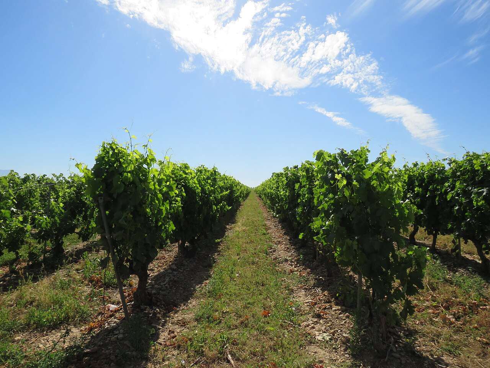

# Spanish DO System

Spain's wine-origin system is less about which region is "best" than about which name is protected and on what conditions. The framework comes from the vine and wine law of 10 July 2003, Ley 24/2003, which replaced the old statute of 1970.

Compared with France and Italy, Spain has more DOs, larger average areas and a higher share of cooperatives. That explains why two Rioja bottles from different estates can differ so much in price, and why only a handful of regions hold DOCa.

Figure: Spanish DOs are built on larger administrative areas; the image shows vineyards at Rodezno in La Rioja. Image: Nicolás Pérez Gimilio, CC BY-SA 4.0, via Wikimedia Commons ([source page](https://commons.wikimedia.org/wiki/File:Vi%C3%B1edos_en_Rodezno,_La_Rioja.jpg)).

## The 2003 law and its tiers

Ley 24/2003 layers the market: Vino de Mesa (table wine), Vino de la Tierra (the EU IGP equivalent), Denominación de Origen (DO, the PDO), Denominación de Origen Calificada (DOCa, a higher PDO), and Vino de Pago (VP, a single estate).

The higher the tier, the smaller the area and the tighter the rules. Only a few regions hold DOCa, including Rioja, Priorat and Ribera del Duero. VP emphasises a single property rather than an administrative district.

## What a DO requires

A DO must satisfy three things together: grapes from the delimited zone, vinification inside the zone, and 100% of the grapes from that zone. Before applying, the area must have existed for at least 5 years as a geographical-indication wine.

Governance sits with a Consejo Regulador: registering vineyards and wineries, writing the specification, checking volumes and labels, and organising sensory panels. The council is not a trade association but a body with public-law status.

## DOCa: one level higher

DOCa raises the bar: the region must have held DO status for at least 10 years; the wine must be bottled at registered wineries inside the zone, so bulk cannot be shipped out for bottling; and the control system must be independent, with chemical and sensory checks on every batch.

Those conditions make DOCa less "a better DO" than "a more closed and traceable DO". For consumers it is a quality signal; for estates it is cost and constraint. Rioja obtained DOCa in 1991, Priorat followed in 2000, and Ribera del Duero joined in 2008.

## Representative regions

Rioja is built on Tempranillo, blended with Garnacha, Graciano and Mazuelo, with Viura for whites. Ribera del Duero centres on Tinto Fino, a local Tempranillo clone, and generally produces a denser style. Priorat combines llicorella slate with Garnacha and Cariñena for high alcohol and a mineral edge.

In the northwest, Rías Baixas is known for Albariño; Rueda for Verdejo; Jerez for Palomino and its biological ageing system. Spain has around 70 DOs, spanning Atlantic humidity to Mediterranean drought.

## Labels and ageing terms

A DO label must show "Denominación de Origen" and the region; a DOCa label says "Denominación de Origen Calificada". The familiar ageing terms are Joven, Crianza, Reserva and Gran Reserva: for reds, Crianza requires at least 2 years, Reserva at least 3 years and Gran Reserva at least 5 years, with separate rules for time in oak.

These terms are national traditional designations, not regional inventions. They tell the consumer about ageing, not about style: a Rioja Reserva and a Priorat Reserva can be completely different drinks.

The ageing terms fix time, not cooperage. Rioja traditionally used American oak and now uses more French oak; Ribera del Duero prefers French oak and longer barrel ageing. A buyer who treats Reserva as a single style will misread the wine.

White wines and sparkling wines are another trap. Cava has its own DO and ageing rules and does not follow the red Crianza ladder; Albariño from Rías Baixas is usually unoaked and more often labelled Joven. Comparing those wines through the same ageing terms makes no sense. Read the region first, then the term.

## How it differs from France and Italy

French AOC works through parcels and villages, Italian DOCG through product specifications and testing, while Spanish DO works through larger administrative areas. As a result, a Spanish DO contains more internal variation and more uneven quality between estates.

The other difference is the cooperative. Much Spanish DO volume is produced by cooperatives, and the share of estate-owned vineyards is lower. That shapes pricing power and the pace of quality improvement, and helps explain why Spanish wine averages cheaper than French wine.

## Disputes: volume, climate and classification

The first dispute is volume. Some DOs long pursued high yields, oversupplying the lower market; after EU reforms, pressure to reduce or convert has grown.

The second is climate. Drought and heat make southern regions ripen too fast and lose acidity; irrigation limits and water allocation have become political.

The third is classification. Should DOCa expand beyond a few regions? Should VP become a separate premium tier? There are no universal answers, only bargains between regions.

## See also and references

- Rioja: [Rioja](ref:region-rioja).
- Ribera del Duero: [Ribera del Duero](ref:region-ribera-del-duero).
- Priorat: [Priorat](ref:region-priorat).
- The national picture: [Spain](ref:region-spain).
- The basic category: [red wine](ref:drink-style-red-wine).
- The idea behind the names: [appellation](ref:term-appellation).

1. Boletín Oficial del Estado, Ley 24/2003, accessed 20 November 2026.
2. Boletín Oficial del Estado, Ley 6/2015, accessed 20 November 2026.
3. MAPA, "vinos", accessed 20 November 2026.
4. OEMV, Observatorio Español del Mercado del Vino, accessed 20 November 2026.
5. Wine of Spain, "appellations", accessed 20 November 2026.

For Spanish DO System, begin with the issuing body, then the version, and finish with the scope; that order keeps the account grounded.

[Rioja](ref:region-rioja) and [Priorat](ref:region-priorat) answer different questions about Spanish DO System: issuer and scope. Read them as a pair, not as alternatives.

**Short definition:** Spain's Denominación de Origen system was set by the 2003 vine and wine law, with DO, DOCa, VP and IGP tiers. A region must first exist for 5 years as a geographical-indication wine before applying for DO; DOCa requires 10 years as a DO and bottling inside the zone.

A product manual is not a safe shorthand for Spanish DO System. Check what it is, then what the current text requires; where they diverge, prefer the specific source.

Spanish DO is a regional appellation tier, with DOCa/DOQ above it for Rioja and Priorat.

**Key facts.**

| Item | Detail |
| --- | --- |
| In one line | Spain's Denominación de Origen system was set by the 2003 vine and wine law, with DO, DOCa, VP and IGP tiers. A region must first exist for 5 years as a geographical-indication wine before applying for DO; DOCa requires … |
| Issuer | Spanish Ministry of Agriculture, Fisheries and Food (MAPA) |
| Code | Ley 24/2003, de 10 de julio, de la Viña y del Vino |
| Effective | 2003-07-11 |
| Scope | Appellations, classification, governance and labelling of Spanish wine |

**Sources and limits.** The key claims about Spanish DO System are checked against the following sources: Boletín Oficial del Estado (Full statute; used for the DO definition, the five-year precondition and the Consejo Regulador; Used for cross-region DOP/IGP recognition and governance), MAPA (Used for the register of appellations and supervisory bodies), OEMV (Used for production, export and price data) and 5 sources in total. Prices, batches and status change; the body is project-written and does not reproduce source text.
