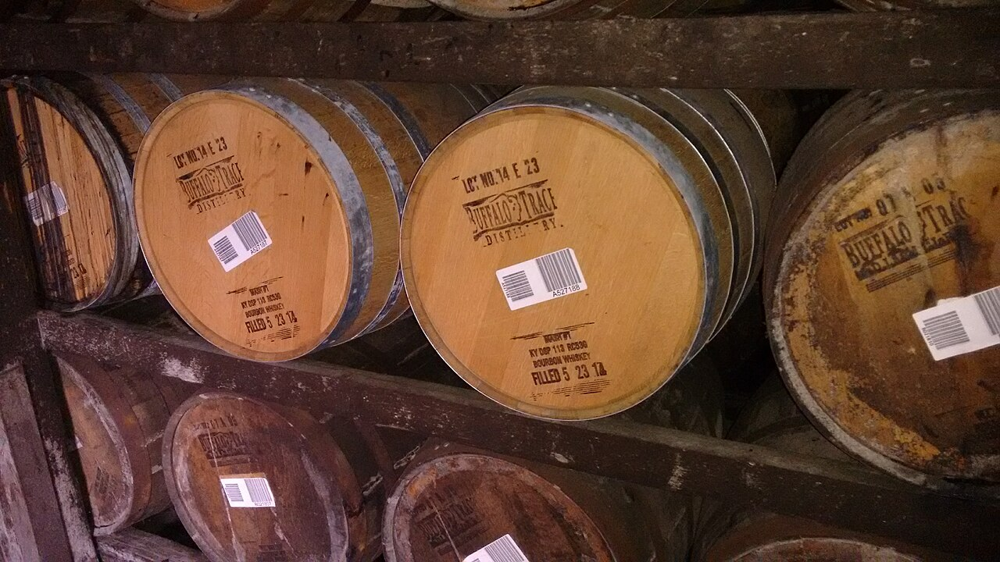

# US Distilled Spirits Labeling: 27 CFR 5

In the United States, whether a bottle may be called "bourbon" is not the distillery's decision. It is a question of federal regulation. Title 27, Part 5 of the Code of Federal Regulations turns that question into enforceable text: first it defines the category, then it prescribes the label. The Alcohol and Tobacco Tax and Trade Bureau, an office of the Treasury, enforces it separately from food-safety law.

The legal personality of these rules is unusual. They do not aim at a minimum safety standard; they aim at identity between name and contents. When a consumer reads "straight bourbon whiskey", the phrase should imply a grain recipe, a distillation strength, an oak-barrel type and a minimum ageing period. If the bottle cannot support those inferences, the label is non-compliant.

Figure: US standards of identity govern grain, distillation and ageing; the image shows bourbon barrels at a Kentucky distillery. Image: Acdixon, CC0, via Wikimedia Commons ([source page](https://commons.wikimedia.org/wiki/File:Buffalo_Trace_barrels.jpg)).

## Where the rules sit: TTB and Title 27

Title 27 is the US compilation of alcohol, tobacco and firearms regulations. Part 4 governs wine, Part 5 governs distilled spirits, Part 7 governs beer. Part 5 covers standards of identity, labeling, advertising and packaging, with pre-approval and market checks run by TTB.

TTB's predecessor was the Bureau of Alcohol, Tobacco and Firearms at the Treasury. In 2003 the alcohol and tobacco functions moved into the newly created TTB, while firearms stayed with ATF. That split explains why American spirits labels often carry a TTB approval number while gun regulation sits in a completely different system.

## Standards of identity: a name is not a marketing word

Part 5 uses "standards of identity" to fix the raw materials and process boundaries of each spirit. Whisky must be fermented from grain, distilled and aged in oak. Bourbon must draw at least 51% of its grain bill from corn, be distilled at no more than 160 proof and aged in new, charred oak containers.

Gin must take its primary flavour from juniper. Vodka is defined as neutral spirits treated to be without distinctive character. Tequila has its own US category definition. A distillery may invent a new name, but the moment it uses a protected category, it must fit the corresponding definition.

## Ageing, "straight" and bottled in bond

US law does not require every whisky to state an age, but anything younger than 4 years must say so. A whisky labelled "straight" must be aged at least 2 years; if it is between 2 and 4 years old, the label must also disclose that. This four-year threshold is one of the most common sources of label errors.

"Bottled in bond" is a stricter voluntary claim: one distillation season, one distillery, at least 4 years of ageing and bottling at exactly 100 proof. It began as a supervisory tool under the 1897 Bottled-in-Bond Act and has since become a quality signal. Tennessee whiskey adds a maple-charcoal filtration step, the Lincoln County process, and a state-of-production requirement on top of the bourbon baseline.

## What the label must say

Mandatory information includes the brand name, the class and type, alcohol content by volume, net contents, the name and address of the responsible party, the country of origin for imports, and the government health warning. The warning has been mandatory since 1989, with prescribed wording and type size; an icon alone is not enough.

Blended products must say "blended", "a blend" or name the components, and colouring agents trigger disclosure. Around 2020, TTB modernised a number of outdated provisions and simplified parts of the approval process, but the core identity standards were not relaxed.

## The key differences from EU rules

The EU manages spirits through geographical indications and category definitions: Cognac and Scotch whisky are GI-protected, while vodka and gin rely on compositional definitions. The US has no equivalent register of GIs; bourbon and Tennessee whiskey are protected mainly through domestic law and international agreements.

As a result, the same liquid gets a different label strategy in each market. Europe emphasises origin and traditional terms; the US emphasises what the bottle is made from, how it was processed and how long it aged. The two systems are not in conflict, but a compliance team must prepare separate dossiers.

One difference is often missed: imported spirits must also meet Part 5 labelling in the US, but some information produced under foreign rules is exempt. An exporter who pastes a European label onto a US shipment is often rejected for a missing government warning or a non-conforming alcohol unit. The US requires alcohol by volume, with proof only as a supplement; the EU works in volume percentage but national formats differ. This is one of the most common reasons for cross-border returns.

## Disputes and reform

Three arguments recur: whether identity standards stifle small distilleries; whether overlapping state and federal rules make interstate shipping too hard; and whether words such as "natural" or "handmade" need a statutory definition. TTB has answered through guidance and case-by-case approvals rather than a wholesale rewrite of Part 5.

The other long-running problem is capacity. TTB simultaneously handles alcohol, tobacco, firearms and excise tax, and approval backlogs are a frequent industry complaint. For exporters, time cost can matter more than the compliance fee itself.

## See also and references

- The grain recipe and ageing of the American spirit: [bourbon](ref:drink-style-bourbon).
- The wider family: [whisky](ref:drink-style-whisky).
- The producing state: [Kentucky](ref:region-kentucky).
- A specific bottle: [Buffalo Trace](ref:drink-usa-buffalo-trace).
- The US system for wine origins: [US AVA system](ref:standard-us-ava).

1. Electronic Code of Federal Regulations, 27 CFR Part 5, accessed 20 November 2026.
2. TTB, "Distilled spirits labeling", accessed 20 November 2026.
3. TTB, "Appellations of origin", accessed 20 November 2026.
4. U.S. Government Publishing Office, CFR Title 27, Volume 1, Part 5, accessed 20 November 2026.
5. Cornell Law School, Legal Information Institute, 27 CFR Part 5, accessed 20 November 2026.

For US Distilled Spirits Labeling, begin with the issuing body. Then look at the version, and finally ask the scope. The answers point to different choices, not to a single score.

The comparison with [Bourbon Whiskey](ref:drink-style-bourbon) and [Kentucky](ref:region-kentucky) runs through issuer and scope. Each answers a different question.

**At a glance:** Title 27, Part 5 of the US Code of Federal Regulations, enforced by the Alcohol and Tobacco Tax and Trade Bureau. It uses standards of identity to define what whisky, bourbon, gin and vodka must be made from, and then dictates what the label has to say. Read it and a bottle's name stops being a marketing choice.

**Key facts.**

| Item | Detail |
| --- | --- |
| In one line | Title 27, Part 5 of the US Code of Federal Regulations, enforced by the Alcohol and Tobacco Tax and Trade Bureau. It uses standards of identity to define what whisky, bourbon, gin and vodka must be made from, and then di… |
| Issuer | US Alcohol and Tobacco Tax and Trade Bureau (TTB) |
| Code | 27 CFR Part 5 |
| Effective | 1935-08-29 |
| Scope | Standards of identity, labeling and advertising of distilled spirits in the United States |

**Sources and limits.** The key claims about US Distilled Spirits Labeling: 27 CFR 5 are checked against the following sources: Electronic Code of Federal Regulations (Current text; used to check the identity standards, ageing rules and label requirements), Alcohol and Tobacco Tax and Trade Bureau (TTB's official page; used for the approval process and required label elements; Used as a comparison for how the US protects place names), U.S. Government Publishing Office (Used to check the numbering and wording of earlier provisions) and 5 sources in total. Prices, batches and status change; the body is project-written and does not reproduce source text.
