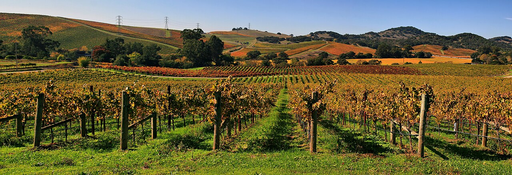

# US AVA System

The AVA is the most misunderstood piece of American wine regulation. Many drinkers assume it works like a French AOC or an Italian DOCG. In fact it does one thing: it draws a boundary around a grape-growing area and gives it a name. It does not dictate varieties, cap yields or require a method.

The system began in 1978, the first AVA — Augusta in Missouri — was approved in 1980, and Napa Valley followed in 1981. Today there are more than 200 AVAs, from a few hundred hectares on one slope to regions spanning states.

Figure: An AVA only draws a geographic boundary; the image shows vineyards in Napa Valley. Image: Brocken Inaglory, CC BY-SA 3.0, via Wikimedia Commons ([source page](https://commons.wikimedia.org/wiki/File:Vineyards_in_Napa_Valley_7.jpg)).

## The 1978 framework and the first AVA

Before AVAs, US labels relied mainly on state or county names. In 1978 the Bureau of Alcohol, Tobacco and Firearms, TTB's predecessor, created the AVA system so that "origin" would have a checkable geographical definition rather than serve as marketing language.

Augusta AVA was approved in 1980, and Napa Valley in 1981; the latter became the country's most influential wine place brand. When TTB took over the alcohol functions, it kept responsibility for petitions and boundary amendments.

## What an AVA is

An American Viticultural Area is a geographical boundary defined by climate, soil, elevation, topography and historical planting records. It is not a county, not a postcode, and not a quality tier.

27 CFR Part 9 lists each AVA name and boundary description. A boundary may cross counties or states, or sit entirely inside one county. An AVA can contain sub-AVAs, such as Oakville, Rutherford and Stags Leap District inside Napa Valley.

## The 85% rule

To name an AVA on a label, at least 85% of the wine must come from grapes grown inside that AVA. This is a labelling rule under 27 CFR Part 4, not a planting rule.

A single-vineyard claim raises the threshold to 95%; a county or state name requires 75%. Blends may cross AVAs, but a label may name only one AVA and must meet the 85% share.

## Petitions and boundaries

An AVA petition may come from a producer, a landowner, a local group or a government body. The petitioner submits maps, a proposed boundary and evidence of climate or geography that distinguishes the area from its surroundings.

TTB publishes the petition for comment, addresses objections and issues a final rule. The process can take years. Boundary expansion is the usual quarrel: estates inside the existing area fear brand dilution, while landowners outside want to share the premium.

## How it differs from a European PDO

A European PDO usually regulates geography, varieties, yields, methods and labelling together. An AVA regulates geography alone. A California estate may plant dozens of varieties inside one AVA and use any method, provided the label percentages comply.

So an AVA is a geographical label, not a quality guarantee. It protects a place name, not a style. Seeing Napa Valley tells you where the grapes grew, not which variety, sweetness or ageing regime produced the wine.

An AVA does not restrict irrigation, yield or rootstock; those are set by the estate and local government. Some California counties have irrigation rules, but that is local water law, not AVA law. Treating an AVA as a farming code overstates its reach.

Label language is another difference: a European PDO often prints "Appellation Contrôlée" on the front, while a US AVA prints only a place name, without the word "controlled". That makes it easier to read an AVA as pure geography rather than a quality tier.

The evidentiary bar is also high: a petitioner must show that climate, soil or terrain inside the boundary differs materially from outside, and that the difference shows in the wine. TTB does not demand sensory data, but it does demand geographic and agricultural evidence, which is why petitions often take years. Once approved, a boundary does not expand with market demand; every amendment reopens public comment. That is the sharpest institutional difference from a European PDO.

## Representative AVAs

Napa Valley is the best-known, subdivided into Oakville, Rutherford, Stags Leap District and others. Sonoma includes Sonoma Coast and Russian River Valley, while Oregon's Willamette Valley is known for Pinot Noir.

Washington's Columbia Valley is vast and contains several sub-AVAs; Paso Robles and Santa Barbara County on the central coast have gained attention in recent years. Climates range from cool coastal fog belts to hot inland valleys.

## Disputes: boundaries, climate and brand

The first dispute is expansion. Folding new land into an existing AVA reduces the scarcity of the original name; refusing it may exclude vineyards that are physically continuous.

The second is climate change. Boundaries were drawn from historical climate data, but warming shifts the plantable range while AVA lines are slow to move.

The third is brand premium. The name Napa Valley can multiply a price, yet quality varies widely inside the same AVA. Consumers buy a place name, not necessarily a level of quality.

## See also and references

- Napa Valley: [Napa Valley](ref:region-napa-valley).
- Sonoma: [Sonoma](ref:region-sonoma).
- The national picture: [United States](ref:region-usa).
- The basic category: [wine](ref:drink-style-wine).
- US spirits labelling: [US Distilled Spirits Labeling 27 CFR 5](ref:standard-us-27-cfr-5).
- The idea behind appellations: [appellation](ref:term-appellation).

1. TTB, "Appellations of origin", accessed 20 November 2026.
2. Electronic Code of Federal Regulations, 27 CFR Part 9, accessed 20 November 2026.
3. TTB, "Wine appellations — final rule and AVA list", accessed 20 November 2026.
4. Electronic Code of Federal Regulations, 27 CFR Part 4, accessed 20 November 2026.
5. Wine Institute, "appellations and AVAs", accessed 20 November 2026.

**At a glance:** American Viticultural Areas are the US geographical label system for wine, created in 1978 with the first AVA approved in 1980. An AVA only draws a boundary; it does not regulate varieties, yields or winemaking. To name an AVA, at least 85% of the grapes must come from it. 

For US AVA System, begin with the issuing body. Then look at the version, and finally ask the scope. The answers point to different choices, not to a single score.

Setting [Napa Valley](ref:region-napa-valley)'s issuer beside [United States](ref:region-usa)'s scope makes the boundary between them visible.

US AVA is a geographic designation, not a guarantee of quality or method.

**Key facts.**

| Item | Detail |
| --- | --- |
| In one line | American Viticultural Areas are the US geographical label system for wine, created in 1978 with the first AVA approved in 1980. An AVA only draws a boundary; it does not regulate varieties, yields or winemaking. To name … |
| Issuer | US Alcohol and Tobacco Tax and Trade Bureau (TTB) |
| Code | 27 CFR Part 9 |
| Effective | 1978-06-02 |
| Scope | Delimitation, petition and label use of US wine appellations |

**Sources and limits.** The key claims about US AVA System are checked against the following sources: Alcohol and Tobacco Tax and Trade Bureau (Official TTB page; used for the AVA definition, petition process and the 85% rule; Used to check the AVA list and boundary descriptions), Electronic Code of Federal Regulations (Full text; each AVA boundary and name is listed here; Used for the 85% AVA, 95% single-vineyard and 75% state/county label rules), Wine Institute (Used for the industry explanation and distribution of AVAs). Prices, batches and status change; the body is project-written and does not reproduce source text.
