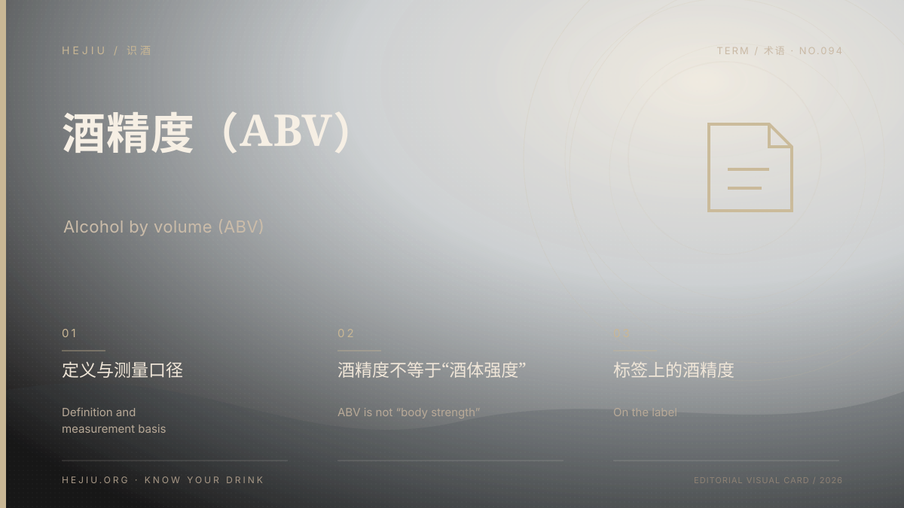

# Alcohol by volume (ABV)

Alcohol by volume (ABV) describes the share of ethanol in a drink by volume. It is usually written as “% vol”: 12.5% vol means that, at 20 °C, every 100 volume units of the drink contain 12.5 volume units of pure ethanol. It is a basic parameter for formulations, labels, taxation and drinking guidance, but it is not a quality score.

Figure: thematic illustration for Alcohol by volume (ABV). Image: AI-assisted illustration generated with Doubao Seedream 5.0 (project-owned); not a photograph of the subject.

## Definition and measurement basis

The OIV uses the term “actual alcoholic strength by volume” in the definitions of its International Code of Oenological Practices, with measurement standardised at 20 °C. Temperature matters because water and ethanol expand at different rates; the same bottle measured at different temperatures can show slightly different volume fractions. Fixing the temperature makes results comparable between laboratories and between years.

The Chinese standards system also uses a volume-fraction basis. GB/T 17204-2021 provides the terminology framework for alcoholic beverages and their categories, while the alcohol-content requirements for a specific product belong to the relevant product standard. Legal ranges differ by drink: wine has a minimum actual alcoholic strength, while baijiu, whisky and vodka commonly occupy higher ranges.

## ABV is not “body strength”

ABV says how much ethanol is present by volume; it says nothing about aroma, sweetness, acidity, tannin or mouthfeel. Two [wines](ref:wine) at 13% vol can be one crisp and light, the other rich and dense. Two [baijiu](ref:baijiu) at 52% vol can taste completely different because of aroma family, raw materials and process. Treating ABV as the single measure of “stronger” or “better” misses the structure of the drink.

Conversely, low ABV does not mean “thin”. Beer, yellow wine and sake can carry complex grain aroma, acidity and umami at modest strength; liqueurs may use sugar and flavour to balance a lower alcohol bite. When evaluating a drink, ABV is only one variable among many.

## On the label

Annex XII of Regulation (EU) No 1169/2011 requires beverages containing more than 1.2% vol of alcohol to state the actual alcoholic strength by volume, to not more than one decimal place, followed by “% vol”, with the strength determined at 20 °C. The purpose is to let consumers compare products on the same shelf, rather than letting producers rely on vague words such as “strong” or “light”.

In the Chinese market, prepackaged alcoholic beverages are governed by food-safety standards and the relevant product standards. The presentation, permitted tolerances and exemptions must be checked for each category. In any market, the figure on the label should correspond to a test report; a large gap between the two deserves further checking.

## Common misconceptions

First, ABV is not “raw-material concentration”. Fermentation can only convert sugar into ethanol, so strength depends first on fermentable sugar and yeast tolerance; distillation concentrates existing ethanol rather than creating new alcohol.

Second, ABV is not an ageing indicator. Ageing mainly affects aroma, colour and structure and may not change strength much; fortified wines and some sweet wines gain strength from added grape spirit.

Third, ABV is not a quality grade. Within one region and one drink category, products may choose different strengths for stylistic reasons; regulations set permitted ranges, not consumer preferences.

## Volume fraction and mass fraction

There are at least two ways to express "how much alcohol" a drink contains. Volume fraction (% vol) is the share of ethanol volume in the total volume; mass fraction (% mas) is the share of ethanol mass in the total mass. The two figures are not equal, because ethanol is less dense than water: the volume fraction of a bottle is usually slightly higher than its mass fraction. Wine, beer and most prepackaged alcoholic drinks use volume fraction because volume is easy to measure, fill and compare; chemistry and engineering sometimes use mass fraction. When reading technical material, check which basis is used, or two different numbers will be mistaken for the same thing.

## A brief note on measurement

Laboratory determination of alcoholic strength usually takes two steps: first separate ethanol from the sample by distillation or a similar method, then measure the density or refractive index of the distillate and convert it to a volume fraction at 20 °C. Modern instruments can also use oscillating U-tube density meters or near-infrared methods, but all need calibration with standard substances. Consumers do not need these details; what matters is knowing that the label figure comes from testing, not from an estimate or marketing.

## ABV and how a drink is served

ABV affects drinking rhythm and serving size. Spirits are usually served in small glasses, over ice or with water; adding water dilutes the strength and also changes aroma release. Beer and wine come in larger servings but contain less ethanol per unit volume. Understanding this helps turn advice such as "drink more slowly", "drink water" and "do not drink on an empty stomach" into concrete practice rather than slogans.

The same drink also smells and feels different at different temperatures. Warmer liquid releases ethanol more readily and smells sharper; cooler liquid keeps aroma tighter but may feel thin on the palate. This is part of why different drink categories have their own recommended serving temperatures.

## Label tolerances and checking

Different markets allow different tolerances for the declared strength, some as an absolute percentage point and some as a relative proportion. Producers leave a safety margin when filling, and testing bodies check with standard methods. For consumers, if a label figure differs clearly from what the drink actually tastes like, or if one batch varies widely, it is worth looking at test reports and batch information. ABV is an objective parameter that instruments can check, not a subjective argument settled only by feeling.

[Baijiu](ref:baijiu)'s definition and [Original gravity](ref:c-extra-1)'s applicable standard form a useful pair: the contrast shows where one ends and the other begins.

**In brief:** ABV is the volume fraction of ethanol in a drink measured at 20 °C, usually written as % vol; it is a basic labelling and formulation parameter, not a quality score.

**Sources and limits.** The key claims about Alcohol by volume (ABV) are checked against the following sources: International Organisation of Vine and Wine (OIV) (Used to check the definition and measurement basis of alcoholic strength), European Union (Used to check the labelling rules for alcoholic strength), State Administration for Market Regulation; Standardization Administration of China and 4 sources in total. Prices, batches and status change; the body is project-written and does not reproduce source text.

**Read alongside.** Put Alcohol by volume (ABV) next to Baijiu, Wine, Original gravity: the first fixes identity and boundary, the others provide a region, process or peer comparison. Read this term first, then return to those entries; the links become coordinates, not decoration.

## Further reading

- [Wine](ref:wine): categories, vintage and labelling rules.
- [Baijiu](ref:baijiu): ingredients, processes and aroma families.

Further reading: [Original gravity](ref:c-extra-1).
