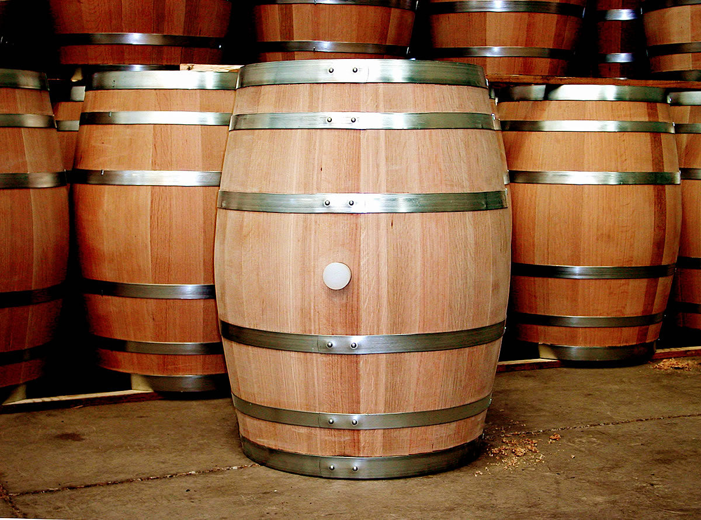

# Angel's share

The angel's share is the portion of a spirit that evaporates into the air through the cask wall during maturation. The name is romantic, but the thing it describes is practical: an oak cask is not a sealed container, ethanol and water keep escaping over time, the volume falls and the strength may change.

Figure: Angel's share. Image: Gerard Prins, CC BY-SA 3.0, via Wikimedia Commons ([source page](https://commons.wikimedia.org/wiki/File:Oak-wine-barrel-at-toneleria-nacional-chile.jpg)).

## Definition and scope

The boundary of the angel's share is normal evaporation through the wood. It does not include leakage from a damaged cask, a loose bung or a cracked stave, nor does it include volume lost to pumping, sampling or filtration. Nor is it the same as maturation itself: maturation is the combined effect of time and container, and the angel's share is only one measurable loss within it.

The term applies to every cask-matured spirit. Whisky, Cognac, Armagnac, rum, tequila and some baijiu all undergo the same physical process. It describes changes in volume and strength, not changes in flavour; flavour comes from wood, oxygen and time together, and evaporation simply concentrates what remains.

## Etymology and origin

English angel's share is synonymous with French part des anges and Spanish parte de los ángeles, popularly explained as "the portion the angels drink". The phrase has circulated in the whisky trade for a long time, but its earliest documented use is hard to establish, and it remains trade slang rather than a legal term. Chinese translations preserve the personified image.

Regulation sets maturation periods, cask types and labelling, but it does not set an evaporation rate. "Two percent a year" is therefore always a rule of thumb, never a legal rule. Mistaking slang for statute is the most common starting error in any discussion of the angel's share.

## Mechanism and parameters

An oak cask is built from staves, and the wood itself is porous. Ethanol and water pass through the wood as vapour, diffuse to the outer surface and evaporate. The driving force is the temperature difference and the vapour-pressure difference between inside and outside, so warehouse conditions explain differences between distilleries better than "cask age" does.

Higher temperatures speed evaporation. Relative humidity changes the ratio in which ethanol and water escape: in humid air, ethanol leaves more readily than water and strength may slowly fall; in dry air, water leaves faster and strength may rise relatively. Cask size matters too, because small casks have a larger surface-area-to-volume ratio and lose more per unit volume; a common 200-litre cask usually loses faster than a 500-litre one. Warehouse type also plays a part: traditional floor warehouses with gentle temperature swings lose less, while the upper levels of racked warehouses run hotter and lose faster. In addition, a falling liquid level enlarges the headspace and adds oxidation risk, so some distilleries top up their casks periodically.

## Use in the industry

Distilleries build the angel's share into stock and cost models: the wine or spirit available at bottling is smaller than the volume filled, and older products need more original casks to reach a target number of bottles. Investment and insurance estimates also use evaporation rates to value remaining stock. Topping up reduces headspace and slows oxidation, but it cannot recover what has already evaporated.

In labelling and product design, the angel's share is related to [cask strength](ref:cask-strength) but distinct: cask strength is the bottling strength without added water, and evaporation changes the ethanol-to-water ratio and therefore the final strength, but strength alone cannot be used to back-calculate the loss. Secondary maturation such as [barrel finishing](ref:barrel-finishing) brings additional losses, and total loss calculations must include them.

## Terms easily confused

- **Angel's share versus leakage**: the first is normal evaporation through intact wood, the second is abnormal loss through a seam, bung or damaged stave. Leakage can often be repaired or traced; evaporation is irreversible.
- **Angel's share versus topping up**: topping up means adding spirit to reduce headspace and is a maintenance action; the angel's share is volume already lost, and topping up cannot bring it back.
- **Angel's share versus age**: age is a length of time, while the angel's share is the volume and strength change accumulated over that time. Two casks of the same age can lose very different amounts.
- **Angel's share versus cask strength**: cask strength is bottling strength, shaped by the relative loss of ethanol and water. Treating cask strength as direct evidence of how much evaporated reverses cause and effect.

## Misconceptions and disputes

First, "two percent a year" is treated as an industry-wide constant or a legal standard. It is only a common order-of-magnitude reference in Scotland; warm regions, small casks or hot warehouses may be higher, and large casks in cool warehouses may be lower. Second, a larger loss is equated with higher quality. Concentration can raise flavour density, but excessive evaporation brings over-oxidation and woody notes. Third, people assume the angel's share happens only in whisky. Fourth, evaporation is assumed to reduce volume without changing strength, ignoring the different escape rates of ethanol and water.

One dispute concerns the effect of high versus low humidity on strength, which is often reduced to a simple either-or. In a real warehouse, temperature, humidity, air movement and stave thickness act together, and the result must be measured rather than calculated from a formula. Another dispute concerns the price of old bottlings: scarcity, storage, capital tied up, brand and tax all play a part, and not all of the premium can be attributed to the angel's share.

## Typical figures and examples

- The Scotch trade often cites an annual volume loss of about 2%; the Scotch Whisky Association's cask investment guidance says a cask loses "roughly 2% of its contents through evaporation each year".
- For a 200-litre cask, 2% is about 4 litres a year, equivalent to five or six 700 mL bottles.
- Compounding at 2% leaves about 82% after ten years, a cumulative loss of about 18%; after thirty years more than half can be gone.
- The legal minimum maturation for Scotch whisky is three years (The Scotch Whisky Regulations 2009).
- Example: two casks from the same distillery, one in a damp coastal warehouse and one in a dry inland warehouse, may differ by several percentage points in strength after ten years, showing that environmental parameters explain more than the vintage label.

## See also

- [Whisky](ref:whisky): the basics of maturation and cask types.
- [Cask strength](ref:cask-strength): bottling strength and dilution.
- [Barrel finishing](ref:barrel-finishing): the purpose and practice of secondary maturation.
- [Vintage](ref:vintage): vintage labelling and wine age.

**In brief:** The angel's share is the portion of a spirit lost through the cask wall during maturation; the Scotch whisky trade often cites about 2% a year, but the real rate depends on temperature, humidity, cask size and warehouse type, and is neither a precise constant nor a quality grade.

For Angel's share, begin with where the term is used. Then look at what it is contrasted with, and finally ask whether the source is a standard. The answers point to different choices, not to a single score.
