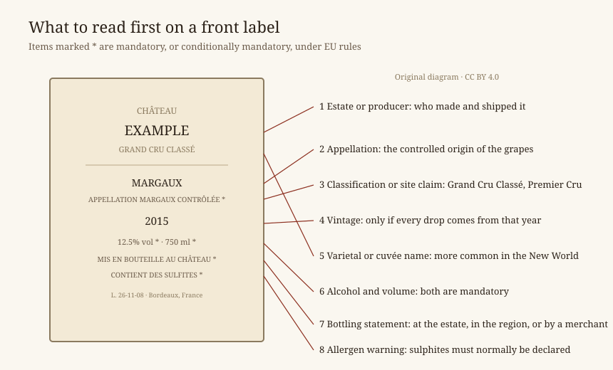

# Appellation

An appellation is a legal geographical designation: it ties the production of a product to a defined area and a set of rules, and only products made inside that area, under those rules, may use the name. France calls it appellation d'origine contrôlée (AOC), later extended as appellation d'origine protégée (AOP); Italy has DOC and DOCG, Spain has DO and DOCa, and at EU level the categories are PDO and PGI.

Figure: common positions on a French AOC front label; items marked * are mandatory or conditionally mandatory under EU rules. Original diagram, CC BY 4.0.

## The problem the system addresses

Without rules, anyone could write "wine from somewhere". Consumers could not tell whether a bottle really came from that place or was made according to local tradition. Appellations answer that with three constraints: a defined geographical area, prescribed production conditions, and inspection and labelling rules.

Production conditions typically include permitted varieties, minimum planting density, maximum yield per hectare, harvest methods, winemaking methods, minimum alcohol level and ageing requirements. Requirements vary widely between regions, so one set of rules cannot be applied everywhere. The aim is to protect local tradition and consumers, not to score the wine.

## Main systems

France's AOC system took shape in the early 20th century and is administered by INAO. AOC covers wine, spirits, dairy and agricultural products; for wine, the hierarchy runs from regional to village level and on to individual vineyards, and the narrower the level, the stricter the rules usually are.

Italy's DOC and DOCG follow similar logic, with DOCG often adding stricter yield, ageing and bottling requirements. Spain's DO and DOCa likewise bind area and specification. At EU level, geographical indications are split into PDO (protected designation of origin) and PGI (protected geographical indication): PDO requires production, processing and preparation all in the defined area, while PGI requires at least one production stage there.

Spirits also have geographical indications — Cognac, Scotch whisky and tequila, for example, all carry legal area and process requirements. Their legal structures differ and cannot be equated directly with the wine AOC.

## Hierarchy and labels

Within one region there are often several levels of name. Wines labelled with a broad regional name have looser rules; wines labelled with a village name cover a smaller area with stricter requirements; wines labelled with a specific vineyard (a climat in France, a cru in Italy) cover the smallest area. A higher level does not mean better quality, but it usually means a narrower area and a more specific specification.

When a brand name and a region name appear together on a label, they answer different questions: the brand identifies the producer, the region identifies geographical origin and rules. Treating a region name as a brand, or a brand as a guarantee of origin, both misread the label.

## Relation to terroir

Appellations are often described as the institutionalised form of [terroir](ref:terroir). They do write "place" into law, but the rules set minimum conditions; they do not guarantee that every bottle expresses a typical style. Within the same boundary, soil, aspect, microclimate, vintage and producer choices still produce clear differences.

A more accurate reading is therefore: a region name tells you where the wine comes from and at least what rules it was made under, not what it must taste like. For style, return to variety, vintage, process and producer information.

## Not a quality ranking

A common misconception treats AOC, DOCG or PDO as quality grades. The core of these systems is geographical origin and production specification; inspection focuses on compliance, not sensory scoring. An everyday table wine can be enjoyable, and an appellation wine can be mediocre. Price correlates with level, but the level is not a sufficient condition for quality.

Another misconception is that geographical indications mean absolute exclusivity. In practice, the rules leave room for innovation within the framework, and the same name can cover different styles. The finer the rules, the less room for innovation — a trade-off in the design, not a defect.

## The Chinese counterpart

China runs several routes — protected geographical indication products, geographical indications for agricultural products, and geographical indication trademarks — whose authorities and legal bases differ from the EU system. Baijiu, huangjiu and tea also have traditions of place names, such as Maotai town or Xinghuacun, but the legal meaning of such wording must be checked case by case and cannot be equated with AOC.

When discussing place names in Chinese drinks, distinguish three cases: a legal geographical indication, a company's product name, and an industry or folk regional term. Their binding force is entirely different.

An appellation ties a geographic name to production rules. It answers where a wine comes from and which practices are allowed, not which wine is better. French AOC/AOP, Italian DOC/DOCG, Spanish DO and the EU PDO/PGI systems use different labels and levels. A wine can carry both a place name and a variety name, but those describe different things. Treating an appellation as a quality ranking is the most common misunderstanding.

Read Appellation through where the term is used, then what it is contrasted with, and finally whether the source is a standard. The sequence matters.

[Terroir](ref:terroir) and [Sparkling wine](ref:sparkling-wine) are the nearest useful comparisons: one clarifies definition, the other tests applicable standard.

**Short definition:** An appellation is a legal designation that binds a geographical area to production rules, such as French AOC/AOP, Italian DOC/DOCG, Spanish DO and EU PDO/PGI; it states origin and rules, not a quality ranking.

The usual confusion is to treat Appellation as a particular drink. Check what it is first, then how the term is used; the two need not agree.

Sources for Appellation include INAO, European Commission, Directorate-General for Agriculture and Rural Development, International Organisation of Vine and Wine (OIV), Encyclopaedia Britannica.

**Sources and limits.** The key claims about Appellation are checked against the following sources: INAO (Used to check the administering body, geographical scope and production rules of the French AOC/AOP system), European Commission, Directorate-General for Agriculture and Rural Development (Used to check the EU framework for PDO, PGI and geographical indications), International Organisation of Vine and Wine (OIV) (Used to check the place of geographical indications in the definition of wine and labelling rules) and 4 sources in total. Prices, batches and status change; the body is project-written and does not reproduce source text.

**Read alongside.** Put Appellation next to Terroir, Wine, Sparkling wine: the first fixes identity and boundary, the others provide a region, process or peer comparison. Read this page first, then return to those entries; the links become coordinates, not decoration.

For Appellation, this page was last checked in 2026; prices, batches and availability change, so confirm them against the sources below.

## Further reading

- [Terroir](ref:terroir): how natural conditions and human practice create regional character.
- [Wine](ref:wine): categories, vintage and labelling rules.
- [Sparkling wine](ref:sparkling-wine): sparkling wines named after places and their process requirements.

Further reading: [Acidity](ref:c-extra-1).
