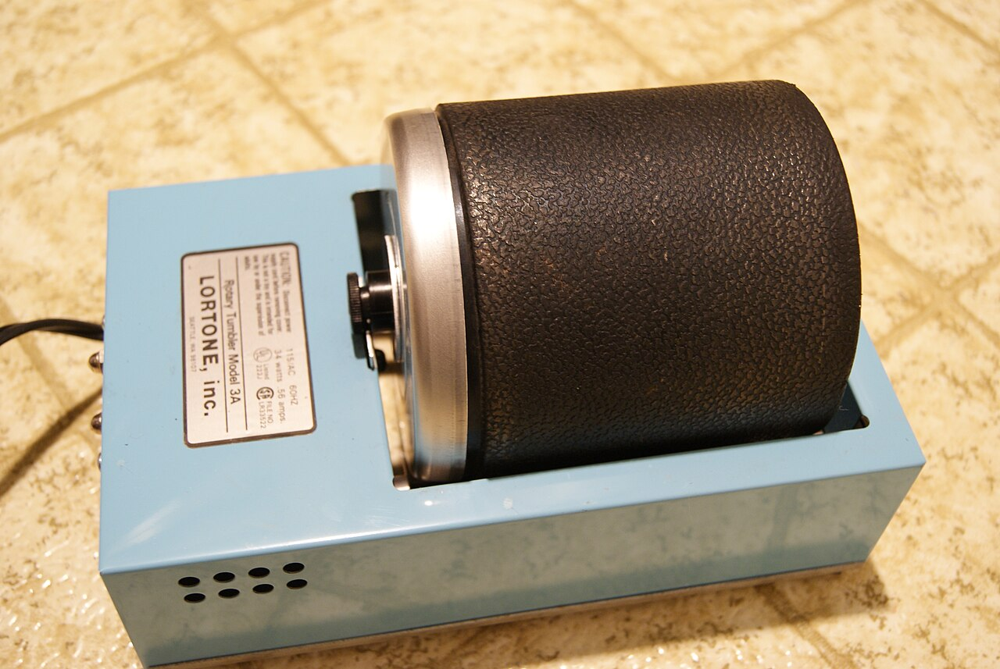

# Barrel finishing

Barrel finishing (also called secondary maturation) moves a drink from its main maturation container into a different cask for a further period, to add, adjust or unify flavour. It describes a later stage, not full-term use of that cask. Finishing appears in [whisky](ref:whisky), [wine](ref:wine) and beer, but the purposes, timing and legal constraints differ.

Figure: Barrel finishing. Image: Zul32, CC BY-SA 3.0, via Wikimedia Commons ([source page](https://commons.wikimedia.org/wiki/File:RockTumbler2.JPG)).

## Definition and boundaries

The key is “main maturation first, then a change of cask”. If a drink stays in one cask from filling to bottling, that is single-cask maturation, not finishing; if it is moved for only a few weeks, the stage is usually called a finish rather than a full maturation period. Finishing is generally shorter than the main maturation, often months to two or three years, but there is no single legal duration.

The boundary also concerns whether the new cask still counts as a legal maturation container. In Scotch whisky, the law requires maturation only in oak casks not exceeding 700 litres, for at least three years; a finishing cask must meet those conditions before its time can count towards legal maturation. Moving the liquid into a non-compliant container would not create legal Scotch maturation.

## Etymology and origin

“Barrel” comes from an Old French word for a wooden container, and “finish” carries the sense of completing or bringing to an end; together they describe “finishing in a barrel”. The trade also uses secondary maturation, cask finishing or simply finish. The Chinese phrase for the concept stresses passing through another cask, while “secondary maturation” stresses that it is a second ageing stage. The terms describe the same position in the process with different emphasis.

Historically, finishing is not new. Producers have long moved spirit from its original cask into old wine, sherry or other casks to borrow residual flavour. Modern labels turned “finished in” into a selling point, which is a marketing development rather than a change in the underlying craft; it mainly tells the buyer which cask was used for the final stage.

## Process mechanism and parameters

The effect comes from the wood and from what the cask previously held. New oak releases more lignin, tannin, vanillin and lactones, giving vanilla, coconut, spice and sweet wood notes; used oak contributes less and acts more through softening and micro-oxygenation. Toast level, stave thickness, cask size and warehouse temperature and humidity all change the rate of extraction. A smaller cask exposes more surface per unit volume and usually changes faster.

“First-fill” and “refill” are important parameters. A first-fill cask is used for this drink for the first time (not necessarily for the first time ever), and its flavour contribution is usually stronger; a refill cask has already been used once or more and contributes less. If the previous contents were sherry, port or wine, residual sugar, acid and aroma pass into the next liquid, which is why labels speak of sherry-cask or wine-cask finishing. Too short a finish may leave the flavour on the surface; too long a finish may overwhelm the base spirit.

## Practical use in the drinks industry

In whisky, a typical arrangement is main maturation in ex-bourbon or refill casks, then transfer to ex-Oloroso sherry, port or wine casks for months to two or three years. Products from [Scotland](ref:scotland) often state “finished in” the final cask type; [The Macallan](ref:macallan) is known for sherry-seasoned oak, and [Glenfiddich 18](ref:glenfiddich) builds flavour through cask combinations. Read the label carefully to separate “matured throughout in this cask” from “finished in this cask”.

Rum uses similar logic: main maturation in ex-bourbon casks, then a second period in casks that held wine, sherry or another spirit to add dried fruit, spice or sweetness. Beer is more direct: the base beer is aged in wood or in casks that previously held whisky or wine, and BJCP's wood-aged style requires that the base beer remain recognisable while wood character is evident without unbalancing the whole. [Oak ageing](ref:oak-ageing) in wine also involves new or used oak, cask size and toast, though many styles deliberately avoid oak influence.

## Related terms compared

The first pair is finishing and primary maturation. Primary maturation is the main period in the first container and establishes structure and age; finishing is a later, shorter adjustment and cannot replace it. The second pair is finishing and cask strength. Cask strength concerns whether water was added at bottling; finishing concerns the sequence of casks. A finished whisky can be a standard 40% vol bottling or a cask-strength release.

A third pair is finishing and barrel fermentation. “Barrel fermented” means fermentation took place in the cask; finishing means a transfer after fermentation. The two can occur in the same wine but are not the same step. A fourth pair is finishing and “extra ageing”. Finishing adds a flavour layer and does not necessarily extend total maturation; treating a finish as “three more years of age” is a common error. A fifth pair is finishing and “flavouring”: finishing borrows from wood and previous contents, not from direct addition of spices or sugar.

## Common misuses and debates

First, equating finishing with full-term cask maturation. Second, assuming finishing always improves quality; the result depends on the match between liquid and cask, and too much finishing lets the wood dominate. Third, confusing finishing with cask strength. Fourth, ignoring finishing time and cask type and reading only “finished in”. Fifth, mistaking cask flavour for the variety's own flavour.

Debate centres on disclosure. Some products say only that a drink was “finished”, without cask type, duration or whether the cask was first-fill; others call a short blend of several casks a finish, leaving the buyer unable to judge the real effect. Another debate concerns “wet” versus “dry” casks: the amount of residual liquid changes extraction intensity, but labels rarely disclose it. The safest approach is to read finishing details alongside the base age, strength and tasting notes.

## Typical figures and examples

The Scotch framework gives three checkable figures: oak casks no larger than 700 litres, maturation of at least three years, and bottling strength of at least 40% vol. A finishing cask must also meet the oak and capacity rules before its time counts towards legal maturation. Common finishing periods run from several months to two or three years; “matured in ex-bourbon for 12 years, finished in ex-Oloroso sherry for 9 months” is the familiar “matured in... finished in...” label structure.

For wine, a Bordeaux-style barrique commonly holds about 225 litres and a Burgundy-style pièce about 228 litres; a smaller cask means more wood contact per unit volume. For beer, BJCP's wood-aged style asks for evident but balanced wood character and allows flavours from alcohol previously stored in the wood. Comparing these parameters with real labels on [whisky](ref:whisky) and [wine](ref:wine) makes it easier to judge what finishing contributes.

## See also

- [Whisky](ref:whisky): types, raw materials and production.
- [Wine](ref:wine): categories, vintage and appellation rules.
- [Oak ageing](ref:oak-ageing): cask type, toast and extraction.
- [Scotland](ref:scotland): the legal maturation requirements for Scotch whisky.
- [The Macallan](ref:macallan): a typical sherry-cask style.
- [Glenfiddich 18](ref:glenfiddich): a cask-combination comparison.

For Barrel finishing, begin with where the term is used. Then look at what it is contrasted with, and finally ask whether the source is a standard. The answers point to different choices, not to a single score.
