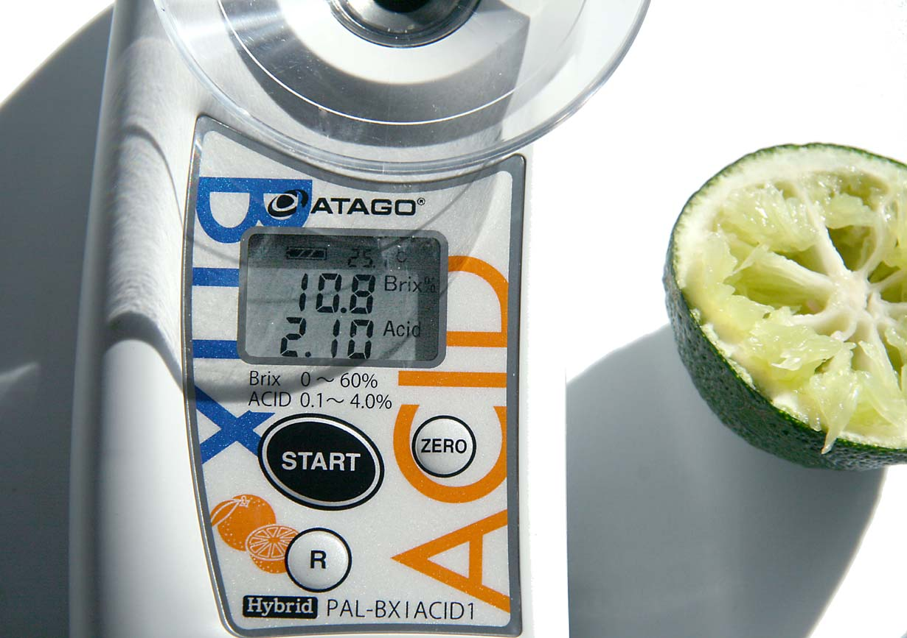

# Brix

Degrees Brix (°Brix, also written °Bx) are a unit of sugar concentration. The definition is specific: at 20 °C, 1 °Brix equals 1 gram of sucrose in 100 grams of solution, which is a sucrose mass fraction of 1%. Wine and juice producers use it to judge grape ripeness, estimate potential alcohol and monitor fermentation.

Figure: Brix. Image: Jpbrigand, CC BY-SA 4.0, via Wikimedia Commons ([source page](https://commons.wikimedia.org/wiki/File:Brix_acide_sudachi_23-08-2016.jpg)).

## Definition and boundaries

The Brix scale is based on pure sucrose solutions, so strictly it describes a sucrose mass fraction. In grape juice the soluble solids are not sugar alone: organic acids, minerals and other components also contribute. A refractometer reading in °Brix is therefore an approximation of total soluble solids. The trade still treats it as a sugar measure, but the reading means a little more than “how much sugar is present”.

The boundary also concerns what is being measured. Brix describes the current sugar or solids concentration of a liquid, not the sweetness of the finished drink and not its alcohol content. Fermentation converts sugar into alcohol and carbon dioxide, so the original Brix reading falls. Whether the finished wine is sweet depends on [residual sugar](ref:residual-sugar) at the end, not on the Brix at harvest.

## Etymology and origin

The degree Brix is named after Adolf Brix, a nineteenth-century scientist associated with the development of a specific-gravity scale for sucrose solutions. Sugar, juice and wine industries later standardised the scale and converted refractive-index or density readings into Brix. The methods published by ICUMSA and the OIV remain the main technical references for this system.

Brix is not the only scale. Older French texts use degrees Baumé, German viticulture often uses Oechsle, and brewing uses degrees Plato. Each belongs to a different measurement tradition and conversion table; sharing the idea of “concentration” does not make them interchangeable.

## Measurement mechanism and parameters

The two usual tools are the refractometer and the hydrometer. A refractometer measures the refractive index of a small sample at 20 °C and converts it to °Brix using standard sucrose tables; it needs little sample and reads quickly, which suits vineyards and production floors. A hydrometer measures density and converts it to sugar content or potential alcohol; it needs more sample but is simple and robust.

The two instruments read close together in pure sugar solutions but diverge in fermenting liquid. Alcohol has a different refractive index from sugar, so once fermentation starts the refractometer reading is biased and cannot be taken directly as sugar content; a correction formula or distillation before measurement is needed. The hydrometer is also affected by alcohol, though in a different way. Temperature matters as well: the standard reading is at 20 °C, and samples at other temperatures need correction.

## Practical use in the drinks industry

Before harvest, growers measure Brix repeatedly and combine it with total acidity, pH, seed ripeness and flavour development to choose a picking date. Rising Brix usually means sugar is accumulating, but acidity is falling at the same time; watching Brix alone can lead to grapes with high sugar and low acid. Target ranges differ by variety, region and style, with many wine grapes harvested around 22–26 °Bx.

During fermentation, falling Brix shows yeast consuming sugar and is one indicator of progress. Residual sugar at the end must be measured separately. Brix is also basic data when buying [must](ref:must) and deciding on chaptalisation, although the amount and legality are limited by regional rules. Brewing uses [original gravity](ref:original-gravity) for a comparable role, but on a different raw material and scale.

## Related terms compared

The first pair is Brix and degrees Plato. Both rest on mass fraction, but °Plato is the brewing scale for malt extract, with its own conversion table; readings for the same solution are close but cannot be substituted without correction. The second pair is Brix and potential alcohol. Brix is a current sugar reading, while potential alcohol is an estimate of the finished strength using a conversion factor; yeast efficiency, temperature and residual sugar all affect the final result.

The third pair is Brix and sweetness. High Brix means more sugar or solids, but if fermentation runs to completion the finished wine may still be dry; low Brix does not guarantee an unsweet wine, because fermentation may stop early. The fourth pair is Brix and Baumé or Oechsle. These belong to different industries and regulatory traditions, and their numbers should not be swapped by impression.

## Common misuses and debates

First, treating Brix as sweetness. Second, treating Brix as alcohol content; the 0.55–0.64 factor is an estimate, not a formula. Third, trusting a refractometer reading directly in fermenting liquid and ignoring the alcohol bias. Fourth, exchanging numbers across different sugar scales. Fifth, using Brix alone to decide harvest and ignoring acidity, flavour and disease.

Debate mostly concerns “how high is ripe”. High Brix may come from over-ripeness, dehydration or noble rot, or simply from a variety's nature; low Brix may signal under-ripeness or a deliberately fresh cool-climate style. Treating Brix as the only ripeness indicator hides changes in acidity and flavour. Another debate is chaptalisation: it can lift a low-Brix must to a target strength, but legality, amount and labelling requirements vary by region.

## Typical figures and examples

With the common approximation, potential alcohol is roughly Brix multiplied by 0.55–0.64. At 24 °Bx, that gives 13.2% vol at 0.55, 14.4% vol at 0.60 and 15.4% vol at 0.64; all are estimates, and the actual figure depends on where fermentation stops. Wine Folly's glossary gives a concrete illustration: 27 °Bx, fully fermented, can produce a dry wine of about 14.9%–17.3% ABV.

Another checkable number is the definition itself: 1 °Brix equals 1 gram of sucrose in 100 grams of solution. A standard reading of 20 °Bx on grape juice therefore means a sucrose mass fraction of about 20% at 20 °C, not an arbitrary “20 parts sugar to 80 parts water” interpretation. This is why Brix is tied to density, refractive index and temperature.

## See also

- [Must](ref:must): sugar content and the starting point of fermentation.
- [Original gravity](ref:original-gravity): the comparable measure in brewing.
- [Residual sugar](ref:residual-sugar): sugar after fermentation and sweetness labelling.

For Brix, begin with where the term is used. Then look at what it is contrasted with, and finally ask whether the source is a standard. The answers point to different choices, not to a single score.

**Sources and limits.** The key claims about Brix are checked against the following sources: International Organisation of Vine and Wine (OIV) (Used to check sugar-measurement and grape-ripeness terminology), Wine Folly, International Commission for Uniform Methods of Sugar Analysis (Used to check the boundary between refractometric dry substance and pure-sucrose conversion) and 6 sources in total. Prices, batches and status change; the body is project-written and does not reproduce source text.

Potential alcohol is roughly 55%–64% of the Brix value.
