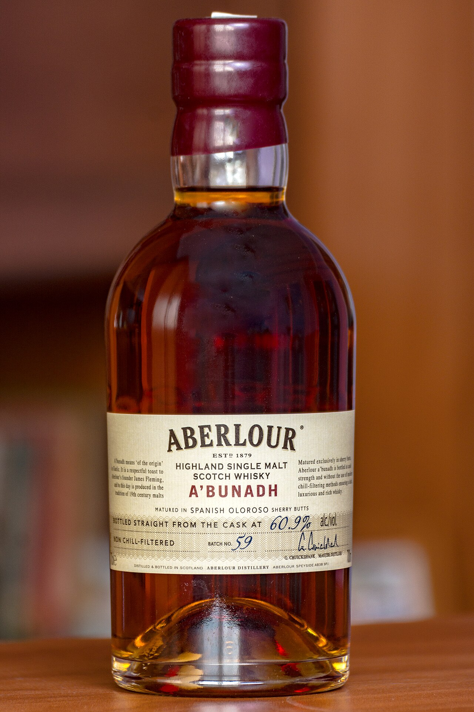

# Cask strength

Cask strength (also called natural strength) means whisky is bottled with little or no added water, retaining the [alcohol by volume](ref:abv) the liquid developed in the cask. It describes a bottling decision, not a cask type, an age or a quality grade. Cask-strength products commonly sit around 50%–65% vol, but two batches from the same distillery can differ by several degrees because each cask reaches its own natural strength.

Figure: Cask strength. Image: Paweł Mazurek KRK, CC BY-SA 4.0, via Wikimedia Commons ([source page](https://commons.wikimedia.org/wiki/File:Aberlour_A%27bunadh_Batch_59.jpg)).

## Definition and boundaries

The test is whether water was added at bottling to pull the strength down, not whether the label carries a high number. Scotch whisky must be bottled at no less than 40% vol, so a cask-strength product still has to meet that legal minimum; it simply sits well above it. If a cask at roughly 58% vol is reduced to 40% vol at bottling, that is standard bottling, not cask strength.

The boundary also lies between “little added water” and “no water ever”. Distillation and filling may already involve water to reach a required strength, so cask strength does not mean the whole production was water-free. It means the bottler did not carry out a large dilution at bottling. A producer may combine several casks and bottle the blend at high strength; it can still be cask strength, but it is not a single cask.

## Etymology and origin

“Cask” is the English word for a wooden barrel, with roots in French and Italian words for a box or container; “strength” refers to concentration or intensity. The compound “cask strength” grew out of the whisky trade and tasting circles as a shorthand for bottling at the strength found in the cask. North America often says “barrel proof” or “barrel strength”, while Japanese usage speaks of undiluted spirit.

The phrase has long been an industry convention rather than a formal grade written into every producing region's law. That is why brands apply it with different rigour: some bottle each cask at its own natural strength and print the cask number, while others adjust several casks to a common high strength and still use the term. The specific strength, cask number, bottling date and single-cask status tell a reader more than the two words alone.

## Mechanism and parameters

Whisky is usually diluted to a filling strength after distillation and then matured in oak. During maturation both alcohol and water evaporate, and which one is lost faster depends on warehouse humidity: damp conditions tend to reduce the alcohol share more quickly, while dry conditions can remove more water and raise strength. The strength in the cask is therefore not fixed; it results from time, cask type, warehouse position and climate.

Scotch rules require maturation only in oak casks not exceeding 700 litres, for at least three years. These limits shape evaporation and the area of wood in contact with the liquid. A smaller cask exposes more surface per unit volume and usually matures faster; a larger cask changes more slowly. To dilute a high-strength spirit to a target, the water needed is approximately the original volume multiplied by (original strength divided by target strength minus one). For example, 10 litres at 58.2% vol reduced to 46% vol needs about 2.65 litres of water.

## Practical use in the drinks industry

Before bottling, a producer decides whether the product should be a stable, easy-drinking standard release or a cask-strength release that preserves concentration and lets drinkers add their own water. Cask-strength versions are common in single malt, single cask and small-batch ranges, and also appear in travel retail, distillery exclusives and auctions. The selling point is closeness to the liquid in the cask, but that also makes batch variation more visible.

In shops and tastings, cask strength is often used as a comparison: the standard and cask-strength versions of one brand are placed side by side, and the drinker starts neat before adding water in small steps. Water is not a destroyer here but part of the tasting method. The key is to add a few drops at a time and wait for the liquid to settle before judging, rather than pouring in a large volume at once.

## Related terms compared

The first pair is cask strength and single cask. A single cask comes from one specific barrel and emphasises an unrepeatable individual character; cask strength means little or no dilution at bottling. A single cask can be diluted, and a cask-strength release can be assembled from several casks, so neither term guarantees the other. The second pair is cask strength and single malt. Single malt governs the raw material and the distillery, and it may combine casks and add water; cask strength governs bottling strength and says nothing about a single distillery.

A third contrast is cask strength versus “high strength”. A 46% vol single malt may simply be a standard bottling and need not be cask strength; a 50% vol product may still have been diluted. A fourth is “cask strength” versus “barrel proof”: the North American phrase is close in meaning, but producers differ in execution and labelling habits, so a translated name is not enough evidence.

## Common misuses and debates

The commonest misuse is treating cask strength as a quality grade and assuming a higher number means a better whisky. Strength changes concentration and the release of aroma; it cannot replace a judgement of balance, finish and defects. A second misuse is equating cask strength with single cask and forgetting that a multi-cask assembly can also be bottled at cask strength. A third is insisting that cask strength must be drunk neat, when adding water is a standard way to understand it.

Debate centres on label transparency. Because “cask strength” is not defined identically in every producing region, some products adjust several casks to a uniform high strength before bottling, and a buyer who reads only the phrase may assume every bottle kept its own natural strength. Another debate is the reading of “no water added” as “no water at any stage”, which does not match the reality of distillation and filling. Buyers should check the stated strength, cask number and batch notes first.

## Typical figures and examples

The Scotch framework gives three figures that can be checked directly: oak casks no larger than 700 litres, maturation of at least three years, and bottling strength of at least 40% vol. Cask-strength products commonly fall between 50% and 65% ABV, while standard bottlings are often reduced to roughly 40%–46%. If a cask holds spirit at 58.2% vol, taking 10 litres down to 46% vol requires about 2.65 litres of water, giving a final volume of about 12.65 litres.

Take products from [Scotland](ref:scotland) as an example. Standard versions of [The Macallan](ref:macallan) and [Glenfiddich 18](ref:glenfiddich) are usually diluted and make useful comparisons for cask-strength releases; compare the stated strengths rather than the brand or age alone. When reading a [whisky](ref:whisky) label, check “cask strength”, “single cask” and “single malt” as three separate dimensions instead of collapsing them into one.

## See also

- [Whisky](ref:whisky): types, raw materials and production.
- [Scotland](ref:scotland): the legal framework and regions of Scotch whisky.
- [The Macallan](ref:macallan): a representative sherry-cask style.
- [Glenfiddich 18](ref:glenfiddich): a standard diluted comparison.
- [Alcohol by volume](ref:abv): bottling strength, dilution and labelling rules.

Start with where the term is used. From there, consider what it is contrasted with, then whether the source is a standard. That is how a practical judgment about Cask strength is built.

[Whisky](ref:whisky) and [The Macallan 18 Sherry Oak](ref:macallan) are the nearest useful comparisons: one clarifies definition, the other tests applicable standard.
