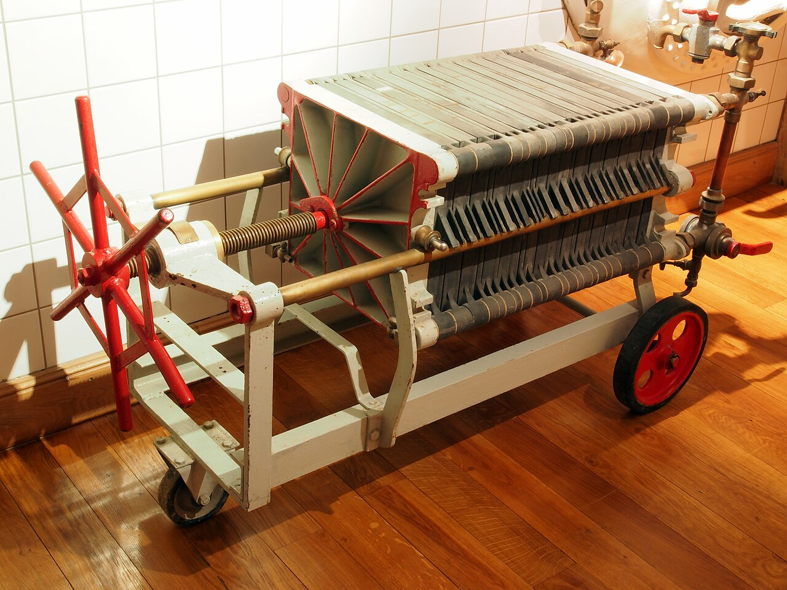

# Chill filtration

Chill filtration is an optional step before bottling whisky: the liquid is cooled close to freezing so that long-chain fatty-acid esters, fatty acids and proteins that were dissolved in the alcohol precipitate, and are then caught by a filter medium. Its immediate purpose is not to “raise strength” or “change flavour”, but to stop the finished product from going hazy at low temperature, in a refrigerator, or after water or ice is added. Whether a distillery uses it is a trade-off between clarity, stability and flavour, not a legal standard of quality.

Figure: A plate-and-frame filter press at the European Beer Museum; a historical example of filtration equipment, not a whisky chill-filtration line and not the process described here. Image: AlfvanBeem, CC0, via Wikimedia Commons ([source page](https://commons.wikimedia.org/wiki/File:Filter_press_at_the_Mus%C3%A9e_Europ%C3%A9en_de_la_Bi%C3%A8re.JPG)).

## Definition and purpose

Aged whisky contains many compounds from grain, yeast and oak. Some long-chain fatty-acid esters dissolve well at high alcohol concentration but become less soluble when the whisky is chilled or diluted, forming fine suspended particles that the trade often calls haze or flocking. Chill filtration cools the liquid to roughly -10°C to +4°C (the exact temperature varies by distillery, and about -1°C is a common description), so that these substances precipitate before bottling, then passes the liquid through cellulose, paper, diatomaceous earth or metal plates to remove the precipitate and some larger particles.

Whisky treated this way is less likely to haze when refrigerated or served with ice; its appearance is more stable and its shelf life more predictable. For large-scale production and export, clarity is part of what consumers expect from a “normal” liquid, so chill filtration is common in mainstream whisky bottled at 40%–43% ABV. It is not sterilisation, not maturation, and not a transformation into another product; it is a physical separation before bottling.

## What precipitates

The main culprits are ethyl esters of long-chain fatty acids, such as ethyl laurate, ethyl palmitate and ethyl palmitoleate. They form when ethanol reacts with the corresponding fatty acid, are relatively soluble in alcohol and poorly soluble in water, and come out of solution when strength falls or temperature drops. Proteins and some polysaccharides can also contribute to haze, especially in spirits with more grain residue or less filtration. Different compounds respond to temperature differently, so “haze in the freezer” and “haze after adding water” are not exactly the same event.

These substances are not all “bad”. Some esters and fatty acids contribute to mouthfeel, oiliness and the persistence of aroma; removing them all can make the spirit cleaner and lighter, or can make some flavours feel thinner. That is why chill filtration has been a long-running craft debate in whisky rather than a purely technical detail.

## The process

A typical sequence is: transfer the whisky to a tank with a cooling jacket, chill it to the set temperature and hold it long enough for the precipitate to form; pass it through a plate-and-frame filter, candle filter or similar equipment; then warm the filtrate to bottling temperature and send it to the filling line. Filter pore size, pressure differential, flow rate and temperature all affect efficiency and flavour retention. Over-filtration can remove aroma and oils that could have been kept; under-filtration can leave visible suspended matter in the finished bottle.

Distilleries choose different temperatures and media. Some filter lightly, some filter before reduction, some filter just before bottling; others skip chill filtration entirely and bottle at 46% ABV or above, using the higher alcohol concentration to reduce the risk of precipitation. No single sequence is “correct”; the choice depends on the target appearance, palate, cost and export market.

## Regulation and label boundaries

The UK Scotch Whisky Regulations 2009 set rules on raw materials, distillation, oak maturation, minimum ABV and permitted additions, but they neither require nor prohibit chill filtration and set no test threshold for “non-chill filtered”. In other words, chill filtration is a process choice, not a legal category; “non-chill filtered” is mainly a distillery's own statement, and the consumer has to read it together with the producer's notes and the actual bottling strength.

That does not mean the label can say anything. General consumer-protection law requires claims to be truthful and not misleading; if a distillery says “non-chill filtered”, it should be able to explain that the process really was skipped. Different markets regulate words such as “natural” and “traditional” differently, so buy by the producer's specific statement, not by a single positive word.

## The flavour debate

Supporters of chill filtration stress clarity, stability and consistency: consumers do not want a bottle that develops flocculent particles when cold, and a stable appearance reduces complaints and returns in export markets. Critics argue that chill filtration removes some long-chain esters, fatty acids and proteins, making the body thinner and the oily texture lower, especially in high-strength, heavily peated or old spirits where those compounds contribute to texture.

Distillery statements divide along similar lines. Bruichladdich's process article says it does not chill filter any of its whisky and argues that filtration removes flavour-critical components and fatty acids that contribute richness and persistence; Glenlivet's article treats filtered and unfiltered as a trade-off with no absolute winner, depending on personal preference and product positioning. Presenting either side as “settled science” is inaccurate; there is no single blind-tasting result showing that every whisky is worse or better for being filtered.

## Common misreadings

First, chill filtration is not “filtering out all flavour”. It mainly targets long-chain esters and proteins that precipitate at low temperature, not every aromatic molecule; the effect depends on the whisky, filtration intensity and target profile. Second, chill filtration is not “lowering ABV”. Reduction is adding water; filtration is separation. They can happen together, but they are not the same act. Third, non-chill filtered does not mean “unfiltered”. Most whisky still passes through a coarse filter to remove cask fragments and larger particles; “non-chill” means no cold filtration, not no filtration at all.

Fourth, haze is not spoilage. Turbidity from fatty-acid esters or proteins is usually harmless and may clear as the liquid warms; if it comes with an off-smell, a leaking closure or a damaged bottle, that is a different issue. Fifth, 46% ABV is not a “legal threshold for non-chill filtration”. It is a common bottling strength because precipitation risk is lower above that concentration; a distillery may choose not to filter at another strength, or may still filter above 46%.

## How to judge and drink it

The most reliable way to know whether a whisky was chill filtered is the distillery website, product page or back label, not ABV alone. If the producer explicitly says “non-chill filtered” or “un-chill filtered”, read that together with strength and any “natural colour” statement. If there is no statement, do not infer one; different expressions from the same distillery may use different processes.

When drinking, do not make filtration the only frame of evaluation. Start with aroma, palate, finish and your own preference. If a non-chill-filtered whisky hazes after ice is added, let it warm at room temperature or add a little water and watch the change. Haze itself is not a defect; a real defect is an off-smell, a leak or a clear mismatch with the product description. Treat process information as a clue to understanding the whisky, not as a win-or-lose label.

## Buying and describing

When buying, place “chill filtered” in the process information, not in a quality hierarchy. You can ask three questions: What is the bottling strength? Does the producer state that it is non-chill filtered? Does it also state natural colour? The answers show the producer's style, but they do not by themselves decide whether a whisky tastes good.

In writing, the more accurate wording is “the distillery states that it does not chill filter, and bottles at 46% ABV”, not “non-chill filtered is always better”. If you discuss a flavour difference, say which two whiskies you compared, whether they share age and cask type, and whether the comparison was blind. Chill filtration is a process choice with trade-offs, not a moral trial that requires taking sides.

## Further reading and see also

- [Whisky](ref:whisky): the category where chill filtration is most often debated.
- [Peat](ref:peat): peat style and chill filtration are often discussed together.
- [Distillation](ref:distillation): how the spirit is made before filtration.
- [Whisky intro](ref:whisky-intro): the overall frame from raw material to bottle.
- [Laphroaig 10](ref:laphroaig): a common non-chill-filtered Islay whisky.
