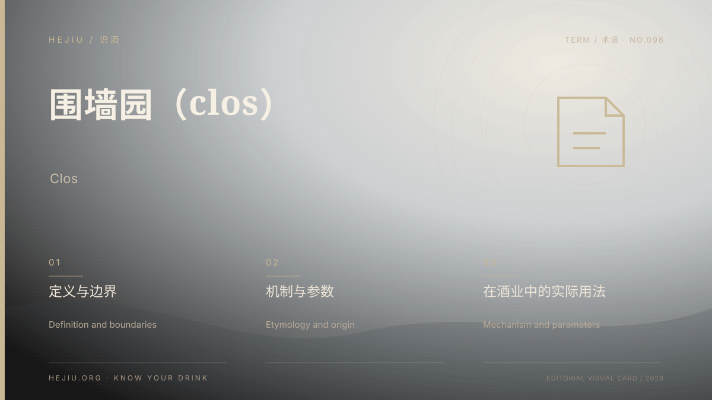

# Clos

A clos is a French noun for a vineyard plot enclosed by a wall, fence, ditch or natural boundary. It answers "where is this site and where does it end", not "which quality tier does it belong to". In [Burgundy](ref:burgundy) a clos often appears together with a named climat; in the Loire, Alsace, Jura and Champagne it is likewise part of a place name. The key is to treat clos as a site identifier, not a quality badge.

Figure: thematic illustration for Clos. Image: AI-assisted illustration generated with Doubao Seedream 5.0 (project-owned); not a photograph of the subject.

## Definition and boundaries

The boundary may be a solid wall, but it may also be a fence, hedge or terrain. An enclosed site is usually small enough to farm, harvest and vinify separately. It does not require a single owner or a single soil; one clos can contain different slopes, soil depths and drainage. Clos is therefore a geographic and property-boundary concept, not a classification, a brand, or a synonym for "single vineyard". The name itself carries no uniform quality promise; it carries source and history. Clos also differs from lieu-dit: a lieu-dit is a place name, while clos stresses enclosure; one lieu-dit can contain several clos, and one clos can cross two place names.

## Etymology and origin

Clos comes from the Latin clausum, "a place that has been closed off", related to the French verb clore, "to close". In the Middle Ages monastic houses such as the Cistercians built walls around plots to mark property, keep livestock out and deter theft. Clos de Vougeot is the classic case: the monks enclosed a slope and gave it a clear identity, and the wall was rebuilt over the centuries; the wall visible today dates from roughly five centuries ago. Clausum is also one source of the English word close; in French, clos works as both noun and adjective, meaning "enclosed".

## Mechanism and parameters

The wall affects microclimate through thermal mass and shelter. By day it absorbs solar radiation and releases heat slowly at night, so temperature swings near the wall are smaller; it also blocks wind, reduces erosion and alters light and drainage on a slope. The size of the effect depends on wall height, orientation, material, terrain and gaps. Conditions inside are not uniform: rows near the wall and rows mid-slope can ripen on different schedules. Different parcels within one clos still need separate management; the whole site is not a homogeneous "micro-region". In a continental climate with wide day-night swings the wall's heat storage and night release matter more; in a cool or windy spot the shelter effect may matter more than warming. Gaps and gates create local channels and change air flow, so "inside the wall" is not a sealed, constant-temperature box.

## Practical use in the industry

On the production side, a clos name often identifies a separately managed plot or a wine series; on a label it points to the core source plot. Legally, clos is not a French or EU classification term. Whether a clos-labelled wine must come entirely from that plot depends on the appellation rules and the producer's declaration; some require all of it, others only that the site dominates. A reader seeing clos should also check [appellation](ref:appellation) and [terroir](ref:terroir) information rather than treating the word as a grade. Champagne's Clos du Mesnil and Clos des Goisses are also named with clos, showing that the usage spans still and sparkling wine; that generality is one reason the word cannot stand for a single rank.

## Confusable terms

First, clos versus climat. Clos stresses an enclosure; climat is Burgundy's term for a plot with a particular natural character and historical identity, not necessarily walled. Second, clos versus monopole. A monopole is a plot held by one owner; a clos may have dozens of owners. Third, clos versus grand cru and premier cru. The latter are legal classifications, clos is not; Clos de Vougeot is a grand cru because it was classified as one in the AOC system, not because the name contains clos.

## Common misuses and disputes

One common misuse is to treat clos as a synonym for "single vineyard". In fact Clos de Vougeot is about 50.59 ha and is today divided among about 80 owners, so the same label can come from different slopes and different winemakers. A second error is to equate a wall with higher quality; the wall changes microclimate, but vintage, viticulture and winemaking matter just as much. A third is to assume clos exists only in Burgundy; the Loire, Alsace, Champagne and Jura also have plots called clos. A fourth is to read the name as a legal quality guarantee; it supplies identity and history, not a uniform rank. A fifth is to confuse clos with monopole; a monopole stresses ownership, clos stresses boundaries, and a plot can be a clos without being a monopole. There is also debate over the modern use of historical names: some are protected by regional rules, others simply continue an old place name.

## Typical figures and examples

Clos de Vougeot lies in the village of Vougeot in the Côte de Nuits, covers 50.59 ha, received grand cru AOC status on 31 July 1937, and its wall goes back roughly five centuries. It is not a single estate: about 80 owners hold parcels, which explains why different producers' Clos de Vougeot can differ sharply. Another example is Clos de la Coulée de Serrant in Savennières in the Loire, also known for an enclosed site under long, independent management; the word clos describes the shape of the site, not an automatic top tier.

## Recording and describing

When tasting or buying, split the clos information into three columns: plot name, producer, legal grade. First confirm the AOC/AOP grade on the label, then the producer's holdings within the site, then record vintage and winemaking style. "A given producer's parcel within a given clos" is more accurate than "a given clos"; if only the name is known, keep the judgement at "source to be confirmed" instead of attaching a quality conclusion to it. If a label carries both clos and lieu-dit, record both, because they answer different questions: one is a boundary, the other a place name.

## See also

- [Terroir](ref:terroir): how natural site conditions and human practice together create regional character.
- [Appellation](ref:appellation): the legal boundaries and labelling rules behind a clos name.

Start with where the term is used. From there, consider what it is contrasted with, then whether the source is a standard. That is how a practical judgment about Clos is built.
